<div align="center">

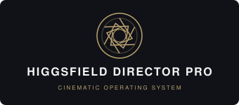

# HIGGSFIELD DIRECTOR PRO

### Cinematic direction skill for AI-generated video · Claude Code & Codex

**Shot planning · Model-aware prompts · Credit budgeting · Generation with approval · Evidence-based review**


[Quick start](#quick-start) · [Examples](#examples) · [Illustrated manual](#illustrated-manual) · [Architecture](#architecture) · [Português](#português) · [License](#licensing)

</div>

> **Status:** private repository, version 5.0.0. Independent project, not affiliated with or endorsed by Higgsfield.
> The skill only *plans* on its own; video and images are generated by the official Higgsfield connector (MCP), with
> credits from your own account, and **only after the cost is shown and the operator says "ok"**.

## Contents

- [Overview](#overview)
- [What changed in v5](#what-changed-in-v5)
- [Capabilities](#capabilities)
- [Quick start](#quick-start)
- [Examples](#examples)
- [`hfd.py` reference](#hfdpy-reference)
- [Choosing a model](#choosing-a-model)
- [Illustrated manual](#illustrated-manual)
- [Scope and coexistence](#scope-and-coexistence)
- [Architecture](#architecture)
- [Quality and security](#quality-and-security)
- [Editions and history](#editions-and-history)
- [Roadmap](#roadmap)
- [Documentation](#documentation)
- [Licensing](#licensing)
- [Português](#português)

## Overview

Higgsfield Director PRO is an **agent skill** (`higgsfield-director`) that turns a creative request into well-directed
AI-generated shots: it picks the model from the live catalog, writes one prompt per shot in the order the official
guides recommend, keeps characters and products consistent across shots, prices the job in credits, waits for approval,
generates through the Higgsfield connector and reviews the result with evidence.

The same folder works in **Claude Code** and **Codex** (Agent Skills format: `SKILL.md` + references + scripts). The skill
talks to the operator in Portuguese and writes prompts in English, which video models follow more predictably.


Without the connector the skill runs in **planning-only mode**: it delivers prompts and parameters ready to paste on the
Higgsfield site, and says that the cost must be checked there.

## What changed in v5

v5 is a rewrite of the v4.1 RC3/RC4 package generated with ChatGPT. Every defect measured in RC3 became a test.
Full evaluation: [docs/AVALIACAO-RC3.md](docs/AVALIACAO-RC3.md).

| | v4.1 RC3 / RC4 | v5.0.0 |
|---|---|---|
| Skill | 328 files, 121 MB, 116 "commands" | 15 files, 216 KB, `SKILL.md` of 91 lines + 6 references read on demand |
| Code | 3 compilers, 2 optics, 3 budgets; SDK, REST, Docker | one `hfd.py`, Python standard library only |
| Models | 9 profiles, 7 with every field `null` | dated snapshot of **122 models** from the connector catalog, refreshable by command |
| Camera check | rejected *"static camera, no orbit"* | understands negation and phases; warns, does not block |
| Audio | moved Cinema Studio audio to post-production | reads native audio from the catalog (Cinema Studio 4.0 generates audio by default) |
| Generation | none | official Higgsfield MCP, after cost and explicit "ok" |
| Conflicts | generic "video" description | trigger anchored on *AI-generated / Higgsfield*, with named exclusions |
| Tests | 67 (2 needed OpenCV) | 41, no dependencies; 4 planted bugs, 4 caught |

## Capabilities

| Capability | How | Where |
|---|---|---|
| Brief and premises | asks only what blocks; the rest becomes a stated premise | [`fluxo.md`](higgsfield-director/references/fluxo.md) |
| Model choice | by need (length, references, first/last frame, audio, cost), confirmed in the live catalog | [`modelos.md`](higgsfield-director/references/modelos.md) |
| Prompt writing | golden order, per-model notes, 18 recipes against common defects | [`prompt.md`](higgsfield-director/references/prompt.md) |
| Vocabulary | camera, framing, lens, light, color, physics, acting, audio | [`vocabulario.md`](higgsfield-director/references/vocabulario.md) |
| Illustrated manual | 11 parts, 185 schematic images: movement, lighting, styles, sheets, optical atlas | [`docs/manual`](docs/manual/README.md) |
| Continuity | bibles (character, product, place) with fixed attributes; boundary check between shots | `hfd.py validar` |
| 180° rule | camera positions against the action axis | `hfd.py validar` |
| Model limits | duration, aspect ratio, resolution, audio, image-to-video inputs | `hfd.py validar` + snapshot |
| Budget | real quotes from the connector + retries + reserve; refuses to invent prices | `hfd.py orcamento` |
| Generation | connector call order, bundled workflows, uploads, waiting | [`conector.md`](higgsfield-director/references/conector.md) |
| Review | pre-spend checklist, symptom → cause table, frames, weighted score with evidence | [`qualidade.md`](higgsfield-director/references/qualidade.md), `hfd.py pontuar` |
| Delivery | script, shot list CSV, subtitles | `hfd.py exportar` |

## Quick start

Requirements: Claude Code and/or Codex, Python 3.9+ (standard library only). For generation, a Higgsfield account.

**1. Install the skill folder** (the `higgsfield-director/` folder, never the repository root). A symbolic link keeps one
source for both agents:

```bash
git clone https://github.com/rniedson/HIGGSFIELD-DIRECTOR-PRO-SKILL.git
R="$PWD/HIGGSFIELD-DIRECTOR-PRO-SKILL/higgsfield-director"
ln -s "$R" ~/.claude/skills/higgsfield-director    # Claude Code
ln -s "$R" ~/.agents/skills/higgsfield-director    # Codex
```

The skill becomes available to every new session as soon as the link exists.

**2. Connect Higgsfield** (optional; without it the skill plans only):

| Agent | How |
|---|---|
| Claude Code | enable the **Higgsfield** connector on claude.ai, then open a new session |
| Codex | `codex mcp add higgsfield --url https://mcp.higgsfield.ai/mcp` then `codex mcp login higgsfield` |

**3. Ask in plain language**, or call it by name (`/higgsfield-director` in Claude Code, `$higgsfield-director` in Codex):

```text
Escreve o prompt para um vídeo de 5 s de uma xícara de café fumegando, câmera se aproximando devagar. É para Reels.
Planeja um comercial de 3 tomadas no Higgsfield para um tênis branco, vertical, e me diz quanto custa. Não gere ainda.
Gerei no Kling uma moça andando e os pés deslizam no chão. Como corrijo o prompt?
```

## Examples

All outputs below are real runs of the bundled templates.

### 01 — Three-shot product commercial

A project declares the model, the bibles and the shots ([`templates/projeto.json`](higgsfield-director/templates/projeto.json)):

```json
{
  "modelo": "cinematic_studio_video_4_0",
  "proporcao": "9:16",
  "biblias": {
    "P01": {
      "tipo": "produto",
      "descricao": "A black glass perfume bottle with a faceted gold cap and a flat cream label reading NOIR",
      "fixo": {"cor": "black", "tampa": "gold"}
    }
  },
  "tomadas": [
    {"id": "T01", "duracao": 5, "entidades": ["P01"],
     "acao": "A thin curl of mist drifts past the bottle and clears",
     "camera": "Static camera, locked off", "otica": "100mm macro look, shallow depth of field"}
  ]
}
```

```bash
python3 higgsfield-director/scripts/hfd.py compilar higgsfield-director/templates/projeto.json --texto
```

```text
## T01
A black glass perfume bottle with a faceted gold cap and a flat cream label reading NOIR. A dark studio with a
polished obsidian plinth. A thin curl of mist drifts past the bottle and clears. Extreme close-up on the cap, eye
level. Static camera, locked off. 100mm macro look, shallow depth of field. Single hard rim light from camera left,
deep black background. The cap fills the upper third of the frame. Keep the label flat, sharp and readable.

Audio: Low airy hum, a soft glass chime as the mist clears.

parametros: {"model": "cinematic_studio_video_4_0", "duration": 5, "aspect_ratio": "9:16", "resolution": "720p", "generate_audio": true}
```

The bible description opens every shot word for word, which is what holds the product's identity across generations.
Duration, aspect ratio, resolution and audio go to the **parameters**, not the prompt text.

### 02 — Budget before spending

```bash
python3 higgsfield-director/scripts/hfd.py orcamento higgsfield-director/templates/projeto.json --tentativas 1
```

```json
{"base": 210.0, "reserva_pct": 20.0, "reserva": 42.0, "total": 252.0,
 "lembrete": "custo é estimativa do conector; gerar só depois do ok do operador com este total"}
```

Prices come from the connector's `estimate_video_cost` (free). Without them, `orcamento` refuses to run instead of
guessing.

### 03 — The validator catches a continuity break

Shot T02 starts with the bottle in red, but the bible fixes it as black:

```json
{
  "erros": ["T02 inicio: P01.cor = 'red', mas a ficha fixa 'black'"],
  "avisos": ["cinematic_studio_video_4_0 não tem multi-shot no retrato: cada tomada é uma geração separada"]
}
```

Exit code 1. Intentional changes are declared per shot in `mudancas_aprovadas: ["P01.cor"]`.

### 04 — Camera direction check

| Camera text | Result |
|---|---|
| `static camera, no orbit` | accepted (negation understood) |
| `slow orbit around a static subject` | accepted: one movement, `orbit` |
| `static camera while the camera orbits` | warning: static and moving in the same phase |
| `slow dolly in while panning left` | warning: two movements at once (`dolly`, `pan`) |

### 05 — Optics

```bash
python3 higgsfield-director/scripts/hfd.py otica 85 2 1.8   # focal mm, distance m, f-number
```

```json
{"campo_de_visao_horizontal_graus": 23.91, "largura_do_quadro_m": 0.847,
 "foco_de_m": 1.972, "foco_ate_m": 2.029, "hiperfocal_m": 133.88}
```

Thin-lens model on a 36 mm full-frame sensor: it describes the *look* to ask for, it is not a model parameter.

## `hfd.py` reference

| Command | Purpose |
|---|---|
| `validar PROJECT` | structure, camera, dialogue length, timeline, continuity, 180° axis, model limits |
| `compilar PROJECT [--texto]` | one prompt per shot + connector-ready `parametros` |
| `orcamento PROJECT [--reserva N]` | total credits from real quotes, retries and reserve |
| `exportar PROJECT DIR` | `roteiro.md`, `tomadas.csv`, `legendas.srt` |
| `otica F D N` | field of view, frame width, depth of field, hyperfocal |
| `pontuar EVALUATION` | weighted score with evidence per criterion; critical failure blocks |
| `modelos [--tipo] [--buscar] [--id] [--importar FILE]` | read or refresh the model snapshot |

JSON output; exit code `1` = content error, `2` = usage error. No network access; reads and writes only the paths given.

## Choosing a model

Source of truth is the **live catalog** (`models_explore`). The bundled snapshot (`data/modelos.json`, 24/11/2026,
66 video + 56 image models) is for offline work and validation, and always quoted with its date.

| Need | Start with |
|---|---|
| Long shot (up to 30 s) | Cinema Studio 4.0, Seedance 2.5, Kling 4.0, MAGI-2, Wan 3.0 |
| Cinema controls (camera body, lens, aperture, era, genre) | Cinema Studio 4.0 |
| Many references (identity, product, style) | Cinema Studio 4.0, Seedance 2.5 (up to 30 images) |
| First **and** last frame | Kling 3.0, Seedance 2.5, Wan 3.0, MiniMax H3, Veo 3.1 Lite |
| Native audio and dialogue | Cinema Studio 4.0, Seedance 2.5, Kling 3.0, Veo 3.1, Wan 3.0 |
| Readable text in an image | Nano Banana Pro, Ideogram 4.6 |

Measured quotes (5 s, 24/11/2026): Cinema Studio 4.0 = 15 / 35 / 80 credits at 480p / 720p / 1080p; Seedance 2.5 720p
= 35; Kling 3.0 = 7.5 to 10. Always re-quote. Full table: [`modelos.md`](higgsfield-director/references/modelos.md).

## Illustrated manual

The [illustrated direction manual](docs/manual/README.md) has **11 parts and 185 schematic images**: camera movement,
framing, lenses and optics, lighting, color and styles, acting, physics and materials, time and editing, sound,
continuity and production. Each part gives the rule, a positive prompt, what to avoid and the illustrations. The
images explain direction; they are not renders and do not prove how a model behaves.

| Part | Topic | | Part | Topic |
|:---:|---|---|:---:|---|
| 01 | [Camera and movement](docs/manual/README.md#parte-01--câmera-e-movimento) | | 07 | [Physics, materials and VFX](docs/manual/README.md#parte-07--física-materiais-e-vfx) |
| 02 | [Framing and composition](docs/manual/README.md#parte-02--enquadramento-e-composição) | | 08 | [Time, transitions and editing](docs/manual/README.md#parte-08--tempo-transições-e-edição) |
| 03 | [Cameras, lenses and optics](docs/manual/README.md#parte-03--câmeras-lentes-e-óptica) | | 09 | [Sound direction](docs/manual/README.md#parte-09--áudio-e-direção-sonora) |
| 04 | [Cinematic lighting](docs/manual/README.md#parte-04--iluminação-cinematográfica) | | 10 | [Continuity and diagnostics](docs/manual/README.md#parte-10--continuidade-e-diagnóstico) |
| 05 | [Color and visual styles](docs/manual/README.md#parte-05--cor-e-estilos-visuais) | | 11 | [Prompt engineering and production](docs/manual/README.md#parte-11--engenharia-de-prompts-e-produção) |
| 06 | [Acting and emotion](docs/manual/README.md#parte-06--atuação-e-emoções) | | — | [Optical atlas, 100 studies](docs/manual/README.md#atlas-óptico--100-estudos) |

### Camera movement

Plan-view schematics of the movements the skill writes into prompts.

| | | | |
|:---:|:---:|:---:|:---:|
| 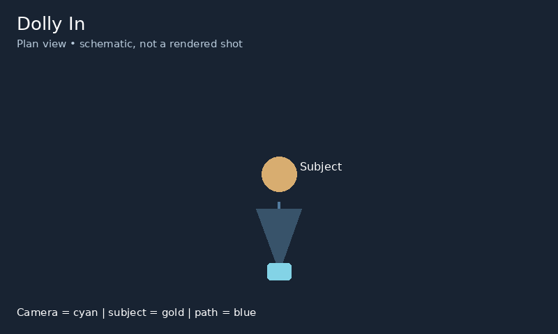<br>**Dolly in** | 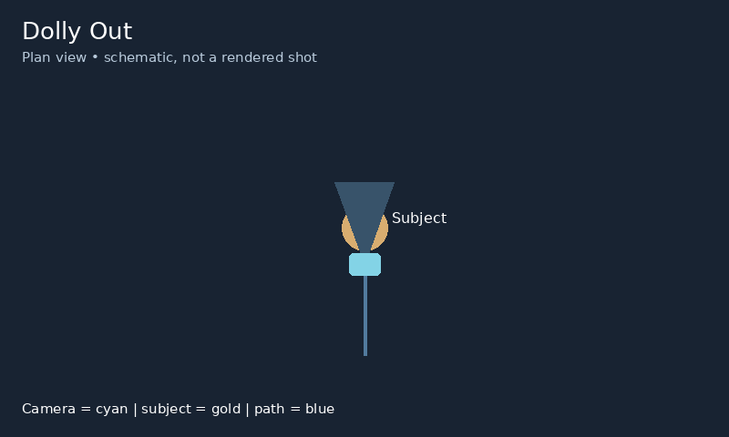<br>**Dolly out** | 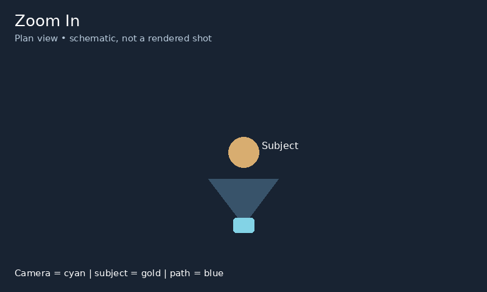<br>**Zoom in** | 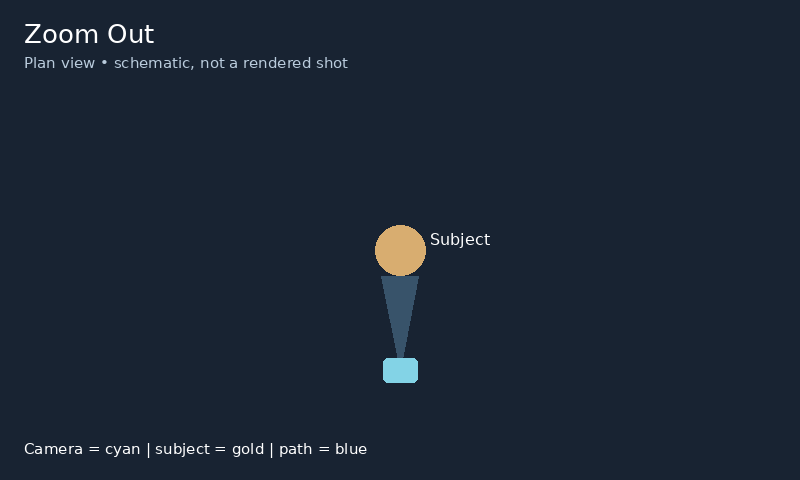<br>**Zoom out** |
| 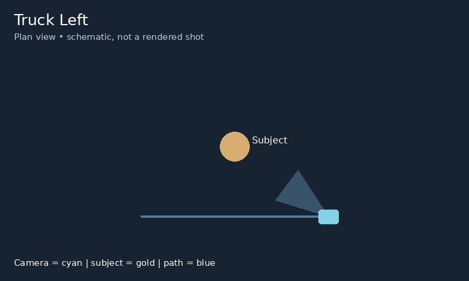<br>**Truck left** | <br>**Truck right** | <br>**Pan left** | 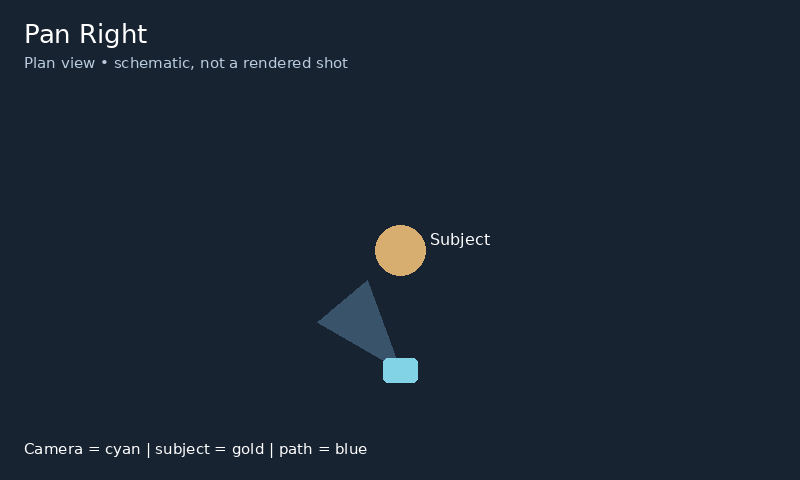<br>**Pan right** |
| 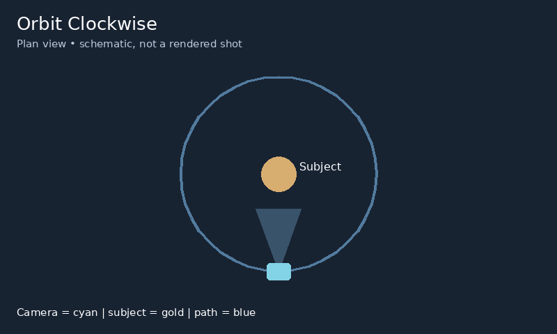<br>**Orbit clockwise** | <br>**Orbit counterclockwise** | 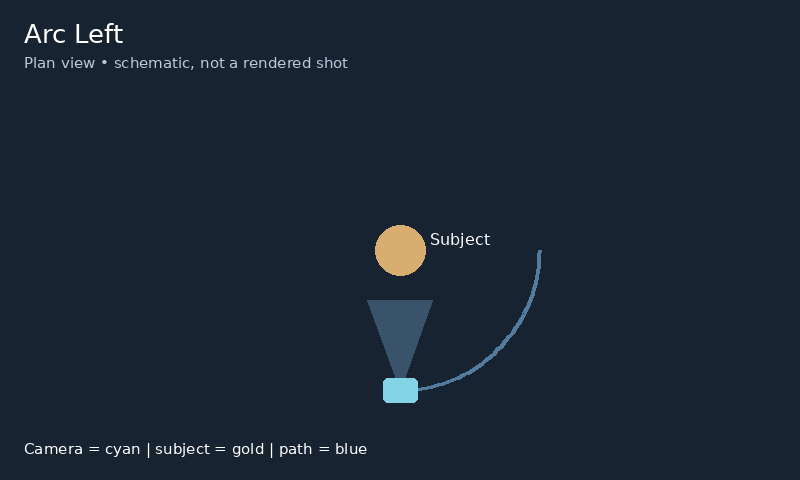<br>**Arc left** | 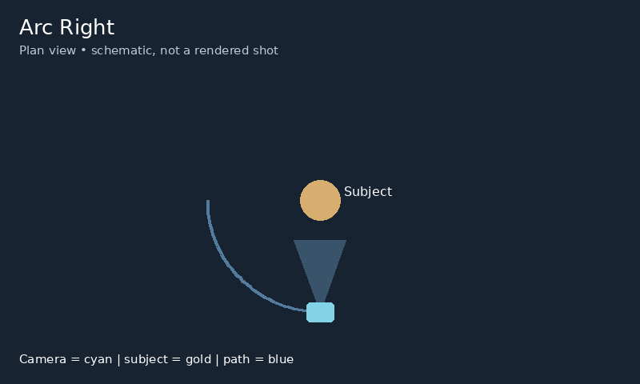<br>**Arc right** |
| 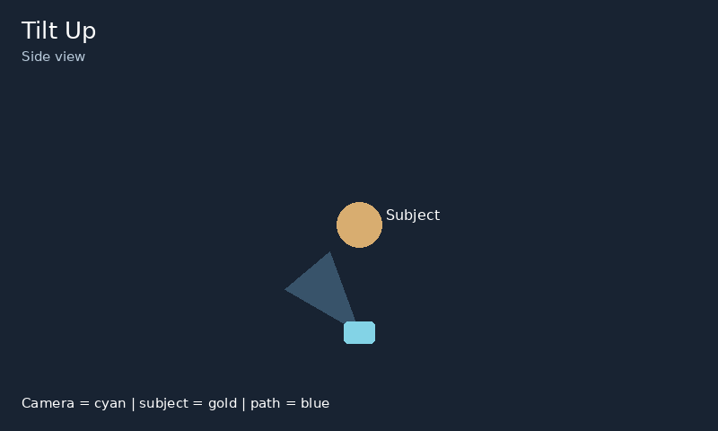<br>**Tilt up** | 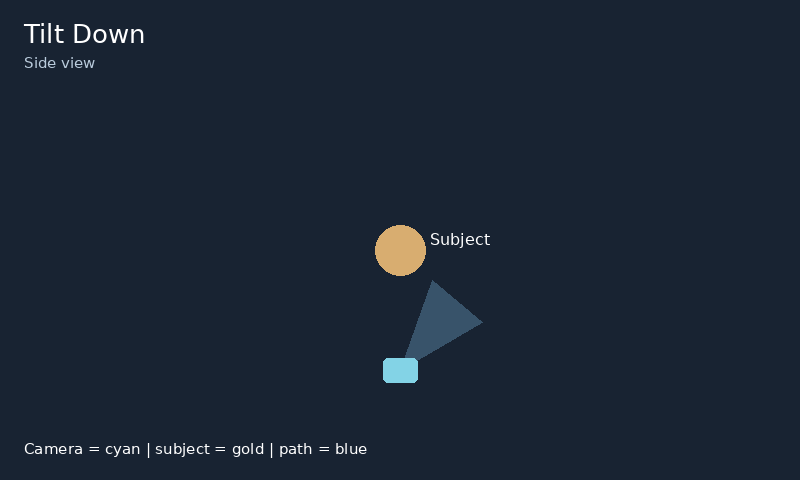<br>**Tilt down** | <br>**Crane up** | <br>**Crane down** |
| <br>**Pedestal up** | <br>**Pedestal down** | 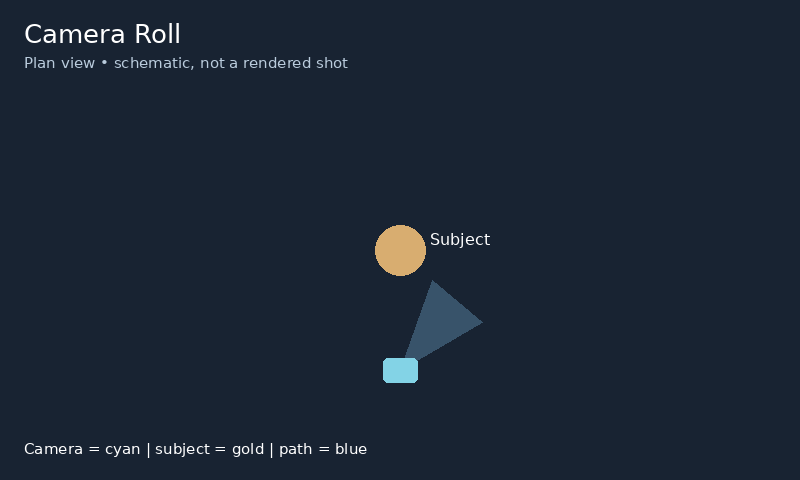<br>**Camera roll** | <br>**Static** |

Dolly moves the camera; zoom changes the lens. **One dominant movement per shot**, or explicit phases
(*"static, then a slow push-in"*).

### Lighting

| | | | |
|:---:|:---:|:---:|:---:|
| 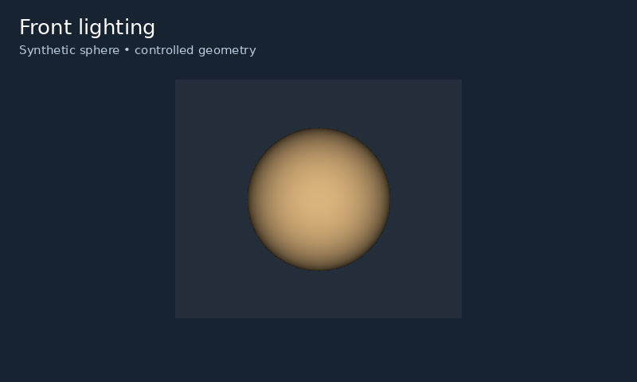<br>**Front light** | 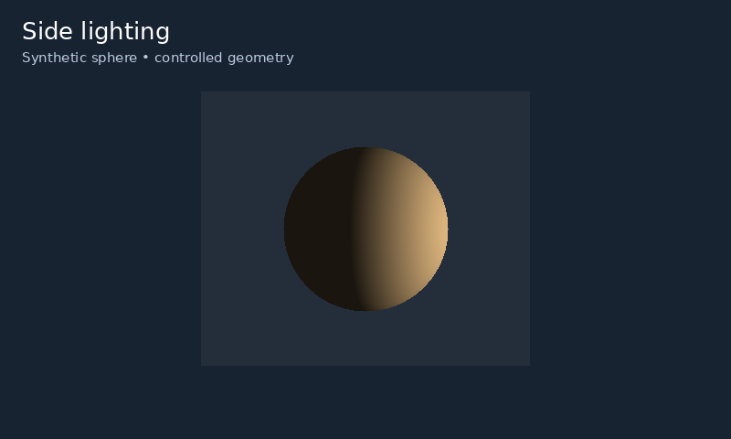<br>**Side light** | <br>**Top light** | 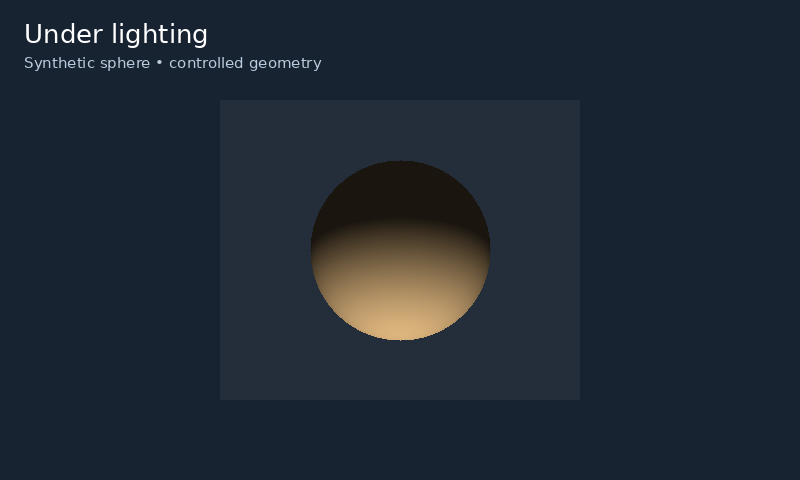<br>**Under light** |
| 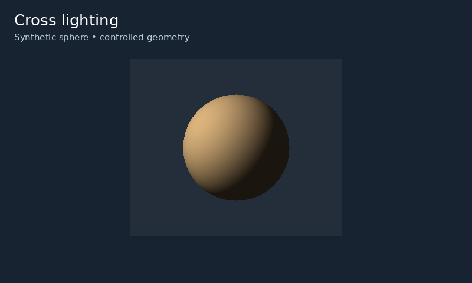<br>**Cross light** | <br>**Back light** | 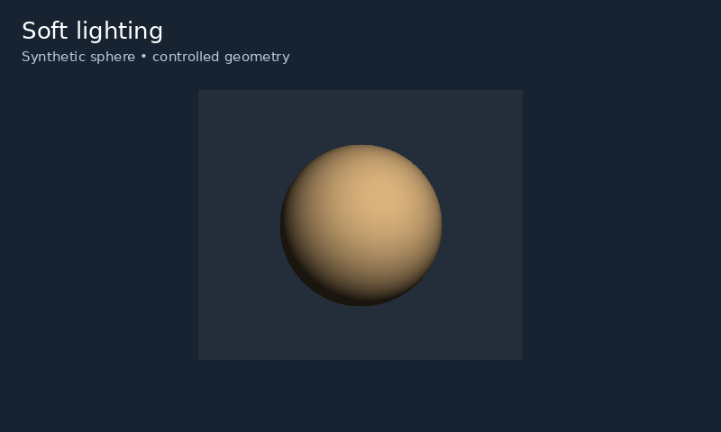<br>**Soft light** | 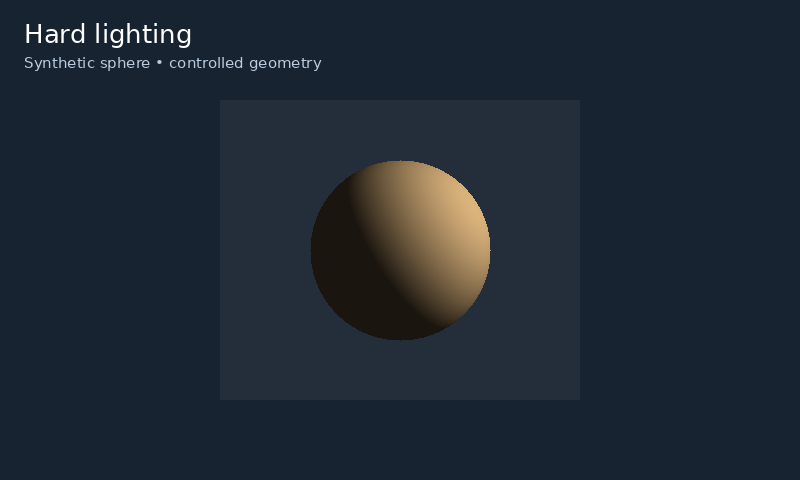<br>**Hard light** |

### Visual styles

| | | | |
|:---:|:---:|:---:|:---:|
| 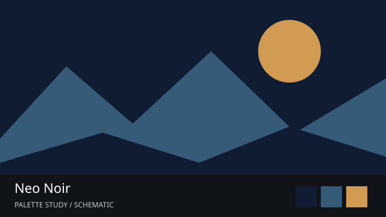<br>**Neo Noir** | 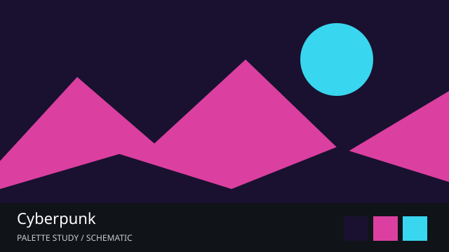<br>**Cyberpunk** | <br>**Luxury Editorial** | 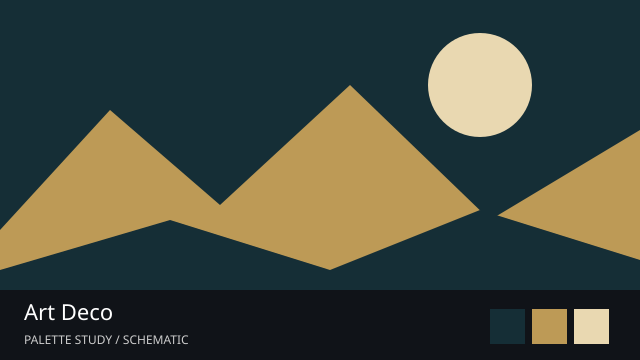<br>**Art Deco** |
| 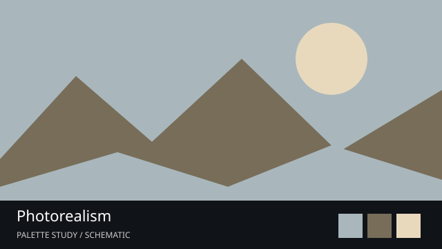<br>**Photorealism** | 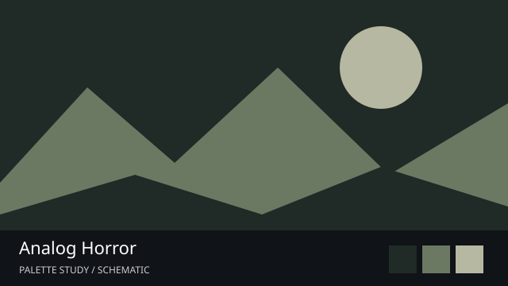<br>**Analog Horror** | <br>**Claymation** | 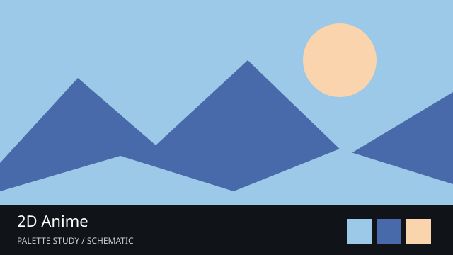<br>**2D Anime** |

20 styles with ready prompts in [part 05](docs/manual/README.md#parte-05--cor-e-estilos-visuais).

<details>
<summary><b>Boards, sheets and the optical atlas</b></summary>
<br>

| Optics | Character turnaround |
|:---:|:---:|
|  | 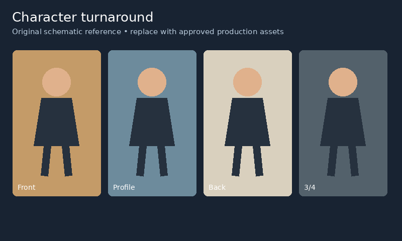 |
| **Product orthographic views** | **Warm luxury moodboard** |
|  | 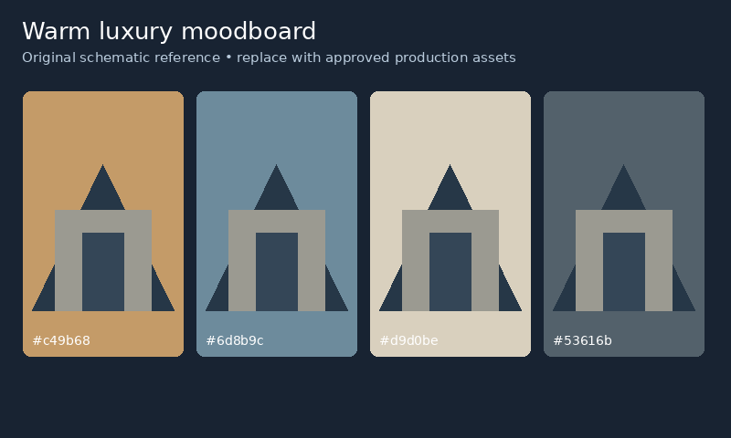 |

| 24 mm | 50 mm | 85 mm | 135 mm |
|:---:|:---:|:---:|:---:|
| 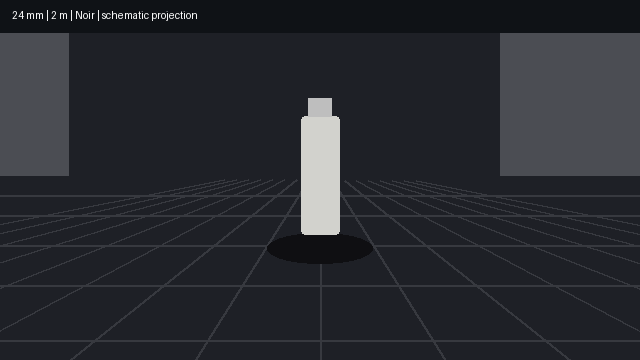 | 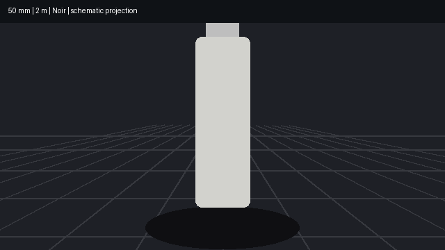 | 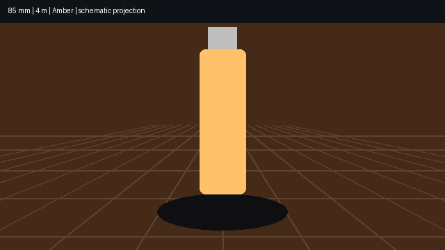 |  |

Geometric studies of one object across lenses, distances and palettes; the full atlas has 100.

</details>

## Scope and coexistence

The skill is built to live next to other video skills without stealing their requests.

| The request is… | Who handles it |
|---|---|
| a prompt, shot or sequence **generated by AI**; model choice; generation cost; diagnosing a generated result | **this skill** |
| UGC, character sheet, product photoshoot, thumbnail, static ad, micro-drama, faceless video, dubbing | the Higgsfield connector's own bundled workflow; this skill adds only the cost-and-ok rule |
| editing recorded footage (cuts, subtitles, color, music) | a video-editing skill or the connector's `video-montage` workflow |
| voice, narration, music, sound effects | an audio skill |
| titles, descriptions, publishing | a publishing skill |

When another video skill needs **one** AI-generated shot, this skill writes and generates that shot; the rest of the
video stays with its owner.

## Architecture

```text
higgsfield-director/            the skill: install THIS folder
  SKILL.md                      entry point: scope, flow, hard rules, routing (91 lines)
  agents/openai.yaml            display name and default prompt for the Codex UI
  references/
    fluxo.md                    brief, studio mode, bibles, project fields, delivery
    prompt.md                   golden order, per-model notes, recipes, examples
    vocabulario.md              camera, framing, lens, light, color, physics, acting, audio
    modelos.md                  choosing a model, snapshot table, refreshing the snapshot
    conector.md                 Higgsfield MCP in Claude and Codex, bundled workflows, call order
    qualidade.md                pre-spend checklist, diagnostics, frames, scoring
  scripts/hfd.py                validate, compile, budget, export, optics, score, models
  data/modelos.json             dated snapshot of the connector catalog (122 models)
  data/pesos.json               scoring weights
  templates/                    3-shot commercial, image-to-video, evaluation
  tests/test_hfd.py             41 unittest cases
docs/
  AVALIACAO-RC3.md              evaluation of the previous package and what v5 kept
  assets/emblema.svg            emblem
  manual/                       illustrated direction manual: README (11 parts), visual/ (185 images + catalog)
```

## Quality and security

```bash
cd higgsfield-director && python3 -m unittest discover -s tests -v
```

| Check | Result |
|---|---|
| Unit tests | 41/41 passing (Python 3.12, no third-party packages) |
| Mutation check | 4 planted bugs (negation ignored, boundary check off, audio dropped, unknown model silent): 4 caught |
| Skill format | frontmatter parsed as YAML; description 937/1024 characters; every path cited in `SKILL.md` and references exists (tested) |
| Routing in Claude Code (headless, final description) | 9/9 requests routed correctly: 5 to this skill (2 quick prompts, 2 diagnostics, 1 character sheet handed to the connector's workflow) and 4 to the skills that own them (render, recorded-footage editing, voice, motion graphics). A first round with an earlier description missed 2 of 3 prompt requests; the description was fixed and re-tested |
| Spending in tests | 16 sessions, 0 generation calls (generation tools blocked in the test); every session that priced a job stopped and asked for "ok" |

Security properties:

- `hfd.py` has no network access and no dependencies; it reads and writes only the paths it is given.
- Nothing is generated without the quoted total and an explicit "ok"; opening a preset or gallery never authorizes
  generation, and an "ok" does not carry over to the next request.
- Model capabilities come from the catalog (live, or the dated snapshot), never from memory.
- Real people's faces or voices only with consent declared by the operator; no minors in sensitive scenes; no
  impersonation of public figures (Higgsfield Terms, sections 4.2 and 5, updated 23/10/2026).

## Editions and history

| Version | Focus |
|---|---|
| v1.0 | cinematic skill and prompt vocabulary |
| v2.0 – v2.1 | structured production, catalogs, quality rules, schematic references |
| v3.0 | cinematic intelligence, experiments, offline labs |
| v4.0 | master modules and illustrated manual |
| v4.1 RC1 – RC4 | packaging, hardening, public/private separation, AAA illustrated README |
| **v5.0.0** | rewrite for Claude Code and Codex: lean skill, live catalog, official connector, cost gate, tests |

Versions up to v4.1 were generated with ChatGPT and are kept outside this repository; what was reused and why is in
[docs/AVALIACAO-RC3.md](docs/AVALIACAO-RC3.md).

## Roadmap

| Priority | Goal | Status |
|---|---|---|
| P0 | End-to-end run in Codex with the Higgsfield MCP configured | Pending (connector setup) |
| P1 | Real pilot: generate a 3-shot sequence and score it with evidence | Pending (needs an approved budget) |
| P1 | Monthly refresh of the model snapshot | Process documented in `modelos.md` |
| P2 | Larger trigger evaluation set (more prompts, several runs each) | Planned |

## Documentation

| Resource | Link |
|---|---|
| Skill entry point | [higgsfield-director/SKILL.md](higgsfield-director/SKILL.md) |
| Production flow | [references/fluxo.md](higgsfield-director/references/fluxo.md) |
| Prompt writing | [references/prompt.md](higgsfield-director/references/prompt.md) |
| Vocabulary | [references/vocabulario.md](higgsfield-director/references/vocabulario.md) |
| Models | [references/modelos.md](higgsfield-director/references/modelos.md) |
| Connector | [references/conector.md](higgsfield-director/references/conector.md) |
| Quality | [references/qualidade.md](higgsfield-director/references/qualidade.md) |
| Illustrated manual | [docs/manual/README.md](docs/manual/README.md) |
| Evaluation of v4.1 | [docs/AVALIACAO-RC3.md](docs/AVALIACAO-RC3.md) |

## Licensing

- Code and skill text: [MIT](LICENSE), © 2026 Robson Niedson.
- Illustrated manual text (`docs/manual/README.md`): adapted from the v4.1 illustrated package, which declares its
  prose under [CC BY-SA 4.0](docs/manual/LICENSE-DOCS.md); the changes are listed at the end of the manual.
- Images in `docs/manual/visual/` and the emblem in `docs/assets/`: come from the v4.1 package, which declares them
  private and schematic, with no public authorization presumed. They are **not** covered by MIT or CC BY-SA.
- Higgsfield, Kling, Seedance, Veo, Wan, MiniMax and other names are trademarks of their owners. This project is
  independent and not affiliated with or endorsed by any of them.

---

## Português

### Direção de cinema para vídeo gerado por IA, no Claude Code e no Codex

O Higgsfield Director PRO é uma **skill** (`higgsfield-director`) que transforma um pedido em tomadas geradas por IA bem
dirigidas. Ela escolhe o modelo pelo catálogo ao vivo, escreve um prompt por tomada e mantém personagem e produto iguais
entre as tomadas. Antes de gerar, mostra o custo em créditos e espera o "ok". Depois gera pelo conector oficial do
Higgsfield e revisa o resultado com evidência. A mesma pasta funciona no Claude Code e no Codex.

**Estado:** repositório privado, versão 5.0.0. Projeto independente, sem vínculo com o Higgsfield.

### Instalação

Instale a pasta `higgsfield-director/` (nunca a raiz do repositório) por link simbólico, uma fonte só para os dois
agentes:

```bash
git clone https://github.com/rniedson/HIGGSFIELD-DIRECTOR-PRO-SKILL.git
R="$PWD/HIGGSFIELD-DIRECTOR-PRO-SKILL/higgsfield-director"
ln -s "$R" ~/.claude/skills/higgsfield-director    # Claude Code
ln -s "$R" ~/.agents/skills/higgsfield-director    # Codex
```

Para gerar, conecte o Higgsfield. No Claude Code, ative o conector "Higgsfield" no claude.ai e abra uma sessão nova. No
Codex, rode `codex mcp add higgsfield --url https://mcp.higgsfield.ai/mcp` e depois `codex mcp login higgsfield`. Sem
conector, a skill trabalha em modo só planejamento.

### Funcionalidades

| Recurso | Situação |
|---|---|
| Briefing, plano de tomadas e fichas de continuidade | Implementado (`fluxo.md`, `hfd.py validar`) |
| Prompt por modelo, na ordem dos guias oficiais | Implementado (`prompt.md`, `hfd.py compilar`) |
| Limites de modelo (duração, proporção, resolução, áudio) | Conferidos no retrato de 122 modelos e no catálogo ao vivo |
| Orçamento em créditos | Com cotação real do conector; sem cotação, o comando recusa |
| Geração | Pelo MCP oficial do Higgsfield, só depois do "ok" |
| Revisão | Checklist, diagnóstico por sintoma, quadros do início, meio e fim, nota com evidência |
| Regra dos 180°, óptica, roteiro, CSV e legendas | Implementados (`hfd.py`) |

### Exemplo

Peça em linguagem natural:

```text
Planeja um comercial de 3 tomadas no Higgsfield para um tênis branco, vertical, e me diz quanto custa. Não gere ainda.
```

A skill responde com direção, premissas, modelo e limites (com a fonte), tabela de tomadas e prompts. Depois mostra o
custo cotado no conector e pergunta qual caminho seguir. Nada é gerado até o "ok". Os exemplos de saída do `hfd.py`
estão em [Examples](#examples).

### Fluxo de trabalho

Briefing → modelo → plano e fichas → prompts → custo → "ok" → geração → revisão → nova tentativa mudando **uma**
variável. Duas falhas seguidas na mesma tomada: replaneje em vez de empilhar restrições.

### Convivência com outras skills

A skill dispara para vídeo e imagem **gerados por IA**. Edição de vídeo gravado, voz e trilha, publicação e os formatos
que o conector resolve com fluxo próprio (UGC, ficha de personagem, foto de produto, miniatura) ficam com quem já cuida
deles. Veja [Scope and coexistence](#scope-and-coexistence).

### Manual ilustrado

O [manual ilustrado](docs/manual/README.md) tem 11 partes e 185 imagens esquemáticas: movimentos de câmera,
enquadramento, lentes, luz, cor e 20 estilos com prompt pronto, atuação, física, tempo, som, continuidade, produção e
um atlas óptico de 100 estudos. Cada parte traz a regra, um prompt positivo e o que evitar.

### Testes e segurança

`python3 -m unittest discover -s tests -v` na pasta da skill: 41 testes, sem dependências. O `hfd.py` não acessa a rede.
Custo mostrado e "ok" explícito antes de qualquer geração. Rosto e voz de pessoa real só com consentimento.

### Histórico e licenças

A v5 reescreve o pacote v4.1 RC3/RC4 gerado no ChatGPT. A avaliação está em
[docs/AVALIACAO-RC3.md](docs/AVALIACAO-RC3.md). Código e texto da skill: MIT. O texto do manual ilustrado segue a CC BY-SA 4.0
declarada pelo pacote v4.1. As imagens (`docs/manual/visual/` e o emblema) são privadas e não entram em nenhuma das
duas licenças.

<div align="center">

**Higgsfield Director PRO — cinematic direction for AI-generated video**

Independent project · Projeto independente

[Back to top / Voltar ao início](#higgsfield-director-pro)

</div>
