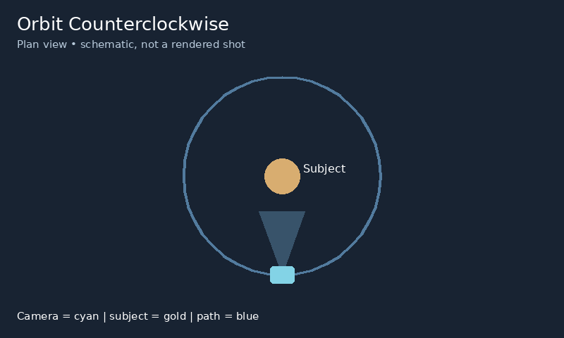
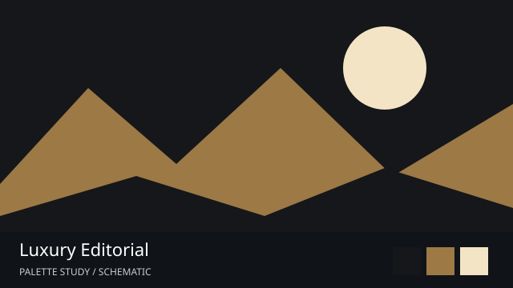
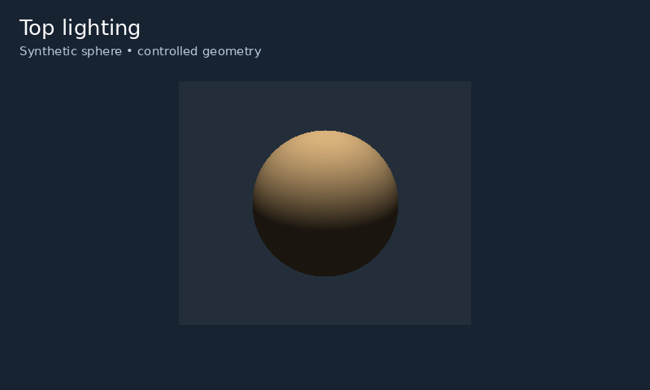
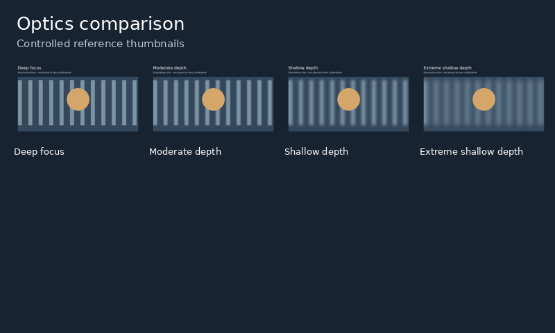
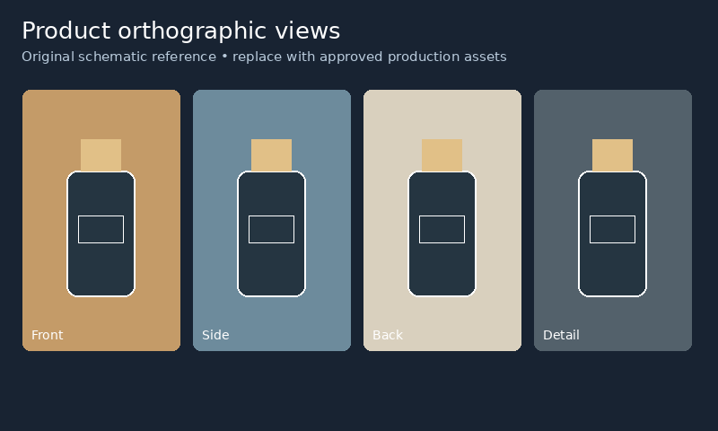
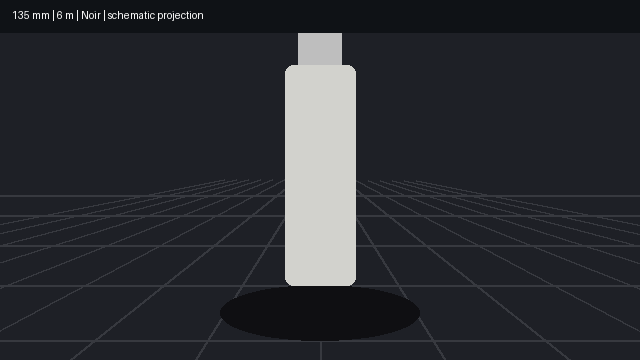
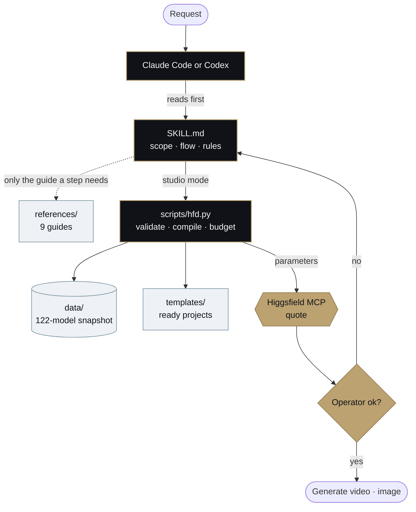
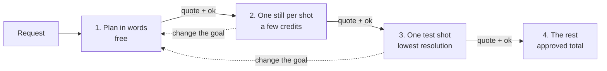

<div align="center">


# HIGGSFIELD DIRECTOR PRO

### A step-by-step process for AI-generated video · Claude Code & Codex

**Your request as you said it · Cheap previews before video · Every credit in view · Generation only after your ok**


[](https://github.com/rniedson/hfd/actions/workflows/tests.yml)


[How it works](#how-it-works) · [Why use it](#why-use-it) · [Illustrated manual](#illustrated-manual) · [Architecture](#architecture) · [Quick start](#quick-start) · [Examples](#examples) · [Disclaimer](#disclaimer) · [License](#licensing)

**English** · [Português](README.pt-BR.md)

</div>

> [!IMPORTANT]
> **Unofficial project.** Higgsfield Director PRO is an independent, community-made skill. It is **not made,
> affiliated with, endorsed, sponsored or supported by Higgsfield**. "Higgsfield" is used only to say which service
> the skill works with. For your account, credits, billing or the connector, contact Higgsfield; this repository
> cannot help with them. See [Disclaimer](#disclaimer).

> **Status:** version 6.0.0, plus the changes on `main` listed under *Unreleased* in the [CHANGELOG](CHANGELOG.md).
> The skill only *plans* on its own; video and images are generated by the official Higgsfield connector (MCP), with
> credits from your own account, and **only after the cost is shown and the operator says "ok"**.

## How it works

The models on Higgsfield already do well with a plain request. This skill does not try to write a better prompt
than that. It keeps your request as you said it and spends its effort on the process around it: one step at a time,
a cheap look at the idea before each expensive step, and every credit in view, so what comes out is what you were
expecting and nothing is spent by surprise.

| Step | What you see | What it costs | What you decide |
|---|---|---|---|
| 1. The plan | the idea, the shots, the model and the prompts, in words | nothing | change the idea while it is free |
| 2. One still per shot | an image of each shot, from a cheap image model | a few credits per image | whether the look, the people and the place are what you want |
| 3. One test shot | the riskiest shot as a short video at the lowest resolution | the price of one shot | whether the motion and the sound work |
| 4. The rest | the other shots, then the final resolution if you want it | the total you approved | — |

Before each step the skill shows its price from the connector and waits for your "ok"; after each one it shows what
it cost and the total so far ("17 of the 75 approved credits spent"). A change of plan costs least where it is found: a shop
sign that should not be there costs one still to redo when it is caught on the still, and a whole video when it is
caught on the video.

- **The prompt is your request.** Every fact you give and every limit you set ("nobody real, no brand, no text")
  goes into each prompt as you said it, naming where a ruled-out thing would show. Camera moves, lenses, light,
  styles and recipes against defects come in only when you ask for them, or to fix a defect a preview showed.
- **How much it asks depends on you.** You choose once per project: approve every step, give one "ok" for the
  total, or set a ceiling for the session ([Your way: modes](#your-way-modes)).
- **What it does not change:** the model and its price, and the connector's ready-made workflows (product photos,
  creator videos, dubbing, ads), where the skill steps aside and keeps only the cost-and-ok rule.

For one quick prompt or one image, the plan is the whole job: there are no steps to climb.

### In practice

https://github.com/user-attachments/assets/95668b75-fac8-459f-b26f-211d8e396daa

A 10 s fight between the maintainer's own character and a robot clone of himself, made one step at a time: four
stills to choose the look (0.48 credits, as quoted on 2026-11-26), the whole shot as a draft (30), then the final at 1080p from
the approved draft (160). The idea of splitting into copies came in before the draft, while changing the plan was still free.
[How it was made](docs/demo/README.md), with the prompt and the sound.

## Why use it

1. **Nothing is spent by surprise.** Every generation is quoted first and waits for your "ok"; after each one you see
   what it cost and the total so far.
2. **Mistakes are caught where they cost least.** One still per shot, then one test shot at the lowest resolution,
   before the rest. In the demo above, four stills (0.48 credits) came before a final of 160.
3. **Your request stays yours.** Every fact and limit you give goes into the prompt as you said it. Camera, light and
   recipes come in only when you ask for them, or to fix a defect a preview showed.
4. **Errors are found before any credit.** `hfd.py validate`, offline and free, checks the model's limits (duration,
   aspect ratio, resolution, audio), dialogue that does not fit the shot, continuity between shots and the 180° axis.
5. **Today's models and prices, never stale ones.** No price is written in the skill. On each day of use it makes a
   table of that day's free quotes and says what changed; it reads the catalog again each week, or on request, and
   new models join the table for 30 days.
6. **A budget that does not guess.** `hfd.py budget` adds real quotes, retries and a reserve, and refuses to run
   without the prices; `--prices` plans from the day's table, marked as planning.
7. **Fewer tokens.** What a script can do, a script does: the checks, the prompts, the budget and the day's quotes
   run in Python, not in the model. `connector.py` makes the day's quotes with no model at all (below).
8. **Your way of working.** Approve every step, give one "ok" for the total, or set a ceiling for the session. The
   preferences file never holds a spending limit ([modes](#your-way-modes)).
9. **It steps aside when it should.** For the connector's ready-made workflows (product photos, creator videos,
   dubbing, ads) it keeps only the cost-and-ok rule. Without the connector it still delivers the prompts and the
   parameters to paste on the Higgsfield site.
10. **Light, and checked.** Python's standard library only, nothing to install. 162 tests with no network and no
    credits run on Python 3.9 to 3.13 for every change, and they caught all 75 defects that a review planted on
    purpose and that still apply ([tests](higgsfield-director/tests/README.md)). What real runs taught is kept in
    [`lessons-learned/`](lessons-learned/README.md).

### What a price check costs in tokens

The day's price table was 29 free quotes on 2026-11-27. They cost no credits, but whoever makes them spends tokens.
Measured that day in a long Claude Code session, with the same 29 prices each way:

| Who makes the 29 quotes | Model tokens | Time | At that day's API list prices |
|---|---|---|---|
| The main conversation (Claude Opus 5.5) | 5,276 written and 550,485 re-read, in two turns | — | about US$ 0.28 |
| A subagent on Claude Haiku 5.5 | 5,088 written and 250,714 read by the small model; 1,029 written and 180,280 re-read by the main conversation to send it, plus one turn to read its summary | 23.5 s | about US$ 0.11, plus that turn |
| `connector.py prices` | none for the quotes: the agent writes one command and reads a summary of about 600 characters | 43.2 s | nothing for the quotes |

Most of the main conversation's cost is re-reading itself: each turn re-reads the whole conversation, about 275,000
tokens in that session. A new session re-reads far less, but the quotes still go through the large model. On a
Claude subscription these figures come out of the usage limits instead of dollars. How each way works:
[`models.md`](higgsfield-director/references/models.md#who-makes-the-quotes).

## Showcases

What the skill did on real requests, told from the records ([all showcases](docs/showcases/README.md)).

### Kung fu vs robot clone: a 10 s fight, one step at a time

Four stills to choose the look (0.48 credits), the whole shot as a draft (30), then the final at 1080p from the
approved draft (160), as quoted on 2026-11-26. The final repeated the draft's motion and also its silence, so the skill
now makes the draft with sound when the final needs it.
[Read the case](docs/showcases/kung-fu-clone.md) · [Watch the video](docs/demo/kung-fu-vs-robot-clone.mp4)

### The day's prices without the model

The same 29 free quotes made three ways on 2026-11-27: by the main conversation (5,276 tokens written, 550,485
re-read), by a subagent on a small model, and by `connector.py prices` (no model tokens for the quotes).
[Read the case](docs/showcases/price-check-tokens.md)

## Illustrated manual

The [illustrated direction manual](docs/manual/README.md) has **11 parts and 185 schematic images**: camera movement,
framing, lenses and optics, lighting, color and styles, acting, physics and materials, time and editing, sound,
continuity and production. Each part gives the rule, a positive prompt, what to avoid and the illustrations. The
images explain direction; they are not renders and do not prove how a model behaves. The skill uses it when you ask
for a specific look or control, or to fix a defect a preview showed; a plain request does not need it.

### Camera movement

Plan-view schematics of the movements the skill writes into prompts.

| | | | |
|:---:|:---:|:---:|:---:|
| <br>**Dolly in** | <br>**Dolly out** | <br>**Zoom in** | <br>**Zoom out** |
| <br>**Truck left** | <br>**Truck right** | <br>**Pan left** | <br>**Pan right** |
| <br>**Orbit clockwise** | <br>**Orbit counterclockwise** | <br>**Arc left** | <br>**Arc right** |
| <br>**Tilt up** | <br>**Tilt down** | <br>**Crane up** | <br>**Crane down** |
| <br>**Pedestal up** | <br>**Pedestal down** | <br>**Camera roll** | <br>**Static** |

Dolly moves the camera; zoom changes the lens. **One dominant movement per shot**, or explicit phases
(*"static, then a slow push-in"*).

### Visual styles

| | | | |
|:---:|:---:|:---:|:---:|
| <br>**Neo Noir** | <br>**Cyberpunk** | <br>**Luxury Editorial** | <br>**Art Deco** |
| <br>**Photorealism** | <br>**Analog Horror** | <br>**Claymation** | <br>**2D Anime** |

20 styles with ready prompts in [part 05](docs/manual/README.md#part-05--color-and-visual-styles).

### Lighting

| | | | |
|:---:|:---:|:---:|:---:|
| <br>**Front light** | <br>**Side light** | <br>**Top light** | <br>**Under light** |
| <br>**Cross light** | <br>**Back light** | <br>**Soft light** | <br>**Hard light** |

### The 11 parts

| Part | Topic | | Part | Topic |
|:---:|---|---|:---:|---|
| 01 | [Camera and movement](docs/manual/README.md#part-01--camera-and-movement) | | 07 | [Physics, materials and VFX](docs/manual/README.md#part-07--physics-materials-and-vfx) |
| 02 | [Framing and composition](docs/manual/README.md#part-02--framing-and-composition) | | 08 | [Time, transitions and editing](docs/manual/README.md#part-08--time-transitions-and-editing) |
| 03 | [Cameras, lenses and optics](docs/manual/README.md#part-03--cameras-lenses-and-optics) | | 09 | [Sound direction](docs/manual/README.md#part-09--audio-and-sound-direction) |
| 04 | [Cinematic lighting](docs/manual/README.md#part-04--cinematic-lighting) | | 10 | [Continuity and diagnostics](docs/manual/README.md#part-10--continuity-and-diagnostics) |
| 05 | [Color and visual styles](docs/manual/README.md#part-05--color-and-visual-styles) | | 11 | [Prompt engineering and production](docs/manual/README.md#part-11--prompt-engineering-and-production) |
| 06 | [Acting and emotion](docs/manual/README.md#part-06--acting-and-emotions) | | — | [Optical atlas, 100 studies](docs/manual/README.md#optical-atlas--100-studies) |

<details>
<summary><b>Boards, sheets and the optical atlas</b></summary>
<br>

| Optics | Character turnaround |
|:---:|:---:|
|  |  |
| **Product orthographic views** | **Warm luxury moodboard** |
|  |  |

| 24 mm | 50 mm | 85 mm | 135 mm |
|:---:|:---:|:---:|:---:|
|  |  |  |  |

Geometric studies of one object across lenses, distances and palettes; the full atlas has 100.

</details>

## Reference images

What a good reference looks like. These three were generated for one of the skill's tests (GPT Image 2.6 through
Higgsfield, 2026-11-25); the prompts that made them, and how a video prompt names them, are in
[`examples/references`](examples/references/README.md).

| | | |
|:---:|:---:|:---:|
| <br>**Character sheet**<br>one face; the body cropped at the neck | <br>**Location in two views**<br>the room and the way in, no people | <br>**A set detail**<br>the detail the action ends on |

Each reference says what it brings and what stays out of the shot: the sheet gives the identity, and its grey
background never enters the scene.

## Architecture

How the pieces talk to each other. The agent reads only `SKILL.md` up front; everything else is loaded when a step
needs it. `hfd.py` works offline, and the only path to spending credits goes through the Higgsfield connector,
after the quoted total and the operator's "ok".



| | Part | What it holds | When it comes in |
|:---:|---|---|---|
| **1** | [`SKILL.md`](higgsfield-director/SKILL.md) | scope, the 9-step flow, hard rules, who handles what | every request: the agent reads it first |
| **2** | [`references/`](higgsfield-director/references/README.md) | 9 guides: flow · pre-production · prompt · vocabulary · models · connector · quality · modes · calibration | only the guide the current step asks for |
| **3** | [`scripts/hfd.py`](higgsfield-director/scripts/README.md) | validate · compile · budget · export · optics · score · models | studio mode, before any credit is spent |
| **4** | [`data/`](higgsfield-director/data/README.md) | dated snapshot of 122 models + scoring weights | checking model limits without the connector |
| **5** | [`templates/`](higgsfield-director/templates/README.md) | 3-shot commercial, image-to-video, evaluation | starting a new project |
| **6** | [`tests/`](higgsfield-director/tests/README.md) | 162 cases, no dependencies, run in CI | before publishing a change |
| **7** | [`agents/openai.yaml`](higgsfield-director/agents/openai.yaml) | name and default prompt shown by Codex | Codex only |
| **+** | [`docs/manual/`](docs/manual/README.md) | illustrated manual: 11 parts, 185 images | learning the language of direction |

Each folder has its own guide, with a diagram: [the skill](higgsfield-director/README.md) · [docs](docs/README.md) ·
[tools](tools/README.md) · [examples](examples/README.md) · [lessons learned](lessons-learned/README.md) ·
[calibration](calibration/README.md) · [blocking studio](blocking-studio/README.md).

<details>
<summary><b>Full file tree</b></summary>
<br>

```text
higgsfield-director/            the skill: install THIS folder
  SKILL.md                      entry point: scope, flow, hard rules, routing
  agents/openai.yaml            display name and default prompt for the Codex UI
  references/
    workflow.md                 brief, studio mode, bibles, project fields, delivery
    preproduction.md            idea, script draft, two-phase sketch storyboard, locked script, audio route
    prompt.md                   on request: golden order, per-model notes, recipes, examples
    vocabulary.md               camera, framing, lens, light, color, physics, acting, audio
    models.md                   choosing a model, snapshot table, refreshing the snapshot
    connector.md                Higgsfield MCP in Claude and Codex, bundled workflows, call order
    quality.md                  pre-spend checklist, diagnostics, frames, scoring
    modes.md                    first use; follow, price and ceiling modes
    calibration.md              blind test with and without the skill, only on request
  scripts/hfd.py                validate, compile, budget, export, optics, score, models, crop, blind, result
  scripts/connector.py          the day's quotes with no model, on the operator's own sign-in
  scripts/calibrate_claude_code.sh  runs both calibration conditions in Claude Code
  data/models.json              dated snapshot of the connector catalog (122 models)
  data/weights.json             scoring weights
  templates/                    3-shot commercial, image-to-video, evaluation
  tests/                        162 unittest cases
examples/references/            three reference images and the prompts that made them
calibration/                    records of the blind rounds run while the skill was built, and their scoreboard
lessons-learned/                lessons that changed the skill, each with its source
price-history/                  the connector's quotes, one record a week, with a chart of how they move
blocking-studio/                animated 3D storyboards before spending credits: two mannequins (GLB), a procedural human generator, Blender scripts, a Three.js viewer
website/                        the GitHub Pages site (landing page), deployed by .github/workflows/static.yml
docs/
  MIGRATION-6.md                every name from before 6.0 and its English name
  RC3-EVALUATION.md             evaluation of the previous package and what v5 kept
  assets/emblem.svg             emblem
  manual/                       illustrated direction manual: README (11 parts), visual/ (185 images + catalog)
tools/check_repo.py             skill format, JSON, links, anchors and language (run by CI)
tools/aggregate_calibration.py  builds the scoreboard in calibration/README.md from the records
.github/                        CI workflow, issue and pull request templates
AGENTS.md · CLAUDE.md · CHANGELOG.md · CONTRIBUTING.md · SECURITY.md
```

</details>

## Contents

- [How it works](#how-it-works)
- [Why use it](#why-use-it)
- [Showcases](#showcases)
- [Illustrated manual](#illustrated-manual)
- [Reference images](#reference-images)
- [Architecture](#architecture)
- [Overview](#overview)
- [Your way: modes](#your-way-modes)
- [What changed in 6.0](#what-changed-in-60)
- [What changed in v5](#what-changed-in-v5)
- [Capabilities](#capabilities)
- [Quick start](#quick-start)
- [Examples](#examples)
- [`hfd.py` reference](#hfdpy-reference)
- [Choosing a model](#choosing-a-model)
- [Scope and coexistence](#scope-and-coexistence)
- [Quality and security](#quality-and-security)
- [Editions and history](#editions-and-history)
- [Roadmap](#roadmap)
- [Documentation](#documentation)
- [Disclaimer](#disclaimer)
- [Licensing](#licensing)

Portuguese translation: [README.pt-BR.md](README.pt-BR.md).

## Overview

Higgsfield Director PRO is an **agent skill** (`higgsfield-director`) that runs the production of AI-generated video
and images one step at a time. It picks the model from the live catalog, writes the prompts from your request as you
said it, keeps characters and products consistent across shots, shows a cheap preview before each expensive step,
keeps every credit in view, generates through the Higgsfield connector only after your "ok", and reviews the result
with you.

It is tested in **Claude Code** and locally in **Codex** for planning and CLI checks. Authenticated Higgsfield
quoting and generation have not yet been tested from Codex. The skill replies in the operator's language and writes
prompts in English, which video models follow more predictably.



Without the connector the skill runs in **planning-only mode**: it delivers prompts and parameters ready to paste on the
Higgsfield site, and says that the cost must be checked there.

## Your way: modes

People work differently. The first time in a project, the skill asks how you want to work and stores the answer in
`.higgsfield-director/preferences.json`, in the project folder ([modes.md](higgsfield-director/references/modes.md)).

| Mode | For whom | What happens |
|---|---|---|
| `follow` (follow along) | wants to see and approve every step | every image and every video comes to you, with the skill's pre-check beside it, and nothing moves on without your approval |
| `price` (price only) | only wants to know the price | the skill decides the plan and shows the total; one "ok" covers the whole package |
| `ceiling` (ceiling) | does not want to be asked | you say in the conversation how many credits it may spend this session; it shows the running total and stops at the ceiling |

The file stores **how** to work, never **how much** to spend: `hfd.py` rejects a file with a ceiling or any other
field, and spending authorization still comes only from the conversation. In every mode, the skill shows what each
generation cost and the total so far.

**Cheap pre-production.** Before the previews, the idea can mature where mistakes cost little: an idea in one
sentence, a script draft as a table, then a sketch storyboard in two phases. First the whole storyboard in one sketch
sheet from the cheapest image model; then each panel, cropped (`hfd.py crop`), becomes the reference for its own frame
in a cheap model that accepts references, so every frame keeps the same block figures and can be redone alone. Only
after the operator locks the script does the skill ask where to make the audio
([preproduction.md](higgsfield-director/references/preproduction.md)). Tested once.

## What changed in 6.0

6.0.0 (2026-11-27) is the first version since 5.1.0. Everything is in [CHANGELOG.md](CHANGELOG.md); in short:

- **Breaking: everything is in English.** `SKILL.md`, the references, and the commands, fields and output of `hfd.py`.
  The Portuguese names still work through 6.x with a warning that names the new one, and go in 7.0
  ([MIGRATION-6.md](docs/MIGRATION-6.md)).
- **The skill is the process, not a better prompt.** It keeps your request as you said it, shows one still per shot
  and then one test shot before the rest, keeps every credit in view, and asks once how you want to work
  ([modes](#your-way-modes)).
- **Today's prices and models.** No price is written in the skill: the day's price table (`hfd.py prices`),
  new models dated for 30 days, and `connector.py`, which makes the day's quotes with no model tokens.
- **Cheap pre-production:** idea, script draft and a sketch storyboard in two phases (`hfd.py crop`).
- **Checked harder:** 162 tests, from 50 in 5.1.0. A review planted 91 defects on purpose, and the tests now catch
  every one that still applies. The repository check reads every link and anchor and keeps private material out.
- **Two rules for contributors** ([AGENTS.md](AGENTS.md)): no data that goes stale, and scripts before the model.
- **What real runs taught**, in [`lessons-learned/`](lessons-learned/README.md), and the demo above.

## What changed in v5

v5 is a rewrite of the v4.1 RC3/RC4 package generated with ChatGPT. Every defect measured in RC3 became a test.
Full evaluation: [docs/RC3-EVALUATION.md](docs/RC3-EVALUATION.md).

| | v4.1 RC3 / RC4 | v5.1.0 |
|---|---|---|
| Skill | 328 files, 121 MB, 116 "commands" | 15 files, `SKILL.md` of 93 lines + 6 references read on demand |
| Code | 3 compilers, 2 optics, 3 budgets; SDK, REST, Docker | one `hfd.py`, Python standard library only |
| Models | 9 profiles, 7 with every field `null` | dated snapshot of **122 models** from the connector catalog, refreshable by command |
| Camera check | rejected *"static camera, no orbit"* | understands negation and phases; warns, does not block |
| Audio | moved Cinema Studio audio to post-production | reads native audio from the catalog (Cinema Studio 4.0 generates audio by default) |
| Generation | none | official Higgsfield MCP, after cost and explicit "ok" |
| Conflicts | generic "video" description | trigger anchored on *AI-generated / Higgsfield*, with named exclusions |
| Tests | 67 (2 needed OpenCV) | 50, no dependencies, CI on Python 3.9 to 3.13; 4 planted bugs, 4 caught |

## Capabilities

| Capability | How | Where |
|---|---|---|
| Brief and premises | asks only what blocks; the rest becomes a stated premise | [`workflow.md`](higgsfield-director/references/workflow.md) |
| Model choice | by need (length, references, first/last frame, audio, cost), confirmed in the live catalog | [`models.md`](higgsfield-director/references/models.md) |
| Prompt writing | your request as you said it, every fact and limit kept; on request, golden order, per-model notes and 32 recipes against common defects | [`prompt.md`](higgsfield-director/references/prompt.md) |
| Vocabulary | camera, framing, lens, light, color, physics, acting, audio | [`vocabulary.md`](higgsfield-director/references/vocabulary.md) |
| Illustrated manual | 11 parts, 185 schematic images: movement, lighting, styles, sheets, optical atlas | [`docs/manual`](docs/manual/README.md) |
| Continuity | bibles (character, product, place) with fixed attributes; boundary check between shots | `hfd.py validate` |
| 180° rule | camera positions against the action axis | `hfd.py validate` |
| Model limits | duration, aspect ratio, resolution, audio, image-to-video inputs | `hfd.py validate` + snapshot |
| Budget | real quotes from the connector + retries + reserve; refuses to invent prices; plans from the day's price table on request | `hfd.py budget` |
| Generation | connector call order, bundled workflows, uploads, waiting | [`connector.md`](higgsfield-director/references/connector.md) |
| Review | pre-spend checklist, symptom → cause table, frames, weighted score with evidence | [`quality.md`](higgsfield-director/references/quality.md), `hfd.py score` |
| Delivery | script, shot list CSV, subtitles | `hfd.py export` |
| Working mode | follow every step, price only, or a ceiling said in the conversation; asked on first use | [`modes.md`](higgsfield-director/references/modes.md), `hfd.py preferences` |
| Pre-production | idea, script draft, two-phase sketch storyboard in block figures, locked script, where to make the audio | [`preproduction.md`](higgsfield-director/references/preproduction.md), `hfd.py crop` |
| Previews | one still per shot, then one test shot, before the rest | [`workflow.md`](higgsfield-director/references/workflow.md) |

## Quick start

Requirements: Claude Code and/or Codex, Python 3.9+ (standard library only). For generation, a Higgsfield account.

**1. Install the skill only where you will use it.** `install.sh` links the `higgsfield-director/` folder (never the
repository root) into the agent's skills folder. For Claude Code it offers the project's `.claude/skills/` (the
default when the project has a `.claude/` folder: the skill then exists only in sessions opened there) or
`~/.claude/skills/` for every session; for Codex, `~/.agents/skills/`. It asks when Claude Code and Codex are both
installed, never overwrites what is already there, and prints how to remove the link. Plain bash; `--help` lists its
options, `--dry-run` shows what it would do.

```bash
git clone https://github.com/rniedson/hfd.git
H="$PWD/hfd"
cd /path/to/your/project
"$H/install.sh"
```

Without cloning first: `curl -fsSL https://raw.githubusercontent.com/rniedson/hfd/main/install.sh | bash` clones the
repository into `~/hfd` (or `--dir`) and does the same; read the script at that address before you run it.

By hand, the same link for a project:

```bash
R="$PWD/hfd/higgsfield-director"
cd /path/to/your/project
mkdir -p .claude/skills && ln -s "$R" .claude/skills/higgsfield-director
```

To remove it, `rm .claude/skills/higgsfield-director` (no trailing slash: it deletes only the link). Sessions already
open may need a restart to see the change.

| Other scope | Command | Effect |
|---|---|---|
| Every Claude Code session | `ln -s "$R" ~/.claude/skills/higgsfield-director` | available in all projects at once |
| Codex | `ln -s "$R" ~/.agents/skills/higgsfield-director` | available in Codex sessions |

**2. Connect Higgsfield** (optional; without it the skill plans only). The connector is Higgsfield's own; this
unofficial repository does not ship it, change it or speak for it:

| Agent | How |
|---|---|
| Claude Code | enable the **Higgsfield** connector on claude.ai, then open a new session |
| Codex | `codex mcp add higgsfield --url https://mcp.higgsfield.ai/mcp` then `codex mcp login higgsfield` |

**3. Ask in plain language**, or call it by name (`/higgsfield-director` in Claude Code, `$higgsfield-director` in Codex):

```text
Write the prompt for a 5 s video of a steaming cup of coffee, the camera slowly moving closer. It's for Reels.
Plan a 3-shot commercial on Higgsfield for a white sneaker, vertical, and tell me how much it costs. Don't generate yet.
I made a woman walking in Kling and her feet slide on the floor. How do I fix the prompt?
```

## Examples

All outputs below are real runs of the bundled templates.

### 01 — Three-shot product commercial

A project declares the model, the bibles and the shots ([`templates/project.json`](higgsfield-director/templates/project.json)):

```json
{
  "model": "cinematic_studio_video_4_0",
  "aspect_ratio": "9:16",
  "bibles": {
    "P01": {
      "type": "product",
      "description": "A black glass perfume bottle with a faceted gold cap and a flat cream label reading NOIR",
      "fixed": {"color": "black", "cap": "gold"}
    }
  },
  "shots": [
    {"id": "T01", "duration": 5, "entities": ["P01"],
     "action": "A thin curl of mist drifts past the bottle and clears",
     "camera": "Static camera, locked off", "optics": "100mm macro look, shallow depth of field"}
  ]
}
```

```bash
python3 higgsfield-director/scripts/hfd.py compile higgsfield-director/templates/project.json --text
```

```text
## T01
A black glass perfume bottle with a faceted gold cap and a flat cream label reading NOIR. A dark studio with a
polished obsidian plinth. A thin curl of mist drifts past the bottle and clears. Extreme close-up on the cap, eye
level. Static camera, locked off. 100mm macro look, shallow depth of field. Single hard rim light from camera left,
deep black background. The cap fills the upper third of the frame. Keep the label flat, sharp and readable.

Audio: Low airy hum, a soft glass chime as the mist clears.

parameters: {"model": "cinematic_studio_video_4_0", "duration": 5, "aspect_ratio": "9:16", "resolution": "720p", "generate_audio": true}
```

The bible description opens every shot that lists it, word for word, which is what holds the product's identity across
generations. In image-to-video it is left out: the start image already shows the subject.
Duration, aspect ratio, resolution and audio go to the **parameters**, not the prompt text. The camera, lens and light
are in this template because its request asked for that look; for a plain request those fields stay empty, and
`compile` joins only what the request gives.

### 02 — Budget before spending

```bash
python3 higgsfield-director/scripts/hfd.py budget higgsfield-director/templates/project.json --attempts 1
```

```json
{"error": "T01: no test_cost/final_cost. Run the connector's estimate (estimate_video_cost / estimate_image_cost) and fill them in; do not invent a price"}
```

The template has no price, on purpose: prices change at any time, and a number written in a file would go stale
without anyone noticing. Before the budget, the agent quotes each step live with the connector's `estimate_video_cost`
(free; it returns a `quote_ref`), writes what came back into each shot's `test_cost` and `final_cost`, and only then
`budget` adds the attempts and a 20 % reserve. Without the prices it refuses to run instead of guessing. To plan
before quoting each shot, `budget --prices` fills them from the day's price table, marked `"planning": true`.

### 03 — The validator catches a continuity break

Shot T02 starts with the bottle in red, but the bible fixes it as black:

```json
{
  "errors": ["T02 start: P01.color = 'red', but the bible fixes 'black'"],
  "warnings": ["cinematic_studio_video_4_0 has no multi-shot in the snapshot: each shot is a separate generation"]
}
```

Exit code 1. A fixed attribute has no exception. A change of state between shots (the bottle ends on the plinth,
the next shot starts it in a hand) is declared in that shot's `approved_changes: ["P01.position"]`.

### 04 — Camera direction check

| Camera text | Result |
|---|---|
| `static camera, no orbit` | accepted (negation understood) |
| `slow orbit around a static subject` | accepted: one movement, `orbit` |
| `static camera while the camera orbits` | warning: static and moving in the same phase |
| `slow dolly in while panning left` | warning: two movements at once (`dolly`, `pan`) |

### 05 — Optics

```bash
python3 higgsfield-director/scripts/hfd.py optics 85 2 1.8   # focal mm, distance m, f-number
```

```json
{"horizontal_fov_degrees": 23.91, "frame_width_m": 0.847,
 "focus_from_m": 1.972, "focus_to_m": 2.029, "hyperfocal_m": 133.88}
```

Thin-lens model on a 36 mm full-frame sensor: it describes the *look* to ask for, it is not a model parameter.

## `hfd.py` reference

| Command | Purpose |
|---|---|
| `validate PROJECT` | structure, camera, dialogue length, timeline, continuity, 180° axis, model limits |
| `compile PROJECT [--text]` | one prompt per shot + connector-ready `parameters` |
| `budget PROJECT [--reserve N]` | total credits from real quotes, retries and reserve |
| `export PROJECT DIR` | `script.md`, `shots.csv`, and `subtitles.srt` when a shot has dialogue |
| `optics F D N` | field of view, frame width, depth of field, hyperfocal |
| `score EVALUATION` | weighted score with evidence per criterion; critical failure blocks |
| `models [--type] [--search] [--id]` | read the model snapshot |
| `models --import LIST... --out FILE` | build a fresh snapshot from `models_explore` lists, written only to `--out` |
| `prices [--plan] [--import ANSWERS]` | the day's price table in the project folder: the free quotes to ask for, their import (with what changed since the last table), or reading it; `budget --prices` plans from it |
| `connector.py login`, `prices`, `status`, `logout` | the day's quotes with no model and no tokens: the operator signs in to Higgsfield once, and the script plans, quotes and imports |
| `preferences [--mode M] [--calibrate C]` | read or store how the operator wants to work (`follow`, `price`, `ceiling`); never stores a spending ceiling |
| `blind --with A --without B --out FOLDER` | check both conditions have the same format and draw X, Y and the order; writes the key without showing it (for a test with and without the skill, only on request) |
| `result --key K --vote X ... --out FILE` | build the allowlisted calibration record, ready for `calibration/` |
| `crop SHEET DIR NAME:x0,y0,x1,y1...` | writes the ffmpeg commands that crop a sketch sheet into frames; runs nothing, never overwrites |

`--snapshot FILE` makes `validate`, `compile`, `export` and `models` use another snapshot. JSON output. Exit code `1`:
the project has errors, listed in `errors`. Exit code `2`: usage, file or malformed input, with the message in `error`;
never a traceback. No network access; reads and writes only the paths given (without `--file`, `preferences` uses
`.higgsfield-director/preferences.json` in the current folder).

## Choosing a model

Source of truth is the **live catalog** (`models_explore`). The bundled snapshot (`data/models.json`, 24/11/2026,
66 video + 56 image models) is for offline work and validation, and always quoted with its date.

| Need | Start with |
|---|---|
| Long shot (up to 30 s) | Cinema Studio 4.0, Seedance 2.5, Kling 4.0, MAGI-2, Wan 3.0 |
| Cinema controls (camera body, lens, aperture, era, genre) | Cinema Studio 4.0 |
| Many references (identity, product, style) | Cinema Studio 4.0, Seedance 2.5 (up to 30 images) |
| First **and** last frame | Kling 3.0, Seedance 2.5, Wan 3.0, MiniMax H3, Veo 3.1 Lite |
| Native audio and dialogue | Cinema Studio 4.0, Seedance 2.5, Kling 3.0, Veo 3.1, Wan 3.0 |
| Readable text in an image | Nano Banana Pro, Ideogram 4.6 |

No prices here: they change with the model, duration, resolution, sound and plan, and over time. On each day of
use the skill makes a table of that day's prices in the project folder, from the connector's free quotes, and says
what changed since the last one; a week-old catalog is read again, and new models join the table
([`models.md`](higgsfield-director/references/models.md#price-of-the-day)).

## Scope and coexistence

The skill is built to live next to other video skills without stealing their requests.

| The request is… | Who handles it |
|---|---|
| a prompt, shot or sequence **generated by AI**; model choice; generation cost; diagnosing a generated result | **this skill** |
| UGC, character sheet, product photoshoot, thumbnail, static ad, micro-drama, faceless video, dubbing | the Higgsfield connector's own bundled workflow; this skill adds only the cost-and-ok rule |
| an animated 3D storyboard (gray figures, camera, timing) to plan a video before spending credits | [`blocking-studio/`](blocking-studio/README.md), in this repository; its frames come back to this skill as camera or position references |
| editing recorded footage (cuts, subtitles, color, music) | a video-editing skill or the connector's `video-montage` workflow |
| voice, narration, music, sound effects | an audio skill |
| titles, descriptions, publishing | a publishing skill |

When another video skill needs **one** AI-generated shot, this skill writes and generates that shot; the rest of the
video stays with its owner.

## Quality and security

```bash
cd higgsfield-director && python3 -m unittest discover -s tests -v
cd .. && python3 tools/check_repo.py
```

| Check | Result |
|---|---|
| Unit tests | 162 skill tests and 25 repository-check tests passing on 27/11/2026; CI runs on Python 3.9 to 3.13 (no third-party packages for the skill) |
| Malformed input | 13 kinds of wrong types in a project, plus bad evaluations and budgets: reported as errors or exit code 2, never a traceback |
| Repository check | `tools/check_repo.py` passed in Codex and runs in CI: frontmatter, JSON, links, anchors, language and the public/private boundary |
| Mutation check | 4 planted bugs (negation ignored, boundary check off, audio dropped, unknown model silent): 4 caught |
| Skill format | frontmatter parsed as YAML; English description, 1013/1024 characters; every path cited in `SKILL.md` and references exists (tested) |
| Codex local workflow | The current project template validated with zero errors and compiled into 3 shots; the crop suite includes a real `ffmpeg` crop. The Higgsfield connector was configured, but its authenticated quote and generation tools were not available in this Codex session. No Higgsfield credits were spent. |
| Routing in Claude Code (headless, current English description) | 14/14 in each of 3 rounds (42/42), the last two after the connector-first change. Per round: 9 in Portuguese and 5 in English: 8 to this skill (3 quick prompts, 3 diagnostics, 1 studio plan that priced and stopped, 1 character sheet handed to the connector's workflow) and 6 to the skills that own them (render, recorded-footage editing ×2, voice ×2, motion graphics). Each answer came in the language of the request. In the last two rounds the studio plan listed the connector's live workflows before planning. Earlier rounds: the first Portuguese description missed 2 of 3 prompt requests and was fixed; the fixed one scored 9/9 |
| Spending in tests | 78 sessions (5 routing rounds, a 2-arm pilot and 18 sessions with and without the skill), 0 generation calls in them (generation tools blocked in the test); every session that priced a job stopped and asked for "ok". The generated rounds were run separately, each with its quote and the operator's ok |

Security properties:

- `hfd.py` has no network access and no dependencies; it reads and writes only the paths it is given.
- Nothing is generated without the quoted total and an explicit "ok"; opening a preset or gallery never authorizes
  generation, and an "ok" does not carry over to the next request.
- Model capabilities come from the catalog (live, or the dated snapshot), never from memory.
- Real people's faces or voices only with consent declared by the operator; no minors in sensitive scenes; no
  impersonation of public figures (Higgsfield Terms, sections 4.2 and 5, updated 23/10/2026).

## Editions and history

Every change, including the earlier editions (v1.0 to v4.1 RC4), is in [CHANGELOG.md](CHANGELOG.md).

Versions up to v4.1 were generated with ChatGPT and are kept outside this repository; what was reused and why is in
[docs/RC3-EVALUATION.md](docs/RC3-EVALUATION.md).

## Roadmap

| Priority | Goal | Status |
|---|---|---|
| P1 | A spending log in the project folder, so the running total carries over between sessions | Planned |
| P1 | The weekly catalog read by `connector.py`, with no model tokens, like the day's quotes | Proposed |
| P2 | Larger trigger evaluation set (more prompts, several runs each) | Planned |
| P2 | End-to-end run in Codex with the Higgsfield MCP configured | Open: local Codex checks passed on 25/11/2026; authenticated Higgsfield quoting and generation remain to be tested |

## Documentation

| Resource | Link |
|---|---|
| Skill entry point | [higgsfield-director/SKILL.md](higgsfield-director/SKILL.md) |
| Production flow | [references/workflow.md](higgsfield-director/references/workflow.md) |
| Prompt writing | [references/prompt.md](higgsfield-director/references/prompt.md) |
| Vocabulary | [references/vocabulary.md](higgsfield-director/references/vocabulary.md) |
| Models | [references/models.md](higgsfield-director/references/models.md) |
| Connector | [references/connector.md](higgsfield-director/references/connector.md) |
| Quality | [references/quality.md](higgsfield-director/references/quality.md) |
| Illustrated manual | [docs/manual/README.md](docs/manual/README.md) |
| Evaluation of v4.1 | [docs/RC3-EVALUATION.md](docs/RC3-EVALUATION.md) |
| Lessons learned | [lessons-learned/README.md](lessons-learned/README.md) |
| Blocking studio | [blocking-studio/README.md](blocking-studio/README.md) |
| Changelog | [CHANGELOG.md](CHANGELOG.md) |
| Contributing | [CONTRIBUTING.md](CONTRIBUTING.md) |
| Security policy | [SECURITY.md](SECURITY.md) |

## Disclaimer

- **This is not an official Higgsfield product.** It is an independent project by Robson Niedson, not made,
  affiliated with, endorsed, sponsored or supported by Higgsfield. Higgsfield has not reviewed it.
- **The name is used only to describe compatibility.** "Higgsfield" says which service the skill works with. This
  repository does not use Higgsfield's logo, and its emblem is an original drawing.
- **Support is split.** Your Higgsfield account, credits, billing, the website and the MCP connector belong to
  Higgsfield: ask them. Issues here are only about the skill, `hfd.py` and this documentation.
- **Credits are yours.** Every generation runs on your own Higgsfield account, under Higgsfield's terms. The skill
  asks for your "ok" first, but you are responsible for what you approve.
- **Facts about models and prices can be out of date.** The model snapshot and the measured quotes are dated; the
  live catalog and Higgsfield's own quotes always win.
- **No warranty.** The software is provided "as is", as the [MIT License](LICENSE) says.

## Licensing

- Code and skill text: [MIT](LICENSE), © 2026 Robson Niedson.
- Illustrated manual (`docs/manual/`, text and images) and the emblem (`docs/assets/`):
  [CC BY-SA 4.0](docs/manual/LICENSE-DOCS.md). The text is adapted from the v4.1 illustrated package, with the changes
  listed at the end of the manual; the images are schematic drawings made by code.
- The demo video and its images in `docs/demo/`: their license is the maintainer's decision, recorded in
  [that folder](docs/demo/README.md) when made; the man in them is the maintainer, who agreed to publish them.
- The three reference images in `examples/references/`: their license is the maintainer's decision, recorded in
  [that folder](examples/references/README.md) when made.
- The mannequins in `blocking-studio/assets/` (the models, their sources and their design sheets): their license is
  the maintainer's decision, recorded in each one's folder when made
  ([male](blocking-studio/assets/characters/mannequin/README.md#license),
  [female](blocking-studio/assets/characters/mannequin-female/README.md#license)). The blocking studio's scripts,
  viewer and human generator are code, under the MIT License.
- Higgsfield, Kling, Seedance, Veo, Wan, MiniMax and other names are trademarks of their owners. The licenses above
  give no right to use them. This project is independent and not affiliated with or endorsed by any of them.

<div align="center">

**Higgsfield Director PRO — AI-generated video, one step at a time, with every credit in view**

Unofficial, independent project · not affiliated with or endorsed by Higgsfield

[Back to top](#higgsfield-director-pro) · [Leia em português](README.pt-BR.md)

</div>
