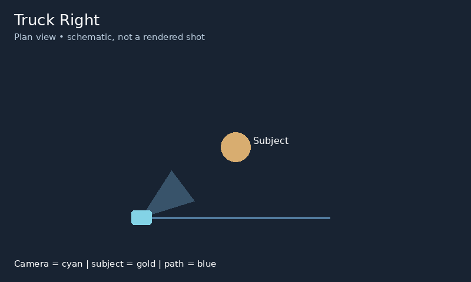
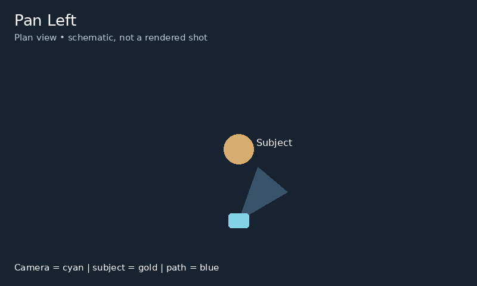
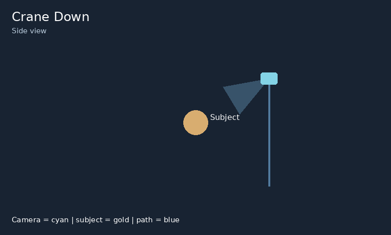
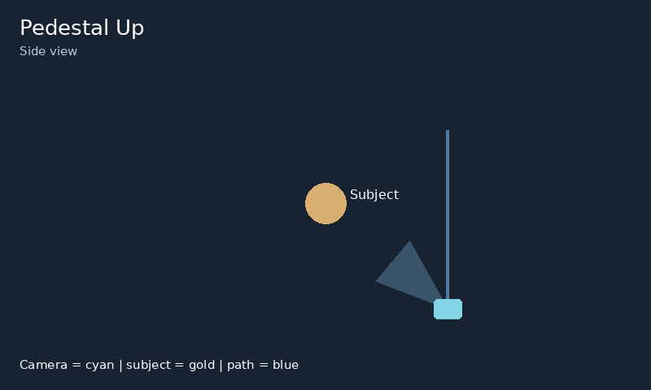
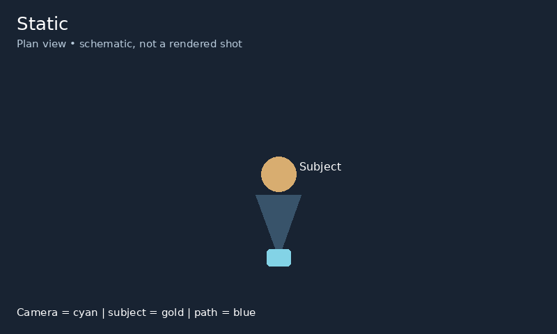
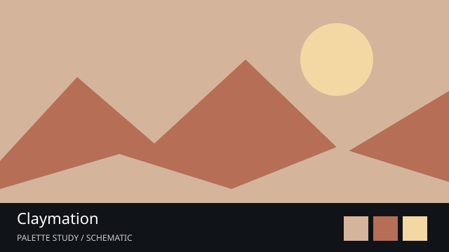
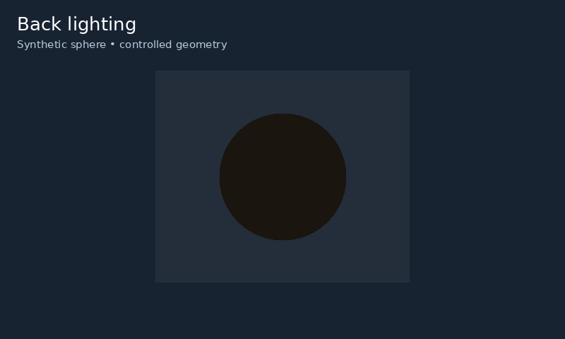
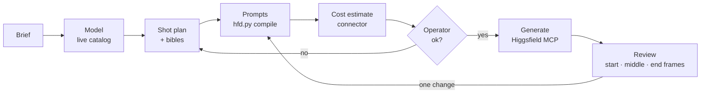

<div align="center">


# HIGGSFIELD DIRECTOR PRO

### Cinematic direction skill for AI-generated video · Claude Code & Codex

**Shot planning · Model-aware prompts · Credit budgeting · Generation with approval · Evidence-based review**


[](https://github.com/rniedson/higgsfield-director-pro-skill/actions/workflows/tests.yml)


[Illustrated manual](#illustrated-manual) · [Architecture](#architecture) · [Quick start](#quick-start) · [Examples](#examples) · [Disclaimer](#disclaimer) · [License](#licensing)

**English** · [Português](README.pt-BR.md)

</div>

> [!IMPORTANT]
> **Unofficial project.** Higgsfield Director PRO is an independent, community-made skill. It is **not made,
> affiliated with, endorsed, sponsored or supported by Higgsfield**. "Higgsfield" is used only to say which service
> the skill works with. For your account, credits, billing or the connector, contact Higgsfield; this repository
> cannot help with them. See [Disclaimer](#disclaimer).

> **Status:** version 5.1.0.
> The skill only *plans* on its own; video and images are generated by the official Higgsfield connector (MCP), with
> credits from your own account, and **only after the cost is shown and the operator says "ok"**.

## Illustrated manual

The [illustrated direction manual](docs/manual/README.md) has **11 parts and 185 schematic images**: camera movement,
framing, lenses and optics, lighting, color and styles, acting, physics and materials, time and editing, sound,
continuity and production. Each part gives the rule, a positive prompt, what to avoid and the illustrations. The
images explain direction; they are not renders and do not prove how a model behaves.

### Camera movement

Plan-view schematics of the movements the skill writes into prompts.

| | | | |
|:---:|:---:|:---:|:---:|
| <br>**Dolly in** | <br>**Dolly out** | <br>**Zoom in** | <br>**Zoom out** |
| <br>**Truck left** | <br>**Truck right** | <br>**Pan left** | <br>**Pan right** |
| <br>**Orbit clockwise** | <br>**Orbit counterclockwise** | <br>**Arc left** | <br>**Arc right** |
| <br>**Tilt up** | <br>**Tilt down** | <br>**Crane up** | <br>**Crane down** |
| <br>**Pedestal up** | <br>**Pedestal down** | <br>**Camera roll** | <br>**Static** |

Dolly moves the camera; zoom changes the lens. **One dominant movement per shot**, or explicit phases
(*"static, then a slow push-in"*).

### Visual styles

| | | | |
|:---:|:---:|:---:|:---:|
| <br>**Neo Noir** | <br>**Cyberpunk** | <br>**Luxury Editorial** | <br>**Art Deco** |
| <br>**Photorealism** | <br>**Analog Horror** | <br>**Claymation** | <br>**2D Anime** |

20 styles with ready prompts in [part 05](docs/manual/README.md#part-05--color-and-visual-styles).

### Lighting

| | | | |
|:---:|:---:|:---:|:---:|
| <br>**Front light** | <br>**Side light** | <br>**Top light** | <br>**Under light** |
| <br>**Cross light** | <br>**Back light** | <br>**Soft light** | <br>**Hard light** |

### The 11 parts

| Part | Topic | | Part | Topic |
|:---:|---|---|:---:|---|
| 01 | [Camera and movement](docs/manual/README.md#part-01--camera-and-movement) | | 07 | [Physics, materials and VFX](docs/manual/README.md#part-07--physics-materials-and-vfx) |
| 02 | [Framing and composition](docs/manual/README.md#part-02--framing-and-composition) | | 08 | [Time, transitions and editing](docs/manual/README.md#part-08--time-transitions-and-editing) |
| 03 | [Cameras, lenses and optics](docs/manual/README.md#part-03--cameras-lenses-and-optics) | | 09 | [Sound direction](docs/manual/README.md#part-09--audio-and-sound-direction) |
| 04 | [Cinematic lighting](docs/manual/README.md#part-04--cinematic-lighting) | | 10 | [Continuity and diagnostics](docs/manual/README.md#part-10--continuity-and-diagnostics) |
| 05 | [Color and visual styles](docs/manual/README.md#part-05--color-and-visual-styles) | | 11 | [Prompt engineering and production](docs/manual/README.md#part-11--prompt-engineering-and-production) |
| 06 | [Acting and emotion](docs/manual/README.md#part-06--acting-and-emotions) | | — | [Optical atlas, 100 studies](docs/manual/README.md#optical-atlas--100-studies) |

<details>
<summary><b>Boards, sheets and the optical atlas</b></summary>
<br>

| Optics | Character turnaround |
|:---:|:---:|
|  |  |
| **Product orthographic views** | **Warm luxury moodboard** |
|  |  |

| 24 mm | 50 mm | 85 mm | 135 mm |
|:---:|:---:|:---:|:---:|
|  |  |  |  |

Geometric studies of one object across lenses, distances and palettes; the full atlas has 100.

</details>

## Architecture

How the pieces talk to each other. The agent reads only `SKILL.md` up front; everything else is loaded when a step
needs it. `hfd.py` works offline, and the only path to spending credits goes through the Higgsfield connector,
after the quoted total and the operator's "ok".


| | Part | What it holds | When it comes in |
|:---:|---|---|---|
| **1** | [`SKILL.md`](higgsfield-director/SKILL.md) | scope, the 6-step flow, hard rules, who handles what (91 lines) | every request: the agent reads it first |
| **2** | [`references/`](higgsfield-director/references) | 6 guides: flow · prompt · vocabulary · models · connector · quality | only the guide the current step asks for |
| **3** | [`scripts/hfd.py`](higgsfield-director/scripts/hfd.py) | validate · compile · budget · export · optics · score · models | studio mode, before any credit is spent |
| **4** | [`data/`](higgsfield-director/data) | dated snapshot of 122 models + scoring weights | checking model limits without the connector |
| **5** | [`templates/`](higgsfield-director/templates) | 3-shot commercial, image-to-video, evaluation | starting a new project |
| **6** | [`tests/`](higgsfield-director/tests) | 61 cases, no dependencies, run in CI | before publishing a change |
| **7** | [`agents/openai.yaml`](higgsfield-director/agents/openai.yaml) | name and default prompt shown by Codex | Codex only |
| **+** | [`docs/manual/`](docs/manual/README.md) | illustrated manual: 11 parts, 185 images | learning the language of direction |

<details>
<summary><b>Full file tree</b></summary>
<br>

```text
higgsfield-director/            the skill: install THIS folder
  SKILL.md                      entry point: scope, flow, hard rules, routing (124 lines)
  agents/openai.yaml            display name and default prompt for the Codex UI
  references/
    workflow.md                 brief, studio mode, bibles, project fields, delivery
    preproduction.md            idea, script draft, two-phase sketch storyboard, locked script, audio route
    prompt.md                   golden order, per-model notes, recipes, examples
    vocabulary.md               camera, framing, lens, light, color, physics, acting, audio
    models.md                   choosing a model, snapshot table, refreshing the snapshot
    connector.md                Higgsfield MCP in Claude and Codex, bundled workflows, call order
    quality.md                  pre-spend checklist, diagnostics, frames, scoring
    modes.md                    first use; follow, price and ceiling modes
    calibration.md              blind test with and without the skill, and the record
  scripts/hfd.py                validate, compile, budget, export, optics, score, models, crop, blind, result
  scripts/calibrate_claude_code.sh  runs both calibration conditions in Claude Code
  data/models.json              dated snapshot of the connector catalog (122 models)
  data/weights.json             scoring weights
  templates/                    3-shot commercial, image-to-video, evaluation
  tests/                        83 unittest cases
calibration/                    blind-test records and the scoreboard source
lessons-learned/                lessons that changed the skill, each with its source
docs/
  MIGRATION-6.md                every name from before 6.0 and its English name
  RC3-EVALUATION.md             evaluation of the previous package and what v5 kept
  assets/emblem.svg             emblem
  manual/                       illustrated direction manual: README (11 parts), visual/ (185 images + catalog)
tools/check_repo.py             skill format, JSON, links, anchors and language (run by CI)
tools/aggregate_calibration.py  builds the scoreboard in both READMEs from calibration/
.github/                        CI workflow, issue and pull request templates
AGENTS.md · CLAUDE.md · CHANGELOG.md · CONTRIBUTING.md · SECURITY.md
```

</details>

## Contents

- [Illustrated manual](#illustrated-manual)
- [Architecture](#architecture)
- [Overview](#overview)
- [With and without the skill](#with-and-without-the-skill)
- [Your way: modes and calibration](#your-way-modes-and-calibration)
- [What changed in v5](#what-changed-in-v5)
- [Capabilities](#capabilities)
- [Quick start](#quick-start)
- [Examples](#examples)
- [`hfd.py` reference](#hfdpy-reference)
- [Choosing a model](#choosing-a-model)
- [Scope and coexistence](#scope-and-coexistence)
- [Quality and security](#quality-and-security)
- [Editions and history](#editions-and-history)
- [Roadmap](#roadmap)
- [Documentation](#documentation)
- [Disclaimer](#disclaimer)
- [Licensing](#licensing)

Portuguese translation: [README.pt-BR.md](README.pt-BR.md).

## Overview

Higgsfield Director PRO is an **agent skill** (`higgsfield-director`) that turns a creative request into well-directed
AI-generated shots: it picks the model from the live catalog, writes one prompt per shot in the order the official
guides recommend, keeps characters and products consistent across shots, prices the job in credits, waits for approval,
generates through the Higgsfield connector and reviews the result with evidence.

It is tested in **Claude Code** and locally in **Codex** for planning and CLI checks. Authenticated Higgsfield
quoting and generation have not yet been tested from Codex. The skill replies in the operator's language and writes
prompts in English, which video models follow more predictably.



Without the connector the skill runs in **planning-only mode**: it delivers prompts and parameters ready to paste on the
Higgsfield site, and says that the cost must be checked there.

## With and without the skill

The Higgsfield connector is **the camera and the studio**: it generates whatever you ask, the way you ask. The skill is
**the directing crew** beside Claude: it plans the shots, keeps continuity, does the budget and reviews the result.
The same request, both ways:

| Step | Claude + the connector only | With the skill |
|---|---|---|
| 1. Plan | one prompt per request, scene by scene | the request becomes a shot plan with durations, order and total cost, before a single credit is spent (in one test, a 7-minute spoken script became 36 shots) |
| 2. Write the prompt | free text, in a different order each time | always the same order (who, where, action, camera, light, end state), in English, with the project's rules in every shot, one moment of impact per shot in ads, and [recipes against common defects](higgsfield-director/references/prompt.md) |
| 3. Check before spending | nothing checks | `hfd.py validate` checks the model's limits, whether the dialogue fits the duration, continuity and camera (in one test it stopped a shot with two camera moves) |
| 4. Cost | depends on each connector workflow | per-shot cost from the connector, separate test and final versions, and an explicit "ok" before any spending |
| 5. Continuity | each shot comes out on its own | character, product and location sheets repeated in every shot; a product with no photo first gets a reference image, because text alone does not hold its design ([measured](#what-we-measured)); the last frame of one shot becomes the first of the next |
| 6. Review | "does it look good?" by eye | frames from the start, middle and end, a score per criterion with evidence, and checks that cost no credits: transcribed speech, the loop seam, the model that actually ran |
| 7. Learn | the same mistake comes back next time | the mistake becomes a recipe in the skill's references |

**What does not change:**

- **The model and the price.** The skill does not make generation cheaper or the model better: it changes what is
  asked for, and when.
- **The connector's ready-made workflows** (product photos, creator videos, dubbing, ads…). There the skill steps
  aside and lets the connector lead.
- **The eye of someone who knows the subject.** The score measures whether the video obeyed the prompt, not whether
  the scene happens that way in real life. The skill asks that before spending, but you answer it.

**When it pays off:** work with several shots (commercial, trailer, corporate video, music clip). For a single image or
a ready-made connector workflow, you do not need it.

### What we measured

The table above is the promise. To check it, the same requests were made with and without the skill, on 24/11/2026.

**1. Planning: 18 automated Claude Code sessions, 9 with and 9 without the skill, with no credits spent.** There were
5 requests (a 3-shot commercial, a "go ahead and generate", product photos, a creator video and a single image), with
the generation tools blocked.

- For product photos and the creator video, both conditions picked the connector's ready-made workflow: the skill
  does not get in the way of what the connector already does.
- 17 of the 18 sessions got a quote from the connector before proposing a generation. The other one, without the
  skill, stopped before quoting when it noticed the generation tools were blocked.
- With the skill, the work took 34% longer overall (753 s against 564 s), and about 40% longer for a single image.
- **What could not be measured:** whether the skill prevents "spending without asking for an ok". With the generation
  tools blocked, no session could spend.

**2. The result: the generated commercial, judged blind (6 shots of 5 s, 90 credits).** It was a 3-shot running shoe
commercial: material detail, a run on a wet track at night, and the product as the hero at the end. Each condition's
prompts were generated on Cinema Studio 4.0 at 480p with sound, and the two videos got shuffled labels (X and Y). An
automated judge that saw only the request and the videos scored them, and a person voted without knowing which was
which.

| | With the skill | Without the skill |
|---|---|---|
| Blind judge score (0–100) | 70.7 | 71.3 |
| Camera (0–10) | **8.7** | 7.3 |
| Light (0–10) | **8.7** | 7.0 |
| Product identity (0–10) | 5.0 | **6.3** |
| Materials (0–10) | 7.7 | **8.3** |
| The person's blind vote | | **chosen**: "for the movement, action, emotion, sound" |

**It was a tie, and the person preferred the version made without the skill.**

- **Where the skill helped:** one clean camera move per shot and steady light. Without it, the model cut one shot into
  three on its own, and the last second came out blurred and blown out.
- **Where it lost, because of its own rules:**
  1. **Prompts that were too restrained.** A sliding water drop and a sideways slide looked correct and flat next to a
     fingertip pressing the knit, slow-motion splashes and a bass hit on the final frame.
  2. **Camera move against end state.** The text asked for a push-in to a close-up and for the whole product at the
     end. The model followed the move and cropped the product.
  3. **Product described in text only.** In a close-up of the knit alone, the model drew a shoe with no laces. Both
     conditions warned about the risk, but neither proposed generating a product reference image first.

The three points became rules in this version ([prompt](higgsfield-director/references/prompt.md),
[quality](higgsfield-director/references/quality.md)).

**3. The rematch, with the fixed skill (2 rounds, 152 credits).** With the three fixes in, the same method ran again,
with its own X and Y draw in each round. Round 1 was the same running shoe commercial, now with the same product photo
in both conditions (generated first, for 2 credits). Round 2 was a 3-shot 16:9 trailer: a lighthouse keeper on a
stormy night. The connector's copyright filter rejected the middle shot in both conditions, with no charge, so the
comparison uses shots 1 and 3.

| Round | Blind judge score, with the skill | Without the skill | The person's blind vote |
|---|---|---|---|
| 1 · running shoe commercial, with the product photo | **82.5** | 73.8 | with the skill |
| 2 · lighthouse trailer (shots 1 and 3) | **78.0** | 69.8 | with the skill |

**The person chose the version with the skill in both rounds**, "for the whole: how one scene connects to the next,
more organic". The blind judge, which scored each version per criterion with evidence, chose the same.

- **What decided it, according to the judge.** In round 1, with the skill the shoe from the photo stayed the same in
  all three shots, and the night stadium ties the first shot to the last. Without it, the model gave the shoe a sole
  that lights up blue and showed the white shoe as grey: in an ad, that is showing a different product. In round 2,
  without the skill shot 3 had two cuts nobody asked for, and the boat changed design halfway through.
- **What is still missing.** Sound: both conditions came out quiet (−22 to −32 LUFS, against about −14 for social
  platforms) with level jumps between shots. And, with the skill, the lighthouse's bands changed between shots and the
  colour drifted from cold to warm.

**Caution, raised by the person who voted:** in both rounds the version with the skill drew X and was shown first, on
the left, and "having seen it first may also affect the choice". Two rounds cannot separate that effect. So `hfd.py
blind` now draws, separately, which version is shown first, and the record keeps the order so the scoreboard can
measure it. The sample is still small: three rounds and one voter.

### Calibration scoreboard

Every blind round, ours or from anyone who uses the skill, comes in here by pull request
([how to send yours](calibration/README.md)).

<!-- calibration:start -->
| Request type | Rounds | Chose with the skill | Chose without | Tie | Blind reviewer score, with × without |
|---|---:|---:|---:|---:|---|
| Product ad | 2 | 1 | 1 | 0 | 76.6 × 72.5 (2) |
| Trailer | 1 | 1 | 0 | 0 | 78.0 × 69.8 (1) |
| **Total** | 3 | 2 | 1 | 0 | |

By skill version (with × without): `5.1.0+982e7fa`: 0 × 1; `5.1.0+e4dee7b`: 2 × 0.

The version seen first was chosen in 2 of 2 round(s) with the order recorded.

Generated by `tools/aggregate_calibration.py` from 3 record(s) in `calibration/`.
<!-- calibration:end -->

## Your way: modes and calibration

People work differently. The first time in a project, the skill asks how you want to work and stores the answer in
`.higgsfield-director/preferences.json`, in the project folder ([modos.md](higgsfield-director/references/modes.md)).

| Mode | For whom | What happens |
|---|---|---|
| `follow` (follow along) | wants to see and approve every step | every image and every video comes to you, with the skill's pre-check beside it, and nothing moves on without your approval |
| `price` (price only) | only wants to know the price | the skill decides the plan and shows the total; one "ok" covers the whole package |
| `ceiling` (ceiling) | does not want to be asked | you say in the conversation how many credits it may spend this session; it shows the running total and stops at the ceiling |

The file stores **how** to work, never **how much** to spend: `hfd.py` rejects a file with a ceiling or any other
field, and spending authorization still comes only from the conversation.

**Blind calibration.** In the same question, the skill offers a test with and without it, on a request of yours, so
you can see whether it makes a difference to your work ([calibracao.md](higgsfield-director/references/calibration.md)).
In Claude Code, `scripts/calibrate_claude_code.sh` runs both conditions without spending. Then `hfd.py blind` draws X, Y
and the order, you vote, and `hfd.py result` builds a record with allowlisted fields only: no prompts, media, names
or clients. If you want, the record becomes a pull request and joins the [scoreboard](#calibration-scoreboard). If the
skill loses, the loss shows where to fix it.

**Storyboard before video.** In studio mode, the skill first generates one still frame per shot, which costs a
fraction of the video, and moves to video only after the frame is approved
([fluxo.md](higgsfield-director/references/workflow.md)). This rule has not been measured blind yet.

**Cheap pre-production.** Before that, the idea matures where mistakes cost little: an idea in one sentence, a script
draft as a table, then a sketch storyboard in two phases. First the whole storyboard in one sketch sheet from the
cheapest image model; then each panel, cropped (`hfd.py crop`), becomes the reference for its own frame in a
cheap model that accepts references, so every frame keeps the same block figures and can be redone alone. Only after
the operator locks the script does the skill ask where to make the audio
([preproducao.md](higgsfield-director/references/preproduction.md)). Tested once, not measured blind.

## What changed in v5

v5 is a rewrite of the v4.1 RC3/RC4 package generated with ChatGPT. Every defect measured in RC3 became a test.
Full evaluation: [docs/RC3-EVALUATION.md](docs/RC3-EVALUATION.md).

| | v4.1 RC3 / RC4 | v5.1.0 |
|---|---|---|
| Skill | 328 files, 121 MB, 116 "commands" | 16 files, `SKILL.md` of 91 lines + 6 references read on demand |
| Code | 3 compilers, 2 optics, 3 budgets; SDK, REST, Docker | one `hfd.py`, Python standard library only |
| Models | 9 profiles, 7 with every field `null` | dated snapshot of **122 models** from the connector catalog, refreshable by command |
| Camera check | rejected *"static camera, no orbit"* | understands negation and phases; warns, does not block |
| Audio | moved Cinema Studio audio to post-production | reads native audio from the catalog (Cinema Studio 4.0 generates audio by default) |
| Generation | none | official Higgsfield MCP, after cost and explicit "ok" |
| Conflicts | generic "video" description | trigger anchored on *AI-generated / Higgsfield*, with named exclusions |
| Tests | 67 (2 needed OpenCV) | 61, no dependencies, CI on Python 3.9 to 3.13; 4 planted bugs, 4 caught |

## Capabilities

| Capability | How | Where |
|---|---|---|
| Brief and premises | asks only what blocks; the rest becomes a stated premise | [`fluxo.md`](higgsfield-director/references/workflow.md) |
| Model choice | by need (length, references, first/last frame, audio, cost), confirmed in the live catalog | [`models.md`](higgsfield-director/references/models.md) |
| Prompt writing | golden order, per-model notes, 18 recipes against common defects | [`prompt.md`](higgsfield-director/references/prompt.md) |
| Vocabulary | camera, framing, lens, light, color, physics, acting, audio | [`vocabulario.md`](higgsfield-director/references/vocabulary.md) |
| Illustrated manual | 11 parts, 185 schematic images: movement, lighting, styles, sheets, optical atlas | [`docs/manual`](docs/manual/README.md) |
| Continuity | bibles (character, product, place) with fixed attributes; boundary check between shots | `hfd.py validate` |
| 180° rule | camera positions against the action axis | `hfd.py validate` |
| Model limits | duration, aspect ratio, resolution, audio, image-to-video inputs | `hfd.py validate` + snapshot |
| Budget | real quotes from the connector + retries + reserve; refuses to invent prices | `hfd.py budget` |
| Generation | connector call order, bundled workflows, uploads, waiting | [`conector.md`](higgsfield-director/references/connector.md) |
| Review | pre-spend checklist, symptom → cause table, frames, weighted score with evidence | [`qualidade.md`](higgsfield-director/references/quality.md), `hfd.py score` |
| Delivery | script, shot list CSV, subtitles | `hfd.py export` |
| Working mode | follow every step, price only, or a ceiling said in the conversation; asked on first use | [`modes.md`](higgsfield-director/references/modes.md), `hfd.py preferences` |
| Pre-production | idea, script draft, two-phase sketch storyboard in block figures, locked script, where to make the audio | [`preproducao.md`](higgsfield-director/references/preproduction.md), `hfd.py crop` |
| Storyboard | one still frame per shot before the video | [`fluxo.md`](higgsfield-director/references/workflow.md) |
| Blind calibration | the same request with and without the skill; X, Y and order drawn; allowlisted record | [`calibracao.md`](higgsfield-director/references/calibration.md), `hfd.py blind`, `hfd.py result` |

## Quick start

Requirements: Claude Code and/or Codex, Python 3.9+ (standard library only). For generation, a Higgsfield account.

**1. Install the skill only where you will use it.** Link the `higgsfield-director/` folder (never the repository
root) into the `.claude/skills/` folder of the project. The skill then exists only in sessions opened in that project;
every other session stays as it was.

```bash
git clone https://github.com/rniedson/higgsfield-director-pro-skill.git
R="$PWD/higgsfield-director-pro-skill/higgsfield-director"
cd /path/to/your/project
mkdir -p .claude/skills && ln -s "$R" .claude/skills/higgsfield-director
```

To remove it, `rm .claude/skills/higgsfield-director` (no trailing slash: it deletes only the link). Sessions already
open may need a restart to see the change.

| Other scope | Command | Effect |
|---|---|---|
| Every Claude Code session | `ln -s "$R" ~/.claude/skills/higgsfield-director` | available in all projects at once |
| Codex | `ln -s "$R" ~/.agents/skills/higgsfield-director` | available in Codex sessions |

**2. Connect Higgsfield** (optional; without it the skill plans only). The connector is Higgsfield's own; this
unofficial repository does not ship it, change it or speak for it:

| Agent | How |
|---|---|
| Claude Code | enable the **Higgsfield** connector on claude.ai, then open a new session |
| Codex | `codex mcp add higgsfield --url https://mcp.higgsfield.ai/mcp` then `codex mcp login higgsfield` |

**3. Ask in plain language**, or call it by name (`/higgsfield-director` in Claude Code, `$higgsfield-director` in Codex):

```text
Write the prompt for a 5 s video of a steaming cup of coffee, the camera slowly moving closer. It's for Reels.
Plan a 3-shot commercial on Higgsfield for a white sneaker, vertical, and tell me how much it costs. Don't generate yet.
I made a woman walking in Kling and her feet slide on the floor. How do I fix the prompt?
```

## Examples

All outputs below are real runs of the bundled templates.

### 01 — Three-shot product commercial

A project declares the model, the bibles and the shots ([`templates/project.json`](higgsfield-director/templates/project.json)):

```json
{
  "model": "cinematic_studio_video_4_0",
  "aspect_ratio": "9:16",
  "bibles": {
    "P01": {
      "type": "product",
      "description": "A black glass perfume bottle with a faceted gold cap and a flat cream label reading NOIR",
      "fixed": {"color": "black", "cap": "gold"}
    }
  },
  "shots": [
    {"id": "T01", "duration": 5, "entities": ["P01"],
     "action": "A thin curl of mist drifts past the bottle and clears",
     "camera": "Static camera, locked off", "optics": "100mm macro look, shallow depth of field"}
  ]
}
```

```bash
python3 higgsfield-director/scripts/hfd.py compile higgsfield-director/templates/project.json --text
```

```text
## T01
A black glass perfume bottle with a faceted gold cap and a flat cream label reading NOIR. A dark studio with a
polished obsidian plinth. A thin curl of mist drifts past the bottle and clears. Extreme close-up on the cap, eye
level. Static camera, locked off. 100mm macro look, shallow depth of field. Single hard rim light from camera left,
deep black background. The cap fills the upper third of the frame. Keep the label flat, sharp and readable.

Audio: Low airy hum, a soft glass chime as the mist clears.

parameters: {"model": "cinematic_studio_video_4_0", "duration": 5, "aspect_ratio": "9:16", "resolution": "720p", "generate_audio": true}
```

The bible description opens every shot word for word, which is what holds the product's identity across generations.
Duration, aspect ratio, resolution and audio go to the **parameters**, not the prompt text.

### 02 — Budget before spending

```bash
python3 higgsfield-director/scripts/hfd.py budget higgsfield-director/templates/project.json --attempts 1
```

```json
{"base": 210.0, "reserve_pct": 20.0, "reserve": 42.0, "total": 252.0,
 "reminder": "the cost is the connector's estimate; generate only after the operator's ok with this total"}
```

Prices come from the connector's `estimate_video_cost` (free). Without them, `budget` refuses to run instead of
guessing.

### 03 — The validator catches a continuity break

Shot T02 starts with the bottle in red, but the bible fixes it as black:

```json
{
  "errors": ["T02 start: P01.color = 'red', but the bible fixes 'black'"],
  "warnings": ["cinematic_studio_video_4_0 has no multi-shot in the snapshot: each shot is a separate generation"]
}
```

Exit code 1. Intentional changes are declared per shot in `approved_changes: ["P01.color"]`.

### 04 — Camera direction check

| Camera text | Result |
|---|---|
| `static camera, no orbit` | accepted (negation understood) |
| `slow orbit around a static subject` | accepted: one movement, `orbit` |
| `static camera while the camera orbits` | warning: static and moving in the same phase |
| `slow dolly in while panning left` | warning: two movements at once (`dolly`, `pan`) |

### 05 — Optics

```bash
python3 higgsfield-director/scripts/hfd.py optics 85 2 1.8   # focal mm, distance m, f-number
```

```json
{"horizontal_fov_degrees": 23.91, "frame_width_m": 0.847,
 "focus_from_m": 1.972, "focus_to_m": 2.029, "hyperfocal_m": 133.88}
```

Thin-lens model on a 36 mm full-frame sensor: it describes the *look* to ask for, it is not a model parameter.

## `hfd.py` reference

| Command | Purpose |
|---|---|
| `validate PROJECT` | structure, camera, dialogue length, timeline, continuity, 180° axis, model limits |
| `compile PROJECT [--text]` | one prompt per shot + connector-ready `parameters` |
| `budget PROJECT [--reserve N]` | total credits from real quotes, retries and reserve |
| `export PROJECT DIR` | `script.md`, `shots.csv`, `subtitles.srt` |
| `optics F D N` | field of view, frame width, depth of field, hyperfocal |
| `score EVALUATION` | weighted score with evidence per criterion; critical failure blocks |
| `models [--type] [--search] [--id]` | read the model snapshot |
| `models --import LIST... --out FILE` | build a fresh snapshot from `models_explore` lists, outside the skill folder |
| `preferences [--mode M] [--calibrate C]` | read or store how the operator wants to work (`follow`, `price`, `ceiling`); never stores a spending ceiling |
| `blind --with A --without B --out FOLDER` | check both conditions have the same format and draw X, Y and the order; writes the key without showing it |
| `result --key K --vote X ... --out FILE` | build the allowlisted calibration record, ready for the scoreboard |
| `crop SHEET DIR NAME:x0,y0,x1,y1...` | writes the ffmpeg commands that crop a sketch sheet into frames; runs nothing, never overwrites |

`--snapshot FILE` makes `validate`, `compile`, `export` and `models` use another snapshot. JSON output. Exit code `1`:
the project has errors, listed in `errors`. Exit code `2`: usage, file or malformed input, with the message in `error`;
never a traceback. No network access; reads and writes only the paths given (without `--file`, `preferences` uses
`.higgsfield-director/preferences.json` in the current folder).

## Choosing a model

Source of truth is the **live catalog** (`models_explore`). The bundled snapshot (`data/models.json`, 24/11/2026,
66 video + 56 image models) is for offline work and validation, and always quoted with its date.

| Need | Start with |
|---|---|
| Long shot (up to 30 s) | Cinema Studio 4.0, Seedance 2.5, Kling 4.0, MAGI-2, Wan 3.0 |
| Cinema controls (camera body, lens, aperture, era, genre) | Cinema Studio 4.0 |
| Many references (identity, product, style) | Cinema Studio 4.0, Seedance 2.5 (up to 30 images) |
| First **and** last frame | Kling 3.0, Seedance 2.5, Wan 3.0, MiniMax H3, Veo 3.1 Lite |
| Native audio and dialogue | Cinema Studio 4.0, Seedance 2.5, Kling 3.0, Veo 3.1, Wan 3.0 |
| Readable text in an image | Nano Banana Pro, Ideogram 4.6 |

Measured quotes (5 s, 24/11/2026): Cinema Studio 4.0 = 15 / 35 / 80 credits at 480p / 720p / 1080p; Seedance 2.5 720p
= 35; Kling 3.0 = 7.5 to 10. Always re-quote. Full table: [`models.md`](higgsfield-director/references/models.md).

## Scope and coexistence

The skill is built to live next to other video skills without stealing their requests.

| The request is… | Who handles it |
|---|---|
| a prompt, shot or sequence **generated by AI**; model choice; generation cost; diagnosing a generated result | **this skill** |
| UGC, character sheet, product photoshoot, thumbnail, static ad, micro-drama, faceless video, dubbing | the Higgsfield connector's own bundled workflow; this skill adds only the cost-and-ok rule |
| editing recorded footage (cuts, subtitles, color, music) | a video-editing skill or the connector's `video-montage` workflow |
| voice, narration, music, sound effects | an audio skill |
| titles, descriptions, publishing | a publishing skill |

When another video skill needs **one** AI-generated shot, this skill writes and generates that shot; the rest of the
video stays with its owner.

## Quality and security

```bash
cd higgsfield-director && python3 -m unittest discover -s tests -v
cd .. && python3 tools/check_repo.py
```

| Check | Result |
|---|---|
| Unit tests | 83/83 skill tests and 5/5 repository-boundary tests passing locally in Codex on 25/11/2026; CI runs on Python 3.9 to 3.13 (no third-party packages for the skill) |
| Malformed input | 13 kinds of wrong types in a project, plus bad evaluations and budgets: reported as errors or exit code 2, never a traceback |
| Repository check | `tools/check_repo.py` passed in Codex and runs in CI: frontmatter, JSON, links, anchors, language and the public/private boundary |
| Mutation check | 4 planted bugs (negation ignored, boundary check off, audio dropped, unknown model silent): 4 caught |
| Skill format | frontmatter parsed as YAML; English description, 1013/1024 characters; every path cited in `SKILL.md` and references exists (tested) |
| Codex local workflow | The current project template validated with zero errors and compiled into 3 shots; the crop suite includes a real `ffmpeg` crop. The Higgsfield connector was configured, but its authenticated quote and generation tools were not available in this Codex session. No Higgsfield credits were spent. |
| Routing in Claude Code (headless, current English description) | 14/14 in each of 3 rounds (42/42), the last two after the connector-first change. Per round: 9 in Portuguese and 5 in English: 8 to this skill (3 quick prompts, 3 diagnostics, 1 studio plan that priced and stopped, 1 character sheet handed to the connector's workflow) and 6 to the skills that own them (render, recorded-footage editing ×2, voice ×2, motion graphics). Each answer came in the language of the request. In the last two rounds the studio plan listed the connector's live workflows before planning. Earlier rounds: the first Portuguese description missed 2 of 3 prompt requests and was fixed; the fixed one scored 9/9 |
| Spending in tests | 78 sessions (5 routing rounds, a 2-arm pilot and 18 sessions with and without the skill), 0 generation calls in them (generation tools blocked in the test); every session that priced a job stopped and asked for "ok". The generated round of the comparison (6 shots, 90 credits) was run separately, with the quote and the operator's ok |
| Pilot, text only (same 3-shot sneaker ad, Cinema Studio 4.0 480p, with and without the skill) | Both priced 45 credits with live quotes and stopped. With the skill: live workflow list checked, the model's live limits imported and validated, one camera move per shot, the same product description in all three prompts, a planned end frame, an "ok" scoped to those three shots. Without it: two camera moves in one shot and negative phrasing ("no logos, no text"). The generated video was measured later, blind: a tie, with the human vote for the version without the skill; in the rematch, after the fixes, the skill won both rounds (see [What we measured](#what-we-measured)) |

Security properties:

- `hfd.py` has no network access and no dependencies; it reads and writes only the paths it is given.
- Nothing is generated without the quoted total and an explicit "ok"; opening a preset or gallery never authorizes
  generation, and an "ok" does not carry over to the next request.
- Model capabilities come from the catalog (live, or the dated snapshot), never from memory.
- Real people's faces or voices only with consent declared by the operator; no minors in sensitive scenes; no
  impersonation of public figures (Higgsfield Terms, sections 4.2 and 5, updated 23/10/2026).

## Editions and history

Every change, including the earlier editions (v1.0 to v4.1 RC4), is in [CHANGELOG.md](CHANGELOG.md).

Versions up to v4.1 were generated with ChatGPT and are kept outside this repository; what was reused and why is in
[docs/RC3-EVALUATION.md](docs/RC3-EVALUATION.md).

## Roadmap

| Priority | Goal | Status |
|---|---|---|
| P1 | Rematch with and without the skill, after the fixes, with the same product reference image in both conditions | Done on 24/11/2026: the skill won both rounds (see [What we measured](#what-we-measured)) |
| P1 | Calibrations from other people, with the order drawn, to separate the effect of which version is shown first | Open: [send yours](calibration/README.md) |
| P2 | Blind test of storyboard-before-video against going straight to video | Planned |
| P1 | Monthly refresh of the model snapshot | Process documented in `models.md` |
| P2 | Larger trigger evaluation set (more prompts, several runs each) | Planned |
| P2 | End-to-end run in Codex with the Higgsfield MCP configured | Open: local Codex checks passed on 25/11/2026; authenticated Higgsfield quoting and generation remain to be tested |

## Documentation

| Resource | Link |
|---|---|
| Skill entry point | [higgsfield-director/SKILL.md](higgsfield-director/SKILL.md) |
| Production flow | [references/workflow.md](higgsfield-director/references/workflow.md) |
| Prompt writing | [references/prompt.md](higgsfield-director/references/prompt.md) |
| Vocabulary | [references/vocabulary.md](higgsfield-director/references/vocabulary.md) |
| Models | [references/models.md](higgsfield-director/references/models.md) |
| Connector | [references/connector.md](higgsfield-director/references/connector.md) |
| Quality | [references/quality.md](higgsfield-director/references/quality.md) |
| Illustrated manual | [docs/manual/README.md](docs/manual/README.md) |
| Evaluation of v4.1 | [docs/RC3-EVALUATION.md](docs/RC3-EVALUATION.md) |
| Lessons learned | [lessons-learned/README.md](lessons-learned/README.md) |
| Changelog | [CHANGELOG.md](CHANGELOG.md) |
| Contributing | [CONTRIBUTING.md](CONTRIBUTING.md) |
| Security policy | [SECURITY.md](SECURITY.md) |

## Disclaimer

- **This is not an official Higgsfield product.** It is an independent project by Robson Niedson, not made,
  affiliated with, endorsed, sponsored or supported by Higgsfield. Higgsfield has not reviewed it.
- **The name is used only to describe compatibility.** "Higgsfield" says which service the skill works with. This
  repository does not use Higgsfield's logo, and its emblem is an original drawing.
- **Support is split.** Your Higgsfield account, credits, billing, the website and the MCP connector belong to
  Higgsfield: ask them. Issues here are only about the skill, `hfd.py` and this documentation.
- **Credits are yours.** Every generation runs on your own Higgsfield account, under Higgsfield's terms. The skill
  asks for your "ok" first, but you are responsible for what you approve.
- **Facts about models and prices can be out of date.** The model snapshot and the measured quotes are dated; the
  live catalog and Higgsfield's own quotes always win.
- **No warranty.** The software is provided "as is", as the [MIT License](LICENSE) says.

## Licensing

- Code and skill text: [MIT](LICENSE), © 2026 Robson Niedson.
- Illustrated manual (`docs/manual/`, text and images) and the emblem (`docs/assets/`):
  [CC BY-SA 4.0](docs/manual/LICENSE-DOCS.md). The text is adapted from the v4.1 illustrated package, with the changes
  listed at the end of the manual; the images are schematic drawings made by code.
- Higgsfield, Kling, Seedance, Veo, Wan, MiniMax and other names are trademarks of their owners. The licenses above
  give no right to use them. This project is independent and not affiliated with or endorsed by any of them.

<div align="center">

**Higgsfield Director PRO — cinematic direction for AI-generated video**

Unofficial, independent project · not affiliated with or endorsed by Higgsfield

[Back to top](#higgsfield-director-pro) · [Leia em português](README.pt-BR.md)

</div>
