<div align="center">

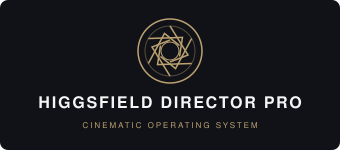

# HIGGSFIELD DIRECTOR PRO

### Skill de direção de cinema para vídeo gerado por IA · Claude Code e Codex

**Plano de tomadas · Prompt por modelo · Orçamento em créditos · Geração com aprovação · Revisão com evidência**


[](https://github.com/rniedson/higgsfield-director-pro-skill/actions/workflows/tests.yml)


[Manual ilustrado](#manual-ilustrado) · [Arquitetura](#arquitetura) · [Começo rápido](#começo-rápido) · [Exemplos](#exemplos) · [Aviso](#aviso) · [Licenças](#licenças)

[English](README.md) · **Português**

</div>

> [!IMPORTANT]
> **Projeto não oficial.** O Higgsfield Director PRO é uma skill independente, feita pela comunidade. **Não é feita,
> aprovada, patrocinada nem mantida pelo Higgsfield, e não tem vínculo com ele.** O nome "Higgsfield" aparece só para
> dizer com qual serviço a skill funciona. Para conta, créditos, cobrança ou o conector, fale com o Higgsfield; este
> repositório não resolve isso. Veja o [Aviso](#aviso).

> **Estado:** versão 5.1.0, mais as mudanças do `main` listadas em *Unreleased* no [CHANGELOG](CHANGELOG.md).
> Sozinha, a skill só *planeja*: vídeo e imagem são gerados pelo conector oficial do Higgsfield (MCP), com créditos da
> sua conta, e **só depois que o custo é mostrado e o operador diz "ok"**.

## Manual ilustrado

O [manual ilustrado de direção](docs/manual/README.md) tem **11 partes e 185 imagens esquemáticas**: movimento de
câmera, enquadramento, lentes e óptica, luz, cor e estilos, atuação, física e materiais, tempo e montagem, som,
continuidade e produção. Cada parte traz a regra, um prompt positivo, o que evitar e as ilustrações. As imagens explicam
a direção; não são renders e não provam como um modelo se comporta.

### Movimentos de câmera

Esquemas vistos de cima dos movimentos que a skill escreve nos prompts.

| | | | |
|:---:|:---:|:---:|:---:|
| 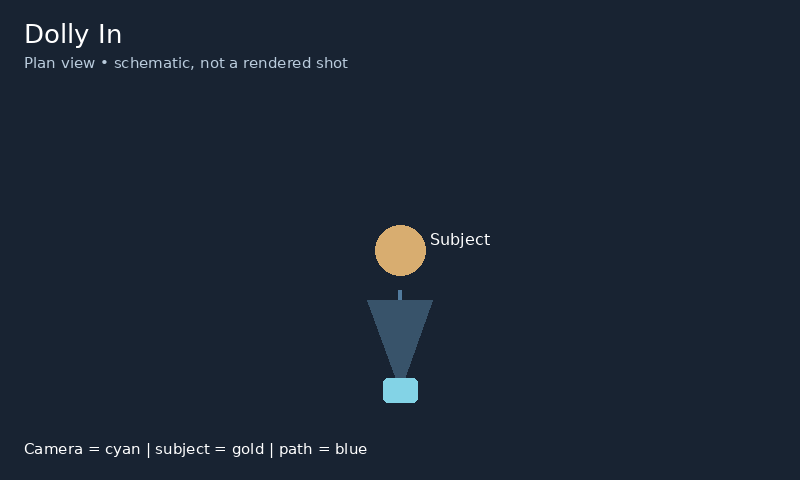<br>**Dolly in** | <br>**Dolly out** | <br>**Zoom in** | <br>**Zoom out** |
| 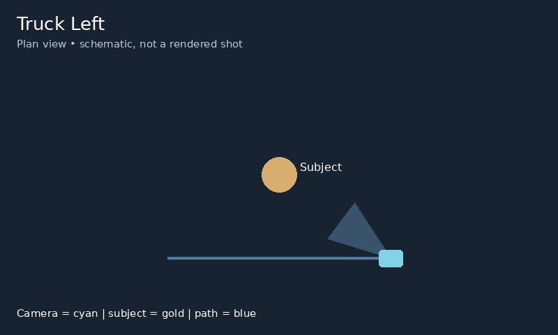<br>**Truck left** | 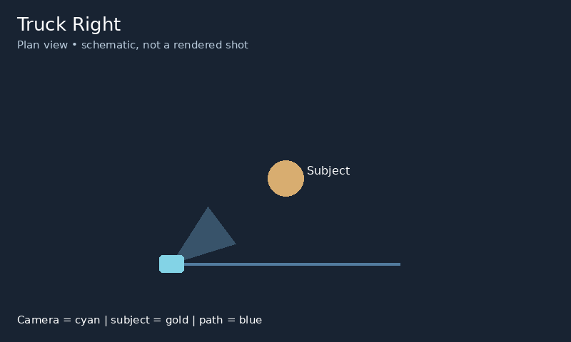<br>**Truck right** | 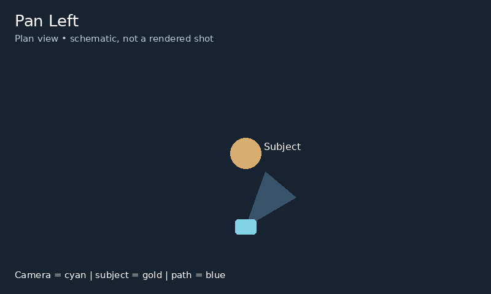<br>**Pan left** | <br>**Pan right** |
| <br>**Orbit clockwise** | 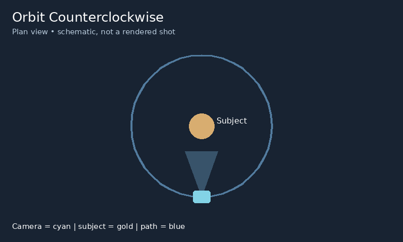<br>**Orbit counterclockwise** | <br>**Arc left** | <br>**Arc right** |
| <br>**Tilt up** | <br>**Tilt down** | <br>**Crane up** | 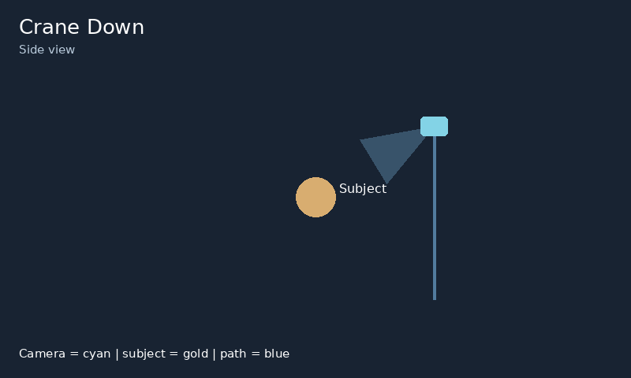<br>**Crane down** |
| 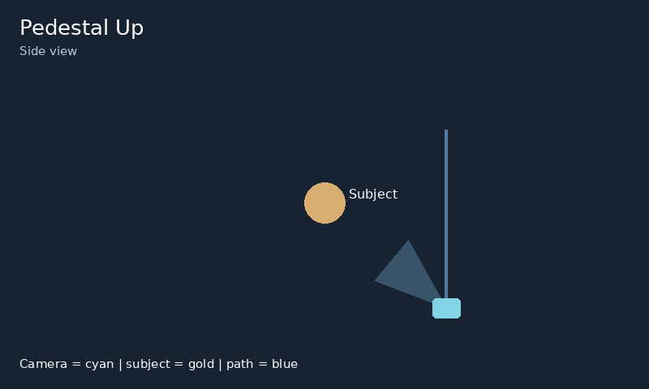<br>**Pedestal up** | <br>**Pedestal down** | 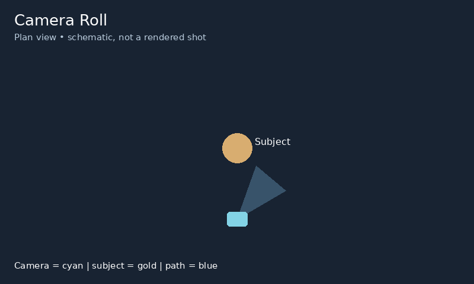<br>**Camera roll** | 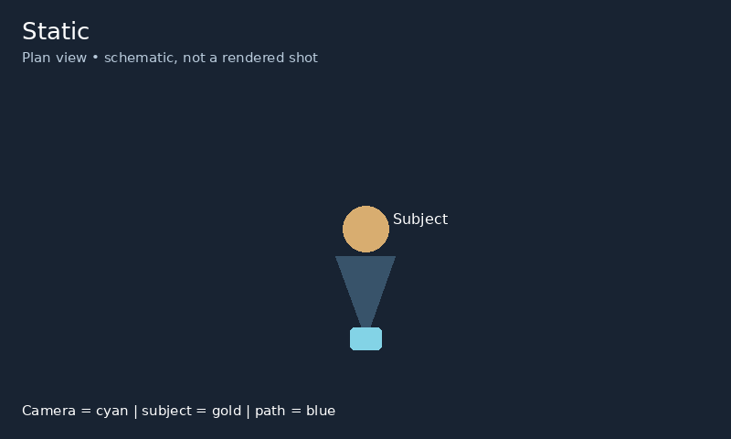<br>**Static** |

Os nomes ficam em inglês porque é assim que entram no prompt. Dolly anda com a câmera; zoom muda a lente. **Um
movimento principal por tomada**, ou fases explícitas (*"static, then a slow push-in"*).

### Estilos visuais

| | | | |
|:---:|:---:|:---:|:---:|
| 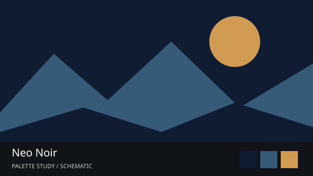<br>**Neo Noir** | 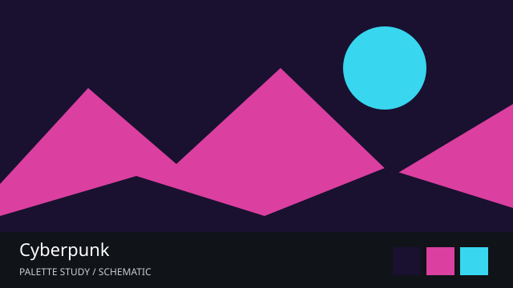<br>**Cyberpunk** | 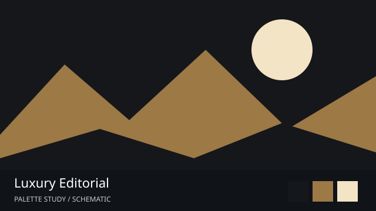<br>**Luxury Editorial** | 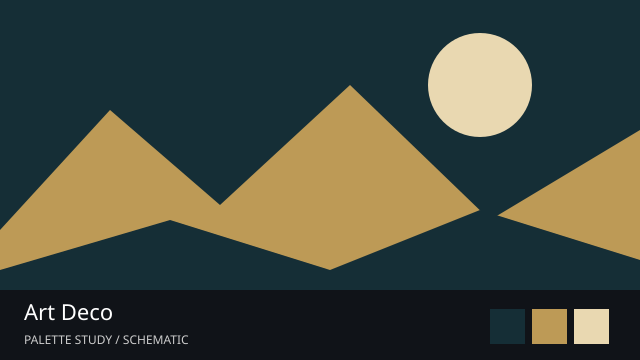<br>**Art Deco** |
| <br>**Photorealism** | 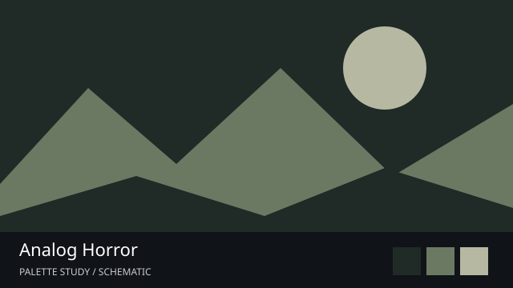<br>**Analog Horror** | 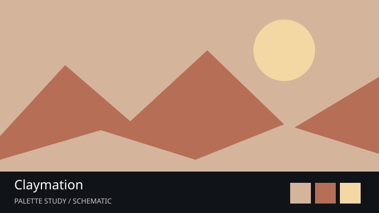<br>**Claymation** | <br>**2D Anime** |

São 20 estilos com prompt pronto na [parte 05](docs/manual/README.md#part-05--color-and-visual-styles).

### Luz

| | | | |
|:---:|:---:|:---:|:---:|
| <br>**Luz frontal** | 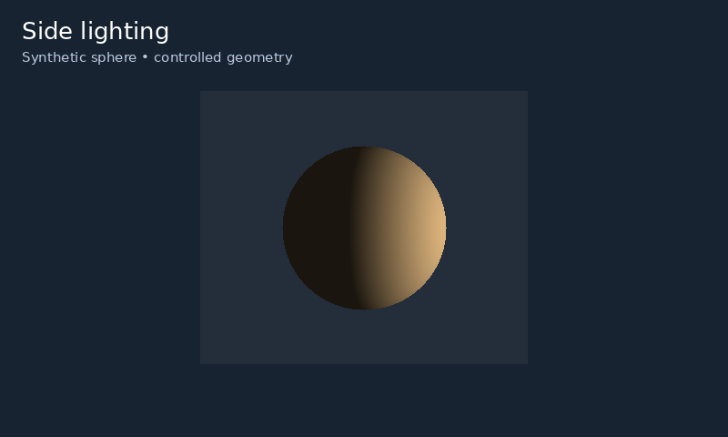<br>**Luz lateral** | 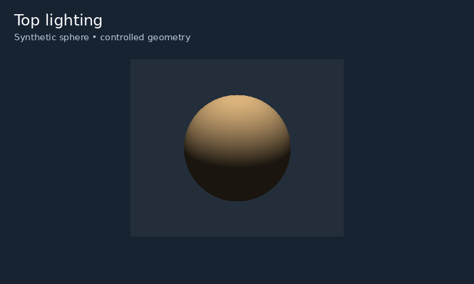<br>**Luz de cima** | 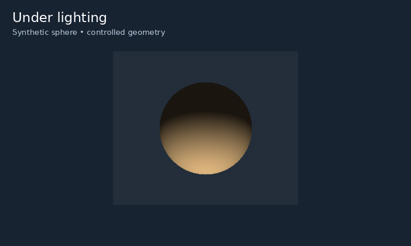<br>**Luz de baixo** |
| 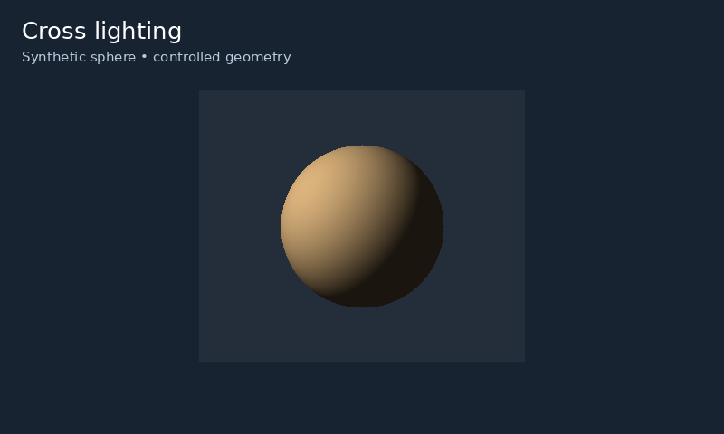<br>**Luz cruzada** | 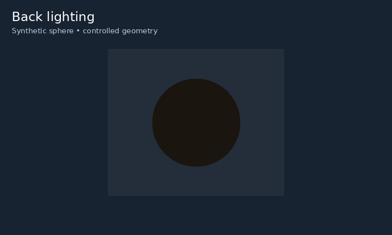<br>**Contraluz** | 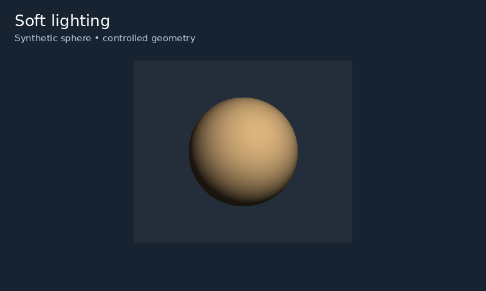<br>**Luz suave** | 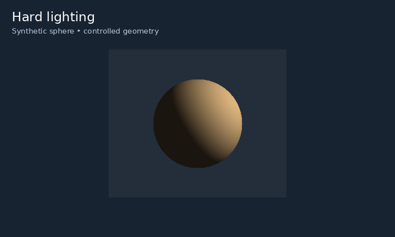<br>**Luz dura** |

### As 11 partes

| Parte | Tema | | Parte | Tema |
|:---:|---|---|:---:|---|
| 01 | [Câmera e movimento](docs/manual/README.md#part-01--camera-and-movement) | | 07 | [Física, materiais e VFX](docs/manual/README.md#part-07--physics-materials-and-vfx) |
| 02 | [Enquadramento e composição](docs/manual/README.md#part-02--framing-and-composition) | | 08 | [Tempo, transições e edição](docs/manual/README.md#part-08--time-transitions-and-editing) |
| 03 | [Câmeras, lentes e óptica](docs/manual/README.md#part-03--cameras-lenses-and-optics) | | 09 | [Áudio e direção sonora](docs/manual/README.md#part-09--audio-and-sound-direction) |
| 04 | [Iluminação cinematográfica](docs/manual/README.md#part-04--cinematic-lighting) | | 10 | [Continuidade e diagnóstico](docs/manual/README.md#part-10--continuity-and-diagnostics) |
| 05 | [Cor e estilos visuais](docs/manual/README.md#part-05--color-and-visual-styles) | | 11 | [Engenharia de prompts e produção](docs/manual/README.md#part-11--prompt-engineering-and-production) |
| 06 | [Atuação e emoções](docs/manual/README.md#part-06--acting-and-emotions) | | — | [Atlas óptico, 100 estudos](docs/manual/README.md#optical-atlas--100-studies) |

<details>
<summary><b>Pranchas, fichas e o atlas óptico</b></summary>
<br>

| Óptica | Ficha de personagem (turnaround) |
|:---:|:---:|
| 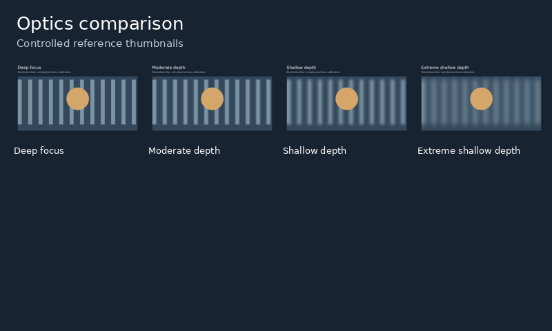 | 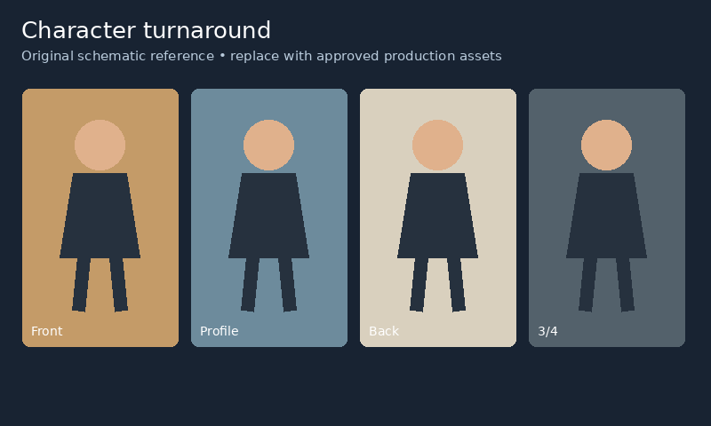 |
| **Vistas ortográficas do produto** | **Moodboard de luxo quente** |
| 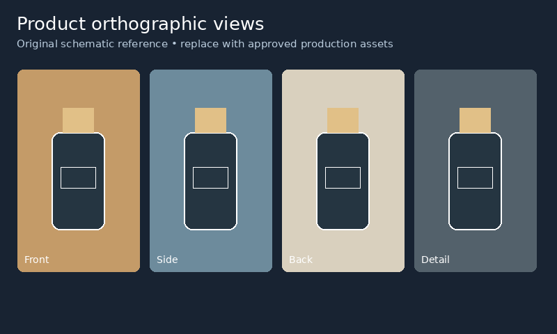 |  |

| 24 mm | 50 mm | 85 mm | 135 mm |
|:---:|:---:|:---:|:---:|
| 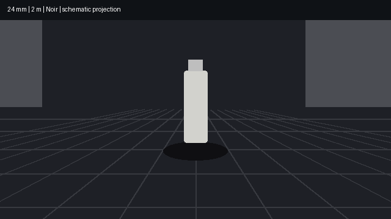 |  |  | 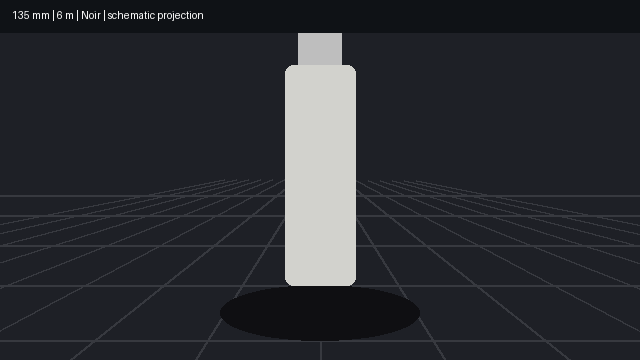 |

Estudos geométricos de um mesmo objeto em lentes, distâncias e paletas diferentes; o atlas completo tem 100.

</details>

## Imagens de referência

Como é uma boa referência. Estas três foram geradas para um dos testes da skill (GPT Image 2.6 pelo Higgsfield,
25/11/2026); os prompts que as fizeram, e como um prompt de vídeo as nomeia, estão em
[`higgsfield-director/examples/references`](higgsfield-director/examples/references/README.md).

| | | |
|:---:|:---:|:---:|
| 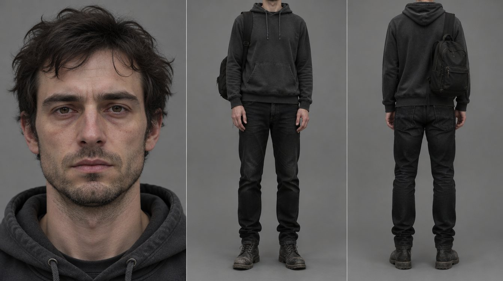<br>**Ficha de personagem**<br>um rosto; o corpo cortado no pescoço | 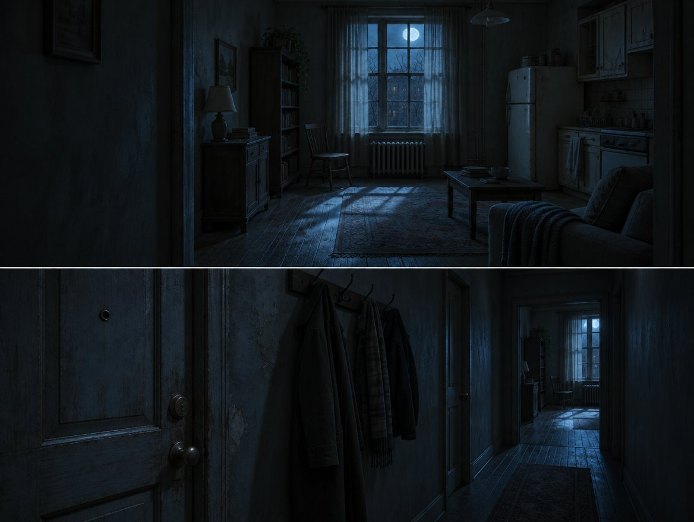<br>**Locação em duas vistas**<br>a sala e a entrada, sem pessoas | 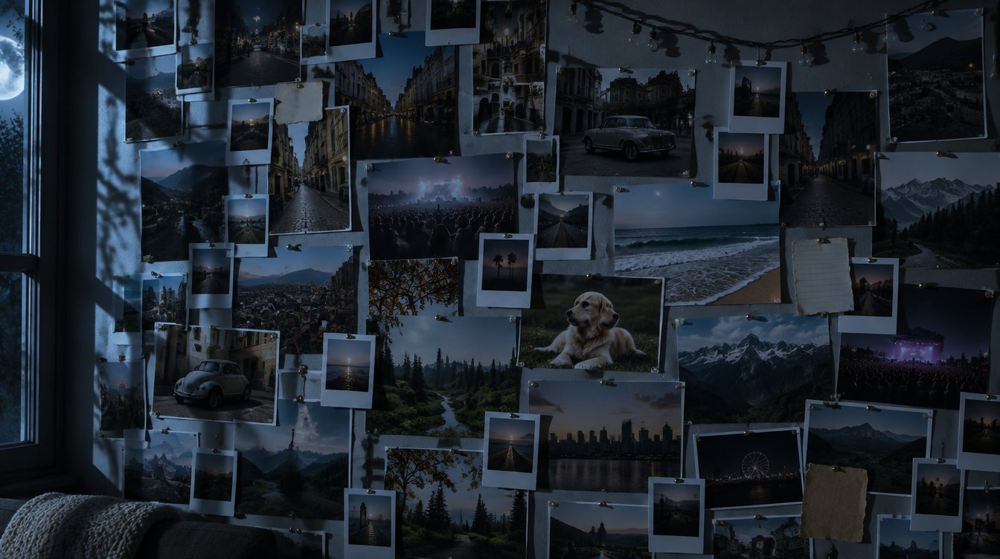<br>**Um detalhe do cenário**<br>o detalhe em que a ação termina |

Cada referência diz o que traz e o que fica fora do plano: a ficha dá a identidade, e o fundo cinza dela nunca
entra na cena.

## Arquitetura

Como as peças conversam. O agente lê só o `SKILL.md` de início; o resto entra quando um passo pede. O `hfd.py`
trabalha sem rede, e o único caminho que gasta crédito passa pelo conector do Higgsfield, depois do total cotado e do
"ok" do operador.

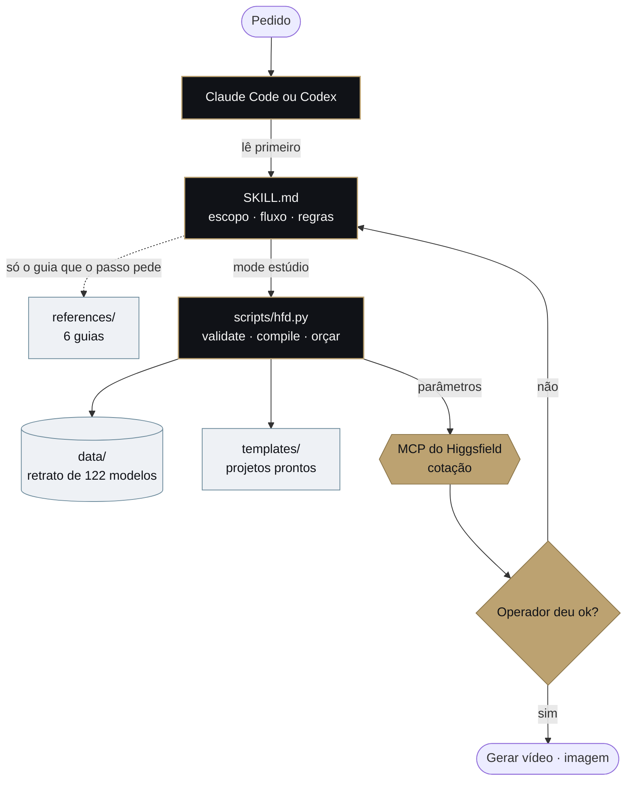

| | Peça | O que guarda | Quando entra |
|:---:|---|---|---|
| **1** | [`SKILL.md`](higgsfield-director/SKILL.md) | escopo, o fluxo em 6 passos, regras duras, quem cuida do quê (91 linhas) | em todo pedido: o agente lê primeiro |
| **2** | [`references/`](higgsfield-director/references) | 6 guias: fluxo · prompt · vocabulário · modelos · conector · qualidade | só o guia que o passo atual pede |
| **3** | [`scripts/hfd.py`](higgsfield-director/scripts/hfd.py) | validar · compilar · orçar · exportar · óptica · nota · modelos | no modo estúdio, antes de gastar crédito |
| **4** | [`data/`](higgsfield-director/data) | retrato datado de 122 modelos + pesos da nota | para conferir limites sem o conector |
| **5** | [`templates/`](higgsfield-director/templates) | comercial de 3 tomadas, imagem-para-vídeo, avaliação | ao começar um projeto |
| **6** | [`tests/`](higgsfield-director/tests) | 61 testes, sem dependências, rodados no CI | antes de publicar uma mudança |
| **7** | [`agents/openai.yaml`](higgsfield-director/agents/openai.yaml) | nome e prompt padrão que o Codex mostra | só no Codex |
| **+** | [`docs/manual/`](docs/manual/README.md) | manual ilustrado: 11 partes, 185 imagens | para aprender a linguagem da direção |

<details>
<summary><b>Árvore completa de arquivos</b></summary>
<br>

```text
higgsfield-director/            a skill: é ESTA pasta que se instala
  SKILL.md                      entrada: escopo, fluxo, regras duras, roteamento (124 linhas)
  agents/openai.yaml            nome e prompt padrão na interface do Codex
  references/
    workflow.md                 briefing, modo estúdio, fichas, campos do projeto, entrega
    preproduction.md            ideia, esboço de roteiro, croqui em duas fases, roteiro travado, rota do áudio
    prompt.md                   ordem de ouro, notas por modelo, receitas, exemplos
    vocabulary.md               câmera, plano, lente, luz, cor, física, atuação, áudio
    models.md                   escolher modelo, tabela do retrato, atualizar o retrato
    connector.md                MCP do Higgsfield no Claude e no Codex, fluxos prontos, ordem das chamadas
    quality.md                  checklist antes de gastar, diagnóstico, quadros, nota
    modes.md                    primeiro uso; modos follow, price e ceiling
    calibration.md              teste às cegas com e sem a skill, e o registro
  scripts/hfd.py                validate, compile, budget, export, optics, score, models, crop, blind, result
  scripts/calibrate_claude_code.sh  roda as duas condições da calibração no Claude Code
  data/models.json              retrato datado do catálogo do conector (122 modelos)
  data/weights.json             pesos da nota
  templates/                    comercial de 3 tomadas, imagem-para-vídeo, avaliação
  tests/                        83 testes (unittest)
calibration/                    registros do teste às cegas, fonte do placar
lessons-learned/                lições que mudaram a skill, cada uma com a fonte
docs/
  MIGRATION-6.md                cada nome de antes da 6.0 e o nome em inglês
  RC3-EVALUATION.md             avaliação do pacote anterior e o que a v5 aproveitou
  assets/emblem.svg             emblema
  manual/                       manual ilustrado: README (11 partes), visual/ (185 imagens + catálogo)
tools/check_repo.py             formato da skill, JSON, links, âncoras e língua (rodado pelo CI)
tools/aggregate_calibration.py  monta o placar nos dois READMEs a partir de calibration/
.github/                        CI, modelos de issue e de pull request
AGENTS.md · CLAUDE.md · CHANGELOG.md · CONTRIBUTING.md · SECURITY.md
```

</details>

## Sumário

- [Manual ilustrado](#manual-ilustrado)
- [Imagens de referência](#imagens-de-referência)
- [Arquitetura](#arquitetura)
- [Visão geral](#visão-geral)
- [Com e sem a skill](#com-e-sem-a-skill)
- [Do seu jeito: modos e calibração](#do-seu-jeito-modos-e-calibração)
- [O que mudou na v5](#o-que-mudou-na-v5)
- [Recursos](#recursos)
- [Começo rápido](#começo-rápido)
- [Exemplos](#exemplos)
- [Referência do `hfd.py`](#referência-do-hfdpy)
- [Como escolher o modelo](#como-escolher-o-modelo)
- [Escopo e convivência](#escopo-e-convivência)
- [Qualidade e segurança](#qualidade-e-segurança)
- [Edições e histórico](#edições-e-histórico)
- [Próximos passos](#próximos-passos)
- [Documentação](#documentação)
- [Aviso](#aviso)
- [Licenças](#licenças)

In English: [README.md](README.md).

## Visão geral

O Higgsfield Director PRO é uma **skill de agente** (`higgsfield-director`) que transforma um pedido criativo em tomadas
geradas por IA bem dirigidas. Ela escolhe o modelo pelo catálogo ao vivo e escreve um prompt por tomada, na ordem que os
guias oficiais recomendam. Mantém personagem e produto iguais entre as tomadas, calcula o custo em créditos e espera a
aprovação. Depois gera pelo conector do Higgsfield e revisa o resultado com evidência.

Ela é testada no **Claude Code** e localmente no **Codex** para planejamento e comandos. A cotação e a geração
autenticadas pelo Higgsfield ainda não foram testadas a partir do Codex. A skill responde no idioma de quem pede e
escreve os prompts em inglês, que os modelos de vídeo seguem de forma mais previsível.

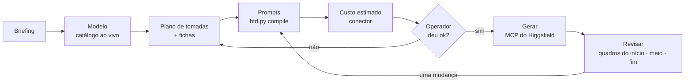

Sem o conector, a skill trabalha em **modo só planejamento**: entrega prompts e parâmetros prontos para colar no site do
Higgsfield e avisa que o custo deve ser conferido lá.

## Com e sem a skill

O conector do Higgsfield é **a câmera e o estúdio**: gera o que você pedir, do jeito que você pedir. A skill é **a
equipe de direção** ao lado do Claude: planeja as tomadas, cuida da continuidade, faz o orçamento e revisa o resultado.
O mesmo pedido, nos dois casos:

| Etapa | Só o Claude + o conector | Com a skill |
|---|---|---|
| 1. Planejar | um prompt por pedido, cena a cena | o pedido vira um plano de tomadas com duração, ordem e custo total, antes de gastar um crédito (num teste, um roteiro falado de 7 minutos virou 36 tomadas) |
| 2. Escrever o prompt | texto livre, numa ordem diferente a cada vez | sempre a mesma ordem (quem, onde, ação, câmera, luz, final), em inglês, com as regras do projeto em todas as tomadas, um momento de impacto por tomada nos anúncios e [receitas contra defeitos comuns](higgsfield-director/references/prompt.md) |
| 3. Conferir antes de gastar | nada confere | o `hfd.py validate` confere os limites do modelo, se a fala cabe no tempo, a continuidade e a câmera (num teste, barrou uma tomada com dois movimentos de câmera) |
| 4. Custo | depende de cada fluxo do conector | custo de cada tomada vindo do conector, versão de teste e versão final separadas, e o "ok" explícito antes de qualquer gasto |
| 5. Continuidade | cada tomada sai solta | fichas de personagem, produto e lugar repetidas em todas as tomadas; produto sem foto ganha antes uma imagem de referência, porque o texto sozinho não segura o desenho ([medido](#o-que-medimos)); o último quadro de uma tomada vira o primeiro da seguinte |
| 6. Avaliar | "ficou bom?" no olho | quadros do início, do meio e do fim, nota por critério com evidência, e conferências que não gastam crédito: a fala transcrita, a emenda do loop, o modelo que de fato rodou |
| 7. Aprender | o mesmo erro volta na próxima vez | o erro vira receita nas referências da skill |

**O que não muda:**

- **O modelo e o preço.** A skill não deixa a geração mais barata nem o modelo melhor: ela muda o que se pede e quando.
- **Os fluxos prontos do conector** (foto de produto, vídeo de criador, dublagem, anúncio…). Neles a skill sai da
  frente e deixa o conector conduzir.
- **O olho de quem conhece o assunto.** A nota mede se o vídeo obedeceu o prompt, não se a cena acontece assim na vida
  real. A skill pergunta isso antes de gastar, mas quem responde é você.

**Quando vale a pena:** em trabalho com várias tomadas (comercial, trailer, vídeo institucional, clipe). Para uma
imagem solta ou um fluxo pronto do conector, ela é dispensável.

### O que medimos

A tabela acima é a promessa. Para conferir, o mesmo pedido foi feito com e sem a skill, em 24/11/2026.

**Onde a skill está.** As rodadas às cegas mais recentes (26/11/2026, com a skill atual `5.1.0+7b60cfa`, que já tem
tudo o que está em *Unreleased* no [CHANGELOG](CHANGELOG.md)) foram **contra a skill**: a pessoa escolheu a versão
feita sem ela nas **2 de 2 rodadas**, enquanto o avaliador cego escolheu a versão com ela nas duas (77,5 × 60,0 e
72,0 × 62,0). A rodada anterior (`5.1.0+e4dee7b`) escolheu a skill nas 2 de 2, e a primeira (`5.1.0+982e7fa`), não.
Todas estão abaixo como saíram, com o que a pessoa disse e o que a skill mudou por causa disso; essa mudança ainda
não passou por uma rodada às cegas. A amostra é pequena: cinco rodadas, uma pessoa votando.

**1. O planejamento: 18 sessões automáticas do Claude Code, 9 com e 9 sem a skill, sem gastar crédito.** Foram 5
pedidos (um comercial de 3 tomadas, um "pode gerar", fotos de produto, um vídeo de criador e uma imagem solta), com as
ferramentas de gerar bloqueadas.

- Nas fotos de produto e no vídeo de criador, as duas condições escolheram o fluxo pronto do conector: a skill não
  atrapalha o que o conector já faz.
- 17 das 18 sessões cotaram pelo conector antes de propor uma geração. A outra, sem a skill, parou antes de cotar, ao
  notar que as ferramentas de gerar estavam bloqueadas.
- Com a skill, o trabalho levou 34% mais tempo no conjunto (753 s contra 564 s). Numa imagem solta, cerca de 40% a mais.
- **O que não deu para medir:** se a skill evita "gastar sem pedir ok". Com as ferramentas de gerar bloqueadas, nenhuma
  sessão podia gastar.

**2. A primeira rodada, com a skill `5.1.0+982e7fa`: o comercial gerado e julgado às cegas (6 tomadas de 5 s, 90 créditos).** Foi um comercial de tênis
de corrida em 3 tomadas: detalhe do material, corrida na pista molhada à noite e o produto como herói no fim. Os
prompts de cada condição foram gerados no Cinema Studio 4.0 em 480p, com som, e os dois vídeos ganharam rótulos
sorteados (X e Y). Um avaliador automático, que só via o pedido e os vídeos, deu as notas, e uma pessoa votou sem saber
qual era qual.

| | Com a skill | Sem a skill |
|---|---|---|
| Nota do avaliador cego (0–100) | 70,7 | 71,3 |
| Câmera (0–10) | **8,7** | 7,3 |
| Luz (0–10) | **8,7** | 7,0 |
| Identidade do produto (0–10) | 5,0 | **6,3** |
| Materiais (0–10) | 7,7 | **8,3** |
| Voto da pessoa, às cegas | | **escolhido**: "pelo movimento, ação, emoção, som" |

**Deu empate técnico, e a pessoa preferiu a versão feita sem a skill.**

- **Onde a skill ajudou:** um movimento de câmera limpo por tomada e a luz estável. Sem ela, o modelo cortou uma tomada
  em três planos por conta própria, e o último segundo saiu desfocado e estourado.
- **Onde ela perdeu, e por culpa das regras dela:**
  1. **Prompts contidos demais.** Uma gota escorrendo e um deslize lateral ficaram corretos e mornos, ao lado de um
     dedo apertando a malha, respingos em câmera lenta e um grave no quadro final.
  2. **Movimento contra estado final.** O texto pedia uma aproximação até o close e o produto inteiro no fim. O modelo
     seguiu o movimento e cortou o produto.
  3. **Produto só em texto.** Num close só da malha, o modelo desenhou um tênis sem cadarço. As duas condições avisaram
     do risco, mas nenhuma propôs gerar antes uma imagem de referência do produto.

Os três pontos viraram regras nesta versão ([prompt](higgsfield-director/references/prompt.md),
[qualidade](higgsfield-director/references/quality.md)).

**3. A revanche, com a skill corrigida `5.1.0+e4dee7b` (2 rodadas, 152 créditos).** Com as três correções, o mesmo método rodou de
novo, com um sorteio de X e Y por rodada. Na rodada 1, o mesmo comercial de tênis, agora com a mesma foto do produto
nas duas condições (gerada antes, por 2 créditos). Na rodada 2, um trailer de 3 tomadas em 16:9: um faroleiro numa
noite de tempestade. A tomada do meio foi recusada pelo filtro de direitos autorais do conector nas duas condições,
sem cobrança, e a comparação ficou com as tomadas 1 e 3.

| Rodada | Nota do avaliador cego, com a skill | Sem a skill | Voto da pessoa, às cegas |
|---|---|---|---|
| 1 · comercial de tênis, com a foto do produto | **82,5** | 73,8 | com a skill |
| 2 · trailer do faroleiro (tomadas 1 e 3) | **78,0** | 69,8 | com a skill |

**A pessoa escolheu a versão com a skill nas duas rodadas**, "pelo conjunto: a ligação de uma cena com outra, mais
orgânico". O avaliador cego, que pontuou cada versão por critério e com evidência, escolheu a mesma.

- **O que decidiu, segundo o avaliador.** Na rodada 1, com a skill o tênis da foto ficou igual nas três tomadas, e o
  estádio à noite liga a primeira tomada à última. Sem ela, o modelo pôs uma sola que acende em azul e deixou o tênis
  branco cinza: num anúncio, é mostrar outro produto. Na rodada 2, sem a skill a tomada 3 teve dois cortes que ninguém
  pediu, e o barco mudou de modelo no meio.
- **O que ainda falta.** O som: as duas condições saíram baixas (de −22 a −32 LUFS, contra perto de −14 pedido nas
  redes) e com salto de volume entre tomadas. E, com a skill, as faixas do farol mudaram entre as tomadas e a cor
  passou de fria para quente.

**Cautela, levantada por quem votou:** nas duas rodadas, a versão com a skill caiu como X e apareceu primeiro, à
esquerda, e "a percepção de ter visto primeiro também pode afetar a escolha". Com duas rodadas não dá para separar esse
efeito. Por isso o `hfd.py blind` agora sorteia, à parte, qual versão aparece primeiro, e o registro guarda a ordem para
o placar medi-la. A amostra ainda é pequena: três rodadas e uma pessoa votando.

**4. A terceira rodada, com a skill atual `5.1.0+7b60cfa` (2 rodadas, 150,24 créditos).** Dois tipos de pedido ainda
não medidos, com a ordem de exibição sorteada à parte: a versão com a skill apareceu primeiro na rodada 1, e a sem
ela, na rodada 2. Rodada 1: uma cena de luta de 10 s num plano só, um lutador contra um robô, a partir de uma
imagem inicial que cada condição desenhou (Seedance 2.5, 480p, com som). Rodada 2:
um vídeo institucional de 3 tomadas para uma escola (Cinema Studio 4.0, 480p, 5 s por tomada, com som).

| Rodada | Nota do avaliador cego, com a skill | Sem a skill | Voto da pessoa, às cegas |
|---|---|---|---|
| 1 · cena de luta, um plano de 10 s | **77,5** | 60,0 | sem a skill |
| 2 · vídeo institucional, 3 tomadas | **72,0** | 62,0 | sem a skill |

**A pessoa escolheu a versão feita sem a skill nas duas rodadas; o avaliador cego escolheu a versão com ela nas
duas.** O voto da pessoa é o critério, então a rodada conta contra a skill.

- **O que a pessoa disse.** Rodada 1: a versão sem a skill estava muito melhor em movimento, atmosfera, sincronia e
  personagens. Rodada 2: a versão sem a skill parecia natural, "que nem parece que foi criado com IA"; a com ela
  parecia falsa, com três adolescentes do mesmo rosto e um som igual ao áudio padrão das redes sociais.
- **O que o avaliador viu.** Na rodada 1, com a skill o robô continuou o mesmo robô e cada golpe se leu com clareza,
  mas a luta acabou por volta de 6,5 s e os últimos 3,5 s ficaram parados; sem ela, o lutador apanhou mais e por mais
  tempo, enquanto o robô mudou de desenho várias vezes. Na rodada 2, com a skill a roupa seguiu igual nas três
  tomadas e não houve corte que ninguém pediu, mas três alunos saíram com o mesmo rosto e a professora quase não
  orienta ninguém; sem ela, a primeira tomada foi a mais viva da rodada, com dois cortes que ninguém pediu.
- **Por quê, lido nos prompts depois do voto.** A versão com a skill tinha transformado receitas contra defeito em
  linhas fixas de todo prompt (luz e exposição constantes, câmera em velocidade constante, um movimento contínuo
  só): a luta acabou aos 6,5 s de 10, e o lugar ficou sem a lâmpada piscando, sem chuva e sem névoa. Ela descreveu a
  turma numa linha só, pôs o grupo posando para a câmera e pediu bipes de interface e uma fala que ninguém pediu. A
  versão sem a skill deu a luta em tempos marcados até os 10 s, moveu a câmera com a ação, deu a cada aluno uma
  linha própria e manteve o som do lugar. A maioria dessas regras entrou na skill depois da `5.1.0+e4dee7b`, vinda
  de lições de tutoriais.
- **O que mudou.** Receita contra defeito agora só entra depois que o defeito aparece; plano longo é escrito em
  tempos marcados até o fim; cada pessoa em cena ganha uma linha própria; peça sobre a vida real fica em registro
  documental e com o som do próprio lugar ([lições](lessons-learned/2026-11-own-runs.md)). Uma rodada por tipo de
  pedido diz qual vídeo ganhou, não qual linha fez a diferença: a próxima rodada às cegas mede a mudança.
- **O avaliador cego discordou da pessoa nas duas rodadas.** Os critérios dele pesam o controle (identidade, câmera
  e continuidade somam 45% da nota), e nenhum pergunta se o vídeo parece natural. As notas dele ficam nos registros
  como segunda opinião; quem decide é o voto da pessoa.

### Placar da calibração

Cada rodada às cegas, nossa ou de quem usa a skill, entra aqui por pull request
([como mandar a sua](calibration/README.md)).

<!-- calibration:start -->
| Tipo de pedido | Rodadas | Escolheu com a skill | Escolheu sem | Empate | Nota do avaliador cego, com × sem |
|---|---:|---:|---:|---:|---|
| Anúncio de produto | 2 | 1 | 1 | 0 | 76,6 × 72,5 (2) |
| Cena com personagem | 1 | 0 | 1 | 0 | 77,5 × 60,0 (1) |
| Trailer | 1 | 1 | 0 | 0 | 78,0 × 69,8 (1) |
| Institucional | 1 | 0 | 1 | 0 | 72,0 × 62,0 (1) |
| **Total** | 5 | 2 | 3 | 0 | |

Por versão da skill (com × sem): `5.1.0+982e7fa`: 0 × 1; `5.1.0+e4dee7b`: 2 × 0; `5.1.0+7b60cfa`: 0 × 2.

A versão vista primeiro foi a escolhida em 3 de 4 rodada(s) com a ordem registrada.

Gerado por `tools/aggregate_calibration.py` a partir de 5 registro(s) em `calibration/`.
<!-- calibration:end -->

## Do seu jeito: modos e calibração

Cada pessoa trabalha de um jeito. Na primeira vez num projeto, a skill pergunta como você quer seguir e guarda a
resposta em `.higgsfield-director/preferences.json`, na pasta do projeto
([modos.md](higgsfield-director/references/modes.md)).

| Modo | Para quem | O que acontece |
|---|---|---|
| `follow` | quer ver e aprovar cada passo | cada imagem e cada vídeo vão para os seus olhos, com a pré-checagem da skill ao lado, e nada avança sem a sua aprovação |
| `price` | quer saber só o preço | a skill decide o plano e mostra o total; um "ok" vale para o pacote inteiro |
| `ceiling` | não quer ser consultado | você diz na conversa até quantos créditos ela pode gastar na sessão; ela mostra o acumulado e para no teto |

O arquivo guarda **como** trabalhar, nunca **quanto** gastar: o `hfd.py` recusa um arquivo com teto ou com qualquer
outro campo, e a autorização de gasto continua vindo só da conversa.

**Calibração às cegas.** Na mesma pergunta, a skill oferece um teste com e sem ela, com um pedido seu, para você ver se
ela faz diferença no seu trabalho ([calibracao.md](higgsfield-director/references/calibration.md)). No Claude Code,
`scripts/calibrate_claude_code.sh` roda as duas condições sem gastar. Depois, `hfd.py blind` sorteia X, Y e a ordem,
você vota, e `hfd.py result` monta um registro só com campos permitidos: nada de prompt, mídia, nome ou cliente. Se
você quiser, o registro vira um pull request e entra no [placar](#placar-da-calibração). Se a skill perder, a derrota
mostra onde corrigir.

**Storyboard antes do vídeo.** No modo estúdio, a skill gera primeiro um quadro por tomada em imagem, que custa uma
fração do vídeo, e só parte para o vídeo depois do quadro aprovado
([fluxo.md](higgsfield-director/references/workflow.md)). Esta regra ainda não foi medida às cegas.

**Pré-produção barata.** Antes disso, a ideia amadurece onde errar custa pouco: a ideia numa frase, o esboço de
roteiro em tabela e um croqui em duas fases. Primeiro o storyboard inteiro numa folha de rabisco, no modelo de imagem
mais barato; depois cada quadro, recortado (`hfd.py crop`), vira a referência do seu próprio quadro num modelo
barato que aceita referência, e todos mantêm os mesmos bonecos de bloco e podem ser refeitos um a um. Só com o roteiro
travado pelo operador a skill pergunta por onde gerar o áudio
([preproducao.md](higgsfield-director/references/preproduction.md)). Testado uma vez, ainda não medido às cegas.

## O que mudou na v5

A v5 reescreve o pacote v4.1 RC3/RC4 gerado no ChatGPT. Cada defeito medido na RC3 virou um teste.
Avaliação completa: [docs/RC3-EVALUATION.md](docs/RC3-EVALUATION.md).

| | v4.1 RC3 / RC4 | v5.1.0 |
|---|---|---|
| Skill | 328 arquivos, 121 MB, 116 "comandos" | 16 arquivos, `SKILL.md` de 91 linhas + 6 referências lidas sob demanda |
| Código | 3 compiladores, 2 ópticas, 3 orçamentos; SDK, REST, Docker | um `hfd.py`, só biblioteca padrão do Python |
| Modelos | 9 perfis, 7 com todos os campos `null` | retrato datado de **122 modelos** do catálogo do conector, atualizável por comando |
| Checagem de câmera | recusava *"static camera, no orbit"* | entende negação e fases; avisa, não bloqueia |
| Áudio | mandava o áudio do Cinema Studio para a pós-produção | lê o áudio nativo no catálogo (o Cinema Studio 4.0 gera áudio por padrão) |
| Geração | nenhuma | MCP oficial do Higgsfield, depois do custo e do "ok" explícito |
| Conflitos | descrição genérica de "vídeo" | gatilho preso a *gerado por IA / Higgsfield*, com exclusões nomeadas |
| Testes | 67 (2 dependiam do OpenCV) | 61, sem dependências, CI no Python 3.9 a 3.13; 4 defeitos plantados, 4 pegos |

## Recursos

| Recurso | Como | Onde |
|---|---|---|
| Briefing e premissas | pergunta só o que bloqueia; o resto vira premissa declarada | [`fluxo.md`](higgsfield-director/references/workflow.md) |
| Escolha do modelo | pela necessidade (duração, referências, primeiro/último quadro, áudio, custo), confirmada no catálogo ao vivo | [`models.md`](higgsfield-director/references/models.md) |
| Escrita do prompt | ordem de ouro, notas por modelo, 18 receitas contra defeitos comuns | [`prompt.md`](higgsfield-director/references/prompt.md) |
| Vocabulário | câmera, plano, lente, luz, cor, física, atuação, áudio | [`vocabulario.md`](higgsfield-director/references/vocabulary.md) |
| Manual ilustrado | 11 partes, 185 imagens: movimento, luz, estilos, fichas, atlas óptico | [`docs/manual`](docs/manual/README.md) |
| Continuidade | fichas (personagem, produto, lugar) com atributos fixos; conferência na passagem entre tomadas | `hfd.py validate` |
| Regra dos 180° | posições de câmera contra o eixo da ação | `hfd.py validate` |
| Limites do modelo | duração, proporção, resolução, áudio, entradas de imagem-para-vídeo | `hfd.py validate` + retrato |
| Orçamento | cotação real do conector + tentativas + reserva; recusa inventar preço | `hfd.py budget` |
| Geração | ordem das chamadas do conector, fluxos prontos, envio de mídia, espera | [`conector.md`](higgsfield-director/references/connector.md) |
| Revisão | checklist antes de gastar, tabela sintoma → causa, quadros, nota ponderada com evidência | [`qualidade.md`](higgsfield-director/references/quality.md), `hfd.py score` |
| Entrega | roteiro, lista de tomadas em CSV, legendas | `hfd.py export` |
| Modo de trabalho | acompanhar cada passo, só o preço, ou um teto dito na conversa; perguntado no primeiro uso | [`modes.md`](higgsfield-director/references/modes.md), `hfd.py preferences` |
| Pré-produção | ideia, esboço de roteiro, croqui em blocos em duas fases, roteiro travado, por onde gerar o áudio | [`preproducao.md`](higgsfield-director/references/preproduction.md), `hfd.py crop` |
| Storyboard | um quadro por tomada em imagem antes do vídeo | [`fluxo.md`](higgsfield-director/references/workflow.md) |
| Calibração às cegas | o mesmo pedido com e sem a skill; X, Y e ordem sorteados; registro com lista branca | [`calibracao.md`](higgsfield-director/references/calibration.md), `hfd.py blind`, `hfd.py result` |

## Começo rápido

Requisitos: Claude Code e/ou Codex, Python 3.9+ (só biblioteca padrão). Para gerar, uma conta no Higgsfield.

**1. Instale a skill só onde for usar.** Faça um link da pasta `higgsfield-director/` (nunca da raiz do repositório)
dentro de `.claude/skills/` do projeto. A skill passa a existir apenas nas sessões abertas naquele projeto; as outras
sessões ficam como estavam.

```bash
git clone https://github.com/rniedson/higgsfield-director-pro-skill.git
R="$PWD/higgsfield-director-pro-skill/higgsfield-director"
cd /caminho/do/projeto
mkdir -p .claude/skills && ln -s "$R" .claude/skills/higgsfield-director
```

Para tirar: `rm .claude/skills/higgsfield-director` (sem barra no fim: apaga só o link). Sessões já abertas podem
precisar ser reiniciadas para ver a mudança.

| Outro alcance | Comando | Efeito |
|---|---|---|
| Todas as sessões do Claude Code | `ln -s "$R" ~/.claude/skills/higgsfield-director` | vale em todos os projetos de uma vez |
| Codex | `ln -s "$R" ~/.agents/skills/higgsfield-director` | vale nas sessões do Codex |

**2. Conecte o Higgsfield** (opcional; sem ele a skill só planeja). O conector é do próprio Higgsfield; este
repositório não oficial não o distribui, não o altera e não fala por ele:

| Agente | Como |
|---|---|
| Claude Code | ative o conector **Higgsfield** no claude.ai e abra uma sessão nova |
| Codex | `codex mcp add higgsfield --url https://mcp.higgsfield.ai/mcp` e depois `codex mcp login higgsfield` |

**3. Peça em linguagem natural**, ou chame pelo nome (`/higgsfield-director` no Claude Code, `$higgsfield-director` no
Codex):

```text
Escreve o prompt para um vídeo de 5 s de uma xícara de café fumegando, câmera se aproximando devagar. É para Reels.
Planeja um comercial de 3 tomadas no Higgsfield para um tênis branco, vertical, e me diz quanto custa. Não gere ainda.
Gerei no Kling uma moça andando e os pés deslizam no chão. Como corrijo o prompt?
```

## Exemplos

Todas as saídas abaixo são execuções reais dos modelos que vêm com a skill.

### 01 — Comercial de produto em 3 tomadas

O projeto declara o modelo, as fichas e as tomadas ([`templates/project.json`](higgsfield-director/templates/project.json)):

```json
{
  "model": "cinematic_studio_video_4_0",
  "aspect_ratio": "9:16",
  "bibles": {
    "P01": {
      "type": "product",
      "description": "A black glass perfume bottle with a faceted gold cap and a flat cream label reading NOIR",
      "fixed": {"color": "black", "cap": "gold"}
    }
  },
  "shots": [
    {"id": "T01", "duration": 5, "entities": ["P01"],
     "action": "A thin curl of mist drifts past the bottle and clears",
     "camera": "Static camera, locked off", "optics": "100mm macro look, shallow depth of field"}
  ]
}
```

```bash
python3 higgsfield-director/scripts/hfd.py compile higgsfield-director/templates/project.json --text
```

```text
## T01
A black glass perfume bottle with a faceted gold cap and a flat cream label reading NOIR. A dark studio with a
polished obsidian plinth. A thin curl of mist drifts past the bottle and clears. Extreme close-up on the cap, eye
level. Static camera, locked off. 100mm macro look, shallow depth of field. Single hard rim light from camera left,
deep black background. The cap fills the upper third of the frame. Keep the label flat, sharp and readable.

Audio: Low airy hum, a soft glass chime as the mist clears.

parameters: {"model": "cinematic_studio_video_4_0", "duration": 5, "aspect_ratio": "9:16", "resolution": "720p", "generate_audio": true}
```

A descrição da ficha abre cada tomada palavra por palavra: é isso que segura a identidade do produto entre as gerações.
Duração, proporção, resolução e áudio vão nos **parâmetros**, não no texto do prompt.

### 02 — Orçamento antes de gastar

```bash
python3 higgsfield-director/scripts/hfd.py budget higgsfield-director/templates/project.json --attempts 1
```

```json
{"base": 210.0, "reserve_pct": 20.0, "reserve": 42.0, "total": 252.0,
 "reminder": "the cost is the connector's estimate; generate only after the operator's ok with this total"}
```

Os preços vêm do `estimate_video_cost` do conector (que não cobra). Sem eles, o `budget` se recusa a rodar em vez de
chutar.

### 03 — O validador pega uma quebra de continuidade

A tomada T02 começa com o frasco vermelho, mas a ficha diz que ele é preto:

```json
{
  "errors": ["T02 start: P01.color = 'red', but the bible fixes 'black'"],
  "warnings": ["cinematic_studio_video_4_0 has no multi-shot in the snapshot: each shot is a separate generation"]
}
```

Código de saída 1. Mudança de propósito se declara na tomada, em `approved_changes: ["P01.color"]`.

### 04 — Checagem da direção de câmera

| Texto da câmera | Resultado |
|---|---|
| `static camera, no orbit` | aceito (a negação é entendida) |
| `slow orbit around a static subject` | aceito: um movimento, `orbit` |
| `static camera while the camera orbits` | aviso: parada e em movimento na mesma fase |
| `slow dolly in while panning left` | aviso: dois movimentos ao mesmo tempo (`dolly`, `pan`) |

### 05 — Óptica

```bash
python3 higgsfield-director/scripts/hfd.py optics 85 2 1.8   # distância focal mm, distância m, abertura f
```

```json
{"horizontal_fov_degrees": 23.91, "frame_width_m": 0.847,
 "focus_from_m": 1.972, "focus_to_m": 2.029, "hyperfocal_m": 133.88}
```

Modelo de lente fina num sensor full-frame de 36 mm: descreve o *visual* a pedir, não é parâmetro do modelo.

## Referência do `hfd.py`

| Comando | Para quê |
|---|---|
| `validate PROJETO` | estrutura, câmera, tamanho das falas, linha do tempo, continuidade, eixo de 180°, limites do modelo |
| `compile PROJETO [--text]` | um prompt por tomada + `parameters` prontos para o conector |
| `budget PROJETO [--reserve N]` | total de créditos com cotação real, tentativas e reserva |
| `export PROJETO PASTA` | `script.md`, `shots.csv`, `subtitles.srt` |
| `optics F D N` | campo de visão, largura do quadro, profundidade de campo, hiperfocal |
| `score AVALIACAO` | nota ponderada com evidência por critério; falha crítica bloqueia |
| `models [--type] [--search] [--id]` | ler o retrato dos modelos |
| `models --import LISTA... --out ARQUIVO` | montar um retrato novo com as listas do `models_explore`, fora da pasta da skill |
| `preferences [--mode M] [--calibrate C]` | ler ou gravar como o operador quer trabalhar (`follow`, `price`, `ceiling`); nunca guarda teto de gasto |
| `blind --with A --without B --out PASTA` | conferir que as duas condições têm o mesmo formato e sortear X, Y e a ordem; grava a chave sem mostrá-la |
| `result --key C --vote X ... --out ARQUIVO` | montar o registro de calibração com lista branca, pronto para o placar |
| `crop FOLHA PASTA NOME:x0,y0,x1,y1...` | escreve os comandos do ffmpeg que recortam a folha de croqui em quadros; não executa nada nem sobrescreve |

`--snapshot ARQUIVO` faz `validate`, `compile`, `export` e `models` usarem outro retrato. Saída em JSON. Código `1`:
o projeto tem erros, listados em `errors`. Código `2`: uso, arquivo ou entrada fora do formato, com a mensagem em
`error`; nunca um traceback. Sem acesso à rede; lê e grava só os caminhos indicados (sem `--file`, o `preferences` usa
`.higgsfield-director/preferences.json` na pasta atual).

## Como escolher o modelo

A fonte de verdade é o **catálogo ao vivo** (`models_explore`). O retrato que vem junto (`data/models.json`, 24/11/2026,
66 modelos de vídeo + 56 de imagem) serve para trabalhar sem conector e para validar, sempre citado com a data.

| Preciso de… | Comece por |
|---|---|
| Tomada longa (até 30 s) | Cinema Studio 4.0, Seedance 2.5, Kling 4.0, MAGI-2, Wan 3.0 |
| Controles de cinema (corpo de câmera, lente, abertura, época, gênero) | Cinema Studio 4.0 |
| Muitas referências (identidade, produto, estilo) | Cinema Studio 4.0, Seedance 2.5 (até 30 imagens) |
| Primeiro **e** último quadro | Kling 3.0, Seedance 2.5, Wan 3.0, MiniMax H3, Veo 3.1 Lite |
| Áudio e fala nativos | Cinema Studio 4.0, Seedance 2.5, Kling 3.0, Veo 3.1, Wan 3.0 |
| Texto legível numa imagem | Nano Banana Pro, Ideogram 4.6 |

Cotações medidas (5 s, 24/11/2026): Cinema Studio 4.0 = 15 / 35 / 80 créditos em 480p / 720p / 1080p; Seedance 2.5 720p
= 35; Kling 3.0 = 7,5 a 10. Sempre recote. Tabela completa: [`models.md`](higgsfield-director/references/models.md).

## Escopo e convivência

A skill foi feita para conviver com outras skills de vídeo sem roubar os pedidos delas.

| O pedido é… | Quem cuida |
|---|---|
| prompt, tomada ou sequência **gerada por IA**; escolha de modelo; custo de geração; diagnóstico de resultado gerado | **esta skill** |
| UGC, ficha de personagem, foto de produto, miniatura, anúncio estático, microdrama, vídeo sem rosto, dublagem | o fluxo próprio do conector Higgsfield; esta skill só acrescenta a regra de custo e "ok" |
| editar vídeo gravado (cortes, legendas, cor, trilha) | uma skill de edição de vídeo ou o fluxo `video-montage` do conector |
| voz, narração, música, efeitos sonoros | uma skill de áudio |
| títulos, descrições, publicação | uma skill de publicação |

Quando outra skill de vídeo precisa de **uma** tomada gerada por IA, esta skill escreve e gera essa tomada; o resto do
vídeo continua com a skill dona dele.

## Qualidade e segurança

```bash
cd higgsfield-director && python3 -m unittest discover -s tests -v
cd .. && python3 tools/check_repo.py
```

| Conferência | Resultado |
|---|---|
| Testes | 83/83 testes da skill e 5/5 testes da fronteira público/privado passando no Codex em 25/11/2026; CI roda no Python 3.9 ao 3.13 (sem pacotes de terceiros para a skill) |
| Entrada fora do formato | 13 tipos errados no projeto, mais avaliações e orçamentos malformados: viram erro listado ou código 2, nunca traceback |
| Conferência do repositório | `tools/check_repo.py` passou no Codex e roda no CI: cabeçalho, JSON, links, âncoras, idioma e fronteira público/privado |
| Mutações | 4 defeitos plantados (negação ignorada, checagem de passagem desligada, áudio perdido, modelo desconhecido calado): 4 pegos |
| Formato da skill | cabeçalho lido como YAML; descrição em inglês, com 1013 de 1024 caracteres; todo caminho citado no `SKILL.md` e nas referências existe (testado) |
| Fluxo local no Codex | O modelo de projeto atual foi validado sem erros e compilado em 3 tomadas; os testes de recorte incluem uma execução real do `ffmpeg`. O conector Higgsfield estava configurado, mas as ferramentas autenticadas de cotação e geração não estavam disponíveis nesta sessão do Codex. Nenhum crédito Higgsfield foi gasto. |
| Encaminhamento no Claude Code (sem interface, descrição atual, em inglês) | 14 de 14 em cada uma de 3 rodadas (42 de 42), as duas últimas depois da mudança para o conector primeiro. Por rodada: 9 em português e 5 em inglês: 8 para esta skill (3 pedidos de prompt, 3 diagnósticos, 1 plano de estúdio que cotou e parou, 1 ficha de personagem passada ao fluxo do conector) e 6 para as skills donas (render, edição de vídeo gravado ×2, voz ×2, motion graphics). Cada resposta veio no idioma do pedido. Nas duas últimas rodadas, o plano de estúdio listou os fluxos ao vivo do conector antes de planejar. Rodadas anteriores: a primeira descrição em português perdeu 2 de 3 pedidos de prompt e foi corrigida; a corrigida fez 9 de 9 |
| Gasto nos testes | 78 sessões (5 rodadas de encaminhamento, um piloto de 2 braços e 18 sessões com e sem a skill), 0 chamadas de geração nelas (ferramentas de geração bloqueadas no teste); toda sessão que cotou parou e pediu o "ok". A rodada gerada da comparação (6 tomadas, 90 créditos) foi feita à parte, com a cotação e o ok do operador |
| Piloto, só texto (o mesmo comercial de tênis em 3 tomadas, Cinema Studio 4.0 480p, com e sem a skill) | Os dois cotaram 45 créditos ao vivo e pararam. Com a skill: conferiu a lista de fluxos ao vivo, importou e validou os limites ao vivo do modelo, um movimento de câmera por tomada, a mesma descrição do produto nos três prompts, quadro final planejado, "ok" restrito às três tomadas. Sem ela: dois movimentos de câmera numa tomada e frases negativas ("no logos, no text"). O vídeo gerado foi medido depois, às cegas: empate, com o voto humano na versão sem a skill; na revanche, depois das correções, a skill ganhou as duas rodadas (veja [O que medimos](#o-que-medimos)) |

Propriedades de segurança:

- O `hfd.py` não acessa a rede e não tem dependências; lê e grava só os caminhos que recebe.
- Nada é gerado sem o total cotado e um "ok" explícito; abrir um preset ou uma galeria nunca autoriza gerar, e um "ok"
  não vale para o pedido seguinte.
- Capacidade de modelo vem do catálogo (ao vivo, ou o retrato datado), nunca de memória.
- Rosto ou voz de pessoa real só com consentimento declarado pelo operador; nada de menor em cena sensível; nada de
  imitar figura pública (Termos do Higgsfield, seções 4.2 e 5, atualizados em 23/10/2026).

## Edições e histórico

Todas as mudanças, inclusive as edições anteriores (v1.0 a v4.1 RC4), estão no [CHANGELOG.md](CHANGELOG.md), em inglês.

As versões até a v4.1 foram geradas no ChatGPT e ficam fora deste repositório; o que foi aproveitado e por quê está em
[docs/RC3-EVALUATION.md](docs/RC3-EVALUATION.md).

## Próximos passos

| Prioridade | Objetivo | Situação |
|---|---|---|
| P1 | Revanche com e sem a skill, depois das correções, com a mesma imagem de referência do produto nas duas condições | Feita em 24/11/2026: a skill ganhou as duas rodadas (veja [O que medimos](#o-que-medimos)) |
| P1 | Calibrações de outras pessoas, com a ordem sorteada, para separar o efeito de quem aparece primeiro | Aberta: [mande a sua](calibration/README.md) |
| P2 | Teste às cegas do storyboard antes do vídeo contra o vídeo direto | Planejado |
| P1 | Atualizar o retrato dos modelos todo mês | Processo descrito em `models.md` |
| P2 | Mais casos no teste de gatilho (mais pedidos, várias rodadas cada) | Planejado |
| P2 | Rodada completa no Codex com o MCP do Higgsfield configurado | Aberta: testes locais no Codex passaram em 25/11/2026; falta testar cotação e geração autenticadas pelo Higgsfield |

## Documentação

| Recurso | Link |
|---|---|
| Entrada da skill | [higgsfield-director/SKILL.md](higgsfield-director/SKILL.md) |
| Fluxo de produção | [references/workflow.md](higgsfield-director/references/workflow.md) |
| Escrita do prompt | [references/prompt.md](higgsfield-director/references/prompt.md) |
| Vocabulário | [references/vocabulary.md](higgsfield-director/references/vocabulary.md) |
| Modelos | [references/models.md](higgsfield-director/references/models.md) |
| Conector | [references/connector.md](higgsfield-director/references/connector.md) |
| Qualidade | [references/quality.md](higgsfield-director/references/quality.md) |
| Manual ilustrado | [docs/manual/README.md](docs/manual/README.md) |
| Avaliação da v4.1 | [docs/RC3-EVALUATION.md](docs/RC3-EVALUATION.md) |
| Lições aprendidas | [lessons-learned/README.md](lessons-learned/README.md) |
| Histórico de mudanças | [CHANGELOG.md](CHANGELOG.md) |
| Como contribuir | [CONTRIBUTING.md](CONTRIBUTING.md) |
| Política de segurança | [SECURITY.md](SECURITY.md) |

## Aviso

- **Este não é um produto oficial do Higgsfield.** É um projeto independente de Robson Niedson, sem vínculo com o
  Higgsfield, que não o fez, não o aprovou, não o patrocina e não lhe dá suporte. O Higgsfield não revisou este projeto.
- **O nome aparece só para descrever compatibilidade.** "Higgsfield" diz com qual serviço a skill funciona. Este
  repositório não usa o logotipo do Higgsfield, e o emblema é um desenho original.
- **O suporte é separado.** Sua conta, créditos, cobrança, o site e o conector MCP são do Higgsfield: fale com eles.
  Issues aqui tratam só da skill, do `hfd.py` e desta documentação.
- **Os créditos são seus.** Toda geração roda na sua conta do Higgsfield, sob os termos dele. A skill pede o seu "ok"
  antes, mas a responsabilidade pelo que você aprova é sua.
- **Dados de modelos e preços podem estar desatualizados.** O retrato dos modelos e as cotações medidas têm data; o
  catálogo ao vivo e as cotações do próprio Higgsfield sempre valem mais.
- **Sem garantia.** O software é fornecido "no estado em que se encontra", como diz a [licença MIT](LICENSE).

## Licenças

- Código e texto da skill: [MIT](LICENSE), © 2026 Robson Niedson.
- Manual ilustrado (`docs/manual/`, texto e imagens) e o emblema (`docs/assets/`):
  [CC BY-SA 4.0](docs/manual/LICENSE-DOCS.md). O texto é adaptado do pacote ilustrado v4.1, com as mudanças listadas
  no fim do manual; as imagens são desenhos esquemáticos feitos por código.
- As três imagens de referência em `higgsfield-director/examples/references/`: a licença é decisão do mantenedor, registrada
  [nessa pasta](higgsfield-director/examples/references/README.md) quando tomada.
- Higgsfield, Kling, Seedance, Veo, Wan, MiniMax e outros nomes são marcas dos seus donos, e as licenças acima não dão
  direito de usá-los. Este projeto é independente e não tem vínculo com nenhum deles nem aprovação deles.

<div align="center">

**Higgsfield Director PRO — direção de cinema para vídeo gerado por IA**

Projeto independente e não oficial · sem vínculo com o Higgsfield nem aprovação dele

[Voltar ao início](#higgsfield-director-pro) · [Read in English](README.md)

</div>
