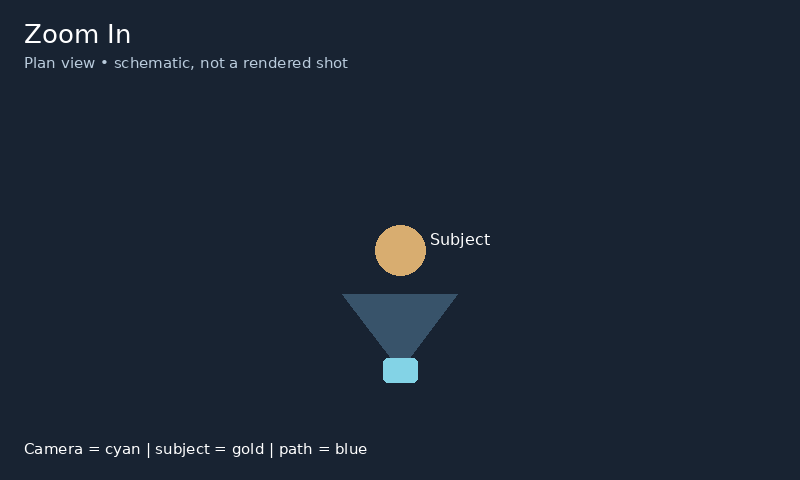
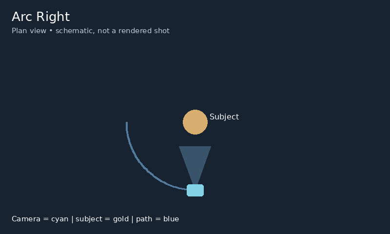
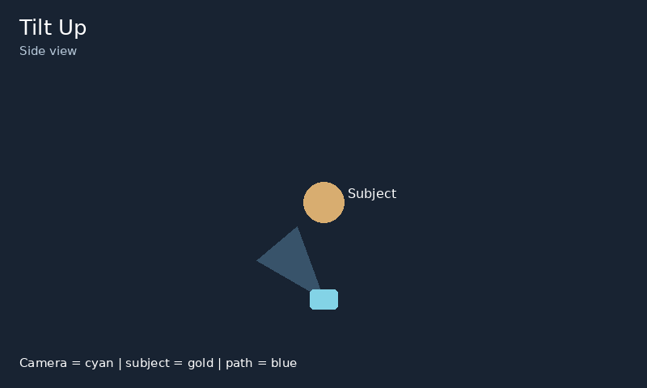
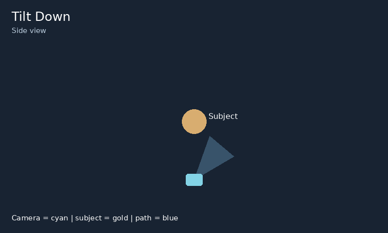
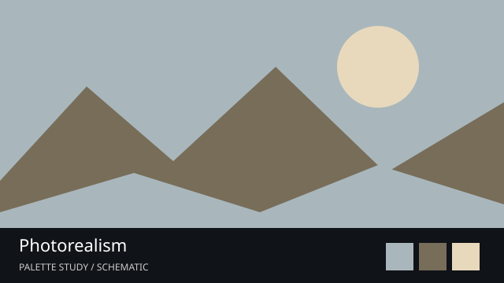
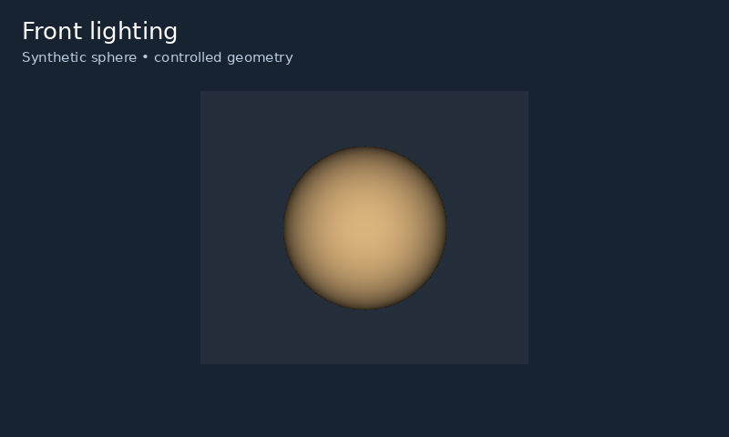
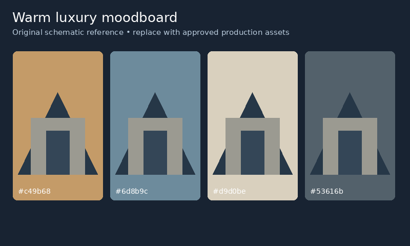
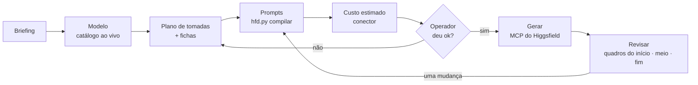

<div align="center">


# HIGGSFIELD DIRECTOR PRO

### Skill de direção de cinema para vídeo gerado por IA · Claude Code e Codex

**Plano de tomadas · Prompt por modelo · Orçamento em créditos · Geração com aprovação · Revisão com evidência**


[](https://github.com/rniedson/higgsfield-director-pro-skill/actions/workflows/testes.yml)


[Manual ilustrado](#manual-ilustrado) · [Arquitetura](#arquitetura) · [Começo rápido](#começo-rápido) · [Exemplos](#exemplos) · [Licenças](#licenças)

[English](README.md) · **Português**

</div>

> **Estado:** versão 5.1.0. Projeto independente, sem vínculo com o Higgsfield nem aprovação dele.
> Sozinha, a skill só *planeja*: vídeo e imagem são gerados pelo conector oficial do Higgsfield (MCP), com créditos da
> sua conta, e **só depois que o custo é mostrado e o operador diz "ok"**.

## Manual ilustrado

O [manual ilustrado de direção](docs/manual/README.md) tem **11 partes e 185 imagens esquemáticas**: movimento de
câmera, enquadramento, lentes e óptica, luz, cor e estilos, atuação, física e materiais, tempo e montagem, som,
continuidade e produção. Cada parte traz a regra, um prompt positivo, o que evitar e as ilustrações. As imagens explicam
a direção; não são renders e não provam como um modelo se comporta.

### Movimentos de câmera

Esquemas vistos de cima dos movimentos que a skill escreve nos prompts.

| | | | |
|:---:|:---:|:---:|:---:|
| <br>**Dolly in** | <br>**Dolly out** | <br>**Zoom in** | <br>**Zoom out** |
| <br>**Truck left** | <br>**Truck right** | <br>**Pan left** | <br>**Pan right** |
| <br>**Orbit clockwise** | <br>**Orbit counterclockwise** | <br>**Arc left** | <br>**Arc right** |
| <br>**Tilt up** | <br>**Tilt down** | <br>**Crane up** | <br>**Crane down** |
| <br>**Pedestal up** | <br>**Pedestal down** | <br>**Camera roll** | <br>**Static** |

Os nomes ficam em inglês porque é assim que entram no prompt. Dolly anda com a câmera; zoom muda a lente. **Um
movimento principal por tomada**, ou fases explícitas (*"static, then a slow push-in"*).

### Estilos visuais

| | | | |
|:---:|:---:|:---:|:---:|
| <br>**Neo Noir** | <br>**Cyberpunk** | <br>**Luxury Editorial** | <br>**Art Deco** |
| <br>**Photorealism** | <br>**Analog Horror** | <br>**Claymation** | <br>**2D Anime** |

São 20 estilos com prompt pronto na [parte 05](docs/manual/README.md#parte-05--cor-e-estilos-visuais).

### Luz

| | | | |
|:---:|:---:|:---:|:---:|
| <br>**Luz frontal** | <br>**Luz lateral** | <br>**Luz de cima** | <br>**Luz de baixo** |
| <br>**Luz cruzada** | <br>**Contraluz** | <br>**Luz suave** | <br>**Luz dura** |

### As 11 partes

| Parte | Tema | | Parte | Tema |
|:---:|---|---|:---:|---|
| 01 | [Câmera e movimento](docs/manual/README.md#parte-01--câmera-e-movimento) | | 07 | [Física, materiais e VFX](docs/manual/README.md#parte-07--física-materiais-e-vfx) |
| 02 | [Enquadramento e composição](docs/manual/README.md#parte-02--enquadramento-e-composição) | | 08 | [Tempo, transições e edição](docs/manual/README.md#parte-08--tempo-transições-e-edição) |
| 03 | [Câmeras, lentes e óptica](docs/manual/README.md#parte-03--câmeras-lentes-e-óptica) | | 09 | [Áudio e direção sonora](docs/manual/README.md#parte-09--áudio-e-direção-sonora) |
| 04 | [Iluminação cinematográfica](docs/manual/README.md#parte-04--iluminação-cinematográfica) | | 10 | [Continuidade e diagnóstico](docs/manual/README.md#parte-10--continuidade-e-diagnóstico) |
| 05 | [Cor e estilos visuais](docs/manual/README.md#parte-05--cor-e-estilos-visuais) | | 11 | [Engenharia de prompts e produção](docs/manual/README.md#parte-11--engenharia-de-prompts-e-produção) |
| 06 | [Atuação e emoções](docs/manual/README.md#parte-06--atuação-e-emoções) | | — | [Atlas óptico, 100 estudos](docs/manual/README.md#atlas-óptico--100-estudos) |

<details>
<summary><b>Pranchas, fichas e o atlas óptico</b></summary>
<br>

| Óptica | Ficha de personagem (turnaround) |
|:---:|:---:|
|  |  |
| **Vistas ortográficas do produto** | **Moodboard de luxo quente** |
|  |  |

| 24 mm | 50 mm | 85 mm | 135 mm |
|:---:|:---:|:---:|:---:|
|  |  |  |  |

Estudos geométricos de um mesmo objeto em lentes, distâncias e paletas diferentes; o atlas completo tem 100.

</details>

## Arquitetura

Como as peças conversam. O agente lê só o `SKILL.md` de início; o resto entra quando um passo pede. O `hfd.py`
trabalha sem rede, e o único caminho que gasta crédito passa pelo conector do Higgsfield, depois do total cotado e do
"ok" do operador.


| | Peça | O que guarda | Quando entra |
|:---:|---|---|---|
| **1** | [`SKILL.md`](higgsfield-director/SKILL.md) | escopo, o fluxo em 6 passos, regras duras, quem cuida do quê (91 linhas) | em todo pedido: o agente lê primeiro |
| **2** | [`references/`](higgsfield-director/references) | 6 guias: fluxo · prompt · vocabulário · modelos · conector · qualidade | só o guia que o passo atual pede |
| **3** | [`scripts/hfd.py`](higgsfield-director/scripts/hfd.py) | validar · compilar · orçar · exportar · óptica · nota · modelos | no modo estúdio, antes de gastar crédito |
| **4** | [`data/`](higgsfield-director/data) | retrato datado de 122 modelos + pesos da nota | para conferir limites sem o conector |
| **5** | [`templates/`](higgsfield-director/templates) | comercial de 3 tomadas, imagem-para-vídeo, avaliação | ao começar um projeto |
| **6** | [`tests/`](higgsfield-director/tests) | 51 testes, sem dependências, rodados no CI | antes de publicar uma mudança |
| **7** | [`agents/openai.yaml`](higgsfield-director/agents/openai.yaml) | nome e prompt padrão que o Codex mostra | só no Codex |
| **+** | [`docs/manual/`](docs/manual/README.md) | manual ilustrado: 11 partes, 185 imagens | para aprender a linguagem da direção |

<details>
<summary><b>Árvore completa de arquivos</b></summary>
<br>

```text
higgsfield-director/            a skill: é ESTA pasta que se instala
  SKILL.md                      entrada: escopo, fluxo, regras duras, roteamento (91 linhas)
  agents/openai.yaml            nome e prompt padrão na interface do Codex
  references/
    fluxo.md                    briefing, modo estúdio, fichas, campos do projeto, entrega
    prompt.md                   ordem de ouro, notas por modelo, receitas, exemplos
    vocabulario.md              câmera, plano, lente, luz, cor, física, atuação, áudio
    modelos.md                  escolher modelo, tabela do retrato, atualizar o retrato
    conector.md                 MCP do Higgsfield no Claude e no Codex, fluxos prontos, ordem das chamadas
    qualidade.md                checklist antes de gastar, diagnóstico, quadros, nota
  scripts/hfd.py                validar, compilar, orçar, exportar, óptica, nota, modelos
  data/modelos.json             retrato datado do catálogo do conector (122 modelos)
  data/pesos.json               pesos da nota
  templates/                    comercial de 3 tomadas, imagem-para-vídeo, avaliação
  tests/test_hfd.py             51 testes (unittest)
docs/
  AVALIACAO-RC3.md              avaliação do pacote anterior e o que a v5 aproveitou
  assets/emblema.svg            emblema
  manual/                       manual ilustrado: README (11 partes), visual/ (185 imagens + catálogo)
tools/checar_repo.py            formato da skill, JSON, links e âncoras (rodado pelo CI)
.github/                        CI, modelos de issue e de pull request
CHANGELOG.md · CONTRIBUTING.md · SECURITY.md
```

</details>

## Sumário

- [Manual ilustrado](#manual-ilustrado)
- [Arquitetura](#arquitetura)
- [Visão geral](#visão-geral)
- [O que mudou na v5](#o-que-mudou-na-v5)
- [Recursos](#recursos)
- [Começo rápido](#começo-rápido)
- [Exemplos](#exemplos)
- [Referência do `hfd.py`](#referência-do-hfdpy)
- [Como escolher o modelo](#como-escolher-o-modelo)
- [Escopo e convivência](#escopo-e-convivência)
- [Qualidade e segurança](#qualidade-e-segurança)
- [Edições e histórico](#edições-e-histórico)
- [Próximos passos](#próximos-passos)
- [Documentação](#documentação)
- [Licenças](#licenças)

In English: [README.md](README.md).

## Visão geral

O Higgsfield Director PRO é uma **skill de agente** (`higgsfield-director`) que transforma um pedido criativo em tomadas
geradas por IA bem dirigidas. Ela escolhe o modelo pelo catálogo ao vivo e escreve um prompt por tomada, na ordem que os
guias oficiais recomendam. Mantém personagem e produto iguais entre as tomadas, calcula o custo em créditos e espera a
aprovação. Depois gera pelo conector do Higgsfield e revisa o resultado com evidência.

Ela é testada no **Claude Code**. A pasta segue o formato Agent Skills (`SKILL.md` + referências + scripts), que o
**Codex** também lê, mas não foi testada lá. A
skill responde no idioma de quem pede e escreve os prompts em inglês, que os modelos de vídeo seguem de forma mais previsível.



Sem o conector, a skill trabalha em **modo só planejamento**: entrega prompts e parâmetros prontos para colar no site do
Higgsfield e avisa que o custo deve ser conferido lá.

## O que mudou na v5

A v5 reescreve o pacote v4.1 RC3/RC4 gerado no ChatGPT. Cada defeito medido na RC3 virou um teste.
Avaliação completa: [docs/AVALIACAO-RC3.md](docs/AVALIACAO-RC3.md).

| | v4.1 RC3 / RC4 | v5.1.0 |
|---|---|---|
| Skill | 328 arquivos, 121 MB, 116 "comandos" | 15 arquivos, 203 kB, `SKILL.md` de 91 linhas + 6 referências lidas sob demanda |
| Código | 3 compiladores, 2 ópticas, 3 orçamentos; SDK, REST, Docker | um `hfd.py`, só biblioteca padrão do Python |
| Modelos | 9 perfis, 7 com todos os campos `null` | retrato datado de **122 modelos** do catálogo do conector, atualizável por comando |
| Checagem de câmera | recusava *"static camera, no orbit"* | entende negação e fases; avisa, não bloqueia |
| Áudio | mandava o áudio do Cinema Studio para a pós-produção | lê o áudio nativo no catálogo (o Cinema Studio 4.0 gera áudio por padrão) |
| Geração | nenhuma | MCP oficial do Higgsfield, depois do custo e do "ok" explícito |
| Conflitos | descrição genérica de "vídeo" | gatilho preso a *gerado por IA / Higgsfield*, com exclusões nomeadas |
| Testes | 67 (2 dependiam do OpenCV) | 51, sem dependências, CI no Python 3.9 a 3.13; 4 defeitos plantados, 4 pegos |

## Recursos

| Recurso | Como | Onde |
|---|---|---|
| Briefing e premissas | pergunta só o que bloqueia; o resto vira premissa declarada | [`fluxo.md`](higgsfield-director/references/fluxo.md) |
| Escolha do modelo | pela necessidade (duração, referências, primeiro/último quadro, áudio, custo), confirmada no catálogo ao vivo | [`modelos.md`](higgsfield-director/references/modelos.md) |
| Escrita do prompt | ordem de ouro, notas por modelo, 18 receitas contra defeitos comuns | [`prompt.md`](higgsfield-director/references/prompt.md) |
| Vocabulário | câmera, plano, lente, luz, cor, física, atuação, áudio | [`vocabulario.md`](higgsfield-director/references/vocabulario.md) |
| Manual ilustrado | 11 partes, 185 imagens: movimento, luz, estilos, fichas, atlas óptico | [`docs/manual`](docs/manual/README.md) |
| Continuidade | fichas (personagem, produto, lugar) com atributos fixos; conferência na passagem entre tomadas | `hfd.py validar` |
| Regra dos 180° | posições de câmera contra o eixo da ação | `hfd.py validar` |
| Limites do modelo | duração, proporção, resolução, áudio, entradas de imagem-para-vídeo | `hfd.py validar` + retrato |
| Orçamento | cotação real do conector + tentativas + reserva; recusa inventar preço | `hfd.py orcamento` |
| Geração | ordem das chamadas do conector, fluxos prontos, envio de mídia, espera | [`conector.md`](higgsfield-director/references/conector.md) |
| Revisão | checklist antes de gastar, tabela sintoma → causa, quadros, nota ponderada com evidência | [`qualidade.md`](higgsfield-director/references/qualidade.md), `hfd.py pontuar` |
| Entrega | roteiro, lista de tomadas em CSV, legendas | `hfd.py exportar` |

## Começo rápido

Requisitos: Claude Code e/ou Codex, Python 3.9+ (só biblioteca padrão). Para gerar, uma conta no Higgsfield.

**1. Instale a skill só onde for usar.** Faça um link da pasta `higgsfield-director/` (nunca da raiz do repositório)
dentro de `.claude/skills/` do projeto. A skill passa a existir apenas nas sessões abertas naquele projeto; as outras
sessões ficam como estavam.

```bash
git clone https://github.com/rniedson/higgsfield-director-pro-skill.git
R="$PWD/higgsfield-director-pro-skill/higgsfield-director"
cd /caminho/do/projeto
mkdir -p .claude/skills && ln -s "$R" .claude/skills/higgsfield-director
```

Para tirar: `rm .claude/skills/higgsfield-director` (sem barra no fim: apaga só o link). Sessões já abertas podem
precisar ser reiniciadas para ver a mudança.

| Outro alcance | Comando | Efeito |
|---|---|---|
| Todas as sessões do Claude Code | `ln -s "$R" ~/.claude/skills/higgsfield-director` | vale em todos os projetos de uma vez |
| Codex | `ln -s "$R" ~/.agents/skills/higgsfield-director` | vale nas sessões do Codex |

**2. Conecte o Higgsfield** (opcional; sem ele a skill só planeja):

| Agente | Como |
|---|---|
| Claude Code | ative o conector **Higgsfield** no claude.ai e abra uma sessão nova |
| Codex | `codex mcp add higgsfield --url https://mcp.higgsfield.ai/mcp` e depois `codex mcp login higgsfield` |

**3. Peça em linguagem natural**, ou chame pelo nome (`/higgsfield-director` no Claude Code, `$higgsfield-director` no
Codex):

```text
Escreve o prompt para um vídeo de 5 s de uma xícara de café fumegando, câmera se aproximando devagar. É para Reels.
Planeja um comercial de 3 tomadas no Higgsfield para um tênis branco, vertical, e me diz quanto custa. Não gere ainda.
Gerei no Kling uma moça andando e os pés deslizam no chão. Como corrijo o prompt?
```

## Exemplos

Todas as saídas abaixo são execuções reais dos modelos que vêm com a skill.

### 01 — Comercial de produto em 3 tomadas

O projeto declara o modelo, as fichas e as tomadas ([`templates/projeto.json`](higgsfield-director/templates/projeto.json)):

```json
{
  "modelo": "cinematic_studio_video_4_0",
  "proporcao": "9:16",
  "biblias": {
    "P01": {
      "tipo": "produto",
      "descricao": "A black glass perfume bottle with a faceted gold cap and a flat cream label reading NOIR",
      "fixo": {"cor": "black", "tampa": "gold"}
    }
  },
  "tomadas": [
    {"id": "T01", "duracao": 5, "entidades": ["P01"],
     "acao": "A thin curl of mist drifts past the bottle and clears",
     "camera": "Static camera, locked off", "otica": "100mm macro look, shallow depth of field"}
  ]
}
```

```bash
python3 higgsfield-director/scripts/hfd.py compilar higgsfield-director/templates/projeto.json --texto
```

```text
## T01
A black glass perfume bottle with a faceted gold cap and a flat cream label reading NOIR. A dark studio with a
polished obsidian plinth. A thin curl of mist drifts past the bottle and clears. Extreme close-up on the cap, eye
level. Static camera, locked off. 100mm macro look, shallow depth of field. Single hard rim light from camera left,
deep black background. The cap fills the upper third of the frame. Keep the label flat, sharp and readable.

Audio: Low airy hum, a soft glass chime as the mist clears.

parametros: {"model": "cinematic_studio_video_4_0", "duration": 5, "aspect_ratio": "9:16", "resolution": "720p", "generate_audio": true}
```

A descrição da ficha abre cada tomada palavra por palavra: é isso que segura a identidade do produto entre as gerações.
Duração, proporção, resolução e áudio vão nos **parâmetros**, não no texto do prompt.

### 02 — Orçamento antes de gastar

```bash
python3 higgsfield-director/scripts/hfd.py orcamento higgsfield-director/templates/projeto.json --tentativas 1
```

```json
{"base": 210.0, "reserva_pct": 20.0, "reserva": 42.0, "total": 252.0,
 "lembrete": "custo é estimativa do conector; gerar só depois do ok do operador com este total"}
```

Os preços vêm do `estimate_video_cost` do conector (que não cobra). Sem eles, o `orcamento` se recusa a rodar em vez de
chutar.

### 03 — O validador pega uma quebra de continuidade

A tomada T02 começa com o frasco vermelho, mas a ficha diz que ele é preto:

```json
{
  "erros": ["T02 inicio: P01.cor = 'red', mas a ficha fixa 'black'"],
  "avisos": ["cinematic_studio_video_4_0 não tem multi-shot no retrato: cada tomada é uma geração separada"]
}
```

Código de saída 1. Mudança de propósito se declara na tomada, em `mudancas_aprovadas: ["P01.cor"]`.

### 04 — Checagem da direção de câmera

| Texto da câmera | Resultado |
|---|---|
| `static camera, no orbit` | aceito (a negação é entendida) |
| `slow orbit around a static subject` | aceito: um movimento, `orbit` |
| `static camera while the camera orbits` | aviso: parada e em movimento na mesma fase |
| `slow dolly in while panning left` | aviso: dois movimentos ao mesmo tempo (`dolly`, `pan`) |

### 05 — Óptica

```bash
python3 higgsfield-director/scripts/hfd.py otica 85 2 1.8   # distância focal mm, distância m, abertura f
```

```json
{"campo_de_visao_horizontal_graus": 23.91, "largura_do_quadro_m": 0.847,
 "foco_de_m": 1.972, "foco_ate_m": 2.029, "hiperfocal_m": 133.88}
```

Modelo de lente fina num sensor full-frame de 36 mm: descreve o *visual* a pedir, não é parâmetro do modelo.

## Referência do `hfd.py`

| Comando | Para quê |
|---|---|
| `validar PROJETO` | estrutura, câmera, tamanho das falas, linha do tempo, continuidade, eixo de 180°, limites do modelo |
| `compilar PROJETO [--texto]` | um prompt por tomada + `parametros` prontos para o conector |
| `orcamento PROJETO [--reserva N]` | total de créditos com cotação real, tentativas e reserva |
| `exportar PROJETO PASTA` | `roteiro.md`, `tomadas.csv`, `legendas.srt` |
| `otica F D N` | campo de visão, largura do quadro, profundidade de campo, hiperfocal |
| `pontuar AVALIACAO` | nota ponderada com evidência por critério; falha crítica bloqueia |
| `modelos [--tipo] [--buscar] [--id]` | ler o retrato dos modelos |
| `modelos --importar LISTA... --saida ARQUIVO` | montar um retrato novo com as listas do `models_explore`, fora da pasta da skill |

`--retrato ARQUIVO` faz `validar`, `compilar`, `exportar` e `modelos` usarem outro retrato. Saída em JSON. Código `1`:
o projeto tem erros, listados em `erros`. Código `2`: uso, arquivo ou entrada fora do formato, com a mensagem em
`erro`; nunca um traceback. Sem acesso à rede; lê e grava só os caminhos indicados.

## Como escolher o modelo

A fonte de verdade é o **catálogo ao vivo** (`models_explore`). O retrato que vem junto (`data/modelos.json`, 24/11/2026,
66 modelos de vídeo + 56 de imagem) serve para trabalhar sem conector e para validar, sempre citado com a data.

| Preciso de… | Comece por |
|---|---|
| Tomada longa (até 30 s) | Cinema Studio 4.0, Seedance 2.5, Kling 4.0, MAGI-2, Wan 3.0 |
| Controles de cinema (corpo de câmera, lente, abertura, época, gênero) | Cinema Studio 4.0 |
| Muitas referências (identidade, produto, estilo) | Cinema Studio 4.0, Seedance 2.5 (até 30 imagens) |
| Primeiro **e** último quadro | Kling 3.0, Seedance 2.5, Wan 3.0, MiniMax H3, Veo 3.1 Lite |
| Áudio e fala nativos | Cinema Studio 4.0, Seedance 2.5, Kling 3.0, Veo 3.1, Wan 3.0 |
| Texto legível numa imagem | Nano Banana Pro, Ideogram 4.6 |

Cotações medidas (5 s, 24/11/2026): Cinema Studio 4.0 = 15 / 35 / 80 créditos em 480p / 720p / 1080p; Seedance 2.5 720p
= 35; Kling 3.0 = 7,5 a 10. Sempre recote. Tabela completa: [`modelos.md`](higgsfield-director/references/modelos.md).

## Escopo e convivência

A skill foi feita para conviver com outras skills de vídeo sem roubar os pedidos delas.

| O pedido é… | Quem cuida |
|---|---|
| prompt, tomada ou sequência **gerada por IA**; escolha de modelo; custo de geração; diagnóstico de resultado gerado | **esta skill** |
| UGC, ficha de personagem, foto de produto, miniatura, anúncio estático, microdrama, vídeo sem rosto, dublagem | o fluxo próprio do conector Higgsfield; esta skill só acrescenta a regra de custo e "ok" |
| editar vídeo gravado (cortes, legendas, cor, trilha) | uma skill de edição de vídeo ou o fluxo `video-montage` do conector |
| voz, narração, música, efeitos sonoros | uma skill de áudio |
| títulos, descrições, publicação | uma skill de publicação |

Quando outra skill de vídeo precisa de **uma** tomada gerada por IA, esta skill escreve e gera essa tomada; o resto do
vídeo continua com a skill dona dele.

## Qualidade e segurança

```bash
cd higgsfield-director && python3 -m unittest discover -s tests -v
cd .. && python3 tools/checar_repo.py
```

| Conferência | Resultado |
|---|---|
| Testes | 51/51 passando no Python 3.9 e 3.12 aqui, e no CI do 3.9 ao 3.13 (sem pacotes de terceiros) |
| Entrada fora do formato | 13 tipos errados no projeto, mais avaliações e orçamentos malformados: viram erro listado ou código 2, nunca traceback |
| Conferência do repositório | `tools/checar_repo.py` no CI: cabeçalho lido como YAML, todo JSON, links e âncoras dos Markdown |
| Mutações | 4 defeitos plantados (negação ignorada, checagem de passagem desligada, áudio perdido, modelo desconhecido calado): 4 pegos |
| Formato da skill | cabeçalho lido como YAML; descrição em inglês, com 1013 de 1024 caracteres; todo caminho citado no `SKILL.md` e nas referências existe (testado) |
| Encaminhamento no Claude Code (sem interface, descrição atual, em inglês) | 14 de 14 em cada uma de 3 rodadas (42 de 42), as duas últimas depois da mudança para o conector primeiro. Por rodada: 9 em português e 5 em inglês: 8 para esta skill (3 pedidos de prompt, 3 diagnósticos, 1 plano de estúdio que cotou e parou, 1 ficha de personagem passada ao fluxo do conector) e 6 para as skills donas (render, edição de vídeo gravado ×2, voz ×2, motion graphics). Cada resposta veio no idioma do pedido. Nas duas últimas rodadas, o plano de estúdio listou os fluxos ao vivo do conector antes de planejar. Rodadas anteriores: a primeira descrição em português perdeu 2 de 3 pedidos de prompt e foi corrigida; a corrigida fez 9 de 9 |
| Gasto nos testes | 60 sessões (5 rodadas de encaminhamento e um piloto de 2 braços), 0 chamadas de geração (ferramentas de geração bloqueadas no teste); toda sessão que cotou parou e pediu o "ok" |
| Piloto, só texto (o mesmo comercial de tênis em 3 tomadas, Cinema Studio 4.0 480p, com e sem a skill) | Os dois cotaram 45 créditos ao vivo e pararam. Com a skill: conferiu a lista de fluxos ao vivo, importou e validou os limites ao vivo do modelo, um movimento de câmera por tomada, a mesma descrição do produto nos três prompts, quadro final planejado, "ok" restrito às três tomadas. Sem ela: dois movimentos de câmera numa tomada e frases negativas ("no logos, no text"). Se isso muda o vídeo gerado ainda não foi medido: falta gerar as 6 tomadas (90 créditos pela cotação de 24/11/2026) com o ok do operador |

Propriedades de segurança:

- O `hfd.py` não acessa a rede e não tem dependências; lê e grava só os caminhos que recebe.
- Nada é gerado sem o total cotado e um "ok" explícito; abrir um preset ou uma galeria nunca autoriza gerar, e um "ok"
  não vale para o pedido seguinte.
- Capacidade de modelo vem do catálogo (ao vivo, ou o retrato datado), nunca de memória.
- Rosto ou voz de pessoa real só com consentimento declarado pelo operador; nada de menor em cena sensível; nada de
  imitar figura pública (Termos do Higgsfield, seções 4.2 e 5, atualizados em 23/10/2026).

## Edições e histórico

Todas as mudanças, inclusive as edições anteriores (v1.0 a v4.1 RC4), estão no [CHANGELOG.md](CHANGELOG.md), em inglês.

As versões até a v4.1 foram geradas no ChatGPT e ficam fora deste repositório; o que foi aproveitado e por quê está em
[docs/AVALIACAO-RC3.md](docs/AVALIACAO-RC3.md).

## Próximos passos

| Prioridade | Objetivo | Situação |
|---|---|---|
| P1 | Piloto real: gerar uma sequência de 3 tomadas e dar nota com evidência | Pendente (precisa de orçamento aprovado) |
| P1 | Atualizar o retrato dos modelos todo mês | Processo descrito em `modelos.md` |
| P2 | Mais casos no teste de gatilho (mais pedidos, várias rodadas cada) | Planejado |
| P2 | Rodada completa no Codex com o MCP do Higgsfield configurado | Sem data (não está em uso no Codex) |

## Documentação

| Recurso | Link |
|---|---|
| Entrada da skill | [higgsfield-director/SKILL.md](higgsfield-director/SKILL.md) |
| Fluxo de produção | [references/fluxo.md](higgsfield-director/references/fluxo.md) |
| Escrita do prompt | [references/prompt.md](higgsfield-director/references/prompt.md) |
| Vocabulário | [references/vocabulario.md](higgsfield-director/references/vocabulario.md) |
| Modelos | [references/modelos.md](higgsfield-director/references/modelos.md) |
| Conector | [references/conector.md](higgsfield-director/references/conector.md) |
| Qualidade | [references/qualidade.md](higgsfield-director/references/qualidade.md) |
| Manual ilustrado | [docs/manual/README.md](docs/manual/README.md) |
| Avaliação da v4.1 | [docs/AVALIACAO-RC3.md](docs/AVALIACAO-RC3.md) |
| Histórico de mudanças | [CHANGELOG.md](CHANGELOG.md) |
| Como contribuir | [CONTRIBUTING.md](CONTRIBUTING.md) |
| Política de segurança | [SECURITY.md](SECURITY.md) |

## Licenças

- Código e texto da skill: [MIT](LICENSE), © 2026 Robson Niedson.
- Manual ilustrado (`docs/manual/`, texto e imagens) e o emblema (`docs/assets/`):
  [CC BY-SA 4.0](docs/manual/LICENSE-DOCS.md). O texto é adaptado do pacote ilustrado v4.1, com as mudanças listadas
  no fim do manual; as imagens são desenhos esquemáticos feitos por código.
- Higgsfield, Kling, Seedance, Veo, Wan, MiniMax e outros nomes são marcas dos seus donos, e as licenças acima não dão
  direito de usá-los. Este projeto é independente e não tem vínculo com nenhum deles nem aprovação deles.

<div align="center">

**Higgsfield Director PRO — direção de cinema para vídeo gerado por IA**

Projeto independente

[Voltar ao início](#higgsfield-director-pro) · [Read in English](README.md)

</div>
