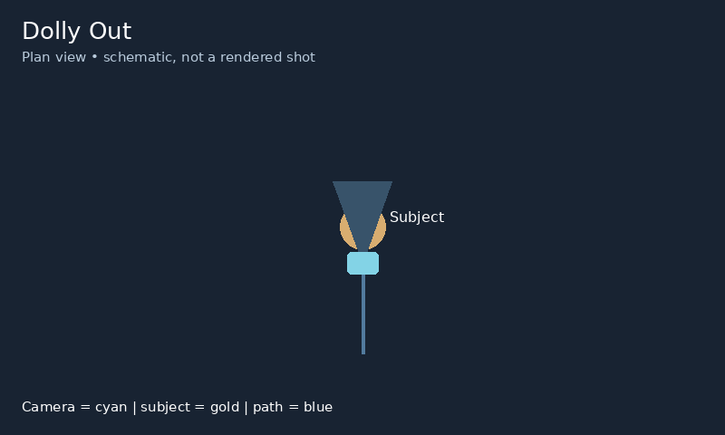
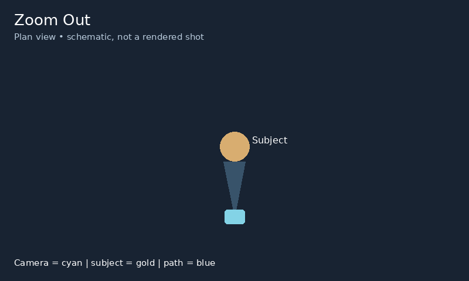
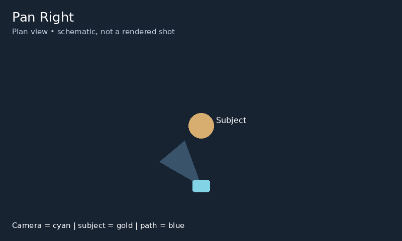
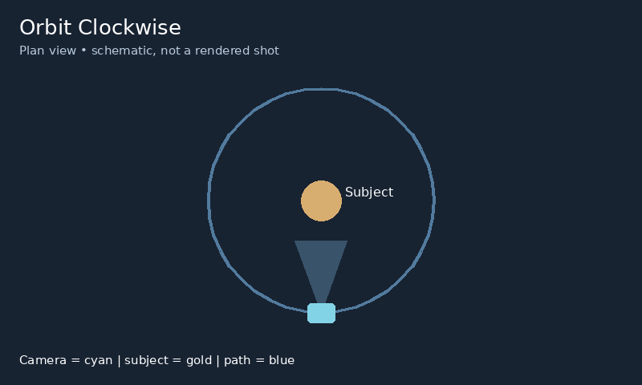
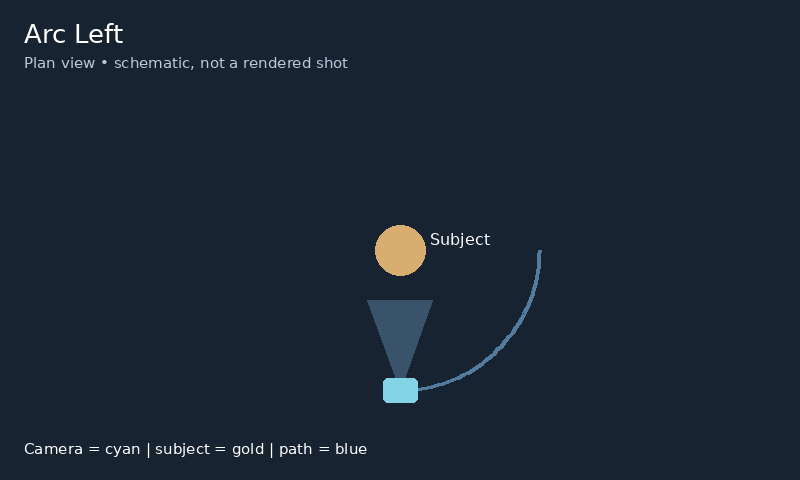
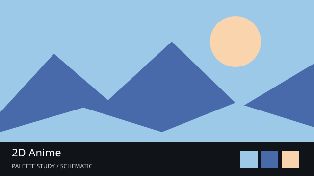
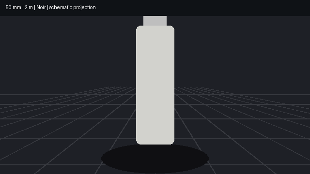
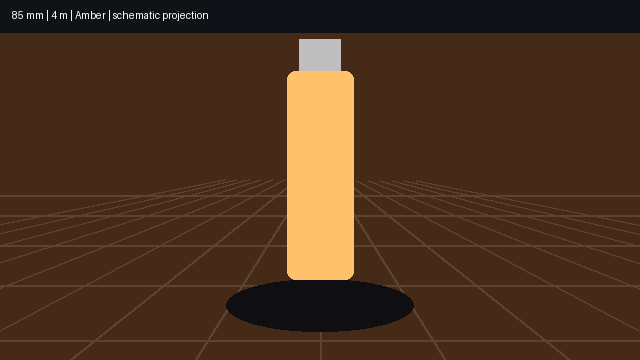
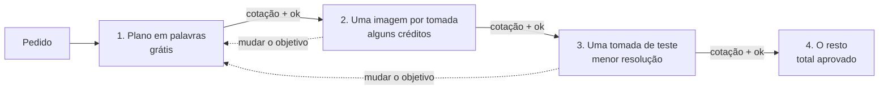

<div align="center">


# HIGGSFIELD DIRECTOR PRO

### Um processo passo a passo para vídeo gerado por IA · Claude Code e Codex

**O seu pedido como você disse · Prévia barata antes do vídeo · Cada crédito à vista · Geração só depois do seu ok**


[](https://github.com/rniedson/higgsfield-director-pro-skill/actions/workflows/tests.yml)


[Como funciona](#como-funciona) · [Manual ilustrado](#manual-ilustrado) · [Arquitetura](#arquitetura) · [Começo rápido](#começo-rápido) · [Exemplos](#exemplos) · [Aviso](#aviso) · [Licenças](#licenças)

[English](README.md) · **Português**

</div>

> [!IMPORTANT]
> **Projeto não oficial.** O Higgsfield Director PRO é uma skill independente, feita pela comunidade. **Não é feita,
> aprovada, patrocinada nem mantida pelo Higgsfield, e não tem vínculo com ele.** O nome "Higgsfield" aparece só para
> dizer com qual serviço a skill funciona. Para conta, créditos, cobrança ou o conector, fale com o Higgsfield; este
> repositório não resolve isso. Veja o [Aviso](#aviso).

> **Estado:** versão 5.1.0, mais as mudanças do `main` listadas em *Unreleased* no [CHANGELOG](CHANGELOG.md).
> Sozinha, a skill só *planeja*: vídeo e imagem são gerados pelo conector oficial do Higgsfield (MCP), com créditos da
> sua conta, e **só depois que o custo é mostrado e o operador diz "ok"**.

## Como funciona

Os modelos do Higgsfield já se saem bem com um pedido simples. Esta skill não tenta escrever um prompt melhor que
isso. Ela mantém o seu pedido como você disse e põe o esforço no processo em volta dele: um passo de cada vez, uma
olhada barata na ideia antes de cada passo caro e cada crédito à vista. Assim, o que sai é o que você esperava, e
nada é gasto de surpresa.

| Passo | O que você vê | Quanto custa | O que você decide |
|---|---|---|---|
| 1. O plano | a ideia, as tomadas, o modelo e os prompts, em palavras | nada | mudar a ideia enquanto é de graça |
| 2. Uma imagem por tomada | uma imagem de cada tomada, num modelo de imagem barato | alguns créditos por imagem | se o visual, as pessoas e o lugar são o que você quer |
| 3. Uma tomada de teste | a tomada mais arriscada, em vídeo curto na menor resolução | o preço de uma tomada | se o movimento e o som funcionam |
| 4. O resto | as outras tomadas e, se você quiser, a resolução final | o total que você aprovou | — |

Antes de cada passo, a skill mostra o preço dado pelo conector e espera o seu "ok"; depois de cada um, mostra quanto
custou e o total até ali ("gastos 17 de 75 aprovados"). Uma mudança de plano custa menos onde é achada: uma placa que
não deveria estar lá custa cerca de 2 créditos para refazer numa imagem, e 15 ou mais num vídeo.

- **O prompt é o seu pedido.** Cada fato que você dá e cada limite que você põe ("ninguém real, nenhuma marca, nenhum
  texto") entram em cada prompt como você disse, nomeando onde a coisa proibida apareceria. Movimento de câmera,
  lente, luz, estilo e receitas contra defeitos só entram se você pedir, ou para consertar um defeito que uma prévia
  mostrou.
- **Quanto ela pergunta depende de você.** Você escolhe uma vez por projeto: aprovar cada passo, dar um "ok" para o
  total ou dar um teto para a sessão ([Do seu jeito: modos](#do-seu-jeito-modos)).
- **O que não muda:** o modelo e o preço dele, e os fluxos prontos do conector (fotos de produto, vídeos de criador,
  dublagem, anúncios), onde a skill sai da frente e fica só com a regra do custo e do ok.

Para um prompt rápido ou uma imagem só, o plano é o trabalho inteiro: não há passos para subir.

### Na prática

<a href="docs/demo/kung-fu-vs-robot-clone.mp4"></a>

Uma luta de 10 s entre o personagem do próprio mantenedor e um clone robô dele, feita um passo de cada vez: quatro
imagens para escolher o visual (0,48 crédito), a tomada inteira como rascunho (30) e, depois, a versão final em 1080p a
partir do rascunho aprovado (160). A ideia de se dividir em cópias entrou antes do rascunho, enquanto mudar o plano
ainda era de graça. [Como foi feito](docs/demo/README.md) (em inglês), com o prompt e o som.

## Manual ilustrado

O [manual ilustrado de direção](docs/manual/README.md) tem **11 partes e 185 imagens esquemáticas**: movimento de
câmera, enquadramento, lentes e óptica, luz, cor e estilos, atuação, física e materiais, tempo e montagem, som,
continuidade e produção. Cada parte traz a regra, um prompt positivo, o que evitar e as ilustrações. As imagens explicam
a direção; não são renders e não provam como um modelo se comporta. A skill usa o manual quando você pede um visual
ou um controle específico, ou para consertar um defeito que uma prévia mostrou; um pedido simples não precisa dele.

### Movimentos de câmera

Esquemas vistos de cima dos movimentos que a skill escreve nos prompts.

| | | | |
|:---:|:---:|:---:|:---:|
| <br>**Dolly in** | <br>**Dolly out** | <br>**Zoom in** | <br>**Zoom out** |
| <br>**Truck left** | <br>**Truck right** | <br>**Pan left** | <br>**Pan right** |
| <br>**Orbit clockwise** | <br>**Orbit counterclockwise** | <br>**Arc left** | <br>**Arc right** |
| <br>**Tilt up** | <br>**Tilt down** | <br>**Crane up** | <br>**Crane down** |
| <br>**Pedestal up** | <br>**Pedestal down** | <br>**Camera roll** | <br>**Static** |

Os nomes ficam em inglês porque é assim que entram no prompt. Dolly anda com a câmera; zoom muda a lente. **Um
movimento principal por tomada**, ou fases explícitas (*"static, then a slow push-in"*).

### Estilos visuais

| | | | |
|:---:|:---:|:---:|:---:|
| <br>**Neo Noir** | <br>**Cyberpunk** | <br>**Luxury Editorial** | <br>**Art Deco** |
| <br>**Photorealism** | <br>**Analog Horror** | <br>**Claymation** | <br>**2D Anime** |

São 20 estilos com prompt pronto na [parte 05](docs/manual/README.md#part-05--color-and-visual-styles).

### Luz

| | | | |
|:---:|:---:|:---:|:---:|
| <br>**Luz frontal** | <br>**Luz lateral** | <br>**Luz de cima** | <br>**Luz de baixo** |
| <br>**Luz cruzada** | <br>**Contraluz** | <br>**Luz suave** | <br>**Luz dura** |

### As 11 partes

| Parte | Tema | | Parte | Tema |
|:---:|---|---|:---:|---|
| 01 | [Câmera e movimento](docs/manual/README.md#part-01--camera-and-movement) | | 07 | [Física, materiais e VFX](docs/manual/README.md#part-07--physics-materials-and-vfx) |
| 02 | [Enquadramento e composição](docs/manual/README.md#part-02--framing-and-composition) | | 08 | [Tempo, transições e edição](docs/manual/README.md#part-08--time-transitions-and-editing) |
| 03 | [Câmeras, lentes e óptica](docs/manual/README.md#part-03--cameras-lenses-and-optics) | | 09 | [Áudio e direção sonora](docs/manual/README.md#part-09--audio-and-sound-direction) |
| 04 | [Iluminação cinematográfica](docs/manual/README.md#part-04--cinematic-lighting) | | 10 | [Continuidade e diagnóstico](docs/manual/README.md#part-10--continuity-and-diagnostics) |
| 05 | [Cor e estilos visuais](docs/manual/README.md#part-05--color-and-visual-styles) | | 11 | [Engenharia de prompts e produção](docs/manual/README.md#part-11--prompt-engineering-and-production) |
| 06 | [Atuação e emoções](docs/manual/README.md#part-06--acting-and-emotions) | | — | [Atlas óptico, 100 estudos](docs/manual/README.md#optical-atlas--100-studies) |

<details>
<summary><b>Pranchas, fichas e o atlas óptico</b></summary>
<br>

| Óptica | Ficha de personagem (turnaround) |
|:---:|:---:|
|  |  |
| **Vistas ortográficas do produto** | **Moodboard de luxo quente** |
|  |  |

| 24 mm | 50 mm | 85 mm | 135 mm |
|:---:|:---:|:---:|:---:|
|  |  |  |  |

Estudos geométricos de um mesmo objeto em lentes, distâncias e paletas diferentes; o atlas completo tem 100.

</details>

## Imagens de referência

Como é uma boa referência. Estas três foram geradas para um dos testes da skill (GPT Image 2.6 pelo Higgsfield,
25/11/2026); os prompts que as fizeram, e como um prompt de vídeo as nomeia, estão em
[`higgsfield-director/examples/references`](higgsfield-director/examples/references/README.md).

| | | |
|:---:|:---:|:---:|
| <br>**Ficha de personagem**<br>um rosto; o corpo cortado no pescoço | <br>**Locação em duas vistas**<br>a sala e a entrada, sem pessoas | <br>**Um detalhe do cenário**<br>o detalhe em que a ação termina |

Cada referência diz o que traz e o que fica fora do plano: a ficha dá a identidade, e o fundo cinza dela nunca
entra na cena.

## Arquitetura

Como as peças conversam. O agente lê só o `SKILL.md` de início; o resto entra quando um passo pede. O `hfd.py`
trabalha sem rede, e o único caminho que gasta crédito passa pelo conector do Higgsfield, depois do total cotado e do
"ok" do operador.


| | Peça | O que guarda | Quando entra |
|:---:|---|---|---|
| **1** | [`SKILL.md`](higgsfield-director/SKILL.md) | escopo, o fluxo em 9 passos, regras duras, quem cuida do quê (165 linhas) | em todo pedido: o agente lê primeiro |
| **2** | [`references/`](higgsfield-director/references) | 6 guias: fluxo · prompt · vocabulário · modelos · conector · qualidade | só o guia que o passo atual pede |
| **3** | [`scripts/hfd.py`](higgsfield-director/scripts/hfd.py) | validar · compilar · orçar · exportar · óptica · nota · modelos | no modo estúdio, antes de gastar crédito |
| **4** | [`data/`](higgsfield-director/data) | retrato datado de 122 modelos + pesos da nota | para conferir limites sem o conector |
| **5** | [`templates/`](higgsfield-director/templates) | comercial de 3 tomadas, imagem-para-vídeo, avaliação | ao começar um projeto |
| **6** | [`tests/`](higgsfield-director/tests) | 61 testes, sem dependências, rodados no CI | antes de publicar uma mudança |
| **7** | [`agents/openai.yaml`](higgsfield-director/agents/openai.yaml) | nome e prompt padrão que o Codex mostra | só no Codex |
| **+** | [`docs/manual/`](docs/manual/README.md) | manual ilustrado: 11 partes, 185 imagens | para aprender a linguagem da direção |

<details>
<summary><b>Árvore completa de arquivos</b></summary>
<br>

```text
higgsfield-director/            a skill: é ESTA pasta que se instala
  SKILL.md                      entrada: escopo, fluxo, regras duras, roteamento (165 linhas)
  agents/openai.yaml            nome e prompt padrão na interface do Codex
  references/
    workflow.md                 briefing, modo estúdio, fichas, campos do projeto, entrega
    preproduction.md            ideia, esboço de roteiro, croqui em duas fases, roteiro travado, rota do áudio
    prompt.md                   a pedido: ordem de ouro, notas por modelo, receitas, exemplos
    vocabulary.md               câmera, plano, lente, luz, cor, física, atuação, áudio
    models.md                   escolher modelo, tabela do retrato, atualizar o retrato
    connector.md                MCP do Higgsfield no Claude e no Codex, fluxos prontos, ordem das chamadas
    quality.md                  checklist antes de gastar, diagnóstico, quadros, nota
    modes.md                    primeiro uso; modos follow, price e ceiling
    calibration.md              teste às cegas com e sem a skill, só a pedido
  scripts/hfd.py                validate, compile, budget, export, optics, score, models, crop, blind, result
  scripts/calibrate_claude_code.sh  roda as duas condições da calibração no Claude Code
  data/models.json              retrato datado do catálogo do conector (122 modelos)
  data/weights.json             pesos da nota
  templates/                    comercial de 3 tomadas, imagem-para-vídeo, avaliação
  tests/                        83 testes (unittest)
calibration/                    registros das rodadas às cegas feitas durante o desenvolvimento, e o placar delas
lessons-learned/                lições que mudaram a skill, cada uma com a fonte
docs/
  MIGRATION-6.md                cada nome de antes da 6.0 e o nome em inglês
  RC3-EVALUATION.md             avaliação do pacote anterior e o que a v5 aproveitou
  assets/emblem.svg             emblema
  manual/                       manual ilustrado: README (11 partes), visual/ (185 imagens + catálogo)
tools/check_repo.py             formato da skill, JSON, links, âncoras e língua (rodado pelo CI)
tools/aggregate_calibration.py  monta o placar em calibration/README.md a partir dos registros
.github/                        CI, modelos de issue e de pull request
AGENTS.md · CLAUDE.md · CHANGELOG.md · CONTRIBUTING.md · SECURITY.md
```

</details>

## Sumário

- [Como funciona](#como-funciona)
- [Manual ilustrado](#manual-ilustrado)
- [Imagens de referência](#imagens-de-referência)
- [Arquitetura](#arquitetura)
- [Visão geral](#visão-geral)
- [Do seu jeito: modos](#do-seu-jeito-modos)
- [O que mudou na v5](#o-que-mudou-na-v5)
- [Recursos](#recursos)
- [Começo rápido](#começo-rápido)
- [Exemplos](#exemplos)
- [Referência do `hfd.py`](#referência-do-hfdpy)
- [Como escolher o modelo](#como-escolher-o-modelo)
- [Escopo e convivência](#escopo-e-convivência)
- [Qualidade e segurança](#qualidade-e-segurança)
- [Edições e histórico](#edições-e-histórico)
- [Próximos passos](#próximos-passos)
- [Documentação](#documentação)
- [Aviso](#aviso)
- [Licenças](#licenças)

In English: [README.md](README.md).

## Visão geral

O Higgsfield Director PRO é uma **skill de agente** (`higgsfield-director`) que conduz a produção de vídeo e imagem
gerados por IA, um passo de cada vez. Ela escolhe o modelo pelo catálogo ao vivo e escreve os prompts a partir do seu
pedido, como você disse. Mantém personagem e produto iguais entre as tomadas e mostra uma prévia barata antes de cada
passo caro. Deixa cada crédito à vista, gera pelo conector do Higgsfield só depois do seu "ok" e revisa o resultado
com você.

Ela é testada no **Claude Code** e localmente no **Codex** para planejamento e comandos. A cotação e a geração
autenticadas pelo Higgsfield ainda não foram testadas a partir do Codex. A skill responde no idioma de quem pede e
escreve os prompts em inglês, que os modelos de vídeo seguem de forma mais previsível.



Sem o conector, a skill trabalha em **modo só planejamento**: entrega prompts e parâmetros prontos para colar no site do
Higgsfield e avisa que o custo deve ser conferido lá.

## Do seu jeito: modos

Cada pessoa trabalha de um jeito. Na primeira vez num projeto, a skill pergunta como você quer seguir e guarda a
resposta em `.higgsfield-director/preferences.json`, na pasta do projeto
([modos.md](higgsfield-director/references/modes.md)).

| Modo | Para quem | O que acontece |
|---|---|---|
| `follow` | quer ver e aprovar cada passo | cada imagem e cada vídeo vão para os seus olhos, com a pré-checagem da skill ao lado, e nada avança sem a sua aprovação |
| `price` | quer saber só o preço | a skill decide o plano e mostra o total; um "ok" vale para o pacote inteiro |
| `ceiling` | não quer ser consultado | você diz na conversa até quantos créditos ela pode gastar na sessão; ela mostra o acumulado e para no teto |

O arquivo guarda **como** trabalhar, nunca **quanto** gastar: o `hfd.py` recusa um arquivo com teto ou com qualquer
outro campo, e a autorização de gasto continua vindo só da conversa. Em todo modo, a skill mostra quanto custou cada
geração e o total até ali.

**Pré-produção barata.** Antes das prévias, a ideia pode amadurecer onde errar custa pouco: a ideia numa frase, o
esboço de roteiro em tabela e um croqui em duas fases. Primeiro o storyboard inteiro numa folha de rabisco, no modelo
de imagem mais barato; depois cada quadro, recortado (`hfd.py crop`), vira a referência do seu próprio quadro num
modelo barato que aceita referência, e todos mantêm os mesmos bonecos de bloco e podem ser refeitos um a um. Só com o
roteiro travado pelo operador a skill pergunta por onde gerar o áudio
([preproducao.md](higgsfield-director/references/preproduction.md)). Testado uma vez.

## O que mudou na v5

A v5 reescreve o pacote v4.1 RC3/RC4 gerado no ChatGPT. Cada defeito medido na RC3 virou um teste.
Avaliação completa: [docs/RC3-EVALUATION.md](docs/RC3-EVALUATION.md).

| | v4.1 RC3 / RC4 | v5.1.0 |
|---|---|---|
| Skill | 328 arquivos, 121 MB, 116 "comandos" | 16 arquivos, `SKILL.md` de 91 linhas + 6 referências lidas sob demanda |
| Código | 3 compiladores, 2 ópticas, 3 orçamentos; SDK, REST, Docker | um `hfd.py`, só biblioteca padrão do Python |
| Modelos | 9 perfis, 7 com todos os campos `null` | retrato datado de **122 modelos** do catálogo do conector, atualizável por comando |
| Checagem de câmera | recusava *"static camera, no orbit"* | entende negação e fases; avisa, não bloqueia |
| Áudio | mandava o áudio do Cinema Studio para a pós-produção | lê o áudio nativo no catálogo (o Cinema Studio 4.0 gera áudio por padrão) |
| Geração | nenhuma | MCP oficial do Higgsfield, depois do custo e do "ok" explícito |
| Conflitos | descrição genérica de "vídeo" | gatilho preso a *gerado por IA / Higgsfield*, com exclusões nomeadas |
| Testes | 67 (2 dependiam do OpenCV) | 61, sem dependências, CI no Python 3.9 a 3.13; 4 defeitos plantados, 4 pegos |

## Recursos

| Recurso | Como | Onde |
|---|---|---|
| Briefing e premissas | pergunta só o que bloqueia; o resto vira premissa declarada | [`fluxo.md`](higgsfield-director/references/workflow.md) |
| Escolha do modelo | pela necessidade (duração, referências, primeiro/último quadro, áudio, custo), confirmada no catálogo ao vivo | [`models.md`](higgsfield-director/references/models.md) |
| Escrita do prompt | o seu pedido como você disse, com cada fato e cada limite; a pedido, ordem de ouro, notas por modelo e 18 receitas contra defeitos comuns | [`prompt.md`](higgsfield-director/references/prompt.md) |
| Vocabulário | câmera, plano, lente, luz, cor, física, atuação, áudio | [`vocabulario.md`](higgsfield-director/references/vocabulary.md) |
| Manual ilustrado | 11 partes, 185 imagens: movimento, luz, estilos, fichas, atlas óptico | [`docs/manual`](docs/manual/README.md) |
| Continuidade | fichas (personagem, produto, lugar) com atributos fixos; conferência na passagem entre tomadas | `hfd.py validate` |
| Regra dos 180° | posições de câmera contra o eixo da ação | `hfd.py validate` |
| Limites do modelo | duração, proporção, resolução, áudio, entradas de imagem-para-vídeo | `hfd.py validate` + retrato |
| Orçamento | cotação real do conector + tentativas + reserva; recusa inventar preço; o total gasto até ali depois de cada geração | `hfd.py budget` |
| Geração | ordem das chamadas do conector, fluxos prontos, envio de mídia, espera | [`conector.md`](higgsfield-director/references/connector.md) |
| Revisão | checklist antes de gastar, tabela sintoma → causa, quadros, nota ponderada com evidência | [`qualidade.md`](higgsfield-director/references/quality.md), `hfd.py score` |
| Entrega | roteiro, lista de tomadas em CSV, legendas | `hfd.py export` |
| Modo de trabalho | acompanhar cada passo, só o preço, ou um teto dito na conversa; perguntado no primeiro uso | [`modes.md`](higgsfield-director/references/modes.md), `hfd.py preferences` |
| Pré-produção | ideia, esboço de roteiro, croqui em blocos em duas fases, roteiro travado, por onde gerar o áudio | [`preproducao.md`](higgsfield-director/references/preproduction.md), `hfd.py crop` |
| Prévias | uma imagem por tomada, depois uma tomada de teste, antes do resto | [`fluxo.md`](higgsfield-director/references/workflow.md) |

## Começo rápido

Requisitos: Claude Code e/ou Codex, Python 3.9+ (só biblioteca padrão). Para gerar, uma conta no Higgsfield.

**1. Instale a skill só onde for usar.** Faça um link da pasta `higgsfield-director/` (nunca da raiz do repositório)
dentro de `.claude/skills/` do projeto. A skill passa a existir apenas nas sessões abertas naquele projeto; as outras
sessões ficam como estavam.

```bash
git clone https://github.com/rniedson/higgsfield-director-pro-skill.git
R="$PWD/higgsfield-director-pro-skill/higgsfield-director"
cd /caminho/do/projeto
mkdir -p .claude/skills && ln -s "$R" .claude/skills/higgsfield-director
```

Para tirar: `rm .claude/skills/higgsfield-director` (sem barra no fim: apaga só o link). Sessões já abertas podem
precisar ser reiniciadas para ver a mudança.

| Outro alcance | Comando | Efeito |
|---|---|---|
| Todas as sessões do Claude Code | `ln -s "$R" ~/.claude/skills/higgsfield-director` | vale em todos os projetos de uma vez |
| Codex | `ln -s "$R" ~/.agents/skills/higgsfield-director` | vale nas sessões do Codex |

**2. Conecte o Higgsfield** (opcional; sem ele a skill só planeja). O conector é do próprio Higgsfield; este
repositório não oficial não o distribui, não o altera e não fala por ele:

| Agente | Como |
|---|---|
| Claude Code | ative o conector **Higgsfield** no claude.ai e abra uma sessão nova |
| Codex | `codex mcp add higgsfield --url https://mcp.higgsfield.ai/mcp` e depois `codex mcp login higgsfield` |

**3. Peça em linguagem natural**, ou chame pelo nome (`/higgsfield-director` no Claude Code, `$higgsfield-director` no
Codex):

```text
Escreve o prompt para um vídeo de 5 s de uma xícara de café fumegando, câmera se aproximando devagar. É para Reels.
Planeja um comercial de 3 tomadas no Higgsfield para um tênis branco, vertical, e me diz quanto custa. Não gere ainda.
Gerei no Kling uma moça andando e os pés deslizam no chão. Como corrijo o prompt?
```

## Exemplos

Todas as saídas abaixo são execuções reais dos modelos que vêm com a skill.

### 01 — Comercial de produto em 3 tomadas

O projeto declara o modelo, as fichas e as tomadas ([`templates/project.json`](higgsfield-director/templates/project.json)):

```json
{
  "model": "cinematic_studio_video_4_0",
  "aspect_ratio": "9:16",
  "bibles": {
    "P01": {
      "type": "product",
      "description": "A black glass perfume bottle with a faceted gold cap and a flat cream label reading NOIR",
      "fixed": {"color": "black", "cap": "gold"}
    }
  },
  "shots": [
    {"id": "T01", "duration": 5, "entities": ["P01"],
     "action": "A thin curl of mist drifts past the bottle and clears",
     "camera": "Static camera, locked off", "optics": "100mm macro look, shallow depth of field"}
  ]
}
```

```bash
python3 higgsfield-director/scripts/hfd.py compile higgsfield-director/templates/project.json --text
```

```text
## T01
A black glass perfume bottle with a faceted gold cap and a flat cream label reading NOIR. A dark studio with a
polished obsidian plinth. A thin curl of mist drifts past the bottle and clears. Extreme close-up on the cap, eye
level. Static camera, locked off. 100mm macro look, shallow depth of field. Single hard rim light from camera left,
deep black background. The cap fills the upper third of the frame. Keep the label flat, sharp and readable.

Audio: Low airy hum, a soft glass chime as the mist clears.

parameters: {"model": "cinematic_studio_video_4_0", "duration": 5, "aspect_ratio": "9:16", "resolution": "720p", "generate_audio": true}
```

A descrição da ficha abre cada tomada palavra por palavra: é isso que segura a identidade do produto entre as gerações.
Duração, proporção, resolução e áudio vão nos **parâmetros**, não no texto do prompt. A câmera, a lente e a luz estão
neste modelo porque o pedido dele pedia esse visual; num pedido simples esses campos ficam vazios, e o `compile` junta
só o que o pedido dá.

### 02 — Orçamento antes de gastar

```bash
python3 higgsfield-director/scripts/hfd.py budget higgsfield-director/templates/project.json --attempts 1
```

```json
{"base": 210.0, "reserve_pct": 20.0, "reserve": 42.0, "total": 252.0,
 "reminder": "the cost is the connector's estimate; generate only after the operator's ok with this total"}
```

Os preços vêm do `estimate_video_cost` do conector (que não cobra). Sem eles, o `budget` se recusa a rodar em vez de
chutar.

### 03 — O validador pega uma quebra de continuidade

A tomada T02 começa com o frasco vermelho, mas a ficha diz que ele é preto:

```json
{
  "errors": ["T02 start: P01.color = 'red', but the bible fixes 'black'"],
  "warnings": ["cinematic_studio_video_4_0 has no multi-shot in the snapshot: each shot is a separate generation"]
}
```

Código de saída 1. Mudança de propósito se declara na tomada, em `approved_changes: ["P01.color"]`.

### 04 — Checagem da direção de câmera

| Texto da câmera | Resultado |
|---|---|
| `static camera, no orbit` | aceito (a negação é entendida) |
| `slow orbit around a static subject` | aceito: um movimento, `orbit` |
| `static camera while the camera orbits` | aviso: parada e em movimento na mesma fase |
| `slow dolly in while panning left` | aviso: dois movimentos ao mesmo tempo (`dolly`, `pan`) |

### 05 — Óptica

```bash
python3 higgsfield-director/scripts/hfd.py optics 85 2 1.8   # distância focal mm, distância m, abertura f
```

```json
{"horizontal_fov_degrees": 23.91, "frame_width_m": 0.847,
 "focus_from_m": 1.972, "focus_to_m": 2.029, "hyperfocal_m": 133.88}
```

Modelo de lente fina num sensor full-frame de 36 mm: descreve o *visual* a pedir, não é parâmetro do modelo.

## Referência do `hfd.py`

| Comando | Para quê |
|---|---|
| `validate PROJETO` | estrutura, câmera, tamanho das falas, linha do tempo, continuidade, eixo de 180°, limites do modelo |
| `compile PROJETO [--text]` | um prompt por tomada + `parameters` prontos para o conector |
| `budget PROJETO [--reserve N]` | total de créditos com cotação real, tentativas e reserva |
| `export PROJETO PASTA` | `script.md`, `shots.csv`, `subtitles.srt` |
| `optics F D N` | campo de visão, largura do quadro, profundidade de campo, hiperfocal |
| `score AVALIACAO` | nota ponderada com evidência por critério; falha crítica bloqueia |
| `models [--type] [--search] [--id]` | ler o retrato dos modelos |
| `models --import LISTA... --out ARQUIVO` | montar um retrato novo com as listas do `models_explore`, fora da pasta da skill |
| `preferences [--mode M] [--calibrate C]` | ler ou gravar como o operador quer trabalhar (`follow`, `price`, `ceiling`); nunca guarda teto de gasto |
| `blind --with A --without B --out PASTA` | conferir que as duas condições têm o mesmo formato e sortear X, Y e a ordem; grava a chave sem mostrá-la (para um teste com e sem a skill, só a pedido) |
| `result --key C --vote X ... --out ARQUIVO` | montar o registro de calibração com lista branca, pronto para `calibration/` |
| `crop FOLHA PASTA NOME:x0,y0,x1,y1...` | escreve os comandos do ffmpeg que recortam a folha de croqui em quadros; não executa nada nem sobrescreve |

`--snapshot ARQUIVO` faz `validate`, `compile`, `export` e `models` usarem outro retrato. Saída em JSON. Código `1`:
o projeto tem erros, listados em `errors`. Código `2`: uso, arquivo ou entrada fora do formato, com a mensagem em
`error`; nunca um traceback. Sem acesso à rede; lê e grava só os caminhos indicados (sem `--file`, o `preferences` usa
`.higgsfield-director/preferences.json` na pasta atual).

## Como escolher o modelo

A fonte de verdade é o **catálogo ao vivo** (`models_explore`). O retrato que vem junto (`data/models.json`, 24/11/2026,
66 modelos de vídeo + 56 de imagem) serve para trabalhar sem conector e para validar, sempre citado com a data.

| Preciso de… | Comece por |
|---|---|
| Tomada longa (até 30 s) | Cinema Studio 4.0, Seedance 2.5, Kling 4.0, MAGI-2, Wan 3.0 |
| Controles de cinema (corpo de câmera, lente, abertura, época, gênero) | Cinema Studio 4.0 |
| Muitas referências (identidade, produto, estilo) | Cinema Studio 4.0, Seedance 2.5 (até 30 imagens) |
| Primeiro **e** último quadro | Kling 3.0, Seedance 2.5, Wan 3.0, MiniMax H3, Veo 3.1 Lite |
| Áudio e fala nativos | Cinema Studio 4.0, Seedance 2.5, Kling 3.0, Veo 3.1, Wan 3.0 |
| Texto legível numa imagem | Nano Banana Pro, Ideogram 4.6 |

Cotações medidas (5 s, 24/11/2026): Cinema Studio 4.0 = 15 / 35 / 80 créditos em 480p / 720p / 1080p; Seedance 2.5 720p
= 35; Kling 3.0 = 7,5 a 10. Sempre recote. Tabela completa: [`models.md`](higgsfield-director/references/models.md).

## Escopo e convivência

A skill foi feita para conviver com outras skills de vídeo sem roubar os pedidos delas.

| O pedido é… | Quem cuida |
|---|---|
| prompt, tomada ou sequência **gerada por IA**; escolha de modelo; custo de geração; diagnóstico de resultado gerado | **esta skill** |
| UGC, ficha de personagem, foto de produto, miniatura, anúncio estático, microdrama, vídeo sem rosto, dublagem | o fluxo próprio do conector Higgsfield; esta skill só acrescenta a regra de custo e "ok" |
| editar vídeo gravado (cortes, legendas, cor, trilha) | uma skill de edição de vídeo ou o fluxo `video-montage` do conector |
| voz, narração, música, efeitos sonoros | uma skill de áudio |
| títulos, descrições, publicação | uma skill de publicação |

Quando outra skill de vídeo precisa de **uma** tomada gerada por IA, esta skill escreve e gera essa tomada; o resto do
vídeo continua com a skill dona dele.

## Qualidade e segurança

```bash
cd higgsfield-director && python3 -m unittest discover -s tests -v
cd .. && python3 tools/check_repo.py
```

| Conferência | Resultado |
|---|---|
| Testes | 83/83 testes da skill e 5/5 testes da fronteira público/privado passando no Codex em 25/11/2026; CI roda no Python 3.9 ao 3.13 (sem pacotes de terceiros para a skill) |
| Entrada fora do formato | 13 tipos errados no projeto, mais avaliações e orçamentos malformados: viram erro listado ou código 2, nunca traceback |
| Conferência do repositório | `tools/check_repo.py` passou no Codex e roda no CI: cabeçalho, JSON, links, âncoras, idioma e fronteira público/privado |
| Mutações | 4 defeitos plantados (negação ignorada, checagem de passagem desligada, áudio perdido, modelo desconhecido calado): 4 pegos |
| Formato da skill | cabeçalho lido como YAML; descrição em inglês, com 1013 de 1024 caracteres; todo caminho citado no `SKILL.md` e nas referências existe (testado) |
| Fluxo local no Codex | O modelo de projeto atual foi validado sem erros e compilado em 3 tomadas; os testes de recorte incluem uma execução real do `ffmpeg`. O conector Higgsfield estava configurado, mas as ferramentas autenticadas de cotação e geração não estavam disponíveis nesta sessão do Codex. Nenhum crédito Higgsfield foi gasto. |
| Encaminhamento no Claude Code (sem interface, descrição atual, em inglês) | 14 de 14 em cada uma de 3 rodadas (42 de 42), as duas últimas depois da mudança para o conector primeiro. Por rodada: 9 em português e 5 em inglês: 8 para esta skill (3 pedidos de prompt, 3 diagnósticos, 1 plano de estúdio que cotou e parou, 1 ficha de personagem passada ao fluxo do conector) e 6 para as skills donas (render, edição de vídeo gravado ×2, voz ×2, motion graphics). Cada resposta veio no idioma do pedido. Nas duas últimas rodadas, o plano de estúdio listou os fluxos ao vivo do conector antes de planejar. Rodadas anteriores: a primeira descrição em português perdeu 2 de 3 pedidos de prompt e foi corrigida; a corrigida fez 9 de 9 |
| Gasto nos testes | 78 sessões (5 rodadas de encaminhamento, um piloto de 2 braços e 18 sessões com e sem a skill), 0 chamadas de geração nelas (ferramentas de geração bloqueadas no teste); toda sessão que cotou parou e pediu o "ok". As rodadas geradas foram feitas à parte, cada uma com a sua cotação e o ok do operador |

Propriedades de segurança:

- O `hfd.py` não acessa a rede e não tem dependências; lê e grava só os caminhos que recebe.
- Nada é gerado sem o total cotado e um "ok" explícito; abrir um preset ou uma galeria nunca autoriza gerar, e um "ok"
  não vale para o pedido seguinte.
- Capacidade de modelo vem do catálogo (ao vivo, ou o retrato datado), nunca de memória.
- Rosto ou voz de pessoa real só com consentimento declarado pelo operador; nada de menor em cena sensível; nada de
  imitar figura pública (Termos do Higgsfield, seções 4.2 e 5, atualizados em 23/10/2026).

## Edições e histórico

Todas as mudanças, inclusive as edições anteriores (v1.0 a v4.1 RC4), estão no [CHANGELOG.md](CHANGELOG.md), em inglês.

As versões até a v4.1 foram geradas no ChatGPT e ficam fora deste repositório; o que foi aproveitado e por quê está em
[docs/RC3-EVALUATION.md](docs/RC3-EVALUATION.md).

## Próximos passos

| Prioridade | Objetivo | Situação |
|---|---|---|
| P1 | Um registro de gastos na pasta do projeto, para o total acumulado passar de uma sessão para a outra | Planejado |
| P1 | Atualizar o retrato dos modelos todo mês | Processo descrito em `models.md` |
| P2 | Mais casos no teste de gatilho (mais pedidos, várias rodadas cada) | Planejado |
| P2 | Rodada completa no Codex com o MCP do Higgsfield configurado | Aberta: testes locais no Codex passaram em 25/11/2026; falta testar cotação e geração autenticadas pelo Higgsfield |

## Documentação

| Recurso | Link |
|---|---|
| Entrada da skill | [higgsfield-director/SKILL.md](higgsfield-director/SKILL.md) |
| Fluxo de produção | [references/workflow.md](higgsfield-director/references/workflow.md) |
| Escrita do prompt | [references/prompt.md](higgsfield-director/references/prompt.md) |
| Vocabulário | [references/vocabulary.md](higgsfield-director/references/vocabulary.md) |
| Modelos | [references/models.md](higgsfield-director/references/models.md) |
| Conector | [references/connector.md](higgsfield-director/references/connector.md) |
| Qualidade | [references/quality.md](higgsfield-director/references/quality.md) |
| Manual ilustrado | [docs/manual/README.md](docs/manual/README.md) |
| Avaliação da v4.1 | [docs/RC3-EVALUATION.md](docs/RC3-EVALUATION.md) |
| Lições aprendidas | [lessons-learned/README.md](lessons-learned/README.md) |
| Histórico de mudanças | [CHANGELOG.md](CHANGELOG.md) |
| Como contribuir | [CONTRIBUTING.md](CONTRIBUTING.md) |
| Política de segurança | [SECURITY.md](SECURITY.md) |

## Aviso

- **Este não é um produto oficial do Higgsfield.** É um projeto independente de Robson Niedson, sem vínculo com o
  Higgsfield, que não o fez, não o aprovou, não o patrocina e não lhe dá suporte. O Higgsfield não revisou este projeto.
- **O nome aparece só para descrever compatibilidade.** "Higgsfield" diz com qual serviço a skill funciona. Este
  repositório não usa o logotipo do Higgsfield, e o emblema é um desenho original.
- **O suporte é separado.** Sua conta, créditos, cobrança, o site e o conector MCP são do Higgsfield: fale com eles.
  Issues aqui tratam só da skill, do `hfd.py` e desta documentação.
- **Os créditos são seus.** Toda geração roda na sua conta do Higgsfield, sob os termos dele. A skill pede o seu "ok"
  antes, mas a responsabilidade pelo que você aprova é sua.
- **Dados de modelos e preços podem estar desatualizados.** O retrato dos modelos e as cotações medidas têm data; o
  catálogo ao vivo e as cotações do próprio Higgsfield sempre valem mais.
- **Sem garantia.** O software é fornecido "no estado em que se encontra", como diz a [licença MIT](LICENSE).

## Licenças

- Código e texto da skill: [MIT](LICENSE), © 2026 Robson Niedson.
- Manual ilustrado (`docs/manual/`, texto e imagens) e o emblema (`docs/assets/`):
  [CC BY-SA 4.0](docs/manual/LICENSE-DOCS.md). O texto é adaptado do pacote ilustrado v4.1, com as mudanças listadas
  no fim do manual; as imagens são desenhos esquemáticos feitos por código.
- O vídeo de demonstração e as imagens dele em `docs/demo/`: a licença é decisão do mantenedor, registrada
  [nessa pasta](docs/demo/README.md) quando tomada; o homem neles é o mantenedor, que concordou em publicá-los.
- As três imagens de referência em `higgsfield-director/examples/references/`: a licença é decisão do mantenedor, registrada
  [nessa pasta](higgsfield-director/examples/references/README.md) quando tomada.
- Higgsfield, Kling, Seedance, Veo, Wan, MiniMax e outros nomes são marcas dos seus donos, e as licenças acima não dão
  direito de usá-los. Este projeto é independente e não tem vínculo com nenhum deles nem aprovação deles.

<div align="center">

**Higgsfield Director PRO — vídeo gerado por IA, um passo de cada vez, com cada crédito à vista**

Projeto independente e não oficial · sem vínculo com o Higgsfield nem aprovação dele

[Voltar ao início](#higgsfield-director-pro) · [Read in English](README.md)

</div>
