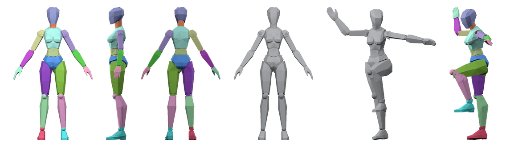

# Female mannequin

An articulated female mannequin for blocking: gray, faceless, 1.68 m tall, with the same skeleton and bone names as the
[mannequin](../mannequin/README.md), so a pose or a clip made for one fits the other. Every piece is bound to one bone
and turns whole, and ball joints fill the gap when a joint bends.



Approved by the author on 2026-11-27.

## Files

| File | What it is |
|---|---|
| `mannequin-female.glb` | the mannequin to use: skinned mesh, 23 bones, no animation |
| `cuts.json` | the cut heights measured on this model, read by the converter |
| `sheets/turnaround.webp` | the author's design sheet: five views, the head, the joints and the mesh |
| `source/meshy_four_views.glb` | the raw model the mannequin is converted from (see below) |

The bone hierarchy and the range of motion per joint are the mannequin's, in [`../mannequin/rig.json`](../mannequin/rig.json).

## The file

- glTF 2.0 binary, Y up, metres, facing +Z, with its left side on +X. The feet rest on y = 0.
- 6,283 triangles in two primitives: the pieces (material `gray`) and the ball joints (material `joint`).
- **Objects:** `MannequinFemale` (the armature), with its mesh `MannequinFemale_body`.
- **Skeleton:** the same 23 bones as the mannequin, `Root > Pelvis > Spine_01 > Spine_02 > Spine_03 > Neck > Head`, with
  the clavicles, arms and legs (`_L` and `_R`). `Root`, `Spine_02`, the clavicles and the toes only carry pivots.
- **Torso:** three pieces, as on the sheet: the chest with the bust, the abdomen and the pelvis. `Spine_01` turns on the
  pelvis seam, about 1.07 m high, and `Spine_02` on the abdomen seam, at 1.16 m.
- **Ball joints:** `Shoulder`, `ElbowJoint`, `HipJoint`, `KneeJoint` and `AnkleJoint` on each side, plus `NeckJoint`,
  and two torso fillers, `Waist` and `Belly`.

## Where it came from

Four views of the turnaround sheet (front, side, back and three-quarter) were sent to Higgsfield's `multi_image_to_3d`
model (Meshy) on 2026-11-27, untextured and rigged, for 25 credits. `tools/blender/convert_meshy_mannequin.py` turns
that model into this mannequin with the heights in `cuts.json`:

```bash
blender -b --factory-startup --python-exit-code 1 -P tools/blender/convert_meshy_mannequin.py -- assets/characters/mannequin-female/source/meshy_four_views.glb assets/characters/mannequin-female/mannequin-female.glb --cuts assets/characters/mannequin-female/cuts.json
```

Three cuts differ from the mannequin's:

- **Seams that rise toward the back:** the pelvis seam, the base of the neck and the line of the jaw are each a height
  plus a tilt (`[height at y = 0, tilt]`).
- **The shoulder:** the cap of the arm is split from the chest at 9.8 cm from the middle, and near the shoulder a face
  with a corner more than 6 cm from the arm's axis stays with the chest (`arm_radius`). Without that, a thin shard of
  the side of the chest followed the arm when it rose.
- **The pelvis:** its V is steeper (`v_slope` 1.15) and starts lower (`v_base` 0.865 m).

## Where it differs from the sheet

- It has 6,283 triangles, where the sheet asks for about 380.
- It stands in an A pose, with the arms more open than in the turnaround.
- The pieces were cut out of one mesh, not modelled one by one.
- The height, 1.68 m, was chosen when generating it: the sheet gives none.
- The balls of the shoulders and knees show a little at rest, as on the mannequin.
- A few small openings stay uncapped: the tips of two fingers, as Meshy made them, and the inner side of each shoulder
  cap, where the cut is not flat. They face the chest, and the test poses do not show them.

The mannequin is generic. Do not name it, or present it, after any commercial figure.

## License

The license of the mannequin, its source model and its design sheet is the maintainer's decision; until it is recorded
here, no license is granted beyond viewing them in this repository. The scripts that build it are code, under the
repository's MIT License.
