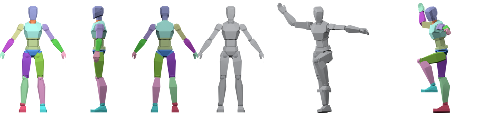

# Mannequin

An articulated male mannequin for blocking: gray, faceless, 1.75 m tall, every piece bound to one bone so it turns
whole, with ball joints that fill the gap when a joint bends.



Approved by the author on 2026-11-27.

## Files

| File | What it is |
|---|---|
| `mannequin.glb` | the mannequin to use: skinned mesh, 23 bones, no animation |
| `rig.json` | the sheet's bone hierarchy, range of motion per joint and piece table |
| `cuts.json` | the cut heights measured on this model, read by the converter |
| `sheets/` | the author's design sheets: turnaround, decomposition into pieces, bones, joint study |
| `source/meshy_four_views.glb` | the raw model the mannequin is converted from (see below) |

## The file

- glTF 2.0 binary, Y up, metres, facing +Z, with its left side on +X. The feet rest on y = 0.
- 5,630 triangles in two primitives: the pieces (material `gray`) and the ball joints (material `joint`).
- **Skeleton:** `Root > Pelvis > Spine_01 > Spine_02 > Spine_03 > Neck > Head`. The clavicles hang from `Spine_03`,
  followed by `UpperArm`, `LowerArm` and `Hand`, and the legs from `Pelvis`: `Thigh`, `Calf`, `Foot`, `Toe` (`_L` and
  `_R`).
- **Bones without mesh:** `Root`, `Spine_02`, the clavicles and the toes only carry pivots.
- **Spine pivots sit on the seams of the torso:** `Spine_01` at 1.035 m (on the pelvis), `Spine_02` at 1.232 m (on the
  abdomen) and `Spine_03` 6 cm above it.
- **Ball joints:** `Shoulder`, `ElbowJoint`, `HipJoint`, `KneeJoint` and `AnkleJoint` on each side, plus `NeckJoint`,
  and two torso fillers, `Waist` and `Belly`. Each sits on its bone's pivot and is hidden at rest.

## Where it came from

The four views of the turnaround sheet were sent to Higgsfield's `multi_image_to_3d` model (Meshy). That model returns
one fused mesh with an automatic Mixamo-like rig. `tools/blender/convert_meshy_mannequin.py` turns it into this
mannequin:

1. It renames the bones to the sheet's names and adds the `Root`.
2. It cuts the shell with a plane at each joint, splits and caps the pieces, and binds each piece to one bone.
3. It moves the spine pivots to the seams and adds the ball joints.

The seam heights are numbers measured on this particular model, kept in `cuts.json`:

```bash
blender -b --factory-startup --python-exit-code 1 -P tools/blender/convert_meshy_mannequin.py -- assets/characters/mannequin/source/meshy_four_views.glb assets/characters/mannequin/mannequin.glb --cuts assets/characters/mannequin/cuts.json
```

A new Meshy model needs them measured again, with `tools/blender/measure_meshy_model.py`.

## Where it differs from the sheet

- It has 5,630 triangles, where the sheet asks for about 400.
- It stands in an A pose, with the arms more open than in the turnaround.
- The pieces were cut out of one mesh, not modelled one by one.
- Two openings of the neck piece stay uncapped, because that cut follows a radius around the neck rather than a plane.
  The neck ball covers them.

The mannequin is generic. Do not name it, or present it, after any commercial figure.

## License

The license of the mannequin, its source model and its design sheets is the maintainer's decision; until it is recorded
here, no license is granted beyond viewing them in this repository. The scripts that build it are code, under the
repository's MIT License.
