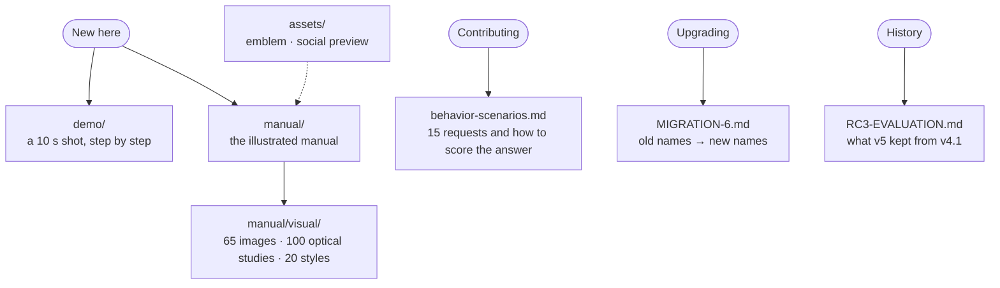
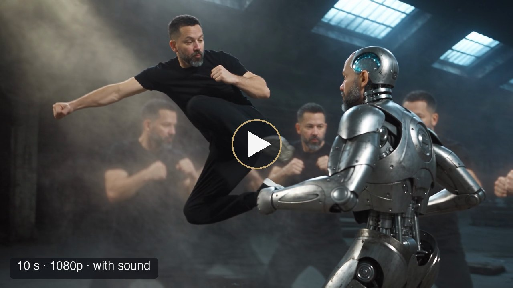
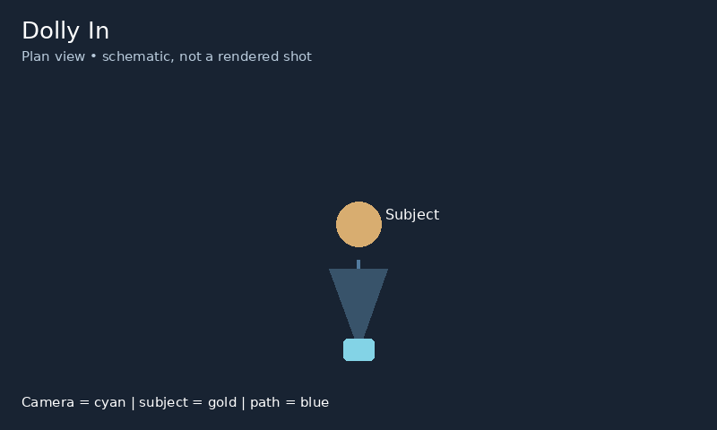
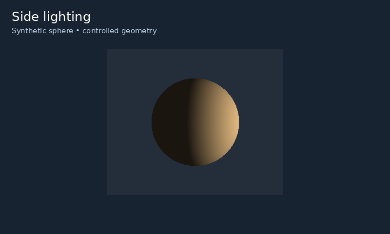
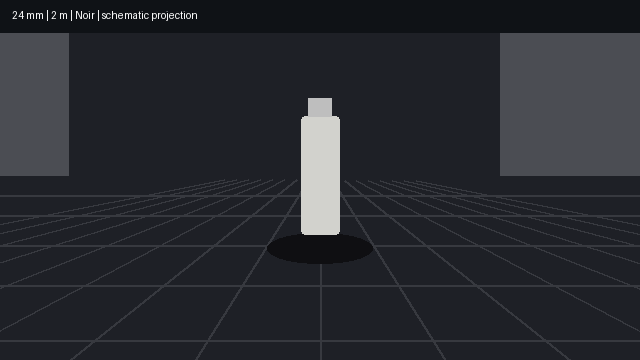

# Documentation: `docs/`

Everything here is for people. The skill never loads this folder: what the agent reads is in
[`higgsfield-director/`](../higgsfield-director/README.md).

| Path | What it is | Read it when |
|---|---|---|
| [demo/](demo/README.md) | a 10 s kung fu fight, made one step at a time, with each step's credits, the prompt and the sound | you want to see the process on a real shot |
| [manual/](manual/README.md) | the illustrated direction manual: 11 parts, from camera to production | you want to see what a camera move, a lens or a light does |
| [manual/visual/](manual/visual/README.md) | the manual's images, indexed with their rights: 65 images and animations, 100 optical studies, 20 style cards | you need one image, or its rights |
| [behavior-scenarios.md](behavior-scenarios.md) | 15 requests, what the skill must do with each, and how to score the answer | you changed the skill and want to check its behavior |
| [MIGRATION-6.md](MIGRATION-6.md) | the commands, fields and files renamed when the skill moved to English in 6.0 | you have projects or records from before 6.0 |
| [RC3-EVALUATION.md](RC3-EVALUATION.md) | the measured evaluation of the v4.1 RC3/RC4 package made with ChatGPT, and what v5 kept from it | you want to know where a part of the skill came from |
| [assets/](assets/) | the emblem and the image GitHub shows when the repository is shared | — |

## A look inside

| | | | |
|:---:|:---:|:---:|:---:|
|  **The demo** |  **Camera: dolly in** |  **Light: side light** |  **Optics: 24 mm at 2 m** |

The manual and its images are licensed CC BY-SA 4.0 ([LICENSE-DOCS.md](manual/LICENSE-DOCS.md)); the demo is not,
and [its folder](demo/README.md) says why.
