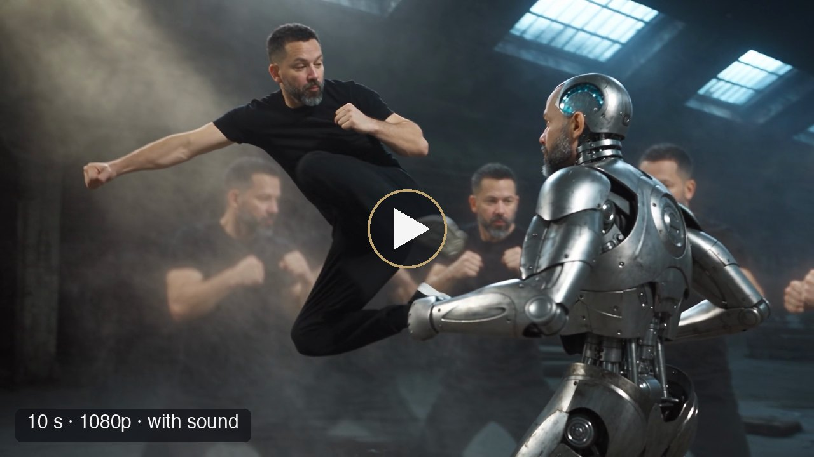
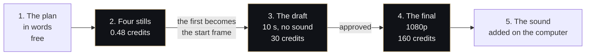
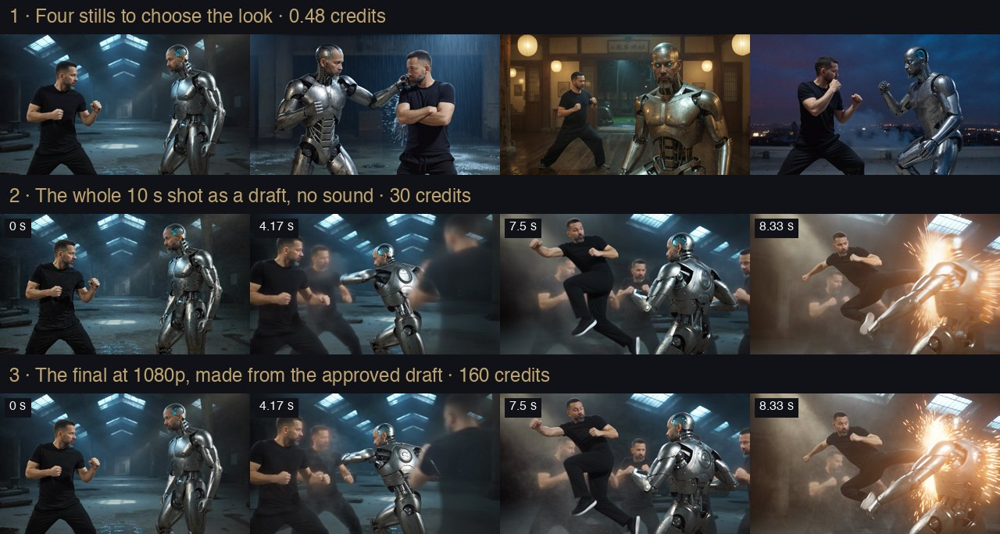

# Demo: a kung fu fight against a robot clone

<a href="kung-fu-vs-robot-clone.mp4"></a>

A 10 s shot at 1080p, with sound ([the video](kung-fu-vs-robot-clone.mp4), 9 MB). The man in it is the maintainer's
own character, trained on his face, and he agreed to publish it (2026-11-26). Everything else was generated: the
robot with his face, the copies, the warehouse.

## How it was made

One step at a time, the way the skill works ([How it works](../../README.md#how-it-works)): each step was quoted
first and paid only after an "ok".





| Step | What came out | Credits |
|---|---|---|
| 1. The plan | the fight in three beats: the robot attacks and he takes a punch; he splits into copies of mist; they close in, and his spinning kick sends the robot to the floor | 0 |
| 2. Four stills | four places and looks for the fight (Soul 2.0, with his character). The first, a dark warehouse, became the start frame. Before the draft, the idea of splitting into copies joined the plan, while changing it was still free | 0.48 |
| 3. The draft | the whole 10 s shot in Seedance 2.5's draft mode, without sound | 30 |
| 4. The final | the same shot at 1080p, made from the approved draft: it repeats the draft's motion, frame by frame, as the image above shows | 160 |
| 5. The sound | the final came back silent (below), so the sound was made apart | — |

Total on Higgsfield: 190.48 credits, as quoted.

**The sound.** A final made from a draft keeps the draft's motion, and here it also kept the draft's silence, although
the final asked for sound ([lesson 1](../../lessons-learned/2026-11-own-runs.md)). The sound was added afterwards on
the computer: 14 sound effects generated with ElevenLabs (12 made for this video, 2 reused from earlier ones), each
hit placed on the frame of its contact.

**The prompt** of the draft and the final, as it was sent. The start frame gave the man, the robot and the place:

```text
Cinematic fight scene, one continuous take, photorealistic, starting exactly from the reference frame: in a dark
abandoned warehouse, the man in a plain black t-shirt faces his robotic clone, a chrome robot with his face.
0-3 s: the robot attacks first with fast, precise strikes; the man blocks two, then takes a heavy punch to the jaw
and staggers back, hurt.
3-6 s: the robot strikes again, but the man bursts into a thin puff of grey mist and splits into two identical
copies of himself. The robot hits one copy and it splits again: four copies, then eight, all the same man in the
black t-shirt, surrounding the robot. The robot spins around, confused, its cyan eyes scanning.
6-10 s: all the copies close in at once with fast kung fu strikes from every side; the real man lands a spinning
kick in slow motion that sends the robot crashing to the floor in a burst of sparks. The copies dissolve into mist,
leaving him alone in a calm kung fu stance.
Handheld camera that orbits the robot while the copies multiply, dramatic lighting, no text, no logos.
```

## License

The video, its poster and the image of the steps are not covered by the repository's licenses (MIT for the code,
CC BY-SA 4.0 for the manual). Their license is the maintainer's decision, recorded here when made; until then, all
rights are reserved.

This folder is an exception, decided by the maintainer on 2026-11-26, to the rule that a production's material stays
outside this repository ([AGENTS.md](../../AGENTS.md)). `tools/public_boundary.py` allows exactly these three files.
