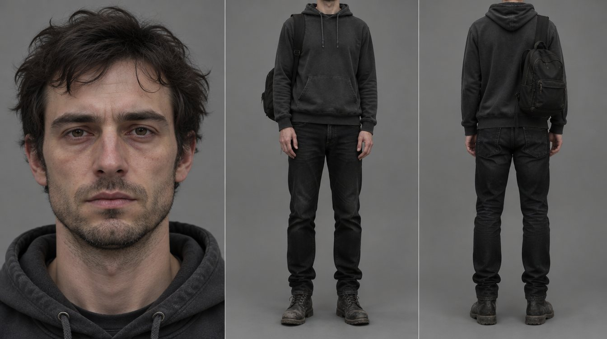
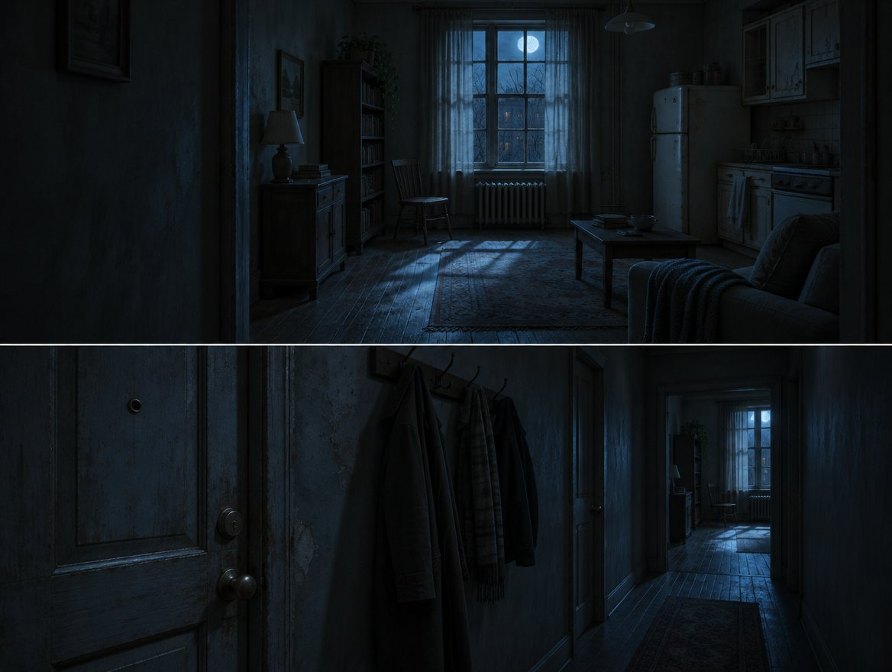
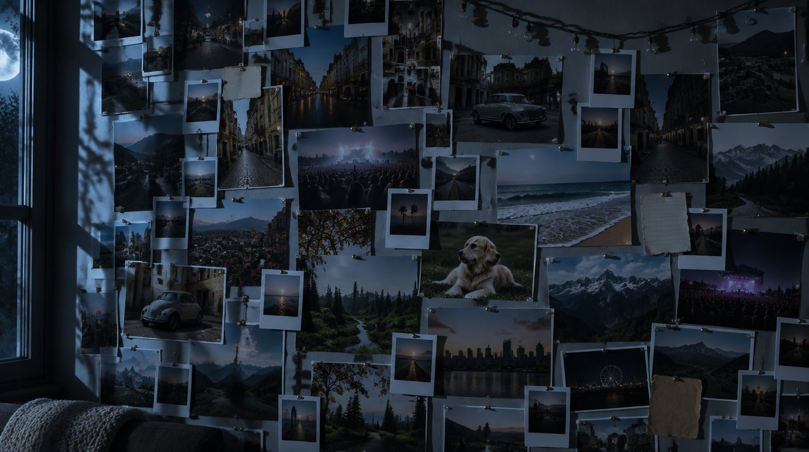
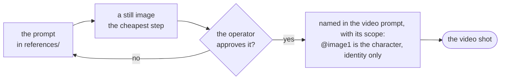

# Examples: `examples/`

What the skill's work looks like, ready to copy. The images here were made the way the skill asks, on generic scenes;
nothing here comes from a client or a real production.

| | | |
|:---:|:---:|:---:|
|  **Character sheet** one face; the body cropped at the neck |  **Location in two views** the room and the way in, no people |  **A set detail** the detail the action ends on |

[`references/`](references/README.md) holds the three images and the exact prompt that made each one.

## How a reference enters a video

A reference does one job, and the prompt says which: the face only, the layout of a place, or one object. A sheet's
grey background, for example, is named as something that stays out of the shot.

## More to look at

| Where | What you see |
|---|---|
| [docs/demo/](../docs/demo/README.md) | a whole shot made one step at a time: four stills, a draft, the 1080p final, with each step's credits |
| [higgsfield-director/templates/](../higgsfield-director/templates/README.md) | projects to copy: a 3-shot commercial, a shot from a photo, a score |
| [lessons-learned/tests/](../lessons-learned/tests/README.md) | the tests behind the lessons, with frame sheets |
| [calibration/](../calibration/README.md) | the blind rounds with and without the skill, and how each was voted |

The license of the three images is still the maintainer's to decide ([references/](references/README.md)).
