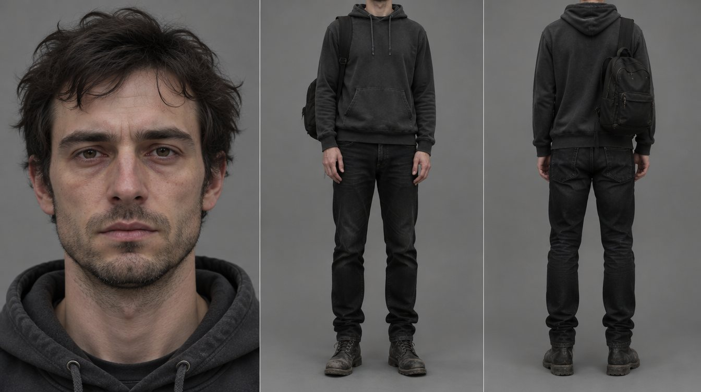
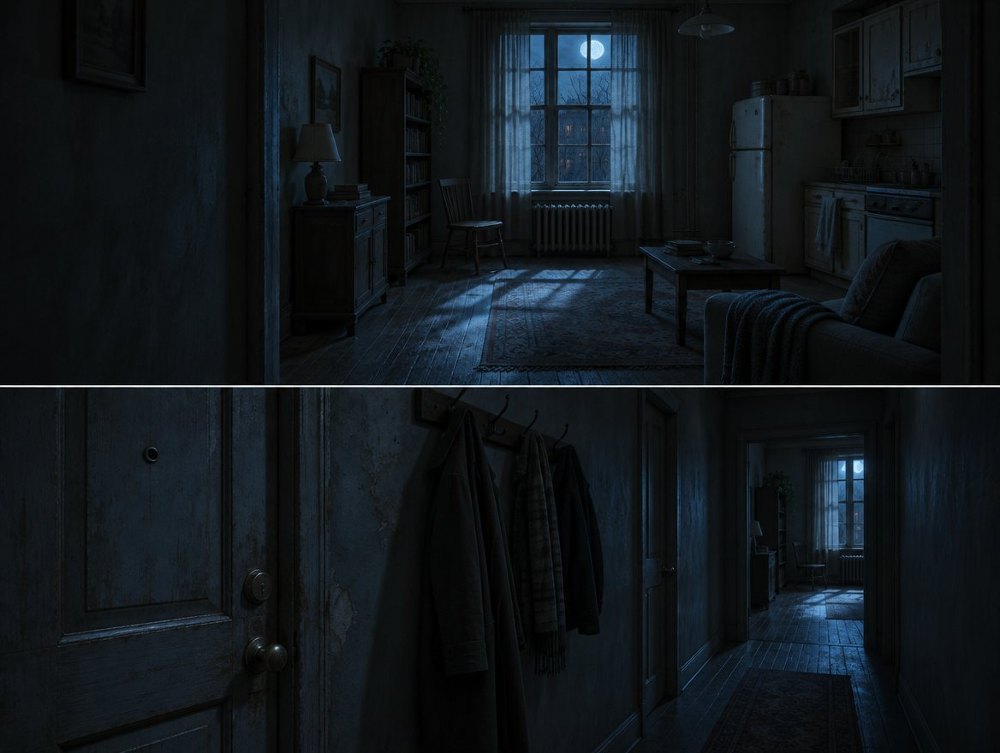
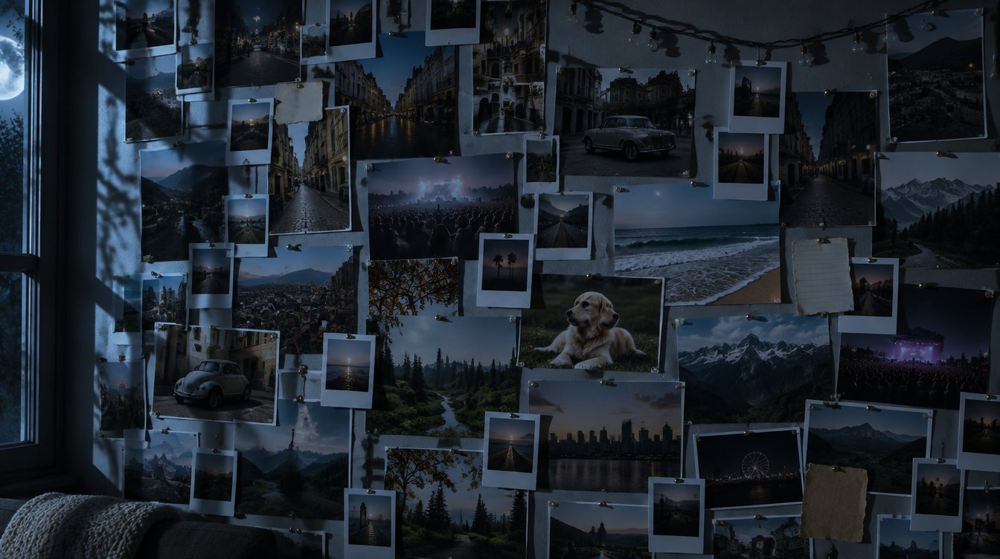

# Reference images: three examples

Three references made the way the skill asks ([`workflow.md`](../../higgsfield-director/references/workflow.md) §4 and
[`prompt.md`](../../higgsfield-director/references/prompt.md) §1), with the
prompt that made each one. They were generated on 2026-11-25 with GPT Image 2.6 through the Higgsfield connector, for
the reproduction of a lesson about unwanted cuts
([`2026-11-25-timed-beats-faithful.md`](../../lessons-learned/tests/2026-11-25-timed-beats-faithful.md)). The person is
fictional; the scene has no brand. Show them to the operator when a sheet, a location or a prop has to be explained.

The license of these three images is the maintainer's decision; until it is recorded here, no license is granted
beyond viewing them in this repository.

## Character sheet



One face, in one close-up; the other panels from the neck down, so the model has a single face to read; a neutral
mid-grey background and soft, even light. 16:9.

```text
Character reference sheet of one fictional man, three panels side by side on a neutral mid-grey seamless background,
soft even studio light. Left panel: a close-up of his face only, front view: early 30s, short messy dark hair,
three-day stubble, tired eyes, pale skin. Middle panel: full body from the front, cropped at the neck so no face is
visible: dark charcoal hoodie, black jeans, worn black boots, a small black backpack on one shoulder. Right panel: full
body from behind, cropped at the neck: the same hoodie, jeans, boots and backpack. Same person, same clothes in every
panel. Photorealistic, no text, no logos, no labels.
```

## Location in two views



One place seen from two points, so the model can rebuild the path between them: the room, wide, and the way in. No
people; the furniture the action passes is named in the prompt. 4:3.

```text
Two views of the same small, old one-bedroom apartment at night, stacked as two panels with a thin white divider. Top
panel: a wide view of the living room seen from the end of the entrance hallway: worn wooden floor, a low sofa on the
lower right, a small kitchen corner on the right with a fridge, a tall window on the far wall letting in cold blue
moonlight, the left wall in shadow. Bottom panel: the entrance hallway seen from the front door looking in: a narrow
dark corridor, coats on hooks, the opening into the living room at the far end, top right of the frame. No people.
Dark, cold moonlight, realistic, no text.
```

## A set detail



A detail the action ends on, as its own reference, so the video does not invent it. No close-up faces and no readable
text, which models tend to distort. 16:9.

```text
A section of a living room wall at night, covered edge to edge with dozens of pinned photographs and instant-film
prints: city streets, old cars, a beach, concert crowds seen from far away, a dog, mountains; a few small paper notes
and a strip of unlit fairy lights. Dim cold moonlight from the side, deep shadows, realistic texture of paper and pins.
No faces in close-up, no readable text, no logos.
```

## In a prompt

Each reference is named and given its scope ([`prompt.md`](../../higgsfield-director/references/prompt.md) §1): for example, "@image1 is the character:
identity only, the sheet's grey background stays out; @image2 is the apartment's layout; @image3 is the photo wall on
the left wall of the living room".
