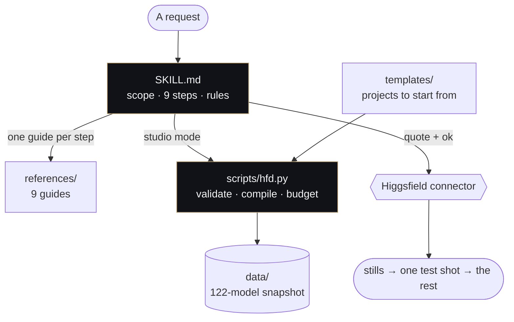

# The skill: `higgsfield-director/`

This folder **is** the skill, and the only folder you install: link it into a project's `.claude/skills/` (see the
[Quick start](../README.md#quick-start)). The agent reads [`SKILL.md`](SKILL.md) first, on every request, and opens
the rest only when a step needs it, so a quick prompt costs little.

| Part | What it holds | Who reads it |
|---|---|---|
| [`SKILL.md`](SKILL.md) | the scope, the 9-step flow and the rules that never bend | the agent, on every request |
| [`references/`](references/README.md) | 9 guides: flow, pre-production, prompt, vocabulary, models, connector, quality, modes, calibration | the agent, one guide per step |
| [`scripts/`](scripts/README.md) | `hfd.py`, the offline helper, and the blind-test runner | the agent, in studio mode |
| [`data/`](data/README.md) | the dated model snapshot and the scoring weights | `hfd.py` |
| [`templates/`](templates/README.md) | projects to copy and fill in | the agent, at the start of a studio job |
| [`tests/`](tests/README.md) | 151 unit tests, standard library only | CI and contributors |
| [`agents/openai.yaml`](agents/openai.yaml) | the name and default prompt Codex shows | Codex only |

## What happens on a request, for example

| Request | What the skill opens | What it spends |
|---|---|---|
| "Write the prompt for a 5 s coffee shot" | `SKILL.md` (and `modes.md` on first use) | nothing: it writes the prompt from the request |
| "Plan a 3-shot commercial and tell me the cost" | `workflow.md`, `models.md`, `connector.md`, `hfd.py` | nothing: free quotes, then it stops for the "ok" |
| "Go ahead" (after the ok) | `quality.md` (the checklist, then the review) | the approved step, with the running total after it |
| "The feet slide in my video" | `quality.md`, then `prompt.md` for the fix | nothing until a new try is approved |

Nothing of a production lives here: briefs, images, quotes and results stay in the operator's project folder. What a
good reference looks like is beside this folder, in [`examples/`](../examples/README.md).
