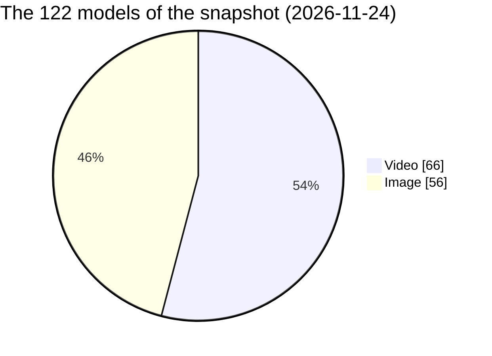
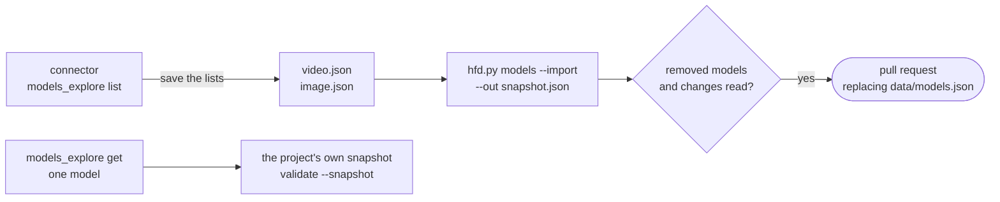
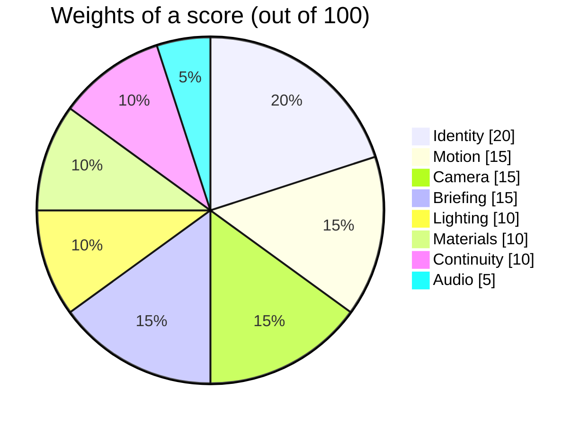

# The model snapshot: `data/`

What `hfd.py` knows about the models when there is no connector: a **dated** copy of the Higgsfield catalog, and the
weights of a score. The live catalog always wins; the snapshot is quoted with its date.

| File | What it holds | Used by |
|---|---|---|
| [models.json](models.json) | per model: id, name, type, provider, durations, aspect ratios, resolutions, audio, accepted media, modes and parameters; with the date and source of the import | `hfd.py validate`, `compile` and `models`; work without the connector |
| [weights.json](weights.json) | the weight of each criterion in a score, adding up to 100 | `hfd.py score` |

## Keeping it fresh

- **One job:** import the chosen model's `get` into the project's own snapshot and validate with `--snapshot`. The
  skill's file is not touched.
- **The whole snapshot:** when it is more than 30 days old, or a model the operator names is missing. Import all pages
  of the lists together: a list cut at 100 items would remove models that still exist
  ([`models.md`](../references/models.md)).

## The weights of a score

Each criterion is scored from 0 to 10 with the evidence seen. The total gives the verdict: excellent from 90,
approved with adjustments from 80, revise from 65, rejected below; a critical failure blocks it whatever the total.
