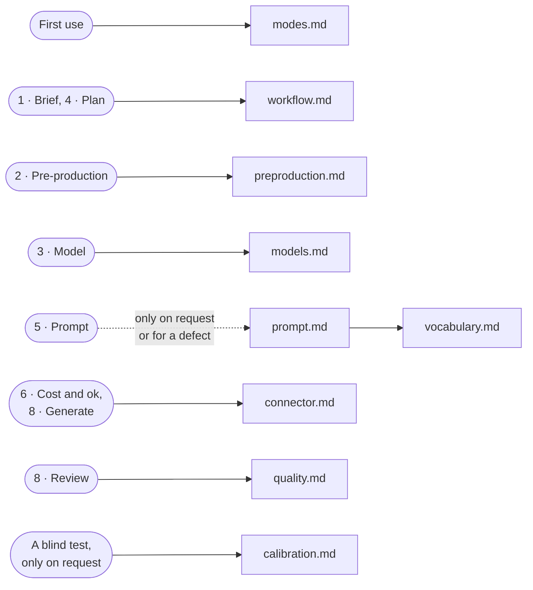
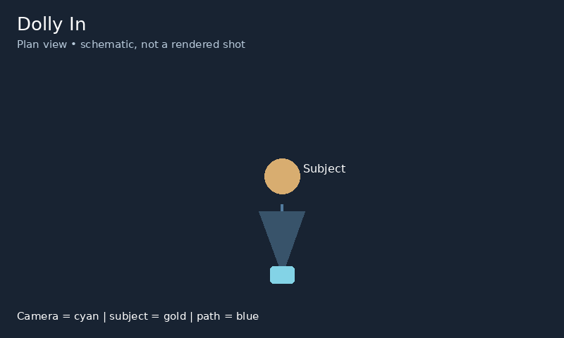
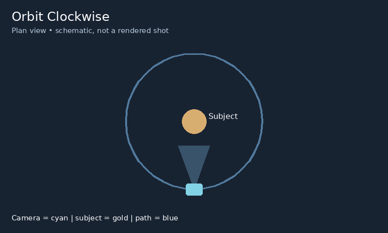
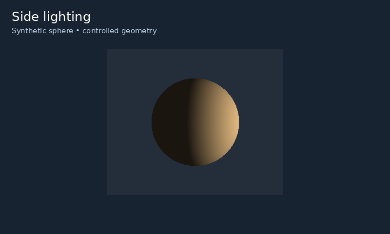
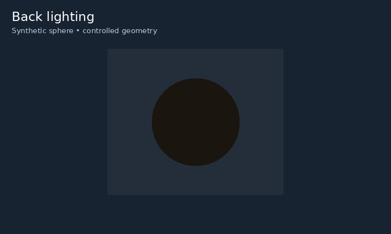

# Guides: `references/`

Nine guides the agent opens **one at a time**, only when a step of [`SKILL.md`](../SKILL.md) asks for it. Keeping
them out of `SKILL.md` keeps every request light: a quick prompt reads none of them.

| Guide | What it answers | Read at |
|---|---|---|
| [workflow.md](workflow.md) | the brief; quick or studio mode; structure by format; bibles and continuity; project fields; delivery | the brief, the plan, the delivery |
| [preproduction.md](preproduction.md) | idea → script draft → sketch storyboard → locked script → where to make the audio; the review page | pre-production |
| [prompt.md](prompt.md) | the golden order, notes per model, recipes against defects, short examples | only when the operator asks for a look or a control, brings a prompt to review, or a preview shows a defect |
| [vocabulary.md](vocabulary.md) | camera, framing, lens, light, color, physics, acting and audio terms | with `prompt.md` |
| [models.md](models.md) | choosing a model by need; the snapshot table; refreshing it | choosing the model |
| [connector.md](connector.md) | the Higgsfield tools in Claude and Codex; ready-made workflows; the call order; the authorization protocol | every quote and every generation |
| [quality.md](quality.md) | the pre-spend checklist; symptom → cause → change; looking at the result; the score | before spending, and after |
| [modes.md](modes.md) | first use; the `follow`, `price` and `ceiling` modes; the running total | first use |
| [calibration.md](calibration.md) | a blind test with and without the skill, and its record | only when the operator asks |

The words of `vocabulary.md` are drawn in the [illustrated manual](../../docs/manual/README.md):

| | | | |
|:---:|:---:|:---:|:---:|
|  **Dolly in** |  **Orbit** |  **Side light** |  **Back light** |

A plain request needs none of these words: the skill writes the prompt from the request as it was said, and the
vocabulary comes in when the operator asks for a look.
