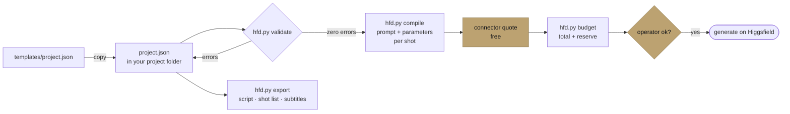

# The helper: `scripts/`

[`hfd.py`](hfd.py) is one Python file: Python 3.9 or later, standard library only, no network access. It checks a
project before any credit is spent and turns it into what the connector needs. **It never generates and never
spends:** generation goes through the Higgsfield connector, after a quote and the operator's "ok".



| Command | What it does |
|---|---|
| `validate PROJECT` | structure, camera text, dialogue length, timeline, continuity, the 180° axis, model limits |
| `compile PROJECT [--text]` | one prompt per shot, joined only from the fields filled in, plus connector-ready `parameters` |
| `budget [PROJECT] [--reserve N]` | total credits from real quotes, attempts and a reserve (20% unless given); refuses to guess a price |
| `export PROJECT DIR` | `script.md`, `shots.csv`, and `subtitles.srt` when a shot has dialogue |
| `optics F D N` | field of view, frame width, depth of field, hyperfocal distance |
| `score EVALUATION` | a weighted score with evidence per criterion; a critical failure blocks |
| `models [--type T] [--search S] [--id ID]` | read the model snapshot |
| `models --import LIST... --out FILE` | build a fresh snapshot from the connector's lists, written only to `--out` |
| `preferences [--mode M]` | read or store how the operator wants to work (`follow`, `price`, `ceiling`); refuses a spending field |
| `crop SHEET DIR NAME:x0,y0,x1,y1...` | write the ffmpeg commands that cut a sketch sheet into frames; runs nothing |
| `blind`, `result` | draw X, Y and the order for a blind test, and build its record; only when the operator asks for one |

`--snapshot FILE` swaps the model snapshot for one job. Exit code `1`: the project has errors, listed in `errors`. Exit code `2`: usage, file or input in the wrong format,
with the message in `error`, never a traceback. Output is JSON.

## A plain shot, compiled

A shot that gives only a subject and an action gets a prompt with only those, and the parameters apart:

```json
{"title": "Plain request", "model": "cinematic_studio_video_4_0", "mode": "t2v", "aspect_ratio": "16:9",
 "shots": [{"id": "T01", "duration": 5, "subject": "A baker in a neighbourhood bakery",
            "action": "At dawn, the baker takes the first batch of bread rolls out of the oven"}]}
```

```text
$ python3 hfd.py compile plain.json --text
## T01
A baker in a neighbourhood bakery. At dawn, the baker takes the first batch of bread rolls out of the oven.

parameters: {"model": "cinematic_studio_video_4_0", "duration": 5, "aspect_ratio": "16:9", "generate_audio": false}
```

`validate` on the same file: zero errors, zero warnings.

## The blind-test runner

[`calibrate_claude_code.sh`](calibrate_claude_code.sh) runs one request in two new Claude Code sessions, with and
without the skill, and saves each side's `params.json`. Each session may read, write its own files, run `python3`,
read the model catalog and ask for quotes, and nothing else, so neither side can generate. It is for a blind test the
operator asks for ([`calibration.md`](../references/calibration.md)); it stops if the skill is installed for the whole
user, because the "without" side would see it.
