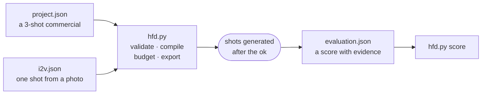

# Starting points: `templates/`

Three JSON files to copy into the operator's project folder and fill in. `hfd.py` reads them; none of them is a real
production.



| Template | For | What it holds |
|---|---|---|
| [project.json](project.json) | a job of several shots: a 3-shot perfume commercial | the model, aspect ratio and resolution; **bibles** for what repeats (here the bottle, with its fixed color and cap); constraints; three shots; the 180° axis |
| [i2v.json](i2v.json) | one shot animated from a photo | the model; what to **preserve** (face, hair, wardrobe, background); the approved photo as the start image; one 5 s shot |
| [evaluation.json](evaluation.json) | scoring a generated shot | per criterion (identity, motion, camera, light, materials, continuity, briefing, audio), a score and the **evidence** seen; a critical failure |

## How a bible holds a product

A bible's description opens every shot that lists it, word for word: the same sentence in every prompt is what
holds the product's identity across generations.

```json
"P01": {"type": "product",
        "description": "A black glass perfume bottle with a faceted gold cap and a flat cream label reading NOIR",
        "fixed": {"color": "black", "cap": "gold"},
        "variable": {"position": "can change"}}
```

`validate` stops with an error when a shot contradicts what the bible fixes, for example a red bottle in shot 2; a
fixed attribute has no exception. What `variable` lists may change, and a change between shots (the bottle ends on
the plinth, the next shot starts it in a hand) is an error too unless the next shot declares it in
`approved_changes`, as `"P01.position"`.

## No price in a template

The templates carry no `test_cost` or `final_cost`, on purpose: prices change at any time, and a number written in a
file goes stale without anyone noticing. The agent quotes each shot live with the connector's estimate (free) and
writes what came back into the shot; until then `budget` refuses to run.

## Fill only what the request gives

`project.json` fills camera, optics and lighting to show where they go when a request asks for a look. For a plain
request, leave them out: `compile` joins only what is filled in ([`scripts/`](../scripts/README.md#a-plain-shot-compiled)).
