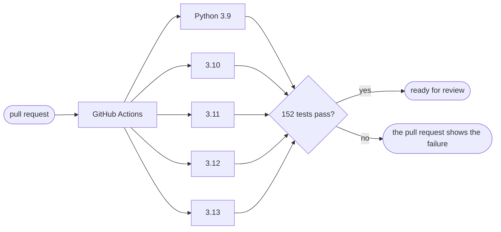
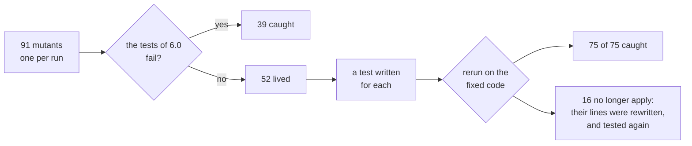

# Tests: `tests/`

152 `unittest` cases, standard library only, with no network and no credits. CI runs them on every pull request, on
Python 3.9 to 3.13.

```bash
cd higgsfield-director && python3 -m unittest discover -s tests -v
```



| Group | Tests | What it protects |
|---|---:|---|
| Camera | 6 | a negation ("static camera, no orbit") is not a conflict; phases are allowed; two moves at once warn and never block |
| Model and audio | 11 | durations, aspect ratios and resolutions within the model; audio as each model takes it; image-to-video modes |
| Continuity | 6 | bibles repeat in every shot; fixed attributes; declared changes; the 180° axis |
| Rules | 7 | dialogue that fits the duration and has a speaker; no overlapping timeline; no empty lines from empty fields |
| Calculations | 4 | the budget refuses to guess a price; the optics formulas; a score needs evidence |
| Files | 7 | export; importing the catalog; the templates validate on the real snapshot; exit codes |
| Robustness | 4 | wrong shapes become listed errors, never a traceback |
| Review | 7 | budget rounding, attempts, subtitles; an import that writes only where `--out` says and keeps the models it did not bring |
| Skill | 3 | the frontmatter; every path `SKILL.md` and the guides cite exists; `SKILL.md` stays under 200 lines |
| Modes and calibration | 11 | the first-use question asks only the working mode; the preferences file refuses a spending field; the blind draw keeps its key closed |
| Old names | 10 | the Portuguese commands, fields and files from before 6.0 still work, with a warning |
| Crop | 4 | a valid box becomes a crop command; an invalid one is an error with no command |
| Mutation killers | 34 | one test per planted defect that the suite used to let through (below) |
| Review fixes | 16 | one test per defect a review reproduced in 6.0; each one fails on that version |
| Prices | 15 | the day's price table: one quote per model and tier; the connector's shortlist and a model new in the catalog join it; the import says what changed or that nothing did; `budget --prices` plans only from today's table |
| This file | 1 | running `python3 tests/test_hfd.py` directly runs every class, not only the ones above a stray `unittest.main()` |
| Security regressions | 6 | huge numbers, non-finite JSON and oversized files are refused before they cost memory |

## A test is worth what it catches

The only way to know is to break the code on purpose and see whether a test fails. When 5.0.0 was written, 4 defects
were planted, and the tests caught all 4 ([CHANGELOG](../../CHANGELOG.md)). In November 2026 a review planted 91
small defects ("mutants"): a reserve read as a fraction, a blind key written next to the requests, a spending field
let into the preferences, a missing price guessed as 0.



A mutant that lives is a line a test does not read. The checks of the rest of the repository are in
[`tools/`](../../tools/README.md).
