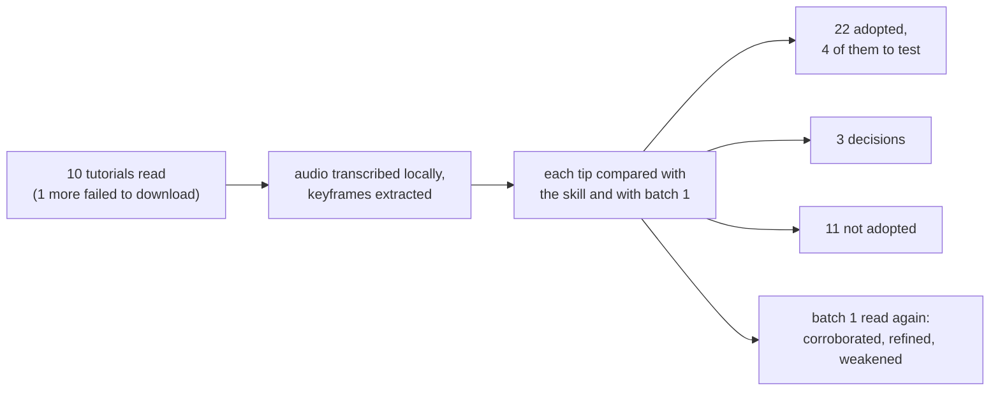

# Lessons from Higgsfield's YouTube channel, batch 2

Collected on 2026-11-25 from ten more tutorials on the official channel
([youtube.com/@HiggsfieldAI](https://www.youtube.com/@HiggsfieldAI)), the next ones by views after
[batch 1](2026-11-higgsfield-channel.md). The method is the same: the audio transcribed locally, keyframes
extracted, each tip compared with the skill and with batch 1. This is the vendor's own channel: almost every tip
rests on one example, and none was measured here. One video of this range failed to download and moves to the next
batch.

Strength: **high** when several videos agree or the catalog confirms it; **medium** when one video explains or shows
it; **low** when it is a single claim, adopted as something to test.

## Sources

| # | Video | Published |
|---|---|---|
| 13 | [How To Make a Luxury Perfume Commercial With AI (Full Breakdown)](https://www.youtube.com/watch?v=em66Mvt8QLc) | 2026-03-27 |
| 14 | [How to Make AI Films That Don't Look AI (Full Tutorial)](https://www.youtube.com/watch?v=-scKERL7PK0) | 2026-05-09 |
| 15 | [I Mixed AI With Real Footage! (Premiere Pro + Higgsfield AI)](https://www.youtube.com/watch?v=DvRGamF7uRo) | 2026-06-05 |
| 16 | [How We Made an AI Short Drama That Looks Like a Real Movie](https://www.youtube.com/watch?v=cBxKZcalwkM) | 2026-10-22 |
| 17 | [Seedance 4K Just Made AI Filmmaking Look Ultra Realistic!](https://www.youtube.com/watch?v=bY8RDKoBwU0) | 2026-06-25 |
| 18 | [I Made a Viral Christmas Ad in One Night With AI](https://www.youtube.com/watch?v=AdjllfZuqYM) | 2025-12-23 |
| 20 | [How I Built a Car Commercial With AI (Every Prompt I Used)](https://www.youtube.com/watch?v=GNxmt_4IifA) | 2026-08-03 |
| 21 | [GPT-6 Astra + After Effects Creates Motion Graphics in Minutes!](https://www.youtube.com/watch?v=W3-RIZ-Ps64) | 2026-09-21 |
| 22 | [The Newest Workflow For Ultra Realistic AI Characters (Seedance 2.5 in 4K + Claude Fable 5.2)](https://www.youtube.com/watch?v=FRukXPBqlNo) | 2026-11-14 |
| 23 | [How to Make a Wedding Love Story Using AI (Full Tutorial)](https://www.youtube.com/watch?v=QfylrxtQSSs) | 2026-08-21 |

## Adopted

Times are minute:second, or hour:minute:second in video 14 (three hours long).

| # | Lesson | Sources | Evidence | Strength | Where it went |
|---|---|---|---|---|---|
| 1 | A continuous action written as timed phases, and then as untimed paragraphs, made Seedance 2.0 cut despite a "no cuts" line; written as one continuous motion, with a slower walk, it did not. Kept as the first suspect for an unwanted cut. | 14 [1:16:48](https://www.youtube.com/watch?v=-scKERL7PK0&t=4608s)–[1:20:19](https://www.youtube.com/watch?v=-scKERL7PK0&t=4819s) | shown on the timeline; the transcript was checked; [not reproduced here](tests/2026-11-25-timed-beats.md) in a simpler form (Seedance 2.5, a short prompt, no references), nor [in a closer one](tests/2026-11-25-timed-beats-faithful.md) (Seedance 2.0, three references, the tutorial's prompt structure: 0 of 4) | low | `references/prompt.md` §1 and §2 (blocking render); `references/quality.md`, "Cuts inside a shot" |
| 2 | Several shots in one generation: Cinema Studio 3.5 has `multi_shots`, `multi_shot_mode` (`auto` or `custom`) and `multi_prompt` (up to 6 shots, each with a prompt and a duration). Its defaults: prompt language Chinese, audio off. | 13 [08:33](https://www.youtube.com/watch?v=em66Mvt8QLc&t=513s)–[09:41](https://www.youtube.com/watch?v=em66Mvt8QLc&t=581s) and [16:34](https://www.youtube.com/watch?v=em66Mvt8QLc&t=994s) (manual multi-shot panel on screen); 20 [21:15](https://www.youtube.com/watch?v=GNxmt_4IifA&t=1275s) and [27:47](https://www.youtube.com/watch?v=GNxmt_4IifA&t=1667s) | live catalog, 2026-11-25 | high | `references/models.md`; `references/prompt.md` §4; `references/quality.md` |
| 3 | Cinema Studio 4.0 accepts a start and an end frame; in the connector it has no camera-movement or frame-rate parameter, so movement stays in the text. | 13 [17:55](https://www.youtube.com/watch?v=em66Mvt8QLc&t=1075s) (movement chosen on the website) | live catalog, 2026-11-25 | high | `references/models.md`; `references/prompt.md` §4 |
| 4 | Approved start and end frames for a change of state or place inside one shot. | 13 [19:03](https://www.youtube.com/watch?v=em66Mvt8QLc&t=1143s) and [22:17](https://www.youtube.com/watch?v=em66Mvt8QLc&t=1337s); 15 [02:46](https://www.youtube.com/watch?v=DvRGamF7uRo&t=166s) | said | medium | `references/prompt.md` §2 |
| 5 | Any good frame, not only the last, can open the next shot. | 13 [08:33](https://www.youtube.com/watch?v=em66Mvt8QLc&t=513s), [09:17](https://www.youtube.com/watch?v=em66Mvt8QLc&t=557s), [09:41](https://www.youtube.com/watch?v=em66Mvt8QLc&t=581s) | said, three uses in one piece | medium | `references/prompt.md` §2; `references/workflow.md` §4 |
| 6 | Patches pile up: an image edited many times loses its layout, and a prompt patched many times breaks; rewrite from the approved plan. When every attempt fails the same way, rewrite; when nearly right, more attempts. | 14 [0:23:23](https://www.youtube.com/watch?v=-scKERL7PK0&t=1403s)–[0:28:47](https://www.youtube.com/watch?v=-scKERL7PK0&t=1727s), [0:39:41](https://www.youtube.com/watch?v=-scKERL7PK0&t=2381s), [1:40:03](https://www.youtube.com/watch?v=-scKERL7PK0&t=6003s), [2:23:07](https://www.youtube.com/watch?v=-scKERL7PK0&t=8587s), [0:48:50](https://www.youtube.com/watch?v=-scKERL7PK0&t=2930s)–[0:52:38](https://www.youtube.com/watch?v=-scKERL7PK0&t=3158s) | said; the new results are shown | medium | `references/quality.md`, diagnosis and notes; `references/prompt.md` §2 (Edit) |
| 7 | With a reference attached, the text does not repeat its look (that added new characters); each reference gets a fixed name. | 14 [0:35:25](https://www.youtube.com/watch?v=-scKERL7PK0&t=2125s), [0:45:04](https://www.youtube.com/watch?v=-scKERL7PK0&t=2704s); 16 [04:23](https://www.youtube.com/watch?v=cBxKZcalwkM&t=263s) | shown in 14; the name on screen in 16 | medium | `references/prompt.md` §1 |
| 8 | The camera anchored to an object in the set; "closer" moved the subject, not the camera. | 14 [1:29:36](https://www.youtube.com/watch?v=-scKERL7PK0&t=5376s)–[1:49:20](https://www.youtube.com/watch?v=-scKERL7PK0&t=6560s) (right at [1:33:09](https://www.youtube.com/watch?v=-scKERL7PK0&t=5589s), wrong at [1:36:04](https://www.youtube.com/watch?v=-scKERL7PK0&t=5764s)) | shown | medium | `references/prompt.md` §1 |
| 9 | Clean the location image before any video: text, background cars, whatever the model multiplies. | 20 [12:12](https://www.youtube.com/watch?v=GNxmt_4IifA&t=732s)–[12:52](https://www.youtube.com/watch?v=GNxmt_4IifA&t=772s), [27:26](https://www.youtube.com/watch?v=GNxmt_4IifA&t=1646s)–[27:47](https://www.youtube.com/watch?v=GNxmt_4IifA&t=1667s) | said | medium | `references/workflow.md` §4; `references/quality.md`, diagnosis |
| 10 | A location built for the action: three-quarter view, free space for the action, the crowd already in the image, the place fixed before the people. | 16 [06:53](https://www.youtube.com/watch?v=cBxKZcalwkM&t=413s), [15:06](https://www.youtube.com/watch?v=cBxKZcalwkM&t=906s); 23 [06:08](https://www.youtube.com/watch?v=QfylrxtQSSs&t=368s)–[06:50](https://www.youtube.com/watch?v=QfylrxtQSSs&t=410s), [18:38](https://www.youtube.com/watch?v=QfylrxtQSSs&t=1118s); 13 [20:07](https://www.youtube.com/watch?v=em66Mvt8QLc&t=1207s) | said | medium to low | `references/workflow.md` §4 |
| 11 | One map or sketch per shot when positions change, used as that shot's reference. | 23 [14:14](https://www.youtube.com/watch?v=QfylrxtQSSs&t=854s)–[15:21](https://www.youtube.com/watch?v=QfylrxtQSSs&t=921s); 20 [29:34](https://www.youtube.com/watch?v=GNxmt_4IifA&t=1774s) (diagram on screen) | said and shown | medium | `references/workflow.md` §4 |
| 12 | One change per image edit; many people in one image break the faces, so generate them one at a time and assemble outside. | 18 [02:49](https://www.youtube.com/watch?v=AdjllfZuqYM&t=169s)–[03:54](https://www.youtube.com/watch?v=AdjllfZuqYM&t=234s), [10:28](https://www.youtube.com/watch?v=AdjllfZuqYM&t=628s); 14 [0:33:21](https://www.youtube.com/watch?v=-scKERL7PK0&t=2001s), [0:43:29](https://www.youtube.com/watch?v=-scKERL7PK0&t=2609s)–[0:45:50](https://www.youtube.com/watch?v=-scKERL7PK0&t=2750s) | the results are shown | medium | `references/workflow.md` §4; `references/prompt.md` §2; `references/quality.md` |
| 13 | Action and performance in separate shots when they compete in one prompt. | 20 [16:25](https://www.youtube.com/watch?v=GNxmt_4IifA&t=985s), [30:21](https://www.youtube.com/watch?v=GNxmt_4IifA&t=1821s); 23 [12:38](https://www.youtube.com/watch?v=QfylrxtQSSs&t=758s), [19:19](https://www.youtube.com/watch?v=QfylrxtQSSs&t=1159s) | said | medium | `references/prompt.md` §1 |
| 14 | In an edit of real footage, say exactly where the change happens; the tutorials mark the area on a frame. | 15 [01:55](https://www.youtube.com/watch?v=DvRGamF7uRo&t=115s)–[02:17](https://www.youtube.com/watch?v=DvRGamF7uRo&t=137s); 17 [04:14](https://www.youtube.com/watch?v=bY8RDKoBwU0&t=254s)–[05:52](https://www.youtube.com/watch?v=bY8RDKoBwU0&t=352s) | said | medium | `references/prompt.md` §2 |
| 15 | "No music" is a request, not a guarantee; with no sound needed, turn audio off. | 14 [2:57:51](https://www.youtube.com/watch?v=-scKERL7PK0&t=10671s) | heard | medium | `references/prompt.md` §3; `references/quality.md` |
| 16 | A face that drifts from the approved one is fixed on the sheet's face panel. | 23 [04:41](https://www.youtube.com/watch?v=QfylrxtQSSs&t=281s)–[05:22](https://www.youtube.com/watch?v=QfylrxtQSSs&t=322s); 20 [04:40](https://www.youtube.com/watch?v=GNxmt_4IifA&t=280s)–[05:45](https://www.youtube.com/watch?v=GNxmt_4IifA&t=345s) | said; the sheets are on screen in 23 | medium to low | `references/workflow.md` §4; `references/quality.md`, "Face changes" |
| 17 | A free check for duplicated frames when the motion looks choppy. | 14 [2:03:24](https://www.youtube.com/watch?v=-scKERL7PK0&t=7404s)–[2:08:44](https://www.youtube.com/watch?v=-scKERL7PK0&t=7724s) | shown in the edit; the command was tested here on synthetic clips | low (the check is cheap) | `references/quality.md`, checks that spend no credits |
| 18 | Every attempt refused by the content filter points to the text (eight of eight in the tutorial: a kiss in a bed and wet clothes in the description; rewritten, it passed). One refusal among passes does not: here, one of two identical, neutral requests was refused and refunded. Retry that once, with the operator's ok. | 14 [2:01:43](https://www.youtube.com/watch?v=-scKERL7PK0&t=7303s)–[2:02:44](https://www.youtube.com/watch?v=-scKERL7PK0&t=7364s) | shown on screen ([2:02:01](https://www.youtube.com/watch?v=-scKERL7PK0&t=7321s), the eight refusals; [2:02:35](https://www.youtube.com/watch?v=-scKERL7PK0&t=7355s), the diagnosis); measured here once ([card](tests/2026-11-25-timed-beats.md#result)) | medium | `references/quality.md`, diagnosis |
| 19 | To test: an accent described by how it sounds, the same voice description in every shot. | 16 [08:44](https://www.youtube.com/watch?v=cBxKZcalwkM&t=524s)–[10:12](https://www.youtube.com/watch?v=cBxKZcalwkM&t=612s) | said | low, to test | `references/prompt.md` §3 |
| 20 | To test: a hummed melody as an audio reference. | 23 [21:19](https://www.youtube.com/watch?v=QfylrxtQSSs&t=1279s)–[22:44](https://www.youtube.com/watch?v=QfylrxtQSSs&t=1364s) | said | low, to test | `references/prompt.md` §3 |
| 21 | To test: traffic in a tighter frame, without intersections. | 20 [20:13](https://www.youtube.com/watch?v=GNxmt_4IifA&t=1213s)–[21:15](https://www.youtube.com/watch?v=GNxmt_4IifA&t=1275s) | said | low, to test | `references/prompt.md` §6 |
| 22 | To test: a planned change of state as a removable prop. | 20 [06:28](https://www.youtube.com/watch?v=GNxmt_4IifA&t=388s)–[06:50](https://www.youtube.com/watch?v=GNxmt_4IifA&t=410s) | said | low, to test | `references/workflow.md` §4 |

## Decisions

- **Timed phases** (lesson 1). A continuous action is written as one continuous motion; a phase with its time only
  when the camera's movement changes, and after a test on that model. This replaces "write it phase by phase, with
  the time of each phase" for a path copied from a blocking reference: the reference carries the timing. **Revised
  after a test here** ([card](tests/2026-11-25-timed-beats.md)): in a simpler form the cut did not happen, so timed
  beats became the first suspect for an unwanted cut instead of a rule. A [closer reproduction](tests/2026-11-25-timed-beats-faithful.md)
  did not cut either (0 of 4), so they are now one suspect among others.
- **Fixing a face on the sheet** (lesson 16). Allowed with the character's approved face, generated, or a real
  person's with the consent the operator declares. Swapping faces with another tool stays outside the skill.
- **Automatic multi-shot** (lesson 2). Cinema Studio 3.5's `auto` mode serves to explore angles, with a quote, and its
  cuts are expected there. For the final piece, `custom` mode with each shot's prompt and duration.

## What batch 2 says about batch 1

- **Corroborated:** lesson 1, one face per sheet (16 [05:07](https://www.youtube.com/watch?v=cBxKZcalwkM&t=307s), and the prompt on screen in 20); 2, the layout map (14,
  16, 20); 3, a new reference for a change of state (14, 16); 4, show instead of describe (14, 15, 20, 23); 5, the
  reverse shot (14, after four attempts); 7, extras from a group reference (16, 23); 8, attempts in the budget (13,
  14, 18, 20, 23); 10, edits of the operator's footage (15, 17).
- **Refined:** lesson 9, one note per defect, holds until the patches pile up (lesson 6 above).
- **Weakened:** lesson 6, named gestures: the wrong hand came back in three attempts (14 [2:10:02](https://www.youtube.com/watch?v=-scKERL7PK0&t=7802s), [2:20:23](https://www.youtube.com/watch?v=-scKERL7PK0&t=8423s), [2:24:21](https://www.youtube.com/watch?v=-scKERL7PK0&t=8661s)).
- **No new evidence:** lesson 11 (the previous clip as a video reference) and lesson 13 (music as a beat reference).

## Not adopted

- Prices and credit counts (13, 14, 16, 17, 18, 22, 23): the skill always quotes.
- "Best model" opinions (Soul, Seedream, GPT Image, Seedance 2.5 and physics).
- Video 21 as a whole (motion graphics in After Effects) and the editing tips (scanlines, speed ramps, an editing
  plugin, the music track, L-cuts, already in `references/vocabulary.md`): editing is outside the skill.
- A creature built in layers with a hard-flash reference photo (22): the connector has its own `monsters` workflow,
  which the skill already loads for creatures.
- Beats for a short series (16): micro-drama is a connector workflow.
- A named emotion with a micro-gesture (14): one success and one failure in the same video; the current rule
  (stimulus → observable reaction) stays.
- A static video shot used to harvest consistent frames (20): it spends video to make images.
- A palette taken from an image (20): Cinema Studio 4.0's `color_palette` takes a preset id, not an image.
- The order and index of references, two angles pasted into one image (14): one example, partial effect.
- Negative phrases in the channel's prompts: batch 1's decision stays.
- A 3,000-character prompt limit and failed generations not being billed (14): not shown in the catalog.

## Catalog check (2026-11-25, `models_explore get`)

- Cinema Studio 3.5: `multi_shots`, `multi_shot_mode` (`auto`, `custom`; default `custom`), `multi_prompt` (up to 6
  items with `prompt` and `duration`), `camera_style`, `light_scheme`, `color_grading`, `style_prompt`,
  `enhance_prompt` (default off), `prompt_language` (`en` or `zh`, default `zh`), `generate_audio` (default off),
  duration from 4 s (default 15), up to 15 media in all, start and end frames.
- Cinema Studio 4.0: start and end frames in `omni_reference` mode; no camera-movement or frame-rate parameter.
- Seedance 2.5: no frame-rate parameter and no prompt rewriter in the parameters.
- Kling 3.0: tagged "multi-shot", with no multi-shot parameter in the connector.

## Still open

- Lessons 19 to 22 are things to test; their original conditions are in [tests/to-test.md](tests/to-test.md).
  Lesson 1 still needs a faithful reproduction of the original.
- The video that failed to download goes into batch 3, with the remaining videos of the channel.
