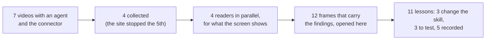

# Lessons from Higgsfield's YouTube channel, batch 4: an agent driving the connector

Collected on 2026-11-27 from the official channel ([youtube.com/@HiggsfieldAI](https://www.youtube.com/@HiggsfieldAI)),
after [batch 1](2026-11-higgsfield-channel.md), [batch 2](2026-11-higgsfield-channel-2.md) and
[batch 3](2026-11-higgsfield-channel-3.md). This batch chose the channel's videos in which an AI agent (Claude or
GPT-6 Astra) uses the Higgsfield connector: the same setup this skill runs in. Batch 3 had read two of them (videos
28 and 43). The question here is what the vendor's own videos show an agent doing with the connector, and where that
confirms, contradicts or adds to the skill.

Seven videos were chosen; four were read. The video site asked the collector to prove it was not a robot on the
fifth download, and the collector stopped there without trying again (videos 48 to 50, under [Still open](#still-open)).

Four readers worked in parallel, one per video, with the same method as batch 3: what the screen **shows** (the chat
with the agent, the tool calls, the prompts sent), not only what is said. Before anything went into the skill, the
twelve frames that carry the findings below were opened full size here; all twelve matched the readers' account. This is
the vendor's own channel: no practice was measured, and "it worked" is the presenter's eye.

Strength: **high** when several videos agree or the catalog confirms it; **medium** when one video shows it;
**low** when it is only said.

## Sources

| # | Video | Published | What the screen shows |
|---|---|---|---|
| 44 | [Claude Fable 5 + Higgsfield MCP: My Favorite Business Idea for 2026!](https://www.youtube.com/watch?v=B6wbbz8UOvA) | 2026-06-12 | the chat with the agent: questions, an approved logo and storyboard, the plan, the request to render |
| 45 | [Higgsfield MCP + Claude Just Changed Marketing Forever!](https://www.youtube.com/watch?v=l7W3QzU8w5s) | 2026-05-11 | a third-party skill making 100 videos in five batches of 20, with a question before each batch and the prompts sent |
| 46 | [GPT-6 Astra + Higgsfield MCP Made This ENTIRE Video in One Chat](https://www.youtube.com/watch?v=NuvA32_dmtg) | 2026-09-06 | slides and the presenter only: the chat and the connector never appear |
| 47 | [I Automated This Hidden Faceless Niche Using Higgsfield AI + Claude Fable 5](https://www.youtube.com/watch?v=Bf74TY20CrM) | 2026-07-09 | the chat with the agent: research, a script, one 10-minute render, thumbnails and shorts |

All four are older than the connector snapshot this skill was compared with (2026-11-25), so a workflow or a tool that
changed since then is not counted against the skill.

## Adopted

| # | Lesson | Source | Evidence | Strength | Where |
|---|---|---|---|---|---|
| 1 | The agent asks before spending, but the question carries no price. In 44 it checks the balance and calls the render "a meaningful spend"; in 45 each batch opens with "Ready to fire Batch 3 (20 videos)?" and four options, none with a cost; in 47 it says "Say 'go' and I'll render it". A balance check is not a quote, and an "ok" without the credits is not the "ok" this skill asks for. | 44 [4:40](https://www.youtube.com/watch?v=B6wbbz8UOvA&t=280s); 45 [10:18](https://www.youtube.com/watch?v=l7W3QzU8w5s&t=618s); 47 [4:05](https://www.youtube.com/watch?v=Bf74TY20CrM&t=245s) | shown, in three videos | high | `references/connector.md`, quote authorization protocol |
| 2 | The cheap check is offered but is not the default. In 45 every batch question lists "Yes — generate all 20 (Recommended)" first and "Start with 3 for a quality check first" second; in 44 the 15 s video is rendered at once, and in 47 a 10:35 video comes out of one generation, with no test before. For a batch of many similar generations, a few of them are the test. | 45 [11:40](https://www.youtube.com/watch?v=l7W3QzU8w5s&t=700s); 44 [4:40](https://www.youtube.com/watch?v=B6wbbz8UOvA&t=280s); 47 [5:19](https://www.youtube.com/watch?v=Bf74TY20CrM&t=319s) | shown | high: the skill's own rule, applied to a batch | `references/quality.md`, before spending |
| 3 | Check the first speaking clip before the rest: face, voice, eyes, lip sync and pronunciation. A clip can look right and still drop words, add a phrase or end early: compare the speech with the script, at normal speed. | 46 [5:47](https://www.youtube.com/watch?v=NuvA32_dmtg&t=347s), [6:11](https://www.youtube.com/watch?v=NuvA32_dmtg&t=371s) | shown on a slide; said | medium, to test | `references/quality.md`, Speech; [card](tests/to-test.md#a-speaking-clip-that-drops-words) |

## Recorded, no change

| # | Lesson | Source | Evidence | Why no change |
|---|---|---|---|---|
| 4 | Credits are shown after the spend, not before. In 47 the shorts are launched and the message then gives the preset, the format and the credits "on the ledger"; in 45 the total comes at the end. | 47 [8:45](https://www.youtube.com/watch?v=Bf74TY20CrM&t=525s); 45 [17:09](https://www.youtube.com/watch?v=l7W3QzU8w5s&t=1029s) | shown (47); said (45) | the skill already quotes before and keeps the running total after each generation (`SKILL.md`, "Every credit in view") |
| 5 | The agent adds camera, light and style the request did not have: "slow push-ins and macro close-ups, dark premium look" in 44, after the presenter chose only a style; "warm shafts of natural light" and "soft Sunday-morning light" in the prompts of 45. | 44 [4:40](https://www.youtube.com/watch?v=B6wbbz8UOvA&t=280s); 45 [11:40](https://www.youtube.com/watch?v=l7W3QzU8w5s&t=700s), [10:18](https://www.youtube.com/watch?v=l7W3QzU8w5s&t=618s) | shown | the skill does the opposite on purpose: in its own blind rounds, what it added to the prompts took away the naturalness the models give a plain request ([own runs, row 17](2026-11-own-runs.md)) |
| 6 | A generation refused by the content filter is reported and left for later, not retried on its own: "19 of 20 Entertainment videos rendered cleanly (One hit a content filter…)". | 45 [15:25](https://www.youtube.com/watch?v=l7W3QzU8w5s&t=925s) | shown | the skill already says it (`references/connector.md`: in batches, no new attempt replaces a failure without consent) |
| 7 | Asking for the shots one at a time is not the only shape: in 45 a plan of 100 rows was approved first ("Pause here — plan only"), then each batch was asked for. The presenter calls these "per-batch permission gates", so the operator is "approving as it goes". | 45 [3:25](https://www.youtube.com/watch?v=l7W3QzU8w5s&t=205s), [6:29](https://www.youtube.com/watch?v=l7W3QzU8w5s&t=389s) | shown; said | the skill already plans before generating and accepts one "ok" for a total (`references/modes.md`, `price`); the gate it lacks is the price (lesson 1) |
| 8 | A request worded "make a motion design video" ends up as generated video (Seedance, with a generated 3D logo), not as code-animated motion graphics. | 44 [4:40](https://www.youtube.com/watch?v=B6wbbz8UOvA&t=280s) | shown | the skill's description excludes code-animated motion graphics, not generated video; one case, not enough to reword the trigger |

## To test

| # | Lesson | Source | Evidence | Card |
|---|---|---|---|---|
| 9 | A presenter's prompt in two sections: how the person looks and sounds (clothes, desk, background, camera), then only the words. | 46 [4:45](https://www.youtube.com/watch?v=NuvA32_dmtg&t=285s) | said | [two sections for a speaking presenter](tests/to-test.md#two-sections-for-a-speaking-presenter) |
| 10 | The storyboard as one sheet of eight panels from an image model, approved before the video, instead of one still per shot. Batch 3 had heard of a nine-frame sheet; here it is on screen, with no comparison. | 44 [5:51](https://www.youtube.com/watch?v=B6wbbz8UOvA&t=351s), [4:40](https://www.youtube.com/watch?v=B6wbbz8UOvA&t=280s) | shown | [one storyboard sheet or one still per shot](tests/to-test.md#one-storyboard-sheet-or-one-still-per-shot) |
| 11 | Dialogue split into short shots, each a complete thought that ends at the end of a sentence, so that only the line that failed is generated again. | 46 [3:42](https://www.youtube.com/watch?v=NuvA32_dmtg&t=222s) | said | the [speaking clip card](tests/to-test.md#a-speaking-clip-that-drops-words) measures the dropped words this would limit |

## Decisions

- **Lesson 1** enters as one line of the quote protocol: checking the balance is not quoting, and the question that
  asks for the "ok" carries the quoted credits. It changes no behavior the skill asked for; it closes a reading in
  which "credits look healthy" passes for a cost.
- **Lesson 2** enters as one line of the checklist before spending: for a batch of many similar generations, a few
  of them first.
- **Lesson 3** enters as one line of the speech check, marked to test.
- Nothing here changes a prompt. Lesson 5 is the vendor's agents doing what the skill's blind rounds measured against.

## What batch 4 says about earlier lessons

- **Batch 3, lesson 18** (what no reference shows, the model invents): 45 shows it again. A box and a banana that
  no one asked for appear, and the presenter accepts them as common practice
  ([10:40](https://www.youtube.com/watch?v=l7W3QzU8w5s&t=640s)). The skill keeps treating them as a defect to diagnose.
- **Batch 3, lesson 15** (compare the parameters that ran with the plan): in 44 the batch storyboard shows `9:16`
  while the first video was `16:9` ([5:51](https://www.youtube.com/watch?v=B6wbbz8UOvA&t=351s)). The batch's request
  is not on screen, so it neither confirms nor contradicts the lesson.
- **Batch 3, lesson 2** (a critical detail in words): the prompts of 45 spell out the label and the logo of the
  product next to its reference ([13:57](https://www.youtube.com/watch?v=l7W3QzU8w5s&t=837s)). It is a weak
  confirmation: whether the bottle held is the presenter's eye.

## Not adopted

- **Publishing, channel planning and trend research** (44, 45, 47): outside the skill, which ends before publishing.
- **Translating, dubbing and cloning a voice** (47): the connector's workflows and other tools handle them.
- **Third-party skills** (44, 45): two of the videos install a skill from a link in the description. Their content
  was not read, and nothing here comes from it.

## Still open

- **Videos 48 to 50** were not collected: [Claude Opus 5.5 Made Clipping The Easiest Side Hustle of 2026!](https://www.youtube.com/watch?v=rZvF_EWZoHw),
  [Claude Fable 5 + Higgsfield MCP Can Now Build Real 3D Games!](https://www.youtube.com/watch?v=XzEgfmesG8c) and
  [GPT-6 Astra Changed Meta Ads Forever!](https://www.youtube.com/watch?v=gVPZU1btFA8).
- **Video 46 shows no chat:** its practices rest on slides and on what is said.
