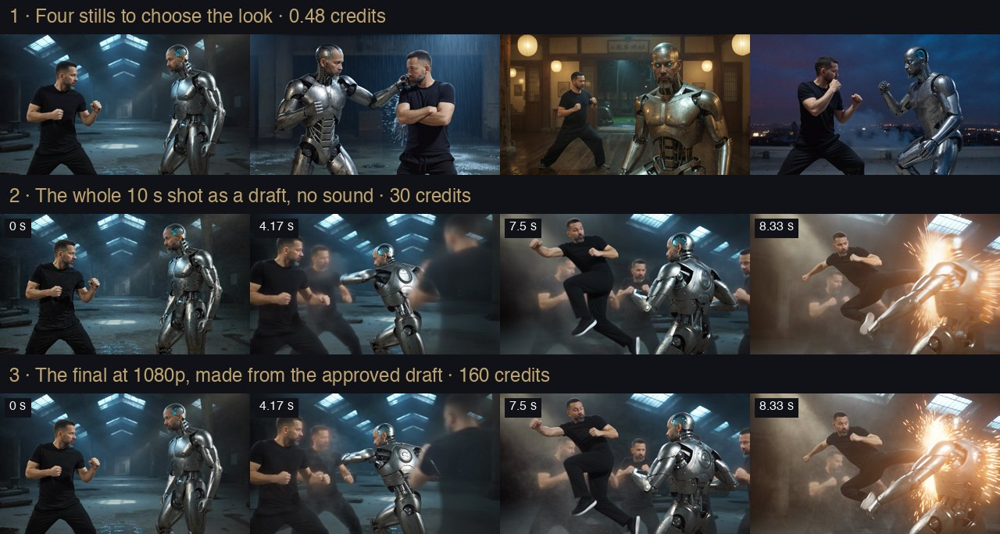
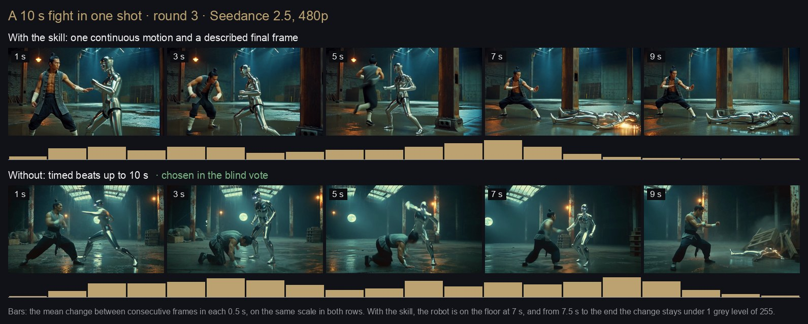
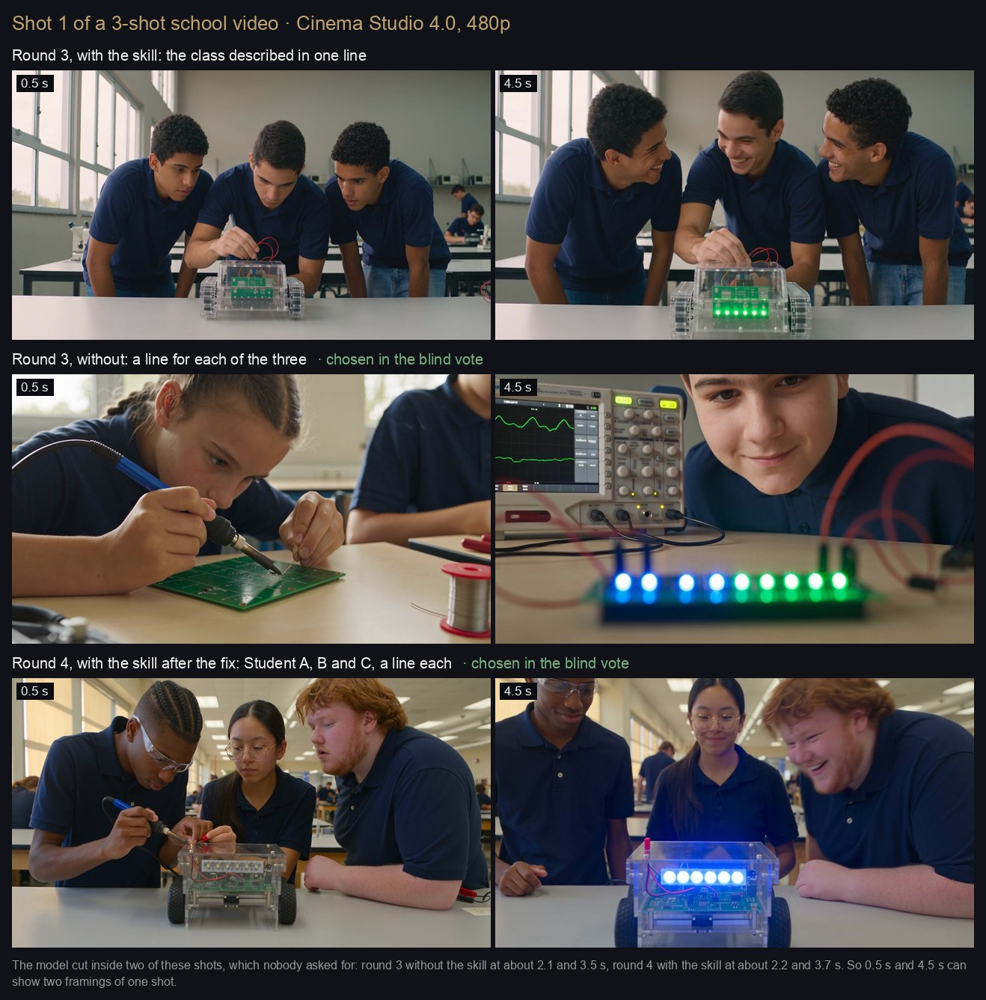
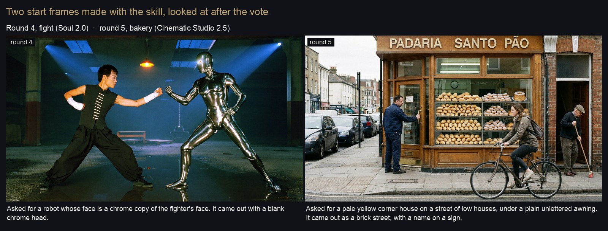
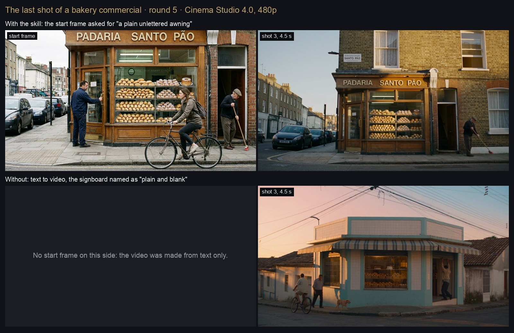
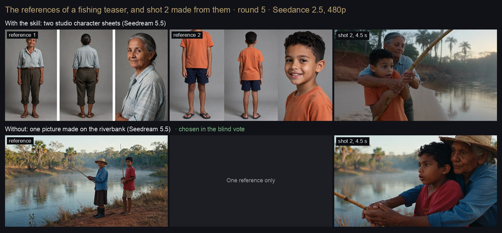
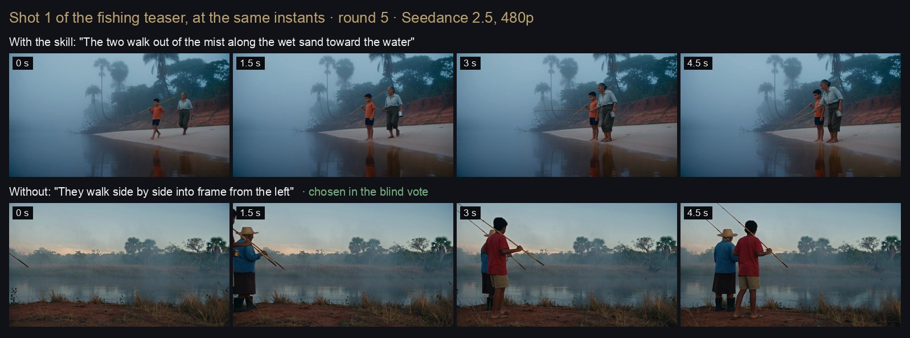

# Lessons from the skill's own generations

Generations made with the skill: in its blind rounds against a plain request
([calibration](../calibration/README.md)), and in work done with it. A lesson from one run is marked that way, and the
catalog is checked before it changes a rule.

**What comes here, and what never does.** The generic lesson comes here, with frames of the skill's own tests:
generic scenes with invented, generated people, kept as stills in
[tests/2026-11-blind-rounds/](tests/2026-11-blind-rounds/). A client's or a real production's material never comes
here: no brief, request text, prompt, image, result or person from real work. Row 1's picture is the README's demo,
published by the maintainer's decision ([docs/demo](../docs/demo/README.md)).

## Index

A linked number has an illustrated card [below](#cards).

| # | Lesson | Run | Evidence | Strength | Where it went |
|---|---|---|---|---|---|
| [1](#1-a-final-made-from-a-draft-repeats-the-draft) | A Seedance 2.5 final made from a draft (`draft_job_id`) repeats the draft's motion at the higher resolution, and kept the draft's silence although the final asked for sound | a 10 s action scene from a start image: a 480p draft without sound, then the final at 1080p, 2026-11-25 | measured: 241 frames in both files; the same poses at the same instants in 8 frame pairs from start to end; no audio stream in either file. The catalog (2026-11-25) says the final renders the draft's whole duration; it says nothing about sound | medium (one run) | `references/models.md`, Test composition cheaply |
| [2](#2-one-continuous-motion-stopped-at-about-65-s) | A 10 s action written as one continuous motion with a described final frame ended at about 6.5 s and held still; timed beats up to 10 s filled the clip and won | a blind round, a fight in one shot, Seedance 2.5 at 480p, 2026-11-26 | the person's blind vote; a frame sheet every 0.5 s: no motion after about 6.5 s in the losing take; no cut in the winning take (scene detection at 0.3 and the sheet) | low (one round) | `references/prompt.md` §1; `references/quality.md` |
| 3 | Recipes against defects written into every prompt as prevention flattened the result: no flickering lamp, no haze, a camera that crawled | both rounds of that blind test | the two sides' prompts compared after the vote; the person named movement and atmosphere | low (one round per request type, several differences at once) | `SKILL.md`; `references/prompt.md` §1 |
| [4](#4-a-class-written-in-one-line-came-out-as-look-alikes) | A group written as one line came out as look-alikes; a line per visible person looked natural | a blind round, a 3-shot corporate video, Cinema Studio 4.0 at 480p, 2026-11-26 | the person ("three teenagers with similar faces") and the blind judge both saw it | medium (the person and the judge agree) | `references/prompt.md` §1; `references/workflow.md` §4; `references/quality.md` |
| 5 | Interface chimes, rising beeps and an unrequested line of dialogue made the generated sound read as the stock audio of social media | the same corporate video | the person's reason; not measured otherwise | low (one round) | `references/prompt.md` §3 |
| 6 | The blind judge chose, in both rounds, the version the person rejected | both rounds of that blind test | judge 77.5 × 60.0 and 72.0 × 62.0 against the vote | low (two rounds) | `references/calibration.md`, step 6 |
| 7 | With the fix of rows 2 to 5, the skill won 2 of 2 on the same two requests it had lost 0 of 2 | a blind retest with new videos on both sides, 2026-11-26 | the person's vote, in round 2 against the order of showing; reason: the most natural, could pass for real footage | low (one round per request type) | the READMEs; the rules of rows 2 to 5 stay |
| [8](#8-and-14-start-frames-that-lost-the-premise-or-the-place) | A start image can lose the premise (a robot meant to wear the fighter's face came out with a blank chrome head); a blind round generates it without review | the retest's fight scene, a soul_2 start image | the start image, looked at after the vote | low (one image) | nothing new: the review page in `SKILL.md` is where a production catches it |
| 9 | The blind judge's score chose against the person in 4 of 4 rounds, in both directions; asked separately which version looked more natural, it agreed once in two | the third and fourth blind rounds | the four records | medium (four rounds, both directions) | `references/calibration.md`, step 6 |
| 10 | Cinema Studio 4.0 put small white crests on plain uniform shirts in group shots | the corporate video of both blind rounds, the side with the skill | the judge in both; checked at full size in the retest | low (two videos, cause unknown) | not a rule yet: check uniforms at full size |
| [11](#11-a-shop-sign-the-request-had-ruled-out) | The request's "no brand, no text" left out of the prompts, or rephrased as "plain", let lettering in: a start frame asked for "a plain unlettered awning" got a wooden sign with a bakery's name; the other side wrote the negative and named the signboard, and the same video model left it blank. Row 10 fits: "plain, free of lettering" on the side with the crests, "no logos" on the side without | the fifth blind round, a 3-shot commercial, a Cinematic Studio 2.5 start frame and Cinema Studio 4.0 at 480p, 2026-11-26 | the start image and the last shot's frames; both sides' prompts compared after the vote; the person changed the vote on learning of the sign: "if it was in the prompt, it should not be there" | medium (two rounds, the same difference between the sides) | `SKILL.md`; `references/prompt.md` §1; `references/quality.md` |
| [12](#12-studio-sheets-against-one-picture-made-on-location) | Studio character sheets with tidy clothes made a real-life pair look posed and glossy; one picture made on location, with worn clothes and the gear of the task, looked more real | the fifth blind round, a 3-shot teaser, Seedream 5.5 references and Seedance 2.5 at 480p | the person's reason ("more natural; they look more real"); asked which looked more natural, the blind judge agreed (worn faces, hat and boots, a walk into the frame) | low (one round, several differences at once) | a lesson only, not a rule: the skill no longer adds a look the request did not ask for |
| [13](#13-already-at-the-water-or-walking-into-frame) | With image references and no start frame, "the two walk out of the mist toward the water" opened with the pair already at the water; "they walk into frame from the left" gave the walk | the same teaser, shot 1 | the frame sheets of both sides | low (one shot per side) | a lesson only, not a rule; a preview of the shot shows it before the final |
| [14](#8-and-14-start-frames-that-lost-the-premise-or-the-place) | The start frame model ignored the place: a residential street of low houses and a pale yellow corner house came out as a brick street that looked foreign; a blind round generates start frames without the review a production has | the fifth round's commercial, the side with the skill | the start image, looked at after the vote | low (one image; with row 8, two start frames in two rounds) | not a rule yet: the review of start frames in a blind round is for the maintainer to decide |
| 15 | The connector's content filter refused one Seedance 2.5 shot of a grandmother and a 10-year-old fishing, with a full refund; the same request, sent again unchanged, passed | the fifth round's teaser | the job status and the refund in the transaction list | low (one refusal) | nothing: a refusal is checked, then sent again once as it was |
| 16 | The blind judge's score went against the person's vote in 5 of 6 rounds; the one agreement came from the briefing criterion catching a sign the person had missed. Asked which looked more natural, it agreed with the person's blind vote in both rounds of the fifth | the third to fifth blind rounds | the six records | medium | `references/calibration.md`, step 6 |
| 17 | Across the blind rounds, the version whose prompts the skill rewrote (camera, light, recipes, structure) was chosen in 4 of 9. When the person chose the other, the reasons were movement, atmosphere, naturalness and looking real, and once a shop sign the request had ruled out. A plain request already does well; what the skill adds is the process around it: a cheap preview before each expensive step, and the credits in view. That sign, found on the video, would have cost about 2 credits to catch on a still | the five blind rounds, 2026-11-24 to 26 | the nine records and the person's reasons | medium (nine rounds, one voter) | `SKILL.md` (the prompt is the request as asked; preview before spending more; every credit in view); `references/modes.md`; the READMEs no longer report the rounds |

Rows 2 to 6 come from one blind round per request type: the vote says which video won, not which line made the
difference. They are the differences between the two sides' prompts, read after the vote. Since row 17 the skill no
longer writes them into every prompt: they stay in `references/prompt.md`, for when the operator asks for that look
or a preview shows the defect.

## Cards

Each card puts the version made with the skill beside the version made without it, in the same round, at the same
instants or for the same shot. Times are seconds into the shot. The rounds are numbered as in
[calibration](../calibration/README.md): the third, the fourth (a retest of the same two requests with the fixed skill)
and the fifth, all on 2026-11-26. "Chosen in the blind vote" marks the version the person picked before seeing the key.

### 1. A final made from a draft repeats the draft

A Seedance 2.5 final made from an approved 480p draft (`draft_job_id`) came back at 1080p with the draft's motion:
241 frames in both files, the same poses at the same instants. It also kept the draft's silence, although the final
asked for sound. The picture is from the README's demo: the draft and the final at 0, 4.17, 7.5 and 8.33 s.

**Where it went:** `references/models.md`, Test composition cheaply.

### 2. One continuous motion stopped at about 6.5 s

The third round's fight, a 10 s shot from a start image. With the skill, the prompt wrote the fight as one continuous
motion and described the final frame: the fight was over at about 6.5 s and the rest held still. Without it, the
prompt gave timed beats up to 10 s, the action filled the clip, and the person chose it. The bars measure the change
between frames every 0.5 s.

**Where it went:** `references/prompt.md` §1; `references/quality.md`. In the fourth round the skill wrote the fight
in timed beats and won ([row 7](#index)).

### 4. A class written in one line came out as look-alikes

The third round's school video. With the skill, the prompt described the whole class in one line, and the three
students of the first shot came out with one face: the person saw "three teenagers with similar faces", and so did the
blind judge. Without it, each of the three had a line, and they look like different people. In the fourth round the
fixed skill gave Student A, B and C a line each.

**Where it went:** `references/prompt.md` §1; `references/workflow.md` §4; `references/quality.md`.

### 8 and 14. Start frames that lost the premise or the place

A blind round generates its start frames without the review a production has, and these two were looked at only
after the vote. In the fourth round's fight, the robot meant to wear the fighter's face came out with a blank chrome
head. In the fifth round's commercial, a residential street of low houses and a pale yellow corner house came out as
a brick street that looked foreign.

**Where it went:** row 8, nothing new: the review page in `SKILL.md` is where a production catches it. Row 14, not a
rule yet: the review of start frames in a blind round is for the maintainer to decide.

### 11. A shop sign the request had ruled out

The fifth round's bakery commercial; the request said no brand and no text on screen. With the skill, the start
frame's prompt asked only for "a plain unlettered awning" and got a wooden sign with a bakery's name, and the video
kept it. Without it, the prompt wrote the negative and named the signboard as plain and blank, and
the same video model left it blank. Blind, the person chose the version with the skill, then changed the vote on
learning of the sign: "if it was in the prompt, it should not be there".

**Where it went:** `SKILL.md`; `references/prompt.md` §1; `references/quality.md`. Seen on the still, before the
video, the sign would have cost about 2 credits to catch ([row 17](#index)).

### 12. Studio sheets against one picture made on location

The fifth round's fishing teaser. With the skill, the grandmother and the boy came from two studio character sheets:
a grey background, a shirt tucked in under a belt, a plain T-shirt. Without it, one picture made on the riverbank
gave them a straw hat, a skirt, rubber boots and the fishing poles. The person chose the version without it ("more
natural; they look more real"), and the blind judge, asked which looked more natural, agreed.

**Where it went:** a lesson only, not a rule: the skill no longer adds a look the request did not ask for.

### 13. Already at the water, or walking into frame

Shot 1 of the same teaser, made from image references with no start frame. "The two walk out of the mist along the
wet sand toward the water" opened with the pair already at the water's edge; "They walk side by side into frame from
the left" gave the walk. One shot per side.

**Where it went:** a lesson only, not a rule; a preview of the shot shows it before the final.
