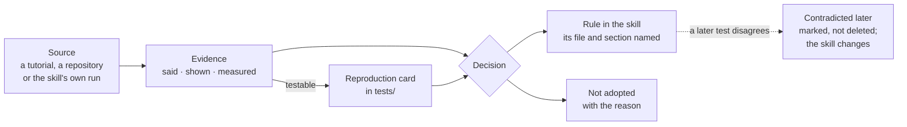
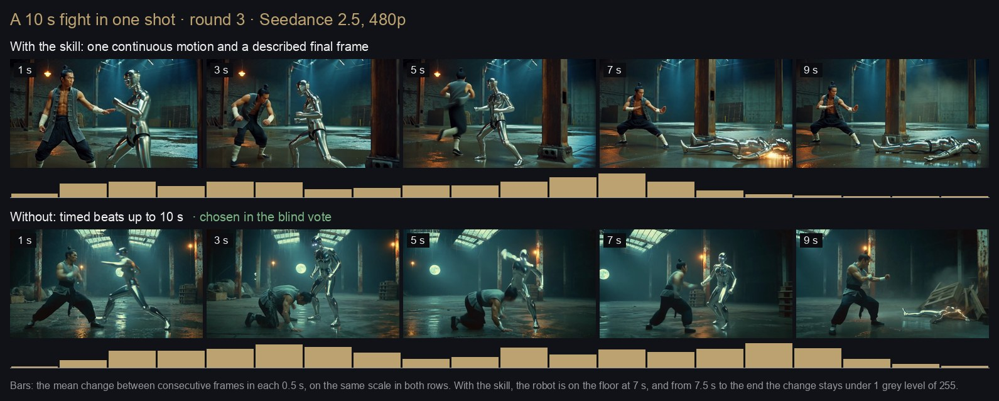
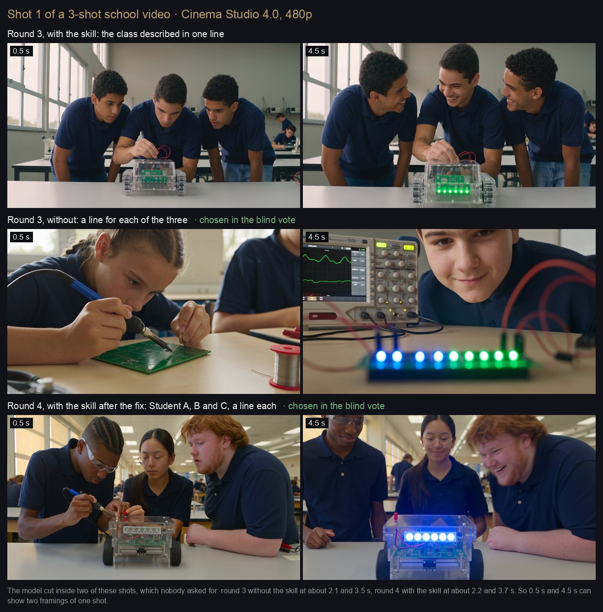
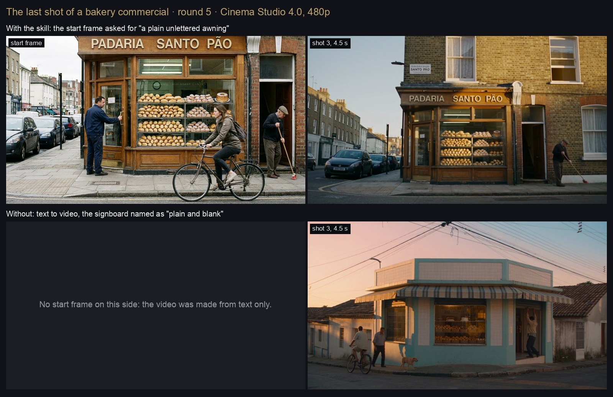
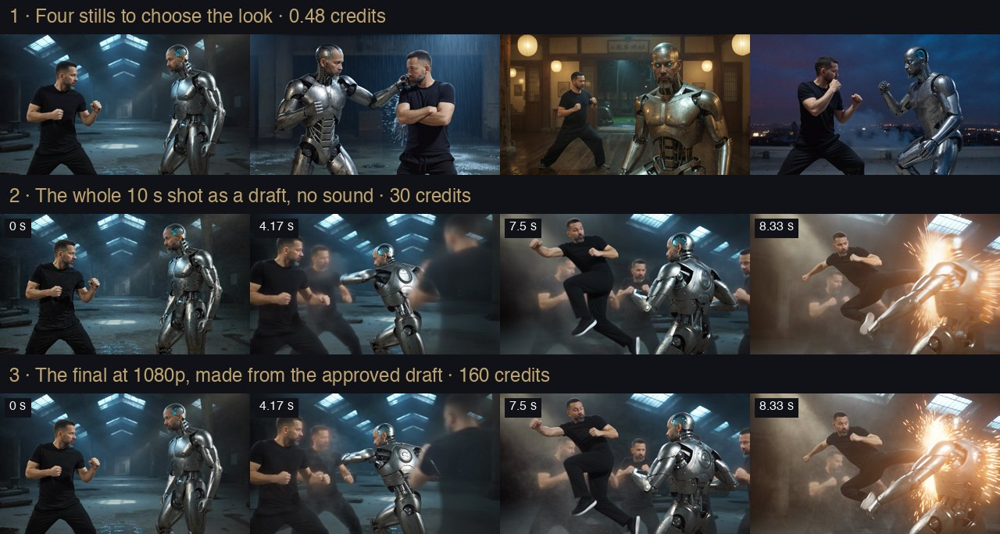

# Lessons learned

This folder records why the skill does what it does. Each file holds a batch of lessons: where each one came from, how
strong the evidence is, and which file of the skill it changed. The skill keeps only the rule; the history and the
sources stay here, so a rule can be traced back, and dropped if its evidence turns out to be weak.

## A lesson's life

One lesson has gone the whole way. Timed beats in a prompt were adopted from a tutorial as a cause of unwanted cuts
([batch 2, lesson 1](2026-11-higgsfield-channel-2.md#adopted)); two tests here did not reproduce the cut
([card](tests/2026-11-25-timed-beats.md), [closer card](tests/2026-11-25-timed-beats-faithful.md)), so they became one
suspect among others; and a blind round later found that timed beats up to the end of a long shot filled it
([own runs, row 2](2026-11-own-runs.md#2-one-continuous-motion-stopped-at-about-65-s)).

## The files

| File | Source | Date | Numbered lessons |
|---|---|---|---|
| [2026-11-higgsfield-channel.md](2026-11-higgsfield-channel.md) | the 12 most-viewed tutorials on Higgsfield's YouTube channel | 2026-11-25 | 13 |
| [2026-11-higgsfield-channel-2.md](2026-11-higgsfield-channel-2.md) | ten more tutorials from the same channel | 2026-11-25 | 22 |
| [2026-11-higgsfield-channel-3.md](2026-11-higgsfield-channel-3.md) | the channel's next tutorials, read for what the screen shows (videos 24 to 43, and 19) | 2026-11-25 | 26 (13 per part) |
| [2026-11-higgsfield-channel-4.md](2026-11-higgsfield-channel-4.md) | four videos from the same channel in which an AI agent drives the Higgsfield connector | 2026-11-27 | 11 |
| [2026-11-higgsfield-skills-repo.md](2026-11-higgsfield-skills-repo.md) | Higgsfield's official skills repository (version 0.14.0), checked against the connector's live catalog | 2026-11-25 | 11 |
| [2026-11-own-runs.md](2026-11-own-runs.md) | the skill's own generations: the generic lesson only, with frames of its blind rounds | from 2026-11-25 | 17 (8 with a picture) |
| [tests/](tests/README.md) | reproduction cards: the original conditions of each testable lesson, and the tests run here | from 2026-11-25 | 2 cards run; 21 lessons waiting for a test |

## Lessons that changed the skill most

Rows 2 and 4 of the own runs were part of the fix that took the skill from 0 of 2 to 2 of 2 on the same two requests;
since row 17, those rules wait in `references/prompt.md` until a look is asked for or a preview shows the defect. Row
11 put the request's own limits into every prompt (`SKILL.md`). Row 1 is why the skill makes a draft with sound when
the final needs it (`references/models.md`). Row 17 itself, the largest change (the prompt is the request as asked,
with a cheap preview before each expensive step), has no picture of its own: the sign of row 11 is its example. Each
picture opens its card.

| | |
|---|---|
|  **Row 2.** A long action in timed beats up to its end |  **Row 4.** A line for each person in frame |
|  **Row 11.** The request's limits in every prompt, naming the surfaces that stay blank |  **Row 1.** A final repeats its draft, silence included |

## How a lesson is written

- **Source:** the video, article or test, linked at the second (`&t=…s`) or the section. Paraphrase; quote at most a
  few words. Frames of a source are never copied here.
- **What was shown, not only what was said:** the model and its version, the mode, the references, the settings on
  screen, the structure of the prompt, the attempts and the result. A tip that was only said weighs less.
- **Evidence:** said only, shown on screen, or measured. Most tutorial tips rest on a single example from the vendor
  and are marked that way.
- **A testable lesson gets a reproduction card** in [tests/](tests/README.md): the original conditions, the run here,
  and the difference between them, written before the result is read.
- **Where it went:** the file and section of the skill it changed, or why it was not adopted.
- **Model claims are checked in the live catalog** before they enter the skill, with the date of the check. Prices
  said in a video never enter: the skill always quotes.
- **Nothing private:** no client, project, prompt of a real production, image or result. Those stay in the
  operator's project folder. Frames of the skill's own tests are generic scenes with generated people; they may come
  here, as stills under [tests/](tests/README.md).
- A lesson that a later test contradicts is not deleted: mark it, say what the test showed, and change the skill.
