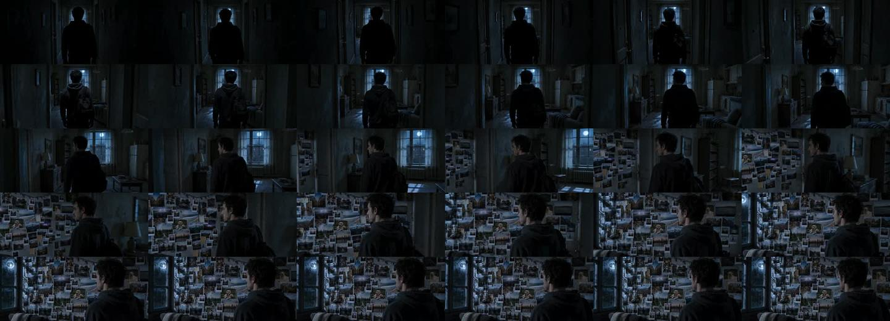
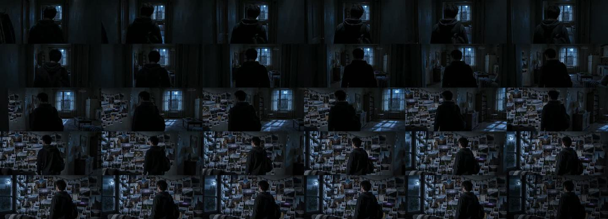
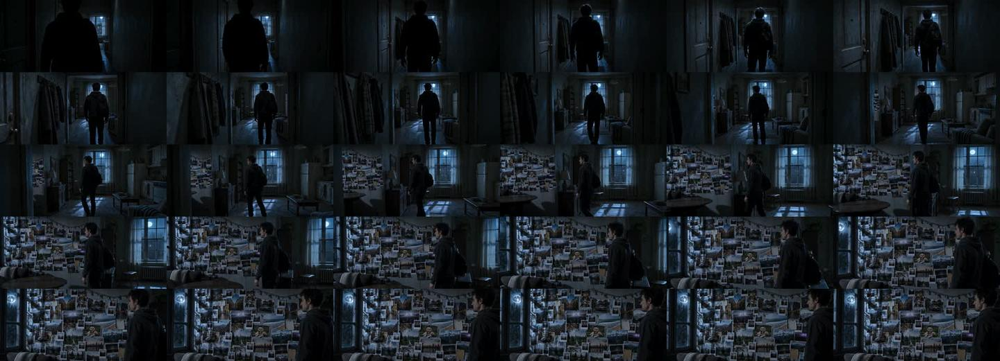
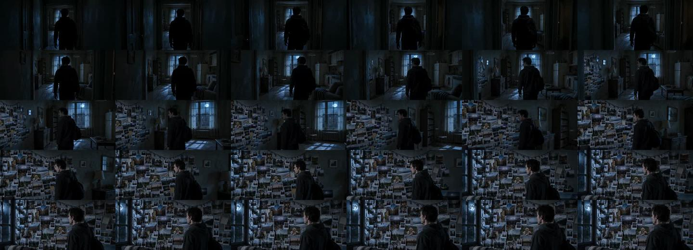
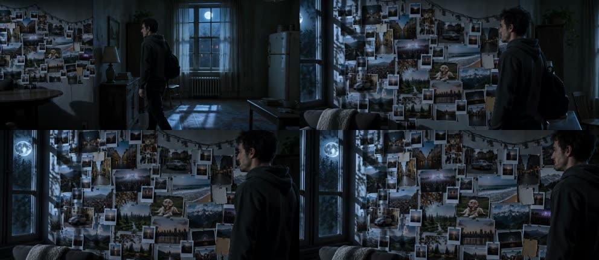

# Timed beats and cuts: a closer reproduction

## Claim

The same as in [the first card](2026-11-25-timed-beats.md): writing a continuous action as timed phases makes
Seedance 2.0 cut inside the shot. This run copies the original's conditions as far as the source shows them.

## Original

Shown, only said, and what cannot be known: in [the first card](2026-11-25-timed-beats.md#original-shown), not
repeated here.

## Run here (2026-11-25)

- **Model and parameters:** `seedance_2_0`, mode `std`, 21:9, 480p, 15 s, `generate_audio: false`, four attempts in
  one run (`count: 4`).
- **References:** three images generated first with GPT Image 2.6, of the same kinds as the original's: a character
  sheet, the apartment in two views (the living room; the hallway from the front door) and the photo wall. They are
  the skill's example references, with the prompts that made them, in
  [`examples/references/`](../../examples/references/README.md).
  Passed as `image_references` and named `@image1` to `@image3` in the prompt.
- **Prompt:** the original's structure: the references by tag, a layout block, five timed phases (0–3, 3–6, 6–10,
  10–13 and 13–15 s), a failure-mode block that asks for one continuous take, and a style line. Written in English
  and sent in Chinese, as in the original. The slow walk is written in every phase.
- **English text** (the source of the translation):

  ```text
  @image1 is Kai: messy short dark hair, stubble, dark grey hoodie, black backpack. @image2 is the two-view reference of this old apartment (top: the living room, wide; bottom: the entrance hallway) — the key spatial layout reference. @image3 is the photo wall on the left wall of the living room.

  Spatial layout: the front door opens into a narrow hallway; the hallway ends in an opening into the living room. In the living room: a tall window on the far wall, the kitchen corner and the fridge on the right, the sofa at the lower right, the photo wall on the left wall. The camera starts deep in the hallway, behind Kai, at shoulder height.

  Shot (0–3 s): the camera is deep in the hallway behind Kai at shoulder height, over the shoulder. Almost total black — only the edge of his silhouette, lit by cold light spilling from the living room. Slow, heavy footsteps on the wooden floor.
  (3–6 s): Kai walks slowly out of the hallway into the living room; the camera follows him from behind through the opening. Cold moonlight from the window starts to bleed into the frame; the room begins to read.
  (6–10 s): he drifts left across the living room, still slow; the fridge passes briefly on the right, the sofa armrest at the lower right; his long shadow stretches across the floor.
  (10–13 s): he stops near the left wall; the camera stops with him. He holds for two seconds.
  (13–15 s): a slight tilt of his head; his eyes lock on the photo wall; his chest rises once. Hold on his back.

  Failure-mode prevention: this is one complete 15-second single continuous take, one shot from start to end. Absolutely no cuts, no jump cuts, no change of shot size, no camera switch. The hallway must match the bottom view of @image2; he enters the living room only through the hallway opening, from no other direction.

  Style: very dark, cold moonlight, natural 24 fps motion, realistic film look.
  ```

- **Sent** (Chinese):

  ```text
  @image1 是 Kai：凌乱的黑色短发，胡茬，深灰色连帽衫，黑色双肩包。@image2 是这间老公寓的两视图参考（上：客厅广角；下：入口走廊视图）——这是关键的空间布局参考。@image3 是客厅左墙上的照片墙。

  空间布局：大门通向一条狭窄的走廊，走廊尽头是通往客厅的开口。客厅里：远处墙上有一扇高窗，右侧是厨房角和冰箱，右下方是沙发，左墙上是照片墙。摄影机从走廊深处开始，位于 Kai 身后，与肩同高。

  镜头（0–3 秒）：摄影机在走廊深处，位于 Kai 身后肩部高度，过肩构图。几乎全黑——只有从客厅漏进来的冷光勾出他的轮廓边缘。木地板上缓慢而沉重的脚步声。
  （3–6 秒）：Kai 缓慢地走出走廊进入客厅，摄影机从身后跟随他穿过开口。窗外冰冷的月光开始渗入画面，房间开始显现。
  （6–10 秒）：他依然缓慢地向左穿过客厅，冰箱在右侧一闪而过，沙发扶手在右下方，他长长的影子在地板上延伸。
  （10–13 秒）：他在左墙附近停下，摄影机随他停住。他停留两秒。
  （13–15 秒）：他的头微微一偏，目光锁定在照片墙上，胸口起伏一次。镜头停在他的背影上。

  失败模式预防：这是一个完整的 15 秒单一连续镜头，从头到尾只有一个镜头。绝对禁止任何剪辑、跳切、景别切换或镜头切换。走廊必须与 @image2 的下方视图一致；他只能从走廊开口进入客厅，不能从其他方向进入。

  风格：非常暗，冰冷的月光，24fps 自然流畅的动作，写实电影质感。
  ```

- **Cost:** quoted at 180 credits; spent 180 (4 × 45), plus 2.25 for the three references.
- **Planned but not run:** the same phases as untimed paragraphs, and one continuous motion, 180 credits each, only
  if this form cut.

## Difference from the original

Set in the plan approved before the run.

| | Original | Here |
|---|---|---|
| Model | Seedance 2.0 (mode not shown) | Seedance 2.0, `std` |
| References | three: the character, the apartment in two views, the photo wall | three of the same kinds, generated here |
| Settings | 21:9 (2016×864), 1080p, 15 s, audio on | 21:9 (992×432), 480p, 15 s, audio off |
| Attempts | four per run | four |
| Prompt | Chinese; a layout block; five timed phases; a no-cuts block | the same structure and phases; our wording, because the original's full text cannot be read |
| Camera and light | follows the character from behind into a very dark room | the same, asked for |
| Date | the tutorial's (the model's version is not shown) | 2026-11-25 |

## Measure

- Scene detection with ffmpeg at 0.3 and at 0.15, as in the first card.
- **A positive control, added for this run.** Two dark, similar pieces of these videos joined with a hard cut at
  2.00 s. Scene detection missed that cut at both thresholds, so a measure that is blind to it cannot say "no cut".
- **A spike measure.** For each frame, the mean difference in luminance from the previous frame (frames scaled to
  64×28, in grey), divided by the median of the same difference over the 12 frames on each side. A hard cut is an
  isolated spike. In the control, the cut scored ×7.8 and nothing else passed ×1.6. A spike above ×3 in a video is
  opened frame by frame.
- A frame sheet with one frame every 0.5 s (30 frames).
- The first card's three videos, rechecked with the spike measure: highest ×2.2.

## Result

| Attempt | Video | Scene changes (0.3 / 0.15) | Highest spike | Seen on the sheet |
|---|---|---|---|---|
| A1 | 15.04 s, 361 frames, 24 fps, 992×432 | none / none | ×1.6 | one continuous take: from the hallway, behind him, into the room and left to the photo wall, in the order of the phases; ends on his profile |
| A2 | the same | none / none | ×3.4 at 14.50 s; frames 345 to 352 opened: a slow, continuous move | the same path, framed tighter over his shoulder from the start; ends on his back |
| A3 | the same | none / none | ×2.4 | the same path; the hallway has the coats on hooks of the reference's bottom view; ends on his profile |
| A4 | the same | none / none | ×1.5 | the same path; ends on his profile |






**Also seen, in all four:** in the last 3 to 4 seconds a second window, with the moon, appears to the left of the
photo wall. The references have one window, on the far wall, and none shows the side of the room next to the photo
wall. Checked at full size in A3 (frames at 7.5, 11, 12.5 and 14.8 s, below) and on the sheet in the other three. No
reference came back as a still picture filling the screen.



**Reading:** with the original's model, kinds of references, aspect ratio, length, number of attempts, prompt
structure and language, the timed phases did not cut: 0 of 4. With the first run, 0 of 7. The claim is not
reproduced, and the tutorial's cut stays unexplained. What is left to differ: 1080p, audio on, the original's
reference images, its exact wording, and any change to the model since. The skill keeps timed beats as one suspect
when an unwanted cut appears, not as a rule; writing a shot that must not cut as one continuous motion costs
nothing and stays the advice. The two other forms were not run: they would compare fixes for a cut that did not
happen.

**What the skill takes from it:**

- cut detection gets a positive control and the spike measure (`references/quality.md`, "Cuts inside a shot");
- a location reference covers every side the camera will face (`references/workflow.md` §4).
