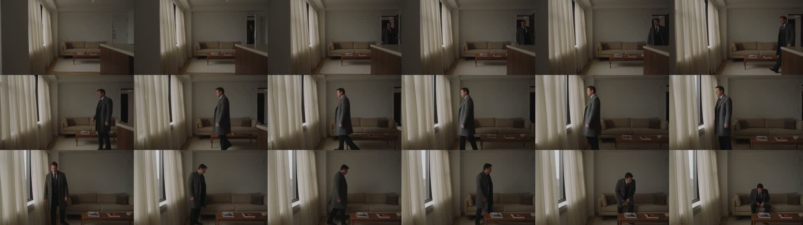
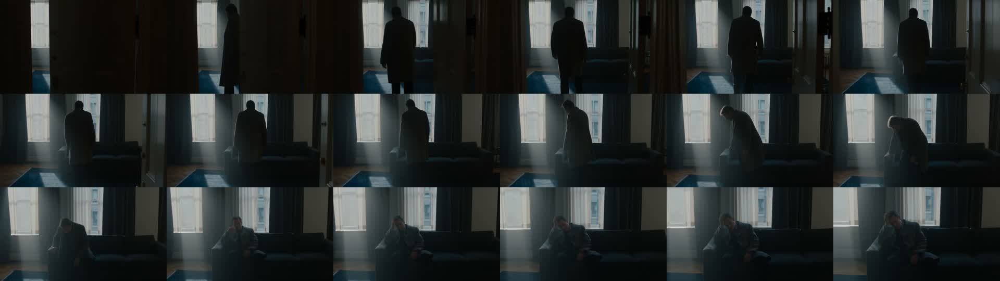
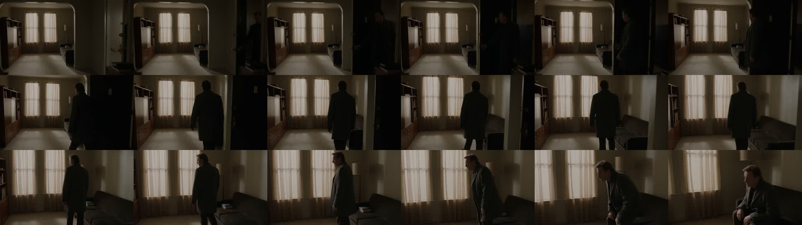

# Timed beats and cuts inside a shot

## Claim

Writing a continuous action as timed beats ("0–3 s…, 3–6 s…") makes the model cut inside the shot; writing it as
one continuous motion does not. Source: [batch 2, lesson 1](../2026-11-higgsfield-channel-2.md#adopted), video 14,
[How to Make AI Films That Don't Look AI](https://www.youtube.com/watch?v=-scKERL7PK0&t=4608s).

## Original: shown

Video 14, [How to Make AI Films That Don't Look AI](https://www.youtube.com/watch?v=-scKERL7PK0&t=4482s), 1:14–1:22.

- **Model:** Seedance 2.0 in the generation panel (on screen, [1:18:26](https://www.youtube.com/watch?v=-scKERL7PK0&t=4706s)); "Seedance 2" in the details of a
  generated clip (on screen, [1:16:58](https://www.youtube.com/watch?v=-scKERL7PK0&t=4618s)).
- **References:** three images, tagged in the prompt: the character, a two-view reference of the apartment, and the
  photo wall (on screen, [1:16:58](https://www.youtube.com/watch?v=-scKERL7PK0&t=4618s) and [1:18:26](https://www.youtube.com/watch?v=-scKERL7PK0&t=4706s)).
- **Settings:** 21:9 (2016×864), 1080p, 15 s, four generations per run, audio on (on screen, [1:18:26](https://www.youtube.com/watch?v=-scKERL7PK0&t=4706s)).
- **Prompt:** written by Claude from a shot list, in Chinese, several paragraphs long. It names the references by
  tag, has a block describing the room's layout and where the camera stands, splits the shot into five timed phases
  (0–3, 3–6, 6–10, 10–13, 13–15 s), and ends with a failure-mode block that already asks for a single continuous take
  with no cuts (on screen, [1:14:42](https://www.youtube.com/watch?v=-scKERL7PK0&t=4482s) and [1:18:26](https://www.youtube.com/watch?v=-scKERL7PK0&t=4706s)). The camera follows the character from
  behind into a very dark room.
- **Attempts:** three runs of four.
  1. Five timed phases: a cut at the phase boundaries, "happening for all of them" (said, [1:17:30](https://www.youtube.com/watch?v=-scKERL7PK0&t=4650s), while
     scrubbing the clips).
  2. First rewrite: the phases became four paragraphs without times (on screen, [1:19:27](https://www.youtube.com/watch?v=-scKERL7PK0&t=4767s)). It still cut
     (said, [1:18:56](https://www.youtube.com/watch?v=-scKERL7PK0&t=4736s)); the closest clip broke the room.
  3. Second rewrite, asked for as one continuous shot without beats; the same message also asked for a slower walk
     and the full room revealed only at the end (on screen, [1:19:57](https://www.youtube.com/watch?v=-scKERL7PK0&t=4797s)). Judged "much better" (said,
     [1:20:19](https://www.youtube.com/watch?v=-scKERL7PK0&t=4819s)); in one clip the room appeared too early ([1:21:04](https://www.youtube.com/watch?v=-scKERL7PK0&t=4864s)). Two clips went to the edit.
- **How the result was judged:** by watching. No count of cuts per run is shown.

## Original: only said

- The cause, in the presenter's words: defining what happens at each second forces the model to cut
  ([1:17:53](https://www.youtube.com/watch?v=-scKERL7PK0&t=4673s)). It is his diagnosis; it was not tested apart from the other changes.

## What cannot be known from the source

- The full text of the prompts, the seeds, and how many clips of each run of four cut.
- Which change stopped the cuts: the second rewrite removed the beats and also slowed the walk and moved the reveal.
- Whether the timed phases matter, or any split into beats: the untimed paragraphs cut too.

## Run here (2026-11-25)

- **Model and parameters:** `seedance_2_5`, text to video (`t2v`), 9 s, 480p, 16:9, `generate_audio: false`, no
  references. Two attempts per version (`count: 2`).
- **What varies:** only how the action is written.
- **Version A, timed beats:**

  ```text
  A man in a grey wool coat in a dim, quiet apartment. 0-3 s: he opens the front door and steps inside. 3-6 s: he
  walks across the room to the window. 6-9 s: he turns around and sits down on the sofa. Medium wide shot, slow
  push-in, soft window light, muted colors.
  ```

- **Version B, one continuous motion:**

  ```text
  A man in a grey wool coat opens the front door of a dim, quiet apartment, steps inside, walks across the room to
  the window, then turns around and sits down on the sofa, all in one continuous motion. Single continuous shot.
  Medium wide shot, slow push-in, soft window light, muted colors.
  ```

- **Cost:** quoted at 27 credits per video, 108 for four. One attempt of version B was refused by the content filter
  (status `nsfw`, a generic message) with the same prompt that passed in the other attempt; its 27 credits were
  refunded. Actual cost: 81 credits.

## Difference from the original

The run did not match the original in:

| | Original | Here |
|---|---|---|
| Model | Seedance 2.0 | Seedance 2.5 |
| References | three images | none (text to video) |
| Settings | 21:9, 1080p, 15 s, audio on | 16:9, 480p, 9 s, audio off |
| Attempts per version | four | two |
| Prompt | Chinese, several paragraphs, a layout block, five timed phases, a block asking for no cuts | English, three sentences, three timed beats, nothing about cuts |
| Camera and light | following from behind, very dark | slow push-in, dim |

So this run tests the claim in its simplest form only. It cannot refute the original case.

## Measure

- Scene detection with ffmpeg at two thresholds:
  `ffmpeg -i video.mp4 -vf "select='gt(scene,0.3)',showinfo" -f null -`, and again with `0.15`.
- A frame sheet with one frame every 0.5 s (18 frames for 9 s), read for cuts to a similar shot that detection can
  miss: `ffmpeg -i video.mp4 -vf "fps=2,scale=320:-1,tile=6x3" -frames:v 1 sheet.jpg`.

## Result

| Attempt | Version | Video | Scene changes (0.3 / 0.15) | Seen on the sheet |
|---|---|---|---|---|
| A1 | timed beats | 9.04 s, 217 frames, 24 fps, 854×480 | none / none | one continuous shot; enters through the door at the back, walks to the window, turns and sits, in the order of the beats |
| A2 | timed beats | 9.04 s, 217 frames, 24 fps, 854×480 | none / none | one continuous shot; starts already in the doorway, seen from behind, so the door opening is missing; walks to the window and sits; darker than asked |
| B1 | continuous | 9.04 s, 217 frames, 24 fps, 854×480 | none / none | one continuous shot; opens the door, steps in, walks to the window, turns and sits |
| B2 | continuous | — | — | refused by the content filter; refunded |





**Reading:** no cut in either version, in this simple form, on Seedance 2.5. In the original, the fix that worked
also changed the walk, so the cause was never isolated there either. The lesson drops to low strength: the skill
keeps beats as the first suspect for an unwanted cut, not as a rule. The content-filter refusal here (one of two
identical, neutral requests) differs from the tutorial's (every attempt refused, for a reason in the text); the
skill now tells the two apart.

**Run since:** [a closer reproduction](2026-11-25-timed-beats-faithful.md) on Seedance 2.0, with three references
and the original's prompt structure: 0 of 4 cut. Its spike measure, applied to the three videos above, finds no
cut either (highest ×2.2). The plan as written before it:

**Still to run:** a faithful reproduction. Three references generated first (a character, a two-view room, a wall);
21:9, 1080p, 15 s; the same long prompt with a layout block and a no-cuts block in three forms (five timed phases,
the same phases as untimed paragraphs, one continuous motion), with the walk and the reveal written the same in all
three; four attempts per form, on Seedance 2.0 and on 2.5. It needs its own quote.
