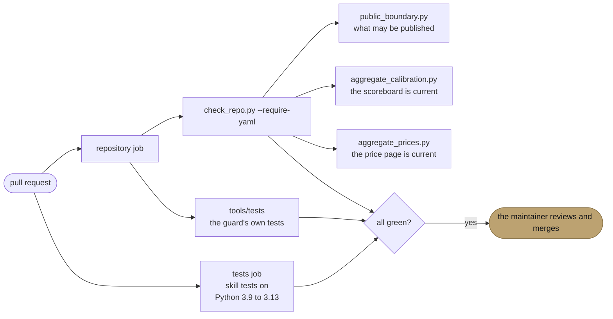
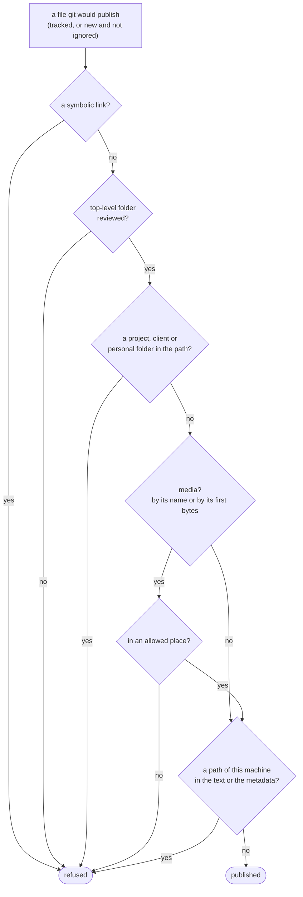

# Repository checks: `tools/`

The scripts that keep the repository publishable. They read files and never touch the network; the one that writes is
`aggregate_calibration.py --write`, which rewrites the scoreboard. None of them is part of the skill. Run them before every pull request ([CONTRIBUTING.md](../CONTRIBUTING.md#run-the-checks)); CI runs
them again.



| Script | What it does |
|---|---|
| [check_repo.py](check_repo.py) | the skill's frontmatter; every guide cited by `SKILL.md`; valid JSON; links and anchors of every published Markdown file; the calibration records; English names and text; and the public boundary below |
| [public_boundary.py](public_boundary.py) | the guard: decides by path, by content and by a file's first bytes which files may be in a public repository |
| [aggregate_calibration.py](aggregate_calibration.py) | adds up the blind-round records of [`calibration/`](../calibration/README.md) into its scoreboard; `check_repo` fails if the scoreboard is out of date |
| [aggregate_prices.py](aggregate_prices.py) | adds a week's price table to [`price-history/`](../price-history/README.md) and redraws its page (the index chart and the table); refuses a second record in the same week; `check_repo` fails if the page is out of date |
| [tests/](tests/) | 26 tests: 20 of the guard (what must pass and what must be refused, one test per hole a review found) and 6 of the price record |

```bash
python3 tools/check_repo.py                      # ok: skill, JSON, links, anchors, calibration, prices, language, README language links and public/private boundary
python3 -m unittest discover -s tools/tests      # the guard's tests
python3 tools/aggregate_calibration.py --write   # rewrite the scoreboard after adding a record
python3 tools/aggregate_prices.py --add <prices.json>   # add this week's price table and redraw its page
```

## What the guard lets through



| Media allowed | Where | Why |
|---|---|---|
| `.gif`, `.png`, `.svg` | `docs/manual/visual/` and `docs/assets/` | the manual's own schematic images |
| `.jpg`, `.png` | `lessons-learned/tests/` and `examples/` | frames of the skill's own tests and the example references: generic scenes, stills only |
| exactly three files | `docs/demo/` | the README's demo, by the maintainer's decision |

Anything else that looks like a production is refused: a video outside the demo, even renamed `.jpg` or saved with no
extension; a `review.html`; a folder named `project`, `client` or `projetos`, at any depth and as one word of a longer
name; a path from someone's machine, in a text file or inside an image. A production's material stays in the operator's project
folder ([AGENTS.md](../AGENTS.md)).
